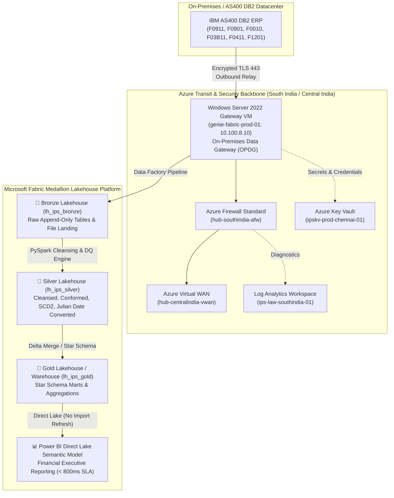

# Enterprise Data Platform Modernization: AS400 DB2 ERP to Microsoft Fabric & Power BI Direct Lake

[](#medallion-architecture)
[](#cloud-infrastructure)
[-orange.svg)](#regional-topology)
[-brightgreen.svg)](#testing--quality-assurance)

An end-to-end enterprise modern data platform migrating JD Edwards (JDE) EnterpriseOne AS400 DB2 ERP financial and operational data into **Microsoft Fabric** using **OneLake**, **Delta Lake**, and **Power BI Direct Lake mode** (< 800ms query SLA).

---

## 🏛️ Architecture Overview



---

## 📂 Repository Structure

```
├── .gitignore                         # Git exclusion rules (caches, secrets, temp files)
├── README.md                          # Repository documentation & getting started guide
├── pyproject.toml                     # Python project configuration & packaging metadata
├── requirements.txt                   # Production & development dependencies
│
├── docs/                              # Technical architectural specifications & runbooks
│   ├── techstalk/
│   │   ├── technical_stack.md         # Full enterprise technology stack specification
│   │   ├── implementation_plan.md     # Multi-phase modernization delivery roadmap
│   │   ├── azure_commands.md          # Step-by-step Azure CLI & Fabric API commands
│   │   ├── azure_services.md          # Detailed Azure services breakdown
│   │   ├── azure_services_table.md    # Service vs. Alternative comparison matrix
│   │   └── networking_concepts.md     # CIDR supernet, vWAN, and OPDG relay deep-dive
│   └── additional_docs/               # Deep-dive design documents & interview guides
│
├── data/                              # Sample datasets & scenario generation engine
│   ├── README.md                      # Data catalog & Julian date documentation
│   ├── generate_sample_data.py        # 11-scenario multi-table synthetic ERP generator
│   ├── metadata/                      # Data Quality rules & ingestion metadata
│   │   ├── meta_dataset_brz_to_silver.csv
│   │   └── meta_dataquality_rules.csv
│   ├── raw_jde_as400/                 # 15 generated AS400 tables (CRPOTA & CRPCTL)
│   └── scenarios/
│       └── test_scenarios_matrix.md   # Complete matrix of 11 enterprise business test cases
│
├── src/                               # Production source code
│   ├── notebooks/                     # Fabric PySpark Notebooks
│   │   ├── bronze/
│   │   │   └── 01_ingest_as400_raw.py         # Incremental raw ingestion & lineage tagging
│   │   ├── silver/
│   │   │   ├── 01_silver_cleansing_dq.py      # Julian conversion, DQ engine, quarantine
│   │   │   └── 02_silver_scd2_dimensions.py   # Slowly Changing Dimension Type 2 Delta merge
│   │   └── gold/
│   │       └── 01_gold_financial_gl_mart.py   # Star Schema, unknown -1 key, Z-ORDER
│   ├── sql/
│   │   └── ddl_gold_warehouse.sql             # Gold Warehouse T-SQL views & analytical DDL
│   └── semantic_models/
│       └── financial_executive_measures.dax   # Power BI Direct Lake DAX calculations
│
├── scripts/                           # Automation & deployment scripts
│   └── deploy_workspaces.py           # Automated Fabric REST API workspace & lakehouse deployer
│
└── tests/                             # Automated test suite
    ├── test_julian_date_conversion.py # Boundary tests for CYYDDD format & leap years
    └── test_scd2_logic.py             # Unit tests for SCD Type 2 state tracking
```

---

## ⚡ Key Architectural Features

1. **South India (`southindia` - Chennai) Proximity:**
   - Sub-5ms round-trip latency for local user datacenter, Gateway VM, and Fabric compute.
   - Paired with **Central India (`centralindia` - Pune)** for sovereign DR, vWAN transit, and GRS backups.
2. **On-Premises Data Gateway (OPDG) Outbound-Only Architecture:**
   - Outbound TLS 443 relay to Azure Service Bus. Zero inbound firewall ports opened on-premises.
3. **Automated Data Quality & Quarantine Engine:**
   - Real-time rule evaluation against `meta_dataquality_rules.csv`. Malformed or out-of-bounds records are automatically diverted to `silver_quarantine_records` Delta table without terminating pipeline execution.
4. **Slowly Changing Dimension Type 2 (SCD2):**
   - SHA-256 attribute hash detection on Chart of Accounts (`F0901`) preserving historical reporting accuracy with `valid_from`, `valid_to`, and `is_current` flags.
5. **Sub-800ms Query SLA via Direct Lake:**
   - Power BI queries Delta parquet directly from OneLake memory without requiring scheduled dataset import refreshes or falling back to DirectQuery.

---

## 🧪 Testing & Quality Assurance

Run the automated test suite locally:

```bash
# 1. Create and activate virtual environment
python3 -m venv .venv
source .venv/bin/activate

# 2. Install dependencies
pip install -r requirements.txt

# 3. Execute unit tests
pytest tests/ -v
```

---

## 🚀 Quickstart: Deploying Workspaces via Fabric REST API

```bash
# 1. Log in interactively targeting your Entra Tenant
az login --tenant "plchandugcp48gmail.onmicrosoft.com" --allow-no-subscriptions

# 2. Obtain Fabric API Bearer Token
export FABRIC_TOKEN=$(az account get-access-token --resource "https://api.fabric.microsoft.com" --query accessToken -o tsv)

# 3. Run automated deployment script
python3 scripts/deploy_workspaces.py
```

---

## 📜 Documentation Links

- [Azure CLI Step-by-Step Runbook](docs/techstalk/azure_commands.md)
- [Enterprise Technical Stack Specification](docs/techstalk/technical_stack.md)
- [Multi-Phase Implementation Plan](docs/techstalk/implementation_plan.md)
- [Networking & Gateway Architecture Guide](docs/techstalk/networking_concepts.md)
- [11 Business Test Scenarios Matrix](data/scenarios/test_scenarios_matrix.md)
