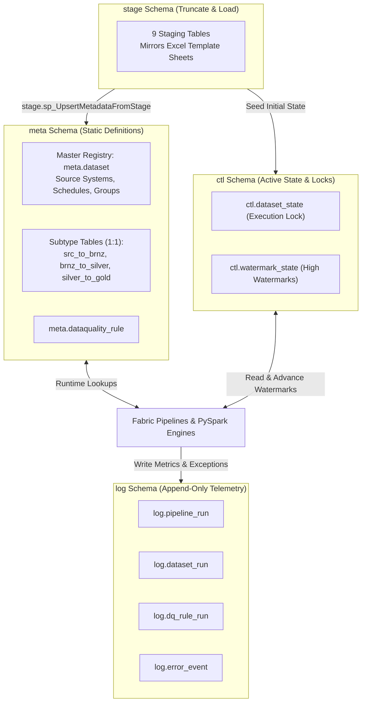

# Metadata Database Tables & Column Data Dictionary

> **Database:** `sqldb-meta-orch-dev` (Microsoft Fabric SQL Database)  
> **Architecture Pattern:** Metadata-Driven Ingestion & Orchestration Framework  
> **Target Lakehouse Architecture:** Microsoft Fabric Medallion (Bronze $\rightarrow$ Silver $\rightarrow$ Gold)  
> **Total Tables:** 24 physical tables across 4 isolated schemas (`meta`, `ctl`, `log`, `stage`)

---

## 📋 Table of Contents
1. [Overview & Schema Architecture](#overview--schema-architecture)
2. [Schema Summary Matrix](#schema-summary-matrix)
3. [Schema `meta` — Configuration & Master Registry (9 Tables)](#1-schema-meta--configuration--master-registry)
   - [meta.source_system](#11-metasource_system)
   - [meta.schedule](#12-metaschedule)
   - [meta.ingestion_group](#13-metaingestion_group)
   - [meta.dataset](#14-metadataset)
   - [meta.ingestion_group_dataset](#15-metaingestion_group_dataset)
   - [meta.dataset_src_to_brnz](#16-metadataset_src_to_brnz)
   - [meta.dataset_brnz_to_silver](#17-metadataset_brnz_to_silver)
   - [meta.dataset_silver_to_gold](#18-metadataset_silver_to_gold)
   - [meta.dataquality_rule](#19-metadataquality_rule)
4. [Schema `ctl` — Runtime Control State & Watermarks (2 Tables)](#2-schema-ctl--runtime-control-state--watermarks)
   - [ctl.watermark_state](#21-ctlwatermark_state)
   - [ctl.dataset_state](#22-ctldataset_state)
5. [Schema `log` — Observability, Auditing & Metrics (4 Tables)](#3-schema-log--observability-auditing--metrics)
   - [log.pipeline_run](#31-logpipeline_run)
   - [log.dataset_run](#32-logdataset_run)
   - [log.dq_rule_run](#33-logdq_rule_run)
   - [log.error_event](#34-logerror_event)
6. [Schema `stage` — Excel Template Ingestion Staging (9 Tables)](#4-schema-stage--excel-template-staging-tables)
7. [Repository CSV Metadata Files Reference](#5-repository-csv-metadata-files-reference)

---

## Overview & Schema Architecture

The centralized metadata repository (`sqldb-meta-orch-dev`) governs dynamic ingestion, data quality evaluation, state persistence, and audit logging. The architecture strictly partitions responsibilities across four schemas:

---

## Schema Summary Matrix

| Schema | Purpose | Volatility | Table Count | Tables |
| :--- | :--- | :--- | :---: | :--- |
| **`meta`** | Static system metadata, dataset definitions, transformation rules, schedules, and group mapping. | **Low volatility** (Read-only at runtime) | **9** | `source_system`, `schedule`, `ingestion_group`, `dataset`, `ingestion_group_dataset`, `dataset_src_to_brnz`, `dataset_brnz_to_silver`, `dataset_silver_to_gold`, `dataquality_rule` |
| **`ctl`** | Active operational state, current high watermarks, and pipeline lock status. | **High volatility** (Read/Write per run) | **2** | `watermark_state`, `dataset_state` |
| **`log`** | Historical execution metrics, row counts, data quality rule evaluation results, and exception traces. | **Append-only** (High write volume) | **4** | `pipeline_run`, `dataset_run`, `dq_rule_run`, `error_event` |
| **`stage`** | Staging tables mirroring the Excel load template sheets for business code resolution. | **Truncate-and-load** (Administrative load) | **9** | `source_system`, `schedule`, `ingestion_group`, `dataset`, `ingestion_group_dataset`, `dataset_src_to_brnz`, `dataset_brnz_to_silver`, `dataset_silver_to_gold`, `dataquality_rule` |
| **Total** | | | **24** | |

---

## 1. Schema `meta` — Configuration & Master Registry

### 1.1 `meta.source_system`
Stores enterprise source connection endpoint definitions (e.g., AS400 DB2, Salesforce CRM, SFTP Flat Files).

| Column Name | Data Type | Nullable | Constraints | Description |
| :--- | :--- | :---: | :--- | :--- |
| `source_system_id` | `BIGINT` | No | `PRIMARY KEY IDENTITY(1,1)` | Unique surrogate identifier for the source system. |
| `source_system_code` | `VARCHAR(50)` | No | `UNIQUE` | Unique business code (e.g., `'AS400_DB2'`, `'SFDC'`, `'FLAT_FILE'`). |
| `source_system_name` | `VARCHAR(200)` | No | | Friendly display name of the source platform. |
| `source_system_type` | `VARCHAR(50)` | No | | Connection type (`'AS400'`, `'SQL Server'`, `'REST API'`, `'File'`). |
| `is_active` | `BIT` | No | `DEFAULT 1` | System activation flag (`1` = Active, `0` = Inactive). |
| `created_on` | `DATETIME2` | No | `DEFAULT SYSUTCDATETIME()` | UTC timestamp when the record was registered. |
| `updated_on` | `DATETIME2` | Yes | | UTC timestamp of the latest metadata update. |

---

### 1.2 `meta.schedule`
Defines orchestration recurrence intervals and execution triggers.

| Column Name | Data Type | Nullable | Constraints | Description |
| :--- | :--- | :---: | :--- | :--- |
| `schedule_id` | `BIGINT` | No | `PRIMARY KEY IDENTITY(1,1)` | Unique surrogate identifier for the execution schedule. |
| `schedule_name` | `VARCHAR(150)` | No | `UNIQUE` | Human-readable schedule identifier (e.g., `'SCH_BATCH_TWICE_DAILY'`). |
| `frequency_type` | `VARCHAR(30)` | No | | Recurrence cadence (`'Hourly'`, `'Daily'`, `'Weekly'`, `'Monthly'`). |
| `frequency_interval` | `INT` | No | `DEFAULT 1` | Recurrence interval factor (e.g., every `1` day, every `10` minutes). |
| `cron_expression` | `VARCHAR(100)` | Yes | | Standard cron syntax expression for complex schedules. |
| `start_datetime` | `DATETIME2` | No | | Schedule start effective timestamp in UTC. |
| `end_datetime` | `DATETIME2` | Yes | | Optional schedule expiration timestamp in UTC. |
| `timezone_name` | `VARCHAR(100)` | No | `DEFAULT 'UTC'` | Primary timezone context (e.g., `'Central European Standard Time'`, `'UTC'`). |
| `is_active` | `BIT` | No | `DEFAULT 1` | Schedule active status indicator. |
| `created_on` | `DATETIME2` | No | `DEFAULT SYSUTCDATETIME()` | UTC record creation timestamp. |
| `updated_on` | `DATETIME2` | Yes | | UTC record last modified timestamp. |

---

### 1.3 `meta.ingestion_group`
Containers that group multiple datasets into logical orchestration waves (e.g., Dimensions vs. Facts).

| Column Name | Data Type | Nullable | Constraints | Description |
| :--- | :--- | :---: | :--- | :--- |
| `ingestion_group_id` | `BIGINT` | No | `PRIMARY KEY IDENTITY(1,1)` | Unique surrogate identifier for the ingestion group. |
| `group_code` | `VARCHAR(50)` | No | `UNIQUE` | Unique business group identifier (e.g., `'IG_AS400_BATCH_DIM'`). |
| `group_name` | `VARCHAR(200)` | No | | Descriptive name of the execution group. |
| `group_description` | `VARCHAR(1000)` | Yes | | Operational purpose and scope of the group. |
| `schedule_id` | `BIGINT` | No | `FOREIGN KEY REFERENCES meta.schedule(schedule_id)` | Bound schedule determining when this group triggers. |
| `orchestration_mode` | `VARCHAR(20)` | No | `DEFAULT 'Batch'` | Execution mode: `'Batch'` or `'NRT'` (Near Real-Time). |
| `is_active` | `BIT` | No | `DEFAULT 1` | Group execution active toggle. |
| `created_on` | `DATETIME2` | No | `DEFAULT SYSUTCDATETIME()` | UTC creation timestamp. |
| `updated_on` | `DATETIME2` | Yes | | UTC modification timestamp. |

---

### 1.4 `meta.dataset`
The master registry catalog of all enterprise datasets across the platform (root of the subtype inheritance pattern).

| Column Name | Data Type | Nullable | Constraints | Description |
| :--- | :--- | :---: | :--- | :--- |
| `dataset_id` | `BIGINT` | No | `PRIMARY KEY IDENTITY(1,1)` | Global unique surrogate identifier for the dataset entity. |
| `source_system_id` | `BIGINT` | No | `FOREIGN KEY REFERENCES meta.source_system(source_system_id)` | Source platform system reference. |
| `dataset_name` | `VARCHAR(200)` | No | `UNIQUE` | Business dataset name (e.g., `'F0911_General_Ledger'`). |
| `dataset_description` | `VARCHAR(1000)` | Yes | | Functional description of business domain contents. |
| `target_silver_table_name`| `VARCHAR(200)` | No | | Conformed target Delta table name in Silver Lakehouse. |
| `target_gold_table_name` | `VARCHAR(200)` | Yes | | Target analytical table/view in Gold Star Schema Mart. |
| `is_active` | `BIT` | No | `DEFAULT 1` | Master pipeline processing switch for this dataset. |
| `created_on` | `DATETIME2` | No | `DEFAULT SYSUTCDATETIME()` | UTC creation timestamp. |
| `updated_on` | `DATETIME2` | Yes | | UTC update timestamp. |

---

### 1.5 `meta.ingestion_group_dataset`
Many-to-many bridge associating datasets with ingestion groups, including dependency order and requirement flags.

| Column Name | Data Type | Nullable | Constraints | Description |
| :--- | :--- | :---: | :--- | :--- |
| `group_dataset_id` | `BIGINT` | No | `PRIMARY KEY IDENTITY(1,1)` | Unique associative mapping record identifier. |
| `ingestion_group_id` | `BIGINT` | No | `FOREIGN KEY REFERENCES meta.ingestion_group(ingestion_group_id)` | Parent ingestion group reference. |
| `dataset_id` | `BIGINT` | No | `FOREIGN KEY REFERENCES meta.dataset(dataset_id)` | Target dataset reference. |
| `is_mandatory_flag` | `BIT` | No | `DEFAULT 1` | Failure tolerance (`1` = Fail group if dataset fails; `0` = Continue). |
| `is_active` | `BIT` | No | `DEFAULT 1` | Mapping active switch. |
| `effective_from` | `DATETIME2` | No | `DEFAULT SYSUTCDATETIME()` | UTC validity start timestamp. |
| `effective_to` | `DATETIME2` | Yes | | Optional UTC validity expiration timestamp. |
| `created_on` | `DATETIME2` | No | `DEFAULT SYSUTCDATETIME()` | UTC mapping creation timestamp. |
| `updated_on` | `DATETIME2` | Yes | | UTC mapping update timestamp. |

---

### 1.6 `meta.dataset_src_to_brnz`
1:1 subtype table containing parameters for extracting from Source and landing raw Parquet in Bronze Lakehouse.

| Column Name | Data Type | Nullable | Constraints | Description |
| :--- | :--- | :---: | :--- | :--- |
| `dataset_id` | `BIGINT` | No | `PRIMARY KEY`, `FOREIGN KEY REFERENCES meta.dataset(dataset_id)` | 1:1 Subtype inheritance link to master dataset registry. |
| `source_schema_name` | `VARCHAR(200)` | Yes | | Source ERP schema/library (e.g., `'CRPOTA'`, `'CRPCTL'`). |
| `source_table_name` | `VARCHAR(500)` | Yes | | Physical source table/file name (e.g., `'F0911'`). |
| `source_query` | `VARCHAR(MAX)` | Yes | | Explicit SQL extract query (overrides table name if provided). |
| `source_container_or_path`| `VARCHAR(1000)`| Yes | | External container/blob path for file-based sources. |
| `source_file_pattern` | `VARCHAR(500)` | Yes | | Wildcard regex pattern for file sources (e.g., `'*.csv'`). |
| `source_file_path` | `VARCHAR(500)` | Yes | | Absolute or relative folder path. |
| `source_file_name` | `VARCHAR(500)` | Yes | | Specific source file name if static. |
| `column_delimiter` | `VARCHAR(10)` | Yes | | Delimiter for delimited text (`','`, `'\|'`). |
| `row_delimiter` | `VARCHAR(10)` | Yes | | Row terminator (`'\r\n'`, `'\n'`). |
| `destination_path` | `VARCHAR(500)` | No | | Destination folder path in Bronze Lakehouse storage. |
| `destination_file_name_prefix`| `VARCHAR(200)`| No | | File name prefix for landed raw chunks. |
| `destination_file_type` | `VARCHAR(200)` | No | | Landing format (`'PARQUET'`, `'CSV'`, `'EXCEL'`). |
| `bronze_schema_name` | `VARCHAR(200)` | No | | Target Bronze schema name. |
| `bronze_table_name` | `VARCHAR(200)` | No | | Target Bronze Delta table name (e.g., `'raw_f0911'`). |
| `use_explicit_mapping` | `BIT` | No | `DEFAULT 0` | Flag to apply strict column mappings (`1`) vs auto-map (`0`). |
| `key_columns` | `VARCHAR(500)` | Yes | | Natural primary key columns delimited by comma. |
| `source_watermark_column`| `VARCHAR(200)` | Yes | | Column used for incremental boundaries (e.g., `'GLUPMJ'`). |
| `created_on` | `DATETIME2` | No | `DEFAULT SYSUTCDATETIME()` | UTC record creation timestamp. |
| `updated_on` | `DATETIME2` | Yes | | UTC record update timestamp. |

---

### 1.7 `meta.dataset_brnz_to_silver`
1:1 subtype table containing parameters for cleansing, Julian date conversion, deduplication, and Silver Delta MERGE.

| Column Name | Data Type | Nullable | Constraints | Description |
| :--- | :--- | :---: | :--- | :--- |
| `dataset_id` | `BIGINT` | No | `PRIMARY KEY`, `FOREIGN KEY REFERENCES meta.dataset(dataset_id)` | 1:1 Subtype inheritance link to master dataset registry. |
| `source_table_lakehouse`| `VARCHAR(200)` | No | | Source lakehouse name (`'lh_ips_bronze'`). |
| `source_table_schema` | `VARCHAR(200)` | No | | Source table schema (`'dbo'`). |
| `source_table_name` | `VARCHAR(200)` | No | | Bronze raw source table name (e.g., `'raw_f0911'`). |
| `target_table_lakehouse`| `VARCHAR(200)` | No | | Target lakehouse name (`'lh_ips_silver'`). |
| `target_table_schema` | `VARCHAR(200)` | No | | Target Silver schema (`'dbo'`). |
| `target_table_name` | `VARCHAR(200)` | No | | Target conformed Delta table name (e.g., `'f0911_gl_ledger'`).|
| `key_columns` | `VARCHAR(500)` | No | | Comma-delimited business natural keys used in Delta MERGE. |
| `data_type` | `VARCHAR(200)` | Yes | | Table classification type (`'Dimension'`, `'Transaction'`). |
| `merge_query` | `VARCHAR(MAX)` | Yes | | Custom Delta MERGE SQL statement (overrides default auto-merge).|
| `created_on` | `DATETIME2` | No | `DEFAULT SYSUTCDATETIME()` | UTC creation timestamp. |
| `updated_on` | `DATETIME2` | Yes | | UTC modification timestamp. |

---

### 1.8 `meta.dataset_silver_to_gold`
1:1 subtype table containing parameters for dimensional modeling, SCD Type 1/2 tracking, and Gold Mart creation.

| Column Name | Data Type | Nullable | Constraints | Description |
| :--- | :--- | :---: | :--- | :--- |
| `dataset_id` | `BIGINT` | No | `PRIMARY KEY`, `FOREIGN KEY REFERENCES meta.dataset(dataset_id)` | 1:1 Subtype inheritance link to master dataset registry. |
| `target_gold_lakehouse`| `VARCHAR(200)` | No | | Target Gold analytical lakehouse/warehouse (`'lh_ips_gold'`). |
| `target_gold_schema` | `VARCHAR(200)` | No | | Target Gold schema name. |
| `target_gold_table_name`| `VARCHAR(200)` | No | | Name of the star schema table (e.g., `'fact_gl_ledger'`). |
| `table_type` | `VARCHAR(50)` | No | | Entity classification (`'Dimension'`, `'Fact'`, `'Bridge'`). |
| `scd_type` | `VARCHAR(20)` | No | `DEFAULT 'SCD1'` | Slowly Changing Dimension strategy: `'SCD1'`, `'SCD2'`, `'Append'`.|
| `business_key_columns` | `VARCHAR(500)` | No | | Natural business key columns identifying unique entities. |
| `surrogate_key_name` | `VARCHAR(100)` | No | | Name of surrogate key column to generate (e.g., `'account_sk'`).|
| `transformation_query`| `VARCHAR(MAX)` | Yes | | Dimensional SQL transformation query or aggregations. |
| `created_on` | `DATETIME2` | No | `DEFAULT SYSUTCDATETIME()` | UTC creation timestamp. |
| `updated_on` | `DATETIME2` | Yes | | UTC update timestamp. |

---

### 1.9 `meta.dataquality_rule`
Configures dynamic Data Quality validation rules evaluated during notebook processing.

| Column Name | Data Type | Nullable | Constraints | Description |
| :--- | :--- | :---: | :--- | :--- |
| `rule_id` | `BIGINT` | No | `PRIMARY KEY IDENTITY(1,1)` | Unique surrogate identifier for the data quality rule. |
| `dataset_id` | `BIGINT` | No | `FOREIGN KEY REFERENCES meta.dataset(dataset_id)` | Bound dataset evaluated against this rule. |
| `target_stage` | `VARCHAR(50)` | No | | Pipeline evaluation stage (`'Bronze'`, `'Silver'`, `'Gold'`). |
| `column_name` | `VARCHAR(200)` | No | | Specific column target being evaluated. |
| `rule_type` | `VARCHAR(100)` | No | | Rule category (`'NOT_NULL'`, `'UNIQUE'`, `'REGEX'`, `'RANGE'`, `'REFERENTIAL'`). |
| `rule_expression` | `VARCHAR(MAX)` | No | | SQL / PySpark Boolean validation expression. |
| `severity` | `VARCHAR(20)` | No | `DEFAULT 'ERROR'` | Rule severity (`'WARNING'`, `'ERROR'`, `'CRITICAL'`). |
| `is_blocking` | `BIT` | No | `DEFAULT 1` | Action on failure (`1` = Quarantine/Halt; `0` = Log warning only).|
| `is_active` | `BIT` | No | `DEFAULT 1` | Rule active evaluation switch. |
| `created_on` | `DATETIME2` | No | `DEFAULT SYSUTCDATETIME()` | UTC rule registration timestamp. |

---

## 2. Schema `ctl` — Runtime Control State & Watermarks

### 2.1 `ctl.watermark_state`
Maintains incremental extraction high watermarks to prevent duplicate or skipped ERP transactions.

| Column Name | Data Type | Nullable | Constraints | Description |
| :--- | :--- | :---: | :--- | :--- |
| `watermark_id` | `BIGINT` | No | `PRIMARY KEY IDENTITY(1,1)` | Unique surrogate record identifier. |
| `dataset_id` | `BIGINT` | No | `UNIQUE`, `FOREIGN KEY REFERENCES meta.dataset(dataset_id)` | 1:1 association to dataset registry. |
| `watermark_column_name`| `VARCHAR(200)` | No | | Name of source watermark column (e.g., `'GLUPMJ'`, `'_fivetran_synced'`). |
| `watermark_value` | `VARCHAR(255)` | No | | Current high watermark value (e.g., `'2026-09-24 17:00:00'`, Julian `'126268'`). |
| `last_extracted_timestamp`| `DATETIME2`| No | `DEFAULT SYSUTCDATETIME()` | UTC timestamp when the watermark value was last committed. |
| `updated_on` | `DATETIME2` | Yes | | UTC modification timestamp. |

---

### 2.2 `ctl.dataset_state`
Maintains operational locks, retry counters, and pipeline health statuses.

| Column Name | Data Type | Nullable | Constraints | Description |
| :--- | :--- | :---: | :--- | :--- |
| `state_id` | `BIGINT` | No | `PRIMARY KEY IDENTITY(1,1)` | Unique surrogate state identifier. |
| `dataset_id` | `BIGINT` | No | `UNIQUE`, `FOREIGN KEY REFERENCES meta.dataset(dataset_id)` | 1:1 association to dataset registry. |
| `current_status` | `VARCHAR(50)` | No | `DEFAULT 'IDLE'` | Operational lock status: `'IDLE'`, `'RUNNING'`, `'FAILED'`, `'SUCCESS'`. |
| `last_successful_run_time`| `DATETIME2`| Yes | | UTC timestamp of last completely successful pipeline execution. |
| `last_failed_run_time` | `DATETIME2` | Yes | | UTC timestamp of last encountered execution failure. |
| `consecutive_failure_count`| `INT` | No | `DEFAULT 0` | Counter tracking consecutive execution failures for alerting. |
| `updated_on` | `DATETIME2` | No | `DEFAULT SYSUTCDATETIME()` | UTC state record update timestamp. |

---

## 3. Schema `log` — Observability, Auditing & Metrics

### 3.1 `log.pipeline_run`
Logs high-level Fabric pipeline execution instances.

| Column Name | Data Type | Nullable | Constraints | Description |
| :--- | :--- | :---: | :--- | :--- |
| `pipeline_run_id` | `BIGINT` | No | `PRIMARY KEY IDENTITY(1,1)` | Global unique audit identifier for this pipeline instance. |
| `ingestion_group_id` | `BIGINT` | No | `FOREIGN KEY REFERENCES meta.ingestion_group(ingestion_group_id)` | Parent ingestion group being orchestrated. |
| `fabric_pipeline_id` | `VARCHAR(255)` | No | | Microsoft Fabric Data Factory Pipeline GUID. |
| `fabric_run_id` | `VARCHAR(255)` | No | | Unique invocation run ID generated by Fabric Data Factory. |
| `run_status` | `VARCHAR(50)` | No | | Execution outcome (`'InProgress'`, `'Completed'`, `'Failed'`). |
| `start_time` | `DATETIME2` | No | `DEFAULT SYSUTCDATETIME()` | UTC execution start time. |
| `end_time` | `DATETIME2` | Yes | | UTC execution completion time. |
| `total_datasets_count`| `INT` | No | | Total number of datasets queued in this run. |
| `success_datasets_count`| `INT` | Yes | | Number of successfully processed datasets. |
| `failed_datasets_count`| `INT` | Yes | | Number of datasets that failed during processing. |
| `error_message` | `VARCHAR(MAX)` | Yes | | High-level orchestrator error summary if aborted. |

---

### 3.2 `log.dataset_run`
Tracks granular row counts, duration, and status per individual dataset per pipeline run.

| Column Name | Data Type | Nullable | Constraints | Description |
| :--- | :--- | :---: | :--- | :--- |
| `dataset_run_id` | `BIGINT` | No | `PRIMARY KEY IDENTITY(1,1)` | Unique execution record identifier. |
| `pipeline_run_id` | `BIGINT` | Yes | `FOREIGN KEY REFERENCES log.pipeline_run(pipeline_run_id)` | Parent pipeline run reference. |
| `dataset_id` | `BIGINT` | No | `FOREIGN KEY REFERENCES meta.dataset(dataset_id)` | Target dataset reference. |
| `stage_name` | `VARCHAR(50)` | No | | Pipeline stage (`'Source_To_Bronze'`, `'Bronze_To_Silver'`, `'Silver_To_Gold'`). |
| `status` | `VARCHAR(50)` | No | | Step outcome (`'Success'`, `'Failed'`, `'Skipped'`). |
| `start_time` | `DATETIME2` | No | `DEFAULT SYSUTCDATETIME()` | Execution start timestamp in UTC. |
| `end_time` | `DATETIME2` | Yes | | Execution end timestamp in UTC. |
| `duration_seconds` | `INT` | Yes | `AS DATEDIFF(SECOND, start_time, end_time)` | Computed runtime duration in seconds. |
| `rows_read` | `BIGINT` | Yes | | Total rows ingested from source/prior stage. |
| `rows_inserted` | `BIGINT` | Yes | | New records appended/inserted into destination. |
| `rows_updated` | `BIGINT` | Yes | | Existing records updated via Delta MERGE. |
| `rows_deleted` | `BIGINT` | Yes | | Soft or hard deleted record count. |
| `rows_rejected` | `BIGINT` | Yes | | Records quarantined due to Data Quality rule failure. |
| `error_message` | `VARCHAR(MAX)` | Yes | | Detailed exception message if execution failed. |

---

### 3.3 `log.dq_rule_run`
Records results of individual Data Quality rule evaluations during PySpark transformations.

| Column Name | Data Type | Nullable | Constraints | Description |
| :--- | :--- | :---: | :--- | :--- |
| `dq_run_id` | `BIGINT` | No | `PRIMARY KEY IDENTITY(1,1)` | Unique audit record identifier. |
| `dataset_run_id` | `BIGINT` | No | `FOREIGN KEY REFERENCES log.dataset_run(dataset_run_id)` | Parent dataset execution instance reference. |
| `rule_id` | `BIGINT` | No | `FOREIGN KEY REFERENCES meta.dataquality_rule(rule_id)` | Evaluated rule reference. |
| `rule_status` | `VARCHAR(20)` | No | | Validation outcome: `'PASSED'`, `'FAILED'`, `'WARNING'`. |
| `failed_record_count`| `BIGINT` | No | `DEFAULT 0` | Total records violating the rule expression. |
| `evaluated_on` | `DATETIME2` | No | `DEFAULT SYSUTCDATETIME()` | Evaluation timestamp in UTC. |

---

### 3.4 `log.error_event`
Centralized exception and stack trace log for deep diagnostics and debugging.

| Column Name | Data Type | Nullable | Constraints | Description |
| :--- | :--- | :---: | :--- | :--- |
| `error_id` | `BIGINT` | No | `PRIMARY KEY IDENTITY(1,1)` | Unique error identifier. |
| `dataset_id` | `BIGINT` | Yes | `FOREIGN KEY REFERENCES meta.dataset(dataset_id)` | Associated dataset reference (if error is table-specific). |
| `activity_name` | `VARCHAR(200)` | No | | Activity or notebook cell where failure originated. |
| `error_code` | `VARCHAR(100)` | Yes | | System error code (e.g., `'ODBC_TIMEOUT'`, `'PYSPARK_TYPE_ERROR'`). |
| `error_description`| `VARCHAR(MAX)` | No | | Formatted error message. |
| `stack_trace` | `VARCHAR(MAX)` | Yes | | Full runtime execution stack trace. |
| `logged_on` | `DATETIME2` | No | `DEFAULT SYSUTCDATETIME()` | UTC timestamp when exception occurred. |

---

## 4. Schema `stage` — Excel Template Staging Tables

The `stage` schema contains 9 truncate-and-load staging tables mirroring the 9 sheets of the Excel workbook (`Ingestion_metadata_load_template.xlsx`). All non-audit fields are declared as permissive strings (`VARCHAR`) to allow staging validation without runtime cast exceptions. Stored procedure `stage.sp_UpsertMetadataFromStage` validates and merges these into the production `meta` and `ctl` schemas.

| Staging Table Name | Corresponding Excel Sheet | Target Production Entity | Primary Key / Business Natural Key |
| :--- | :--- | :--- | :--- |
| `stage.source_system` | `tbl_source_system` | `meta.source_system` | `source_system_code` |
| `stage.schedule` | `tbl_schedule` | `meta.schedule` | `schedule_name` |
| `stage.ingestion_group` | `tbl_ingestion_group` | `meta.ingestion_group` | `group_code` |
| `stage.dataset` | `tbl_dataset` | `meta.dataset` | `dataset_name` |
| `stage.ingestion_group_dataset` | `tbl_ingestion_group_dataset` | `meta.ingestion_group_dataset` | `group_code` + `dataset_name` |
| `stage.dataset_src_to_brnz` | `tbl_dataset_src_to_brnz` | `meta.dataset_src_to_brnz` | `dataset_name` (resolves to `dataset_id`) |
| `stage.dataset_brnz_to_silver`| `tbl_dataset_brnz_to_silver` | `meta.dataset_brnz_to_silver` | `dataset_name` (resolves to `dataset_id`) |
| `stage.dataset_silver_to_gold`| `tbl_dataset_silver_to_gold` | `meta.dataset_silver_to_gold` | `dataset_name` (resolves to `dataset_id`) |
| `stage.dataquality_rule` | `tbl_dataquality_rule` | `meta.dataquality_rule` | `dataset_name` + `column_name` + `rule_type` |

---

## 5. Repository CSV Metadata Files Reference

In addition to the database tables, this repository includes file-based metadata seed tables located directly in [data/metadata/](file:///Users/chandu/Documents/Python_practice/Fabric/data/metadata/):

### 5.1 [meta_dataset_brz_to_silver.csv](file:///Users/chandu/Documents/Python_practice/Fabric/data/metadata/meta_dataset_brz_to_silver.csv)
Defines Silver Lakehouse transformation configurations for AS400 core tables:

| Column Name | Sample Value | Description |
| :--- | :--- | :--- |
| `dataset_id` | `1` | Dataset sequence identifier. |
| `source_system` | `AS400_DB2` | Origin ERP platform. |
| `source_schema` | `CRPOTA` | AS400 library / schema. |
| `source_table` | `F0911` | AS400 physical table. |
| `target_lakehouse` | `lh_silver` | Destination Fabric Lakehouse. |
| `target_table` | `General_Ledger` | Conformed Delta table name. |
| `ingestion_mode` | `Batch` / `NRT` | Processing pattern (Batch vs. CDC Near Real-Time). |
| `primary_business_keys`| `GLKCO,GLDCT,GLDOC,GLDGJ,GLJELN` | Business natural keys used for deduplication & Delta MERGE. |
| `julian_date_columns` | `GLDGJ,GLDICJ,GLDSAV` | JDE `CYYDDD` date columns requiring Gregorian transformation. |
| `currency_column` | `GLCRCD` | Currency code column. |
| `unscaled_amount_columns` | `GLAA,GLACR` | Financial amount columns subject to decimal currency scaling. |
| `watermark_column` | `GLDSAV` | Timestamp or date column used for incremental filtering. |
| `is_active` | `1` | Dataset activation switch (`1` = active). |

### 5.2 [meta_dataquality_rules.csv](file:///Users/chandu/Documents/Python_practice/Fabric/data/metadata/meta_dataquality_rules.csv)
Preconfigured Data Quality rules applied across Bronze and Silver transformations:

| Column Name | Sample Value | Description |
| :--- | :--- | :--- |
| `rule_id` | `101` | Data quality rule identifier. |
| `dataset_id` | `1` | Bound dataset identifier. |
| `table_name` | `F0911` | Source/Silver table name. |
| `column_name` | `GLDOC` | Evaluated column. |
| `rule_type` | `NOT_NULL` / `NUMERIC_POSITIVE` | Rule validation category. |
| `condition_expression`| `GLDOC IS NOT NULL AND GLDOC > 0` | Boolean evaluation condition. |
| `action_on_failure` | `QUARANTINE` / `WARNING` | Enforcement action (`QUARANTINE` routes corrupt rows to quarantine table). |
| `is_active` | `1` | Active evaluation switch. |
