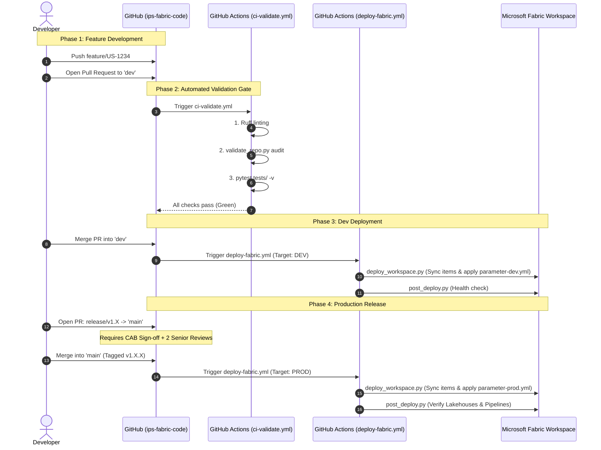

# Microsoft Fabric CI/CD & Production Deployment Runbook

> **Project:** IPS Corporation Enterprise Data Modernization  
> **Platform:** Microsoft Fabric, GitHub Actions, Microsoft Entra ID & Azure Key Vault  
> **Target Environments:** `DEV`, `UAT`, `PROD`  
> **Status:** Production-Ready CI/CD Framework  

---

## 1. Directory Structure

```
deployment/
├── config/
│   ├── parameter-dev.yml         # Environment variables & overrides for DEV
│   ├── parameter-uat.yml         # Environment variables & overrides for UAT
│   └── parameter-prod.yml        # Environment variables & overrides for PROD
├── deploy_workspace.py           # Core deployment runner (Fabric Git REST & Item API)
├── post_deploy.py                # Post-deployment health checks & verification
├── validate_repo.py              # Pre-deployment static audit gate (anti-hardcoding, lint)
├── requirements-cicd.txt         # Runner dependencies (azure-identity, pyyaml, ruff, etc.)
└── README.md                     # Operational runbook & setup instructions

.github/
└── workflows/
    ├── ci-validate.yml           # Automated PR validation workflow (Lint + Tests + Audit)
    └── deploy-fabric.yml         # Multi-environment deployment workflow (DEV -> UAT -> PROD)
```

---

## 2. Prerequisites & Azure / Fabric Configuration

### 2.1 Azure Entra ID App Registration (Service Principal)
1. Register an application in Azure Entra ID: `spn-fabric-cicd-prod`.
2. Generate a Client Secret and note the **Application (Client) ID**, **Directory (Tenant) ID**, and **Client Secret Value**.

### 2.2 Microsoft Fabric Tenant Admin Settings
In the Fabric Admin Portal (`app.fabric.microsoft.com` $\rightarrow$ Settings $\rightarrow$ Admin Portal $\rightarrow$ Tenant Settings):
1. **Service Principals:** Enable *"Service principals can use Fabric APIs"*.
2. Scope it to an Entra ID Security Group (e.g., `SG-Fabric-DevOps-Admins`) containing `spn-fabric-cicd-prod`.
3. **Workspace Permissions:** Grant `spn-fabric-cicd-prod` **Admin** or **Contributor** role on the target shared workspaces (`ws-ips-bi-dev`, `ws-ips-bi-uat`, `ws-ips-bi-prod`).

### 2.3 GitHub Secrets & Variables Configuration
In GitHub Repository $\rightarrow$ **Settings $\rightarrow$ Secrets and variables $\rightarrow$ Actions**:

#### Repository Secrets:
* `AZURE_TENANT_ID`: Directory (Tenant) GUID.
* `AZURE_CLIENT_ID`: Application (Client) GUID of the Service Principal.
* `AZURE_CLIENT_SECRET`: Secret value of the Service Principal.

#### Environment Variables (Configured per GitHub Environment: `DEV`, `UAT`, `PROD`):
* `FABRIC_WORKSPACE_ID`: Target Microsoft Fabric Workspace GUID.
* `FABRIC_ENVIRONMENT`: `DEV`, `UAT`, or `PROD`.

---

## 3. How to Run & Test Locally

Before pushing to Git, developers can run the entire deployment pipeline locally in dry-run mode:

### Step 1: Install CI/CD Dependencies
```bash
pip install -r deployment/requirements-cicd.txt
```

### Step 2: Run the Static Pre-Deployment Audit
```bash
python deployment/validate_repo.py
```
*Enforces: Zero `.ipynb` files, zero hardcoded secrets, YAML schema alignment, and clean Python syntax.*

### Step 3: Run Unit Tests
```bash
pytest tests/ -v
```

### Step 4: Simulate Deployment (Dry-Run Mode)
```bash
# Test DEV simulation
python deployment/deploy_workspace.py --environment DEV --dry-run

# Test PROD simulation
python deployment/deploy_workspace.py --environment PROD --dry-run
```

### Step 5: Simulate Post-Deployment Verification
```bash
python deployment/post_deploy.py --environment PROD --dry-run
```

---

## 4. End-to-End Promotion Workflow



---

## 5. Troubleshooting & Operational Guide

| Error / Symptom | Root Cause | Remediation |
| :--- | :--- | :--- |
| **HTTP 401 Unauthorized** | Expired client secret or missing Fabric API permissions. | Verify `AZURE_CLIENT_SECRET` in GitHub Secrets. Ensure Service Principal is assigned Contributor role in the target workspace. |
| **HTTP 403 Forbidden** | Fabric Tenant Admin setting disabled. | Enable *"Service principals can use Fabric APIs"* in Fabric Admin Portal under Tenant Settings. |
| **HTTP 429 Too Many Requests** | Fabric Capacity throttling. | Deployment runner automatically retries with exponential backoff. If persistent, schedule deployments outside peak business hours. |
| **Git Conflict on Deployment** | Remote workspace contains unsynchronized changes. | The script specifies `conflictResolutionPolicy: "WorkspaceWins"`. Ensure developers do not edit artifacts directly in shared workspaces. |
| **Missing Parameter Error** | Target variable missing in `parameter-*.yml`. | Run `python deployment/validate_repo.py` locally to detect missing environment keys before pushing. |
