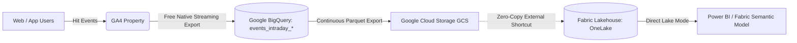
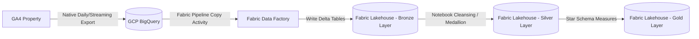
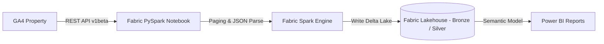
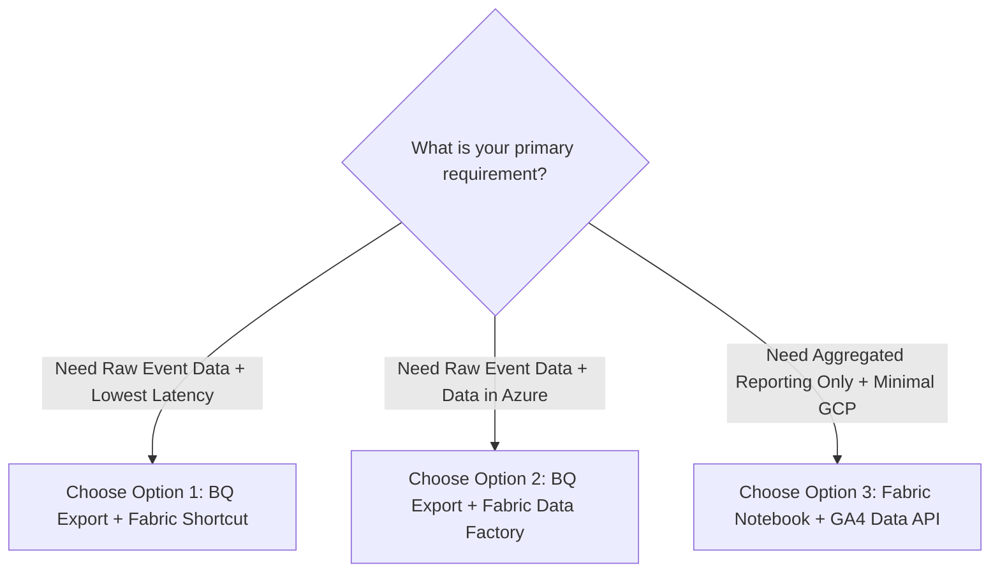

# Ingesting Google Analytics 4 (GA4) Data into Microsoft Fabric

A comprehensive engineering guide for architecting, implementing, and optimizing data pipelines from Google Analytics 4 (GA4) into Microsoft Fabric (OneLake / Lakehouse / Warehouse).

---

## Executive Summary & Comparison Matrix

When integrating GA4 into Microsoft Fabric, organizations must balance **latency**, **cloud costs (GCP + Fabric CUs)**, **data granularity (raw events vs. aggregated metrics)**, and **architectural complexity**.

GA4 does not allow direct ODBC/JDBC connections. Data extraction relies either on **GA4's native BigQuery link** (for event-level data) or the **Google Analytics Data API (v1beta)** (for aggregated reporting metrics).

### Top 3 Architectural Approaches at a Glance

| Evaluation Criteria | Option 1: GA4 Native BQ Export + Fabric GCS/BQ Shortcut (Zero-ETL) | Option 2: GA4 BQ Export + Fabric Data Factory Pipeline (Scheduled Batch) | Option 3: Fabric Notebook (PySpark) + GA4 Data API Direct Ingestion |
| :--- | :--- | :--- | :--- |
| **Primary Use Case** | Real-time / Near Real-Time raw event clickstream analytics | Robust corporate Data Lakehouse with full Azure data residency | Summary reporting, KPI dashboards, minimal GCP footprint |
| **End-to-End Latency** | **Lowest** (Minutes with BQ Streaming Export + Instant Shortcut) | **Medium** (Hourly / Daily scheduled batch) | **Medium-High** (Hourly / Daily API batch polling) |
| **Overall Cost** | **Lowest** (No Fabric CU storage/compute duplication; minor GCP storage) | **Low to Medium** (Fabric Copy CU + BQ Read egress/API) | **Lowest Infrastructure** (Fabric Spark runtime only; Free Google API) |
| **Data Granularity** | Raw Hit/Event-level (`events_*`, `events_intraday_*`) | Raw Hit/Event-level persisted as Delta Lake tables | Aggregated metrics & dimensions (pre-calculated) |
| **Fabric CU Impact** | Minimal (Read-on-demand via Direct Lake / SQL Endpoint) | Moderate (Data Factory Copy Activity CUs) | Moderate (Spark compute engine runtime) |
| **Implementation Complexity** | Low to Moderate (GCP IAM + Fabric External Shortcut) | Low (No-code / Low-code Fabric Data Factory) | Medium (Python API script + token management) |

---

## Option 1: GA4 Native BigQuery Export + Fabric OneLake External Shortcut (Recommended for Best Cost & Latency)

### 1. Architecture Overview
This is a **Zero-Copy / Zero-ETL** pattern. GA4 automatically streams raw hit-level data to Google BigQuery. From BigQuery, data is exported to Google Cloud Storage (GCS) in Parquet format (or accessed via Fabric BigQuery Shortcuts), and Microsoft Fabric Lakehouse mounts the GCS bucket as an **External Shortcut**.



### 2. How It Works
1. **GA4 Link to BigQuery**: Enable the free BigQuery Export in GA4 admin. Choose **Streaming** (intraday events arrive within minutes) and **Daily** (batch finalized overnight).
2. **Parquet Sync to GCS**: BigQuery scheduled query or continuous export formats data into open Parquet files inside a GCS bucket.
3. **Fabric External Shortcut**: In Microsoft Fabric Lakehouse, create an **External Shortcut** pointing to the GCS bucket using GCP Service Account credentials or Fabric BigQuery shortcut.
4. **Instant Querying**: Fabric recognizes the Parquet files as Lakehouse tables instantly without copying bytes into Azure.

### 3. Latency & Cost Breakdown
- **Latency**: **5 - 15 minutes** (BigQuery intraday streaming + continuous micro-batch export to GCS; zero ingestion latency on Fabric side).
- **Cost**:
  - **GCP**: GA4 export is free. BigQuery streaming inserts: ~$0.05 per GB. GCS storage: ~$0.02 per GB/month.
  - **Azure Fabric**: **$0 Ingestion Pipeline cost** (No Data Factory pipeline runs required). Queries only consume Fabric Capacity Units (CUs) when read.

### 4. Implementation Steps

#### Step 4.1: Enable GA4 BigQuery Export
1. In GA4 Admin, navigate to **Product Links** > **BigQuery Links**.
2. Select your Google Cloud Project.
3. Configure data streams and choose:
   - **Daily**: Overnight partitioned tables (`events_YYYYMMDD`).
   - **Streaming**: Near real-time table (`events_intraday_YYYYMMDD`).

#### Step 4.2: Setup GCP IAM for Fabric Shortcut
Create a Google Cloud Service Account with permissions:
- `Storage Object Viewer` on the target GCS bucket.
Generate and download the Service Account JSON key.

#### Step 4.3: Create Fabric External Shortcut
1. Open your **Fabric Lakehouse** > `Files` or `Tables`.
2. Select **New Shortcut** > **Google Cloud Storage**.
3. Fill in:
   - **Connection Settings**: `gs://<your-gcs-bucket>/ga4_parquet/`
   - **Authentication**: Key ID & Private Key from GCP Service Account.
4. Data is instantly accessible via Fabric SQL Analytics Endpoint and Direct Lake Power BI.

---

## Option 2: GA4 BigQuery Export + Fabric Data Factory Pipeline (Best for Azure Data Governance & Compliance)

### 1. Architecture Overview
This is the standard enterprise ETL/ELT approach. GA4 exports raw events to Google BigQuery, and **Microsoft Fabric Data Factory** pulls the delta partitions into OneLake as native **Delta Parquet** tables via a scheduled Copy Activity.



### 2. How It Works
1. Data lands in BigQuery via GA4 export.
2. Fabric Data Pipeline runs on a schedule (e.g., hourly for intraday, or once daily at 04:00 UTC for finalized partitions).
3. The Copy Activity queries BigQuery using the native **Google BigQuery connector** in Fabric and appends new partitions to the Bronze Delta table.

### 3. Latency & Cost Breakdown
- **Latency**: **1 - 4 hours** (hourly batches) or **24 hours** (daily batch).
- **Cost**:
  - **GCP**: Standard BigQuery export costs + BigQuery active storage (~$0.02/GB) + Query scan costs ($6.25 per TB scanned, minimized using partition filters).
  - **Fabric**: Fabric Data Factory Copy Activity consumes minimal CUs (~0.5 - 1.5 CU per run for moderate volumes). OneLake storage charges apply for persisted Delta tables.

### 4. Pipeline Copy Activity Configuration

#### BigQuery Source Query (Partition-Pruned):
To optimize GCP scan costs, avoid full-table scans by querying only the desired date partition:

```sql
SELECT 
    event_date,
    event_timestamp,
    event_name,
    event_previous_timestamp,
    event_value_in_usd,
    event_bundle_sequence_id,
    event_server_timestamp_offset,
    user_id,
    user_pseudo_id,
    privacy_info,
    user_properties,
    user_first_touch_timestamp,
    user_ltv,
    device,
    geo,
    app_info,
    traffic_source,
    stream_id,
    platform,
    event_dimensions,
    ecommerce,
    items,
    TO_JSON_STRING(event_params) AS event_params_json
FROM 
    `your-gcp-project.analytics_123456789.events_*`
WHERE 
    _TABLE_SUFFIX = FORMAT_DATE('%Y%m%d', DATE_SUB(CURRENT_DATE(), INTERVAL 1 DAY))
```

> [!TIP]
> GA4 represents `event_params` as repeated nested records (RECORD REPEATED). BigQuery connector in Fabric handles flat structures best. Converting `event_params` to a JSON string (`TO_JSON_STRING(event_params)`) prevents nested schema mapping errors in Fabric Copy Activity and allows PySpark to unpack it cleanly in the Silver layer.

---

## Option 3: Fabric Notebook (PySpark) + GA4 Data API (Best for Aggregated Data & Zero GCP Infrastructure)

### 1. Architecture Overview
If your reporting only requires aggregate metrics (e.g., sessions by channel, daily active users, landing page conversion rates) and you do not want to manage Google Cloud BigQuery projects, a **Fabric PySpark Notebook** can call the **Google Analytics Data API (v1beta)** directly.



### 2. How It Works
1. Create a Google Cloud Service Account with read-only permissions to the GA4 property.
2. Store credentials securely in **Azure Key Vault** (or Fabric Environment Variables).
3. A Fabric Notebook executes Python code using `google-analytics-data` library, fetches metrics and dimensions, converts them into a Spark DataFrame, and saves as Delta Parquet.

### 3. Latency & Cost Breakdown
- **Latency**: **Batch (Daily or Hourly)**. (GA4 Data API reports standard latency of 24–48 hours for fully processed data, though real-time API endpoint provides limited 30-minute metrics).
- **Cost**:
  - **GCP**: **$0.00** (Google Analytics Data API has generous free request quotas: 25,000 tokens per day).
  - **Fabric**: Consumes Spark starter pool compute during notebook execution (~2-5 minutes per run).

### 4. Implementation Code (Fabric PySpark Notebook)

```python
# Fabric Notebook: Ingest GA4 Aggregated Metrics via Data API
# Requirements: pip install google-analytics-data

import os
from google.analytics.data_v1beta import BetaAnalyticsDataClient
from google.analytics.data_v1beta.types import (
    DateRange,
    Dimension,
    Metric,
    RunReportRequest,
)
from google.oauth2 import service_account
from pyspark.sql import SparkSession
from pyspark.sql.types import (
    DoubleType,
    IntegerType,
    StringType,
    StructField,
    StructType,
)

# 1. Authenticate with Google Analytics Data API
# In production, retrieve credentials from Azure Key Vault
SERVICE_ACCOUNT_KEY_PATH = "/lakehouse/default/Files/secrets/ga4_service_account.json"
GA4_PROPERTY_ID = "YOUR_GA4_PROPERTY_ID"  # e.g., "312345678"

credentials = service_account.Credentials.from_service_account_file(
    SERVICE_ACCOUNT_KEY_PATH
)
client = BetaAnalyticsDataClient(credentials=credentials)

# 2. Define Dimensions & Metrics to Extract
request = RunReportRequest(
    property=f"properties/{GA4_PROPERTY_ID}",
    dimensions=[
        Dimension(name="date"),
        Dimension(name="sessionSourceMedium"),
        Dimension(name="country"),
        Dimension(name="deviceCategory"),
        Dimension(name="pagePath"),
    ],
    metrics=[
        Metric(name="sessions"),
        Metric(name="totalUsers"),
        Metric(name="newUsers"),
        Metric(name="conversions"),
        Metric(name="screenPageViews"),
        Metric(name="engagementRate"),
    ],
    date_ranges=[DateRange(start_date="yesterday", end_date="yesterday")],
)

response = client.run_report(request)

# 3. Transform API Response into Rows
data_rows = []
for row in response.rows:
    dim_values = [val.value for val in row.dimension_values]
    metric_values = [val.value for val in row.metric_values]
    data_rows.append(dim_values + metric_values)

# 4. Define PySpark Schema and Create DataFrame
schema = StructType(
    [
        StructField("report_date", StringType(), True),
        StructField("source_medium", StringType(), True),
        StructField("country", StringType(), True),
        StructField("device_category", StringType(), True),
        StructField("page_path", StringType(), True),
        StructField("sessions", IntegerType(), True),
        StructField("total_users", IntegerType(), True),
        StructField("new_users", IntegerType(), True),
        StructField("conversions", DoubleType(), True),
        StructField("screen_page_views", IntegerType(), True),
        StructField("engagement_rate", DoubleType(), True),
    ]
)

spark = SparkSession.builder.getOrCreate()
df_ga4 = spark.createDataFrame(data_rows, schema=schema)

# 5. Write to Lakehouse Bronze/Silver Delta Table
df_ga4.write.format("delta").mode("append").partitionBy("report_date").saveAsTable(
    "bronze_ga4_daily_metrics"
)

print(
    f"Successfully ingested {df_ga4.count()} GA4 aggregated rows into bronze_ga4_daily_metrics."
)
```

---

## Detailed Pros & Cons Comparison

### Option 1: GA4 BQ Export + Fabric External Shortcut (Zero-ETL)
- **Pros**:
  - **Fastest time-to-insight**: Minutes latency with BigQuery streaming.
  - **Zero Data Duplication**: OneLake reads from GCS/BigQuery without copying files.
  - **Minimal Maintenance**: No ingestion pipeline errors, failure alerts, or pipeline compute bills.
- **Cons**:
  - GCS/BigQuery egress or cross-cloud data transfer costs apply when large volumes are queried.
  - Requires maintaining Google Cloud infrastructure (IAM, GCS/BigQuery).

### Option 2: GA4 BQ Export + Fabric Data Factory Pipeline (Batch Ingestion)
- **Pros**:
  - **Full Data Sovereignty**: All event records reside physically within Azure OneLake.
  - **Full Medallion Architecture**: Supports standard Fabric Bronze -> Silver -> Gold automated pipelines.
  - **Native Integration**: Low-code Data Factory setup with enterprise alerting and lineage.
- **Cons**:
  - Ingestion lag (typically runs daily or hourly).
  - Fabric Capacity Units (CUs) consumed during pipeline execution.

### Option 3: Fabric Notebook + GA4 Data API (Aggregated)
- **Pros**:
  - **Simplest Setup**: No BigQuery billing or GCP data lake required.
  - **Direct to Lakehouse**: Direct integration from GA4 to Fabric via Python.
  - **Zero GCP Storage Cost**: Free API access within Google standard quotas.
- **Cons**:
  - **No Raw Hit-Level Data**: Cannot analyze individual user paths, session stitching, or custom parameters.
  - **API Quota Restrictions**: Subject to daily request limits and rate-limiting.
  - **Data Processing Lag**: Standard GA4 reporting data processing latency is 24-48 hours.

---

## Technical Recommendations & Decision Matrix



### Key Engineering Best Practices for GA4 Ingestion into Fabric:
1. **Handling GA4's Nested `event_params` Array**:
   - In raw GA4 exports, event parameters are stored in key-value arrays (`key`, `value.string_value`, `value.int_value`).
   - In the Fabric Silver layer, use PySpark `expr` or JSON functions to pivot common parameters (e.g., `page_location`, `session_id`, `ga_session_number`) into distinct table columns for high-performance Power BI Direct Lake queries.
2. **Partition Pruning**:
   - Always partition Delta tables by `event_date` (`YYYYMMDD`) to ensure Power BI and Spark queries only scan relevant date ranges.
3. **Deduplication of Intraday vs. Daily Records**:
   - GA4 intraday records (`events_intraday_*`) can contain duplicate hits that are corrected in the finalized daily table (`events_*`). When merging in Fabric Silver layer, run a deduplication window on `user_pseudo_id + event_name + event_timestamp`.
4. **Security & Key Management**:
   - Never hardcode Google Service Account keys in Fabric Notebooks. Store credentials in **Azure Key Vault** and access them via Fabric Azure Key Vault linked services.
