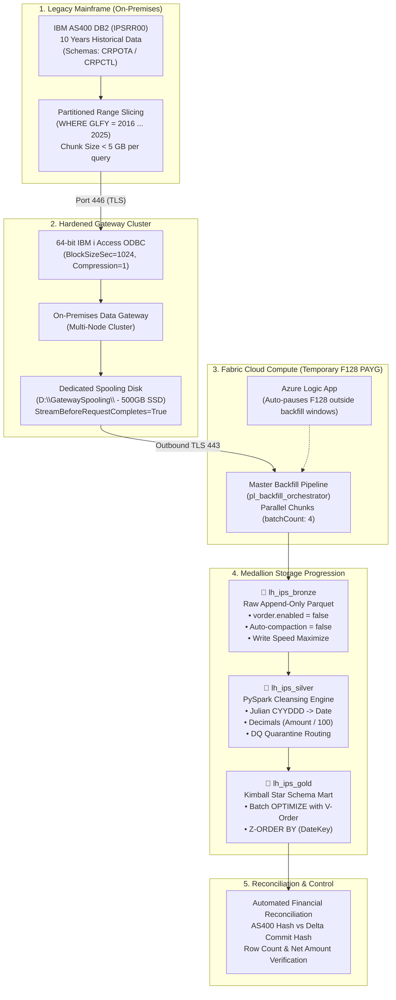
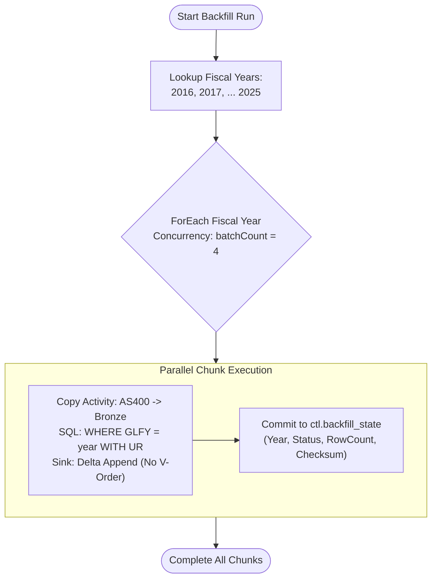

# Microsoft Fabric — Legacy AS400 Mainframe Historical Data Backfill Guide

> **Project:** IPS Corporation Enterprise Data Modernization  
> **Topic:** Strategy, Architecture, Tuning, and Step-by-Step Runbook for Massive Multi-Year Historical Backfills  
> **Source System:** IBM DB2 on IBM i (AS400 Mainframe — Schemas: `CRPOTA`, `CRPCTL` | Host: `IPSRR00`)  
> **Target Platform:** Microsoft Fabric OneLake Medallion Architecture (Bronze $\rightarrow$ Silver $\rightarrow$ Gold)  
> **Document Location:** `docs/additional_docs/Fabric_AS400_Historical_Data_Backfill_Guide.md`  
> **Document Version:** 1.0 (September 2026)  
> **Status:** Approved Enterprise Architecture Standard  

---

## 📋 Table of Contents
1. [Executive Summary & The Backfill Challenge](#1-executive-summary--the-backfill-challenge)
2. [End-to-End Backfill Architecture Blueprint](#2-end-to-end-backfill-architecture-blueprint)
3. [The 4 Critical Failure Traps & Mitigations](#3-the-4-critical-failure-traps--mitigations)
4. [Step-by-Step Backfill Execution Process](#4-step-by-step-backfill-execution-process)
   - [Phase 1: Source Profiling, Slicing & Partition Strategy](#phase-1-source-profiling-slicing--partition-strategy)
   - [Phase 2: On-Premises Gateway & ODBC Driver Hardening](#phase-2-on-premises-gateway--odbc-driver-hardening)
   - [Phase 3: Fabric Compute Sizing & FinOps Scheduling (The F128 State)](#phase-3-fabric-compute-sizing--finops-scheduling-the-f128-state)
   - [Phase 4: Metadata-Driven Pipeline Execution (Dynamic Chunking)](#phase-4-metadata-driven-pipeline-execution-dynamic-chunking)
   - [Phase 5: Delta Lake Ingestion Optimization ("Write Fast, Optimize Once")](#phase-5-delta-lake-ingestion-optimization-write-fast-optimize-once)
   - [Phase 6: Distributed Silver Cleansing & Julian Date Conversion](#phase-6-distributed-silver-cleansing--julian-date-conversion)
   - [Phase 7: End-to-End Reconciliation & Audit Validation](#phase-7-end-to-end-reconciliation--audit-validation)
5. [Operational Troubleshooting Runbook](#5-operational-troubleshooting-runbook)

---

## 1. Executive Summary & The Backfill Challenge

In migrating the **IPS Corporation BI Ecosystem** from legacy AS400 DB2i into Microsoft Fabric, the data engineering team must ingest **10 years of historical transactional ledgers** spanning core JD Edwards EnterpriseOne modules:
* **General Ledger (`F0911`):** ~180 million rows.
* **Accounts Receivable (`F03B11`) & Accounts Payable (`F0411`):** ~45 million rows.
* **Sales Order Detail (`F4211` / `F42119` History):** ~75 million rows.
* **Inventory Ledger (`F4111`):** ~120 million rows.

### Why Standard Ingestion Fails on Historical Backfills
1. **Mainframe CPU & Lock Exhaustion:** Monolithic `SELECT *` queries against production AS400 tables cause extensive table-level read locks, drain mainframe CPU, and trigger timeout errors for active ERP green-screen users.
2. **Gateway VM Disk Crash:** Querying 10 years in one shot buffers tens of gigabytes in the On-Premises Data Gateway (OPDG) local spooling cache, filling the `C:\` drive to 100% and crashing the VM.
3. **Network Drops:** Long-running ODBC connections over hybrid VPN/ExpressRoute links are prone to TCP resets if queries run for longer than 60 minutes.
4. **Capacity Throttling:** Massive write bursts without proper capacity sizing exhaust Microsoft Fabric Capacity Units (CUs), throttling downstream workspaces.

To solve this, the architecture adopts a **Partitioned, Metadata-Driven Chunking Strategy** combined with **Gateway Spooling Hardening**, **Temporary F128 Compute Sizing**, and **Delta Write Optimizations**.

---

## 2. End-to-End Backfill Architecture Blueprint



---

## 3. The 4 Critical Failure Traps & Mitigations

| Failure Trap | Root Cause | Engineering Mitigation |
| :--- | :--- | :--- |
| **Trap 1: Gateway VM Disk Exhaustion (`Disk Full`)** | Default OPDG configuration buffers the entire query result in `C:\Users\PBIEgwService\AppData\...` before sending it to the cloud. A 40 GB table fills the OS drive. | **1.** Move `SpoolingDirectory` to dedicated data drive (`D:\GatewaySpooling`).<br>**2.** Set `StreamBeforeRequestCompletes = True` in `GatewayCore.dll.config`.<br>**3.** Slice queries into $< 5\text{ GB}$ chunks. |
| **Trap 2: AS400 Mainframe Lockouts** | Querying tables without isolation levels triggers shared locks, blocking active warehouse clerks and accounts receivable posting jobs. | Add **`WITH UR`** (Uncommitted Read / Dirty Read) to every historical backfill extraction SQL query to bypass table locks. |
| **Trap 3: The "Azure Downscale Trap"** | Purchasing a 1-year Azure Capacity Reservation for F128 ($10,005/mo) to absorb backfills, intending to downscale to F32 at go-live. Under Azure rules, reserved dollar values cannot be reduced, causing **$90,000+ wasted spend**. | Run F128 on **Pay-As-You-Go (PAYG)** with an automated Logic App schedule. Lock a 1-year reservation **only** on the steady-state PROD F64. |
| **Trap 4: Slow Delta Write Overhead** | Fabric enables V-Order sorting and transactional compaction by default. Applying this to 180M historical rows on raw write causes massive compute throttling. | Set `spark.sql.parquet.vorder.enabled = false` during raw landing. Perform a single batch `OPTIMIZE` with V-Order in Gold **after** all years have landed. |

---

## 4. Step-by-Step Backfill Execution Process

```
┌────────────────────────────────────────────────────────────────────────────────────────┐
│                              HISTORICAL BACKFILL WORKFLOW                              │
│                                                                                        │
│ [Phase 1]          [Phase 2]          [Phase 3]          [Phase 4]          [Phase 5]  │
│ Profiling &   ───► Gateway     ───► Provision   ───► Execute     ───► Run Batch        │
│ Slicing Design     Hardening        F128 PAYG        Chunked Copy     OPTIMIZE & Recon │
└────────────────────────────────────────────────────────────────────────────────────────┘
```

---

### Phase 1: Source Profiling, Slicing & Partition Strategy

Never extract multi-year tables in a single query. Slice historical tables across business boundaries.

#### 1. Slicing Dimension Hierarchy
* **Transactional Tables with Fiscal Year (`F0911`, `F03B11`, `F0411`):** Slice by **Fiscal Year (`GLFY` / `RPFY`)**.
* **Tables with Julian Dates (`F4211`, `F4111`):** Slice by **Century/Year Julian Range (`GLDGJ` / `TRDJ`)**.
  * Example: Year 2021 = `121001` to `121365` | Year 2022 = `122001` to `122365`.
* **Master Tables (`F0101`, `F0901`, `F0010`):** Full snapshot extraction (no slicing needed).

#### 2. Slicing Catalog Matrix (Example: `F0911` General Ledger)
```sql
-- Query pattern configured in meta.dataset_src_to_brnz
SELECT 
    GLKCO, GLDCT, GLDOC, GLJELN, GLPOST, GLANI, GLAA, GLACR, 
    GLCRCD, GLCRRM, GLDGJ, GLDICJ, GLCO, GLMCU, GLOBJ, GLSUB
FROM CRPOTA.F0911
WHERE GLFY = @{item().FiscalYear}
WITH UR
```

---

### Phase 2: On-Premises Gateway & ODBC Driver Hardening

Before launching the backfill, configure the Windows Gateway host (`genie-fabric-prod-01: 10.100.8.10`).

#### 1. Relocate Spooling Directory to Data Drive
Open `C:\Program Files\On-premises data gateway\GatewayCore.dll.config` and modify:
```xml
<configuration>
  <appSettings>
    <!-- Relocate spooling to dedicated 500GB SSD -->
    <add key="SpoolingDirectory" value="D:\GatewaySpooling" />
    <!-- Enable continuous streaming to OneLake without full local buffering -->
    <add key="StreamBeforeRequestCompletes" value="True" />
  </appSettings>
</configuration>
```
Restart the Windows service:
```powershell
Restart-Service -Name "PBIEgwService"
```

#### 2. Tune 64-bit IBM i Access ODBC Driver
In Windows **ODBC Data Source Administrator (64-bit)** $\rightarrow$ System DSN `DB2_AS400_PROD`:
* **Performance Tab:**
  * Enable **Record Blocking:** Checked.
  * **Block Size:** Set to `1024` KB (default is 32 KB).
  * Enable **Large Data Compression (`ABrowLargeDataCompression=1`):** Compresses data over the network, reducing wire transmission time by ~60%.
* **Connection Tab:**
  * **Query Timeout:** Increase from `30` to `3600` seconds (1 hour).
  * **Default Isolation Level:** Set to `*CHG` (Change) or allow dynamic `WITH UR`.

---

### Phase 3: Fabric Compute Sizing & FinOps Scheduling (The F128 State)

To prevent backfill runs from exhausting daily Capacity Units, scale the non-production capacity:

1. **Deploy F128 on Pay-As-You-Go:**
   * In the Azure Portal, provision an **F128 Capacity** ($23.04/hr) under subscription `sub-ips-fabric-prod`.
   * Assign `ws-ips-bi-dev` (or a dedicated `ws-ips-backfill-migration`) to this capacity.
2. **Automate Nightly & Weekend Scheduling (Logic App):**
   * Configure an Azure Logic App to automatically **Pause** the F128 capacity at 08:00 PM and **Resume** at 08:00 AM (or run overnight exclusively for backfills).
   * **FinOps Cost Calculation:** Running F128 for 80 hours across a 2-week backfill sprint costs:
     $$80\text{ hours} \times \$23.04/\text{hr} = \mathbf{\$1,843.20}$$
     *(Saves over $8,000 compared to leaving F128 running 24/7 or buying an un-exchangeable reservation).*

---

### Phase 4: Metadata-Driven Pipeline Execution (Dynamic Chunking)

Create a dedicated backfill pipeline: `pl_backfill_historical_chunks.json`.



#### Pipeline Activity Configuration:
* **Batch Count (Concurrency):** Set `batchCount = 4`. Running more than 4 concurrent large queries against AS400 may saturate the ODBC connection pool or mainframe I/O channels.
* **Timeout per Copy Activity:** Set to `02:00:00` (2 hours).
* **Retry Count:** Set `retry = 3` with `retryIntervalInSeconds = 300` (handles transient network resets).

---

### Phase 5: Delta Lake Ingestion Optimization ("Write Fast, Optimize Once")

By default, Delta Lake applies **V-Order sorting** and **auto-compaction**, which slows down bulk raw ingestion.

#### 1. Ingestion Session Settings (Fast Write Mode)
In your Bronze PySpark ingestion notebook, execute:
```python
# Disable write-time V-Order and auto-compaction during bulk raw backfill
spark.conf.set("spark.sql.parquet.vorder.enabled", "false")
spark.conf.set("spark.microsoft.delta.optimizeWrite.enabled", "false")
spark.conf.set("spark.microsoft.delta.autoCompact.enabled", "false")

# Append raw batch chunk directly into Bronze
raw_df.write \
    .format("delta") \
    .mode("append") \
    .option("mergeSchema", "true") \
    .saveAsTable("lh_ips_bronze.raw_f0911_gl_ledger")
```

#### 2. Post-Backfill Batch Compaction (Run Once at End)
Once all 10 years of data have landed, switch V-Order back on and run a single, optimized compaction during off-peak hours:
```python
# Re-enable V-Order for optimal Direct Lake Power BI performance
spark.conf.set("spark.sql.parquet.vorder.enabled", "true")

# Compact thousands of small chunk files into optimized 512MB Parquet files
spark.sql("""
    OPTIMIZE lh_ips_gold.Fact_GeneralLedger 
    ZORDER BY (CompanyKey, DateKey)
""")

# Clean up temporary backfill transaction logs older than 7 days
spark.sql("""
    VACUUM lh_ips_gold.Fact_GeneralLedger RETAIN 168 HOURS
""")
```

---

### Phase 6: Distributed Silver Cleansing & Julian Date Conversion

Once Bronze has all historical records, execute the distributed Silver cleansing engine ([`01_silver_cleansing_dq.py`](file:///Users/chandu/Documents/Python_practice/Fabric/src/notebooks/silver/01_silver_cleansing_dq.py)).

#### 1. Julian Date Conversion Logic for 10-Year History
```python
def convert_julian_to_gregorian(julian_col):
    """
    Translates JD Edwards CYYDDD Julian dates across centuries:
      - Century 0 = 1900s (e.g., 098120 = May 1, 1998)
      - Century 1 = 2000s (e.g., 124060 = February 29, 2024 - Leap Year)
    """
    century = (julian_col / 100000).cast("int")
    year_part = ((julian_col % 100000) / 1000).cast("int")
    day_of_year = (julian_col % 1000).cast("int")
    
    full_year = lit(1900) + (century * lit(100)) + year_part
    start_of_year = to_date(concat(full_year.cast("string"), lit("-01-01")), "yyyy-MM-dd")
    return expr(f"date_add({start_of_year}, {day_of_year} - 1)")
```

#### 2. Partitioning the Silver Target Table
For historical ledgers exceeding 100M rows, partition by `fiscal_year`:
```python
silver_df.write \
    .format("delta") \
    .mode("overwrite") \
    .partitionBy("fiscal_year") \
    .option("overwriteSchema", "true") \
    .saveAsTable("lh_ips_silver.silver_f0911_gl_ledger")
```

---

### Phase 7: End-to-End Reconciliation & Audit Validation

Before decommissioning the legacy staging or declaring the backfill complete, perform mathematical reconciliation between AS400 and Fabric Gold.

```python
# -------------------------------------------------------------------------------------------------
# Historical Reconciliation Verification Script
# -------------------------------------------------------------------------------------------------

# 1. Query AS400 Ground Truth (Extracted during backfill control step)
as400_audit = spark.table("lh_ips_bronze.control_as400_backfill_checksums")

# 2. Query Curated Gold Fact Mart
gold_gl = spark.table("lh_ips_gold.Fact_GeneralLedger")

# 3. Calculate Aggregates by Fiscal Year
reconciliation_df = gold_gl.groupBy("FiscalYear").agg(
    count("*").alias("gold_row_count"),
    round(sum("AmountDomestic"), 2).alias("gold_net_balance")
).join(as400_audit, on="FiscalYear") \
 .withColumn("row_count_diff", col("gold_row_count") - col("as400_row_count")) \
 .withColumn("balance_diff", round(col("gold_net_balance") - col("as400_net_balance"), 2))

# 4. Assert Zero Variance
variance = reconciliation_df.filter((col("row_count_diff") != 0) | (col("balance_diff") != 0.00))

if variance.count() == 0:
    print("SUCCESS: 10-Year Historical Backfill fully reconciled with 0.00 variance!")
else:
    print("CRITICAL AUDIT MISMATCH DETECTED:")
    variance.show()
    raise AssertionError("Reconciliation failed. Gold mart does not match AS400 financial ledger.")
```

---

## 5. Operational Troubleshooting Runbook

| Incident | Immediate Root Cause | Resolution Action |
| :--- | :--- | :--- |
| **Error: `ODBC SQL0913 - Row or object in use`** | A scheduled AS400 nightly batch job locked the table partition. | Verify that query ends with **`WITH UR`**. Reschedule the specific year's chunk copy outside the AS400 nightly batch window (`00:00 - 04:00 CET`). |
| **Error: `Gateway VM Out of Disk Space`** | Spooling directory was not relocated off the OS drive. | Move `SpoolingDirectory` to `D:\GatewaySpooling`. Delete temporary files from `C:\Users\PBIEgwService\AppData\Local\Microsoft\On-premises data gateway\Spooler`. |
| **Fabric CU Consumption Spike > 100%** | Multiple large Spark notebooks running simultaneously on an F32 capacity. | Verify that backfill runs on the **F128 capacity**. Check the **Fabric Capacity Metrics App** to audit whether 24-hour smoothing has absorbed the write burst. |
| **Julian Date Overflow: `date_add out of range`** | AS400 contains dirty/corrupt dates (e.g., `000000` or `999999`). | Ensure [`01_silver_cleansing_dq.py`](file:///Users/chandu/Documents/Python_practice/Fabric/src/notebooks/silver/01_silver_cleansing_dq.py) handles `when(col("gl_julian_date") > 0, ...).otherwise(None)` and routes invalid dates to `silver_quarantine_records`. |
| **Direct Lake Semantic Model Degrades to DirectQuery** | Fact table exceeded 300 million rows or un-compacted small files prevented VertiPaq memory mapping. | Run `OPTIMIZE lh_gold.Fact_Table ZORDER BY (DateKey)` to compact small Parquet files. Ensure memory is under 25 GB. |
