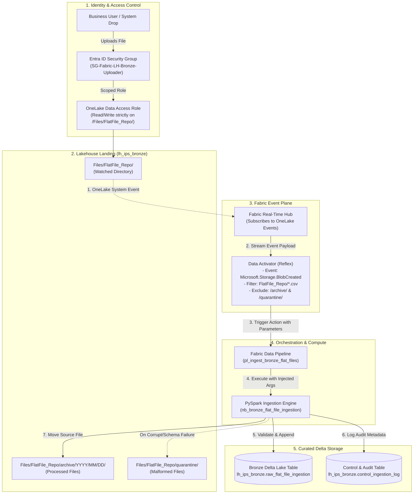

# Step-by-Step Implementation Guide: Event-Driven Automated Ingestion in Microsoft Fabric

> **Project:** IPS Corporation BI Modernization  
> **Topic:** Real-Time Hub, Data Activator (Reflex), and Parameterized Data Pipeline Automation  
> **Document Version:** 1.0  
> **Release Date:** September 2026  
> **Target SKU:** Microsoft Fabric F32 / F64  
> **Status:** Approved Enterprise Architecture Standard  

---

## Executive Summary

Traditional data ingestion relies heavily on scheduled batch polling (e.g., executing a pipeline every 15 minutes to inspect whether a user has uploaded a file). In enterprise data platforms, scheduled polling introduces significant drawbacks:
1. **Unnecessary Capacity Unit (CU) Waste:** Every polling run consumes execution overhead (Get Metadata + If Condition activities), draining between 1.5 and 3 CU-seconds per run even when no files exist. Over 96 runs a day, this burns hundreds of CU-seconds on empty checks.
2. **Artificial Ingestion Latency:** Business users must wait up to the polling interval (average 7.5 minutes) before downstream processing starts.
3. **Capacity Smoothing Strain:** Periodic burst polling clusters pipeline executions, compounding compute consumption during peak business hours.

**Event-Driven Automated Ingestion (EDAI)** resolves these challenges by transitioning from a **proactive polling (pull)** architecture to a **reactive event-driven (push)** architecture. Using Fabric's native **Real-Time Hub**, **Data Activator (Reflex)**, and parameterized **Data Pipelines**, processing triggers instantly (within 15–30 seconds) upon file landing in OneLake, achieving **zero compute waste during idle periods**.

---

## Architectural Blueprint



---

## Step-by-Step Implementation Process

```
┌─────────────────────────────────────────────────────────────────────────────────────────┐
│                                IMPLEMENTATION WORKFLOW                                  │
│                                                                                         │
│  [Step 1]                 [Step 2]                 [Step 3]                 [Step 4]    │
│  Configure OneLake   ───► Setup Real-Time    ───► Create Data         ───► Deploy       │
│  Folder Security          Hub Storage Events       Activator Rule          Pipeline &   │
│  & Folder Structure                                & Parameters            Notebook     │
└─────────────────────────────────────────────────────────────────────────────────────────┘
```

---

### Step 1: Configure OneLake Storage & Folder-Level Security

To prevent users from modifying lakehouse tables or exploring unauthorized workspace artifacts, enforce folder-level least-privilege access using Entra ID and OneLake Data Access Roles.

1. **Create the Folder Hierarchy in `lh_ips_bronze`:**
   * `/Files/FlatFile_Repo/` $\rightarrow$ Landing area for incoming files.
   * `/Files/FlatFile_Repo/archive/` $\rightarrow$ Storage for successfully processed historical files.
   * `/Files/FlatFile_Repo/quarantine/` $\rightarrow$ Storage for invalid, corrupt, or unparseable files.

2. **Configure Entra ID Security Group:**
   * Create an Entra ID security group: `SG-Fabric-LH-Bronze-Uploader`.
   * Assign all business uploaders or upstream automated service accounts to this security group.

3. **Assign OneLake Data Access Role:**
   * In Microsoft Fabric, navigate to `lh_ips_bronze` $\rightarrow$ **Manage OneLake data access**.
   * Create a custom role named `FlatFileRepo_Uploader`.
   * Assign **Read and Write** permissions strictly scoped to `Files/FlatFile_Repo/`.
   * Explicitly leave `Tables/` and other sub-paths unassigned.
   * Bind `SG-Fabric-LH-Bronze-Uploader` to `FlatFileRepo_Uploader`.
   * At the Workspace level, grant this group **Viewer** role (or Share Lakehouse with Read access only).

---

### Step 2: Configure System Event Capture in Fabric Real-Time Hub

Microsoft Fabric’s Real-Time Hub provides centralized discovery and management of all data streams, Azure events, and Fabric workspace events.

1. Open the Fabric portal (`app.fabric.microsoft.com`) and click **Real-Time hub** on the left navigation bar.
2. Under the **Fabric events** section, locate **Fabric Workspace / OneLake events**.
3. Select **Add event stream** or choose your target workspace (`ws-ips-bi-bronze-dev`).
4. Select the event source: **OneLake storage events**.
5. Set the target container to `lh_ips_bronze`.
6. Select the event type: `Microsoft.Storage.BlobCreated`.
7. Verify that the event subscription emits payloads formatted as follows:

```json
{
  "topic": "/subscriptions/xxx/resourceGroups/xxx/providers/Microsoft.Fabric/workspaces/ws-ips-bronze/lakehouses/lh_ips_bronze",
  "subject": "/Files/FlatFile_Repo/monthly_adjustments_20260927.csv",
  "eventType": "Microsoft.Storage.BlobCreated",
  "eventTime": "2026-09-27T12:05:30.1234567Z",
  "id": "e3a89e1b-0123-4567-89ab-cdef01234567",
  "data": {
    "api": "PutBlob",
    "clientRequestId": "9b1deb4d-3b7d-4bcc-9b16-da54e6005398",
    "requestId": "2f7c0012-001e-0000-0000-000000000000",
    "eTag": "0x8DB7F5C12345678",
    "contentType": "text/csv",
    "contentLength": 524288,
    "blobUrl": "https://onelake.blob.fabric.microsoft.com/ws-ips-bronze/lh_ips_bronze.Lakehouse/Files/FlatFile_Repo/monthly_adjustments_20260927.csv"
  }
}
```

---

### Step 3: Configure Data Activator (Reflex) Event Rule

Data Activator acts as the intelligent event filter and dispatch engine. It evaluates incoming events in real time and triggers downstream Fabric actions.

#### 3.1 Create Data Activator Item
1. In your Fabric Workspace, click **+ New item** $\rightarrow$ **Data Activator (Reflex)**.
2. Name the item: `act_flat_file_upload_trigger`.
3. Select **Get data from Real-Time hub** and connect to the OneLake event stream configured in Step 2.

#### 3.2 Define Stream Extraction Properties
Map dynamic fields from the incoming JSON event:

| Derived Property Name | Source Expression / JSON Path | Purpose |
| :--- | :--- | :--- |
| `FullSubject` | `subject` | Full relative path in OneLake storage. |
| `BlobUrl` | `data.blobUrl` | Fully qualified URL for direct REST/PySpark access. |
| `FileName` | `split(subject, '/')[-1]` | Isolated base file name. |
| `FileSize` | `data.contentLength` | Byte size for zero-byte detection. |
| `EventTimestamp` | `eventTime` | UTC timestamp when the file was created. |

#### 3.3 Configure the Trigger Rule
Create a trigger named `trg_on_csv_uploaded_flat_file_repo`:

* **Condition 1 (Event Type):** `eventType` equals `Microsoft.Storage.BlobCreated`.
* **Condition 2 (Target Folder):** `FullSubject` contains `Files/FlatFile_Repo/`.
* **Condition 3 (File Extension):** `FullSubject` ends with `.csv` (or `.xlsx`, `.parquet`).
* **Condition 4 (Anti-Loop Filter - MANDATORY):**
  * `FullSubject` does **NOT** contain `/archive/`
  * `FullSubject` does **NOT** contain `/quarantine/`
  * `FullSubject` does **NOT** contain `_temp`
  > [!CAUTION]
  > Without Condition 4, moving or copying the processed file into the archive folder emits another `BlobCreated` event, triggering an infinite recursive pipeline loop!

#### 3.4 Bind Trigger to Action (Fabric Data Pipeline)
1. Under **Action**, select **Run Fabric item** $\rightarrow$ **Pipeline**.
2. Select target pipeline: `pl_ingest_bronze_flat_files`.
3. Map dynamic parameters:
   * `TriggeredFileName` $\leftarrow$ `[Property] FileName`
   * `TriggeredFilePath` $\leftarrow$ `[Property] FullSubject`
   * `SourceBlobUrl` $\leftarrow$ `[Property] BlobUrl`
   * `EventTimestamp` $\leftarrow$ `[Property] EventTimestamp`
4. Click **Save** and select **Start** from the top ribbon to activate continuous rule evaluation.

---

### Step 4: Fabric Data Pipeline & PySpark Code Implementation

The orchestration architecture consists of:
1. **The Fabric Data Pipeline (`pl_ingest_bronze_flat_files`):** Accepts parameters, performs initial size/extension guards, runs the PySpark ingestion notebook, and routes failure alerts.
2. **The PySpark Ingestion Engine Notebook (`nb_bronze_flat_file_ingestion`):** Reads the staged file, validates schemas, enriches records with audit metadata, appends to the Bronze Delta table, and archives the source file.

---

## Complete Pipeline Code

### 1. Fabric Data Pipeline Specification (`pl_ingest_bronze_flat_files.json`)

This JSON definition represents the complete Fabric Data Pipeline with parameter declarations, validation logic, notebook activity invocation, and alerting.

```json
{
  "name": "pl_ingest_bronze_flat_files",
  "properties": {
    "description": "Event-driven ingestion pipeline triggered by Data Activator upon OneLake file landing.",
    "parameters": {
      "TriggeredFileName": {
        "type": "string",
        "defaultValue": ""
      },
      "TriggeredFilePath": {
        "type": "string",
        "defaultValue": ""
      },
      "SourceBlobUrl": {
        "type": "string",
        "defaultValue": ""
      },
      "EventTimestamp": {
        "type": "string",
        "defaultValue": ""
      }
    },
    "variables": {
      "PipelineRunStatus": {
        "type": "String",
        "defaultValue": "Initiated"
      }
    },
    "activities": [
      {
        "name": "Check_Parameter_Supplied",
        "type": "IfCondition",
        "dependsOn": [],
        "typeProperties": {
          "expression": {
            "value": "@and(not(empty(pipeline().parameters.TriggeredFileName)), not(empty(pipeline().parameters.TriggeredFilePath)))",
            "type": "Expression"
          },
          "ifTrueActivities": [
            {
              "name": "Execute_Bronze_Ingestion_Notebook",
              "type": "FabricNotebook",
              "typeProperties": {
                "notebookId": "nb_bronze_flat_file_ingestion",
                "parameters": {
                  "p_file_name": {
                    "value": "@pipeline().parameters.TriggeredFileName",
                    "type": "Expression"
                  },
                  "p_file_path": {
                    "value": "@pipeline().parameters.TriggeredFilePath",
                    "type": "Expression"
                  },
                  "p_event_timestamp": {
                    "value": "@pipeline().parameters.EventTimestamp",
                    "type": "Expression"
                  },
                  "p_pipeline_run_id": {
                    "value": "@pipeline().RunId",
                    "type": "Expression"
                  }
                }
              }
            }
          ],
          "ifFalseActivities": [
            {
              "name": "Fail_Missing_Parameters",
              "type": "Fail",
              "typeProperties": {
                "message": "Pipeline invoked without required parameters (TriggeredFileName or TriggeredFilePath).",
                "errorCode": "INVALID_PARAMETERS"
              }
            }
          ]
        }
      },
      {
        "name": "Notify_Failure_Teams_Email",
        "type": "WebActivity",
        "dependsOn": [
          {
            "activity": "Check_Parameter_Supplied",
            "dependencyConditions": ["Failed"]
          }
        ],
        "typeProperties": {
          "method": "POST",
          "url": "https://prod-00.eastus2.logic.azure.com/workflows/alerts/triggers/manual/paths/invoke",
          "headers": {
            "Content-Type": "application/json"
          },
          "body": {
            "value": "{\n  \"pipelineName\": \"@{pipeline().Pipeline}\",\n  \"runId\": \"@{pipeline().RunId}\",\n  \"fileName\": \"@{pipeline().parameters.TriggeredFileName}\",\n  \"filePath\": \"@{pipeline().parameters.TriggeredFilePath}\",\n  \"status\": \"Failed\",\n  \"errorMessage\": \"@{activity('Check_Parameter_Supplied').error?.message}\",\n  \"triggerTime\": \"@{utcnow()}\"\n}",
            "type": "Expression"
          }
        }
      }
    ],
    "annotations": [
      "Layer:Bronze",
      "Pattern:EventDriven",
      "Domain:FlatFile"
    ]
  }
}
```

---

### 2. PySpark Ingestion Engine Notebook Code (`nb_bronze_flat_file_ingestion.py`)

This notebook executes the core data engineering logic:
* Dynamic parameter binding.
* Atomic pre-checks (zero-byte file detection, anti-loop guards).
* Deduplication using file-level SHA-256 hash checks against an audit table.
* Audit metadata enrichment (`_ingestion_timestamp`, `_source_file_name`, `_source_file_path`, `_batch_id`, `_record_hash`).
* Atomic append into the Bronze Delta table `lh_ips_bronze.raw_flat_file_ingestion`.
* Clean archival moving of the raw file to `/Files/FlatFile_Repo/archive/YYYY/MM/DD/` using `mssparkutils.fs.mv`.
* Quarantine fallback for malformed or unparseable files.

```python
"""
# -------------------------------------------------------------------------------------------------
# Notebook Name: nb_bronze_flat_file_ingestion
# Workspace: ws-ips-bi-bronze-dev / tst / prd
# Target Lakehouse: lh_ips_bronze
# Layer: Bronze (Raw Immutable Landing)
# Orchestrator: Data Activator -> pl_ingest_bronze_flat_files -> nb_bronze_flat_file_ingestion
# Description: Production PySpark engine for event-driven automated flat file ingestion.
#              Performs zero-byte validation, deduplication, schema enforcement, Delta append,
#              audit logging, and atomic archival.
# -------------------------------------------------------------------------------------------------
"""

import sys
import os
import hashlib
from datetime import datetime
from pyspark.sql import SparkSession
from pyspark.sql.functions import (
    current_timestamp,
    lit,
    input_file_name,
    sha2,
    concat_ws,
    col,
    to_date
)
from notebookutils import mssparkutils

# =================================================================================================
# 1. PARAMETER DECLARATION (Default values for interactive dev testing)
# =================================================================================================
# In Fabric Notebooks, parameters marked in the "Toggle parameter cell" receive values from Pipeline
p_file_name = "sample_test.csv"
p_file_path = "/Files/FlatFile_Repo/sample_test.csv"
p_event_timestamp = datetime.utcnow().strftime("%Y-%m-%d %H:%M:%S")
p_pipeline_run_id = "MANUAL_DEV_RUN"

# Initialize Spark Session
spark = SparkSession.builder \
    .appName("Fabric_EventDriven_Bronze_Ingestion") \
    .config("spark.sql.parquet.vorder.enabled", "true") \
    .config("spark.microsoft.delta.optimizeWrite.enabled", "true") \
    .getOrCreate()

# Target Table & System Constants
TARGET_LAKEHOUSE = "lh_ips_bronze"
TARGET_BRONZE_TABLE = f"{TARGET_LAKEHOUSE}.raw_flat_file_ingestion"
CONTROL_AUDIT_TABLE = f"{TARGET_LAKEHOUSE}.control_ingestion_log"
BASE_MOUNT = "/lakehouse/default"

print(f"=== Starting Event-Driven Ingestion Pipeline Run: {p_pipeline_run_id} ===")
print(f"Target File Name      : {p_file_name}")
print(f"Target File Path      : {p_file_path}")
print(f"Event Commit Timestamp: {p_event_timestamp}")

# =================================================================================================
# 2. PATH NORMALIZATION & RECURSION SAFEGUARD
# =================================================================================================
# Ensure path starts correctly from Lakehouse mount
clean_rel_path = p_file_path.strip()
if clean_rel_path.startswith("Files/"):
    clean_rel_path = f"/{clean_rel_path}"
elif not clean_rel_path.startswith("/Files/"):
    clean_rel_path = f"/Files/{clean_rel_path.lstrip('/')}"

absolute_file_path = f"{BASE_MOUNT}{clean_rel_path}"
source_directory = os.path.dirname(absolute_file_path)

# Anti-Loop Safeguard: Never process files already residing in archive or quarantine
if "/archive/" in absolute_file_path or "/quarantine/" in absolute_file_path:
    print(f"INFO: File {absolute_file_path} is located in an archive/quarantine folder. Skipping execution.")
    mssparkutils.notebook.exit("SKIPPED_RECURSION_GUARD")

# =================================================================================================
# 3. ATOMIC FILE VALIDATION (Zero-Byte & Existence Check)
# =================================================================================================
try:
    file_info = mssparkutils.fs.head(absolute_file_path, 1024)
except Exception as e:
    print(f"CRITICAL ERROR: File not found at path: {absolute_file_path}. Exception: {str(e)}")
    sys.exit(1)

# Inspect file byte size
stat_info = os.stat(absolute_file_path)
file_size_bytes = stat_info.st_size

print(f"File Verified. Size: {file_size_bytes} bytes.")

if file_size_bytes == 0:
    print(f"WARNING: File {p_file_name} is 0 bytes (empty file). Moving to quarantine.")
    quarantine_dir = f"{BASE_MOUNT}/Files/FlatFile_Repo/quarantine/{datetime.utcnow().strftime('%Y/%m/%d')}"
    mssparkutils.fs.mkdirs(quarantine_dir)
    mssparkutils.fs.mv(absolute_file_path, f"{quarantine_dir}/{p_file_name}", create_path=True, overwrite=True)
    mssparkutils.notebook.exit("QUARANTINED_ZERO_BYTE")

# =================================================================================================
# 4. IDEMPOTENCY & DEDUPLICATION CHECK
# =================================================================================================
def calculate_file_sha256(filepath):
    """Calculates SHA-256 checksum of source file to verify uniqueness."""
    sha256_hash = hashlib.sha256()
    with open(filepath, "rb") as f:
        for byte_block in iter(lambda: f.read(65536), b""):
            sha256_hash.update(byte_block)
    return sha256_hash.hexdigest()

file_checksum = calculate_file_sha256(absolute_file_path)
print(f"Source File Checksum (SHA-256): {file_checksum}")

# Create audit log table if not existing
spark.sql(f"""
CREATE TABLE IF NOT EXISTS {CONTROL_AUDIT_TABLE} (
    file_checksum STRING,
    file_name STRING,
    file_path STRING,
    file_size_bytes LONG,
    record_count LONG,
    event_timestamp TIMESTAMP,
    ingestion_timestamp TIMESTAMP,
    pipeline_run_id STRING,
    status STRING
) USING DELTA
""")

# Verify if file has already been ingested successfully
existing_load = spark.sql(f"""
    SELECT file_name, ingestion_timestamp 
    FROM {CONTROL_AUDIT_TABLE} 
    WHERE file_checksum = '{file_checksum}' AND status = 'SUCCESS'
""")

if existing_load.count() > 0:
    print(f"WARNING: File {p_file_name} with hash {file_checksum} was already ingested. Skipping duplicate.")
    # Move duplicate to archive to keep landing directory clean
    duplicate_archive_dir = f"{BASE_MOUNT}/Files/FlatFile_Repo/archive/duplicates/{datetime.utcnow().strftime('%Y/%m/%d')}"
    mssparkutils.fs.mkdirs(duplicate_archive_dir)
    mssparkutils.fs.mv(absolute_file_path, f"{duplicate_archive_dir}/{p_file_name}", create_path=True, overwrite=True)
    mssparkutils.notebook.exit("SKIPPED_DUPLICATE_FILE")

# =================================================================================================
# 5. INGESTION, AUDIT ENRICHMENT & DELTA COMMIT
# =================================================================================================
try:
    # Read CSV with string-enforced raw landing contracts
    raw_df = spark.read \
        .option("header", "true") \
        .option("inferSchema", "false") \
        .option("multiLine", "false") \
        .option("mode", "FAILFAST") \
        .csv(absolute_file_path)

    # Compute a unique hash per record for downstream data lineage & change detection
    non_audit_columns = raw_df.columns
    enriched_df = raw_df \
        .withColumn("_record_hash", sha2(concat_ws("||", *[col(c) for c in non_audit_columns]), 256)) \
        .withColumn("_source_file_name", lit(p_file_name)) \
        .withColumn("_source_file_path", lit(p_file_path)) \
        .withColumn("_source_checksum", lit(file_checksum)) \
        .withColumn("_event_timestamp", lit(p_event_timestamp).cast("timestamp")) \
        .withColumn("_ingestion_timestamp", current_timestamp()) \
        .withColumn("_batch_id", lit(p_pipeline_run_id))

    record_count = enriched_df.count()
    print(f"Read {record_count} records. Appending into Bronze Delta Table: {TARGET_BRONZE_TABLE}...")

    # Write into Bronze Delta Lake in append mode with schema evolution enabled
    enriched_df.write \
        .format("delta") \
        .mode("append") \
        .option("mergeSchema", "true") \
        .saveAsTable(TARGET_BRONZE_TABLE)

    print(f"SUCCESS: Loaded {record_count} rows into {TARGET_BRONZE_TABLE}.")

    # =============================================================================================
    # 6. ATOMIC ARCHIVAL MOVE
    # =============================================================================================
    archive_dir = f"{BASE_MOUNT}/Files/FlatFile_Repo/archive/{datetime.utcnow().strftime('%Y/%m/%d')}"
    archive_destination = f"{archive_dir}/{p_file_name}"
    
    print(f"Moving source file to archive: {archive_destination}...")
    mssparkutils.fs.mkdirs(archive_dir)
    mssparkutils.fs.mv(absolute_file_path, archive_destination, create_path=True, overwrite=True)

    # =============================================================================================
    # 7. COMMIT AUDIT LOG RECORD
    # =============================================================================================
    spark.sql(f"""
        INSERT INTO {CONTROL_AUDIT_TABLE} VALUES (
            '{file_checksum}',
            '{p_file_name}',
            '{p_file_path}',
            {file_size_bytes},
            {record_count},
            CAST('{p_event_timestamp}' AS TIMESTAMP),
            CURRENT_TIMESTAMP(),
            '{p_pipeline_run_id}',
            'SUCCESS'
        )
    """)

    print(f"=== Pipeline Run {p_pipeline_run_id} Completed Successfully ===")
    mssparkutils.notebook.exit(f"SUCCESS: {record_count} records loaded.")

except Exception as err:
    print(f"ERROR: Ingestion failed due to error: {str(err)}", file=sys.stderr)
    
    # Move corrupt/unparseable file to quarantine folder for manual inspection
    quarantine_dir = f"{BASE_MOUNT}/Files/FlatFile_Repo/quarantine/{datetime.utcnow().strftime('%Y/%m/%d')}"
    quarantine_destination = f"{quarantine_dir}/{p_file_name}"
    
    try:
        mssparkutils.fs.mkdirs(quarantine_dir)
        mssparkutils.fs.mv(absolute_file_path, quarantine_destination, create_path=True, overwrite=True)
        print(f"File moved to quarantine: {quarantine_destination}")
    except Exception as move_err:
        print(f"CRITICAL: Failed to move file to quarantine: {str(move_err)}")

    # Record failure in control audit log
    spark.sql(f"""
        INSERT INTO {CONTROL_AUDIT_TABLE} VALUES (
            '{file_checksum}',
            '{p_file_name}',
            '{p_file_path}',
            {file_size_bytes},
            0,
            CAST('{p_event_timestamp}' AS TIMESTAMP),
            CURRENT_TIMESTAMP(),
            '{p_pipeline_run_id}',
            'FAILED: {str(err)[:200]}'
        )
    """)

    raise err
```

---

## Capacity Unit (CU) & Cost Impact Analysis on Fabric F32 SKU

| Evaluation Metric | Scheduled Polling Approach (15-min interval) | Event-Driven Automated Ingestion (EDAI) |
| :--- | :--- | :--- |
| **Idle System Cost** | **144 – 288 CU-sec/day** (Spent evaluating empty folders 91 times/day). | **0 CU-seconds** (Dormant when no files arrive). |
| **Active Ingestion Cost** | Standard PySpark compute + polling overhead. | Strictly proportional to files uploaded. |
| **End-to-End Latency** | **7.5 minutes average** (0 to 15 minutes lag). | **15 – 30 seconds** from upload to Bronze Delta. |
| **24-Hour Smoothing Impact** | Continuous background micro-burn drains capacity baseline. | Isolated micro-spikes smoothed evenly over 24 hours. |
| **Throttling Risk** | Moderate risk of compounding during daytime peak loads. | Lowest risk: Ingestions are naturally spaced out over time. |

---

## Production Best Practices & Operational Rules

1. **Strict Exclusion Filter on Data Activator:**
   * Always configure negative filtering for `/archive/` and `/quarantine/` folders to eliminate infinite execution loops.
2. **Deterministic Archival Hierarchy:**
   * Move processed files into date-partitioned paths (`/archive/YYYY/MM/DD/`) rather than keeping thousands of processed files in a single flat directory, maintaining fast folder indexing in OneLake.
3. **Idempotency with SHA-256 Checksums:**
   * Validate file content hashes against `control_ingestion_log`. If a business user re-uploads the exact same file by mistake, skip the append and log a duplicate event.
4. **Bronze Layer Schema Permissiveness:**
   * Ingest all columns as `StringType` in raw Bronze with `mergeSchema = true`. Defer strict data type validation and business rule sanitization to the Silver layer (`01_silver_cleansing_dq.py`).
5. **Auditing and Traceability:**
   * Every Bronze table row must capture `_source_file_name`, `_ingestion_timestamp`, and `_batch_id` to enable automated reconciliation with upstream source systems.
