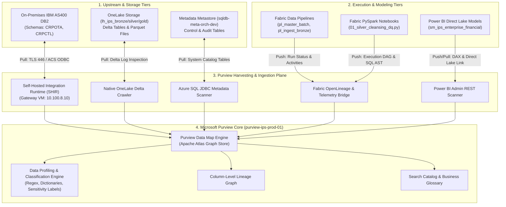
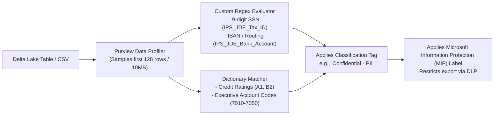
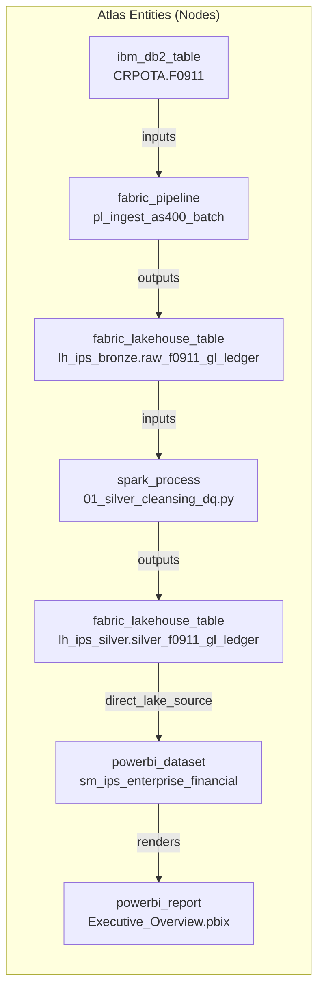

# Microsoft Purview Metadata Capture & Harvesting Architecture Guide

> **Project:** IPS Corporation Enterprise Data Modernization  
> **Platform:** Microsoft Purview Unified Data Governance, Microsoft Fabric OneLake, and IBM AS400 DB2  
> **Scope:** Deep-Dive Technical Mechanics: How Purview Captures, Scans, Extracts, and Stores Metadata  
> **Target Audience:** Lead Data Engineers, Enterprise Architects, Data Governance Stewards  
> **Release Date:** September 2026  
> **Status:** Approved Enterprise Architecture Standard  

---

## Executive Summary

In the **IPS Modernization Platform**, **Microsoft Purview** does not simply act as an external catalog; it functions as an automated metadata harvesting engine. It continuously discovers, extracts, classifies, and maps metadata across hybrid boundaries—from the on-premises **IBM AS400 (DB2)** mainframe, through the **Microsoft Fabric Medallion Lakehouses** and **Data Pipelines**, to downstream **Power BI Direct Lake Semantic Models**.

This document details **how Purview "catches" (captures, scans, and parses) technical, operational, business, and lineage metadata** across every layer of the enterprise data stack.

---

## 1. End-to-End Metadata Harvesting Architecture

Purview employs a **dual-engine harvesting strategy**:
1. **Pull-Based Scanners (Scheduled / Batch Extraction):** Purview actively reaches into storage systems and databases via specialized connectors (e.g., Self-Hosted Integration Runtime for AS400, native OneLake crawlers) to parse schemas, partition structures, and data dictionaries.
2. **Push-Based Telemetry (Reactive / Event-Driven):** Microsoft Fabric items (Pipelines, Spark Notebooks, Semantic Models) automatically broadcast execution events, DAG runs, and column transformations into Purview via native **OpenLineage** and Fabric system events.



---

## 2. Layer-by-Layer: How Metadata is Caught

---

### Layer 1: On-Premises Legacy IBM AS400 (DB2)

Because the AS400 is on a private corporate network (`10.242.2.25`), cloud services cannot access it directly. Purview bridges this gap using a **Self-Hosted Integration Runtime (SHIR)**.

```
[IBM AS400 DB2] ◄──(Port 446 / ACS ODBC)──► [SHIR on Gateway VM] ──► [Outbound TLS 443] ──► [Purview Data Map]
```

* **Agent Component:** Self-Hosted Integration Runtime installed on the On-Premises Gateway VM (`genie-fabric-prod-01: 10.100.8.10`).
* **Protocol & Driver:** IBM i Access Client Solutions (ACS) 64-bit ODBC driver (`cwbdsede.dll`) over secure Port 446.
* **Scan Frequency:** Scheduled weekly (Sunday at 01:00 AM UTC) to avoid mainframe CPU contention.

#### What Metadata is Caught from AS400:
1. **Schema & Hierarchy:** Catalogs, library names (`CRPOTA` = Transactional, `CRPCTL` = Control/UDC), table physical and logical files.
2. **Column Technical Attributes:**
   * Field names (e.g., `GLDOC`, `GLAA`, `GLDGJ`, `RPAAP`).
   * Mainframe native types (e.g., `CHAR(8)`, `NUMERIC(15,2)`, `PACKED DECIMAL`).
   * Field descriptions embedded in the AS400 system catalogs (`QSYS2.SYSCOLUMNS`).
   * Primary key constraints and unique index definitions (`QSYS2.SYSKEYCST`).
3. **Table Statistics:** Total row count, physical disk allocation, table modification timestamps.

---

### Layer 2: Microsoft Fabric OneLake Lakehouses (Bronze, Silver, Gold)

Purview integrates with **Microsoft Fabric OneLake** as a native SaaS service, eliminating the need for private network agents.

* **Harvesting Mechanism:** Purview OneLake Metadata Crawler via Microsoft Graph and OneLake Storage APIs.
* **Tenant Configuration:** Enabled via Fabric Admin Portal: *"Automatically scan OneLake items into Microsoft Purview"*.
* **Scan Frequency:** Continuous event notification combined with daily incremental reconciliation scans (03:00 AM UTC).

#### What Metadata is Caught from OneLake:
1. **Delta Lake Transaction Log (`_delta_log/`):**
   * Purview does **not** read every raw Parquet file across petabytes of storage. Instead, it parses the lightweight Delta transaction log commits (`_delta_log/0000000000000000000X.json`).
   * Extracts table versioning, commit timestamps, user principals, and operation types (`WRITE`, `MERGE`, `OPTIMIZE`).
2. **Schema Definition & Data Types:**
   * Exact Delta Lake schema: Column names, ANSI data types (`StringType`, `LongType`, `DateType`, `DoubleType`), nullability flags.
   * Delta partition columns (e.g., partitioned by fiscal year or company code).
   * Parquet storage layout: Compression codec (Snappy), file size distribution, and Fabric **V-Order** optimization flags.
3. **Operational Audit Columns:**
   * Injected framework audit fields: `_ingestion_timestamp`, `_source_file_name`, `_source_file_path`, `_source_checksum`, `_batch_id`, `_record_hash`.
4. **Lakehouse Endpoints:**
   * Resolves the dual access paths: the Lakehouse **Files/Tables directory URL** and the corresponding **SQL Analytics Endpoint connection string**.

---

### Layer 3: Fabric Data Pipelines & PySpark Notebooks (Orchestration & Logic)

To capture **data lineage** (how data moves from A to B), Purview uses the industry-standard **OpenLineage specification** embedded directly inside Fabric engines.

```
[Spark Execution Engine] ──► [OpenLineage Listener] ──► [Fabric Lineage Event] ──► [Purview Atlas Graph]
```

* **Harvesting Mechanism:** Native Fabric OpenLineage Event Dispatcher.
* **Scan Frequency:** **Real-time / Event-driven**. Whenever a pipeline or notebook run finishes, telemetry is pushed immediately to Purview.

#### What Metadata is Caught from Orchestration:
1. **Pipeline Execution Telemetry:**
   * Pipeline ID, Run ID (`@pipeline().RunId`), pipeline name (`pl_ingest_bronze_flat_files`, `pl_master_batch_orchestrator`).
   * Activity execution DAG: Which activity succeeded, failed, or was skipped.
   * Runtime parameters injected: `TriggeredFileName`, `group_code`, watermark timestamps.
2. **PySpark Abstract Syntax Tree (AST) Parsing:**
   * Fabric’s Spark query planner automatically extracts input datasets, output tables, and transformations.
   * **Column-Level Transformation Expressions:**
     ```python
     # Example from 01_silver_cleansing_dq.py:
     (col("GLAA").cast("double") / 100.0).alias("amount_domestic")
     ```
     Purview parses this expression and registers that column `lh_ips_silver.silver_f0911_gl_ledger.amount_domestic` is derived from `lh_ips_bronze.raw_f0911_gl_ledger.GLAA` with mathematical transformation `DivideBy100`.

---

### Layer 4: Power BI Direct Lake Semantic Models & Reports

Power BI is deeply integrated into Purview, allowing automated capture from reporting layers down to the visual level.

* **Harvesting Mechanism:** Power BI Admin REST APIs (Scanner APIs) and Fabric native semantic catalog bridge.
* **Scan Frequency:** Automatically registered upon semantic model publishing or schema refresh.

#### What Metadata is Caught from Power BI:
1. **Semantic Model Structure:**
   * Model name (e.g., `sm_ips_enterprise_financial`), workspace location, workspace licensing tier (Fabric F32 Capacity).
   * Tables, columns, hierarchies, and relationship cardinality (1:Many, cross-filter direction).
2. **DAX Measure Logic & Formulas:**
   * Captures the exact DAX code:
     ```dax
     [Total Domestic Revenue] = -CALCULATE(SUM(Fact_GeneralLedger[AmountDomestic]), Dim_Account[AccountType] == "Revenue")
     ```
   * Display folders, formatting strings (`$#,##0.00`), and measure descriptions.
3. **Storage Mode:**
   * Detects whether the table is running in **Direct Lake Mode** (zero-copy VertiPaq mapping) or has fallen back to **DirectQuery**.
4. **Report & Dashboard Visual Bindings:**
   * Downstream Power BI reports (`.pbix`), report pages, and individual visual cards (e.g., *"Executive Revenue KPI Tile"* bound to measure `[Total Domestic Revenue]`).

---

### Layer 5: Metadata Framework Metastore (`sqldb-meta-orch-dev`)

The project's centralized configuration and logging database is scanned via the **Azure SQL Database Connector**.

* **Harvesting Mechanism:** JDBC metadata crawler using Managed Identity authentication.
* **Scan Frequency:** Daily at 02:00 AM UTC.

#### What Metadata is Caught from the Metastore:
1. **Static Pipeline Configurations:** Authoritative mappings in `meta.dataset_schema`, `meta.dataset_src_to_brnz`, and `meta.dataquality_rule`.
2. **Operational Log History:** Ingests execution stats from `log.pipeline_run` and `log.dataset_run` (rows read, rows written, failure traces).
3. **Data Quality Scorecard Inputs:** Reads `failed_record_count` from `log.dq_rule_run` to feed Purview’s Data Quality Scorecards.

---

## 3. How Purview "Catches" Sensitive Data (Content Inspection & Profiling)

In addition to structural metadata (schemas), Purview performs **Content Inspection** to identify sensitive information:



### Sampling Mechanics:
* **Zero Performance Impact:** Purview does **not** read entire billions-of-rows tables.
* It uses an intelligent sampler: reads the **top 128 rows** (or up to 10 MB) of the active partition.
* It evaluates column values against custom and system classification rules:

| Column Target | Pattern Evaluated | Classification Applied | Action |
| :--- | :--- | :--- | :--- |
| `ABTAX`, `AIAN8` | `^\d{3}-\d{2}-\d{4}$` or 9 digits | **`IPS_JDE_Tax_ID` (PII)** | Restricts read access to authorized HR/Tax roles. |
| `CBNUMB`, `CBBK` | International Bank Account / ABA routing | **`IPS_JDE_Bank_Account`** | Masks data in SQL endpoint queries. |
| `AICRCA`, `AICRAL`| Credit limits and risk codes (`A1`, `B2`) | **`IPS_Customer_Credit_Rating`** | DLP blocks unencrypted Excel export from Power BI. |

---

## 4. Under the Hood: Apache Atlas Graph Model

Purview stores all captured metadata in a unified graph database powered by **Apache Atlas**. In this graph:
* **Entities** represent physical and logical assets (tables, columns, pipelines, models).
* **Edges / Relationships** represent lineage, dependencies, and containment.



### Atlas Entity Types Used in This Project:
* `ibm_db2_table`: Legacy AS400 tables.
* `fabric_lakehouse`: Bronze, Silver, Gold Lakehouses.
* `fabric_delta_table`: Tables inside Lakehouses.
* `fabric_data_pipeline`: Orchestration pipelines (`pl_*`).
* `spark_process`: Fabric PySpark Notebooks.
* `powerbi_dataset`: Direct Lake Semantic Models.
* `powerbi_measure`: Individual DAX measures.
* `powerbi_report`: Published Power BI reports.

---

## 5. Summary Table: Metadata Capture Matrix

| Asset / Layer | Capture Mechanism | Scan Type | Frequency | Extracted Metadata Details |
| :--- | :--- | :--- | :--- | :--- |
| **IBM AS400 DB2** | Self-Hosted IR (SHIR) via IBM ACS ODBC (Port 446) | Pull (Scan) | Weekly (Sun 01:00 UTC) | Library/Schema, Table name, Columns, Mainframe types (`NUMERIC`, `PACKED`), descriptions, primary keys. |
| **OneLake (Bronze/Silver/Gold)** | Native OneLake Crawler (Graph API / Storage REST) | Pull (Scan) | Daily (03:00 UTC) + Continuous Event | Delta log commits, ANSI data types, partitions, V-Order status, file size, audit columns (`_batch_id`, etc.). |
| **Data Pipelines** | Fabric OpenLineage Telemetry Bridge | Push (Event) | Real-Time (on run end) | Pipeline ID, Run ID, Activity DAG, execution status, runtime parameter values. |
| **PySpark Notebooks** | Spark AST Query Planner Hook | Push (Event) | Real-Time (on job finish) | Input/Output tables, row count deltas, column-level transformation expressions (`GLAA / 100.0`). |
| **Power BI Direct Lake** | Power BI Scanner APIs | Push/Pull | On publish / Schema sync | Tables, relationships, DAX formulas, formatting, display folders, Direct Lake vs DirectQuery status. |
| **Content / Data Rows** | Purview Sampling Engine (128 rows / 10MB) | Pull (Profile)| During scheduled scans | PII detection (SSN, Tax ID), Banking data, Credit limits, MIP sensitivity classification tags. |

---

## 6. How to Verify Caught Metadata in Purview Studio

Data Engineers and Stewards can verify metadata capture using the following steps:

1. **Verify Asset Discovery:**
   * Open **Microsoft Purview Studio** (`web.purview.azure.com`).
   * In the top search bar, enter `raw_f0911_gl_ledger` or `silver_f0911_gl_ledger`.
   * Verify that the asset appears with the **Microsoft Fabric Lakehouse** badge and the correct schema data types.
2. **Verify End-to-End Lineage:**
   * Open asset `lh_ips_gold.Fact_GeneralLedger` $\rightarrow$ select the **Lineage** tab.
   * Confirm the graph connects back through Silver, Bronze, and the AS400 source table `CRPOTA.F0911`.
   * Switch the toggle from **Asset lineage** to **Column lineage** and click `AmountDomestic`. Confirm the transformation path links back to `F0911.GLAA`.
3. **Verify Business Glossary Linkage:**
   * Open `F0911` $\rightarrow$ select **Schema**.
   * Confirm column `GLDOC` has the glossary tag **Document Number** and `GLDGJ` has **GL Julian Date**.
4. **Verify Sensitivity Tags:**
   * Inspect column `ABTAX` in `lh_ips_silver.silver_f0101_address_book`.
   * Confirm that the classification badge `IPS_JDE_Tax_ID` and the MIP sensitivity label `Confidential - PII` are automatically applied.
