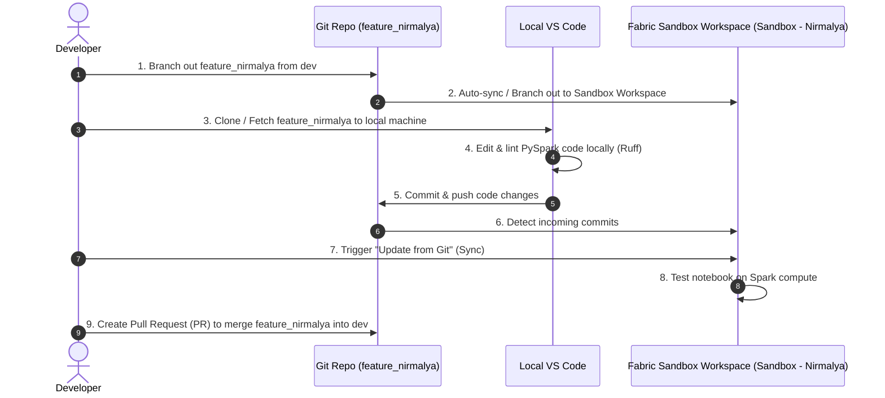

# Microsoft Fabric PySpark Development in VS Code: Guidelines & Best Practices

A comprehensive engineering guide for establishing a robust, code-first development workflow for PySpark notebooks in Microsoft Fabric using **Visual Studio Code**, **personal sandbox workspaces**, **Git branch-out workflows**, and **automated linting/formatting with Ruff**.

---

## Table of Contents
1. [Overview & Motivation](#1-overview--motivation)
2. [Architecture & Git Branch-Out Workflow](#2-architecture--git-branch-out-workflow)
3. [Detailed Developer Walkthrough (Step-by-Step)](#3-detailed-developer-walkthrough-step-by-step)
   - [Step 1: Set Up Local Git Workspace in VS Code](#step-1-set-up-local-git-workspace-in-vs-code)
   - [Step 2: Locate and Edit Notebooks Locally](#step-2-locate-and-edit-notebooks-locally)
   - [Step 3: Local Linting & Formatting (Automated)](#step-3-local-linting--formatting-automated)
   - [Step 4: Run and Test the Code (Two Execution Loops)](#step-4-run-and-test-the-code-two-execution-loops)
   - [Step 5: Finalize and Open a Pull Request](#step-5-finalize-and-open-a-pull-request)
4. [Recommended VS Code Extensions](#4-recommended-vs-code-extensions)
5. [Configuring Linters & Formatters (Ruff & pyproject.toml)](#5-configuring-linters--formatters-ruff--pyprojecttoml)
6. [VS Code Workspace Settings (.vscode/settings.json)](#6-vs-code-workspace-settings-vscodesettingsjson)
7. [Enterprise Best Practices for Fabric PySpark Development](#7-enterprise-best-practices-for-fabric-pyspark-development)
   - [A. Keep Notebooks Thin (Modular Architecture)](#a-keep-notebooks-thin-modular-architecture)
   - [B. Handling Fabric Implicits (spark, mssparkutils, display)](#b-handling-fabric-implicits-spark-mssparkutils-display)

---

## 1. Overview & Motivation

Developing PySpark data transformation pipelines directly in web browser notebooks can impede developer productivity, collaboration, and code quality. Key pain points include:
* **Concurrency Conflicts**: Multiple engineers editing shared notebooks in a single workspace overwrite each other's changes.
* **Limited IDE Capabilities**: Web-based editors lack robust refactoring, auto-formatting, static type checking, and unit testing tooling.
* **Release Governance**: Without strict Git integration, tracking changes, conducting code reviews, and enforcing CI/CD gates is difficult.

**The Solution:**
Pair Microsoft Fabric's native **Git Integration (Branch-Out feature)** with a code-first local **VS Code** environment, dedicated **Developer Sandbox Workspaces**, and automated linting via **Ruff**.

---

## 2. Architecture & Git Branch-Out Workflow

Microsoft Fabric supports bidirectional synchronization with Azure DevOps Git and GitHub repositories. In an enterprise team structure, developers work in isolated **Personal Sandbox Workspaces** mapped to their personal feature branches. This prevents workspace collisions while maintaining a single shared source of truth (`dev` branch).




---

## 3. Detailed Developer Walkthrough (Step-by-Step)

### Scenario Setup
* **Base Branch (Single Source of Truth)**: `dev`
* **Feature Branch**: `feature_nirmalya` (created from `dev`)
* **Personal Sandbox Workspace**: `Sandbox - Nirmalya` (connected to `feature_nirmalya`)
* **Selected Work**: 2 specific notebooks synced from `feature_nirmalya` into `Sandbox - Nirmalya` (`Notebook_A` and `Notebook_B`).

---

### Step 1: Set Up Local Git Workspace in VS Code
After creating the feature branch `feature_nirmalya` and linking it to your Fabric sandbox workspace, pull the latest branch down to your local machine:

1. Open VS Code in your local repository root.
2. Fetch remote updates and checkout your branch:

```bash
git fetch origin
git checkout feature_nirmalya
```

*(If cloning the repository for the first time:)*
```bash
git clone <repo-url>
cd <repo-folder>
git checkout feature_nirmalya
```

---

### Step 2: Locate and Edit Notebooks Locally
In Microsoft Fabric's Git repository structure, notebooks are represented as directories with the suffix `.Notebook/` containing a `notebook-content.py` file and metadata files:

```
├── my-fabric-repo/
│   ├── Notebook_A.Notebook/
│   │   ├── .platform
│   │   └── notebook-content.py
│   ├── Notebook_B.Notebook/
│   │   ├── .platform
│   │   └── notebook-content.py
```

1. In the VS Code file explorer, locate the target notebook folders:
   * `Notebook_A.Notebook/notebook-content.py`
   * `Notebook_B.Notebook/notebook-content.py`
2. Open `notebook-content.py` to start editing.

> [!NOTE]
> VS Code recognizes the `# CELL ********************` markers as cell divisions, allowing you to edit the file as an interactive script with full code folding and block navigation.

---

### Step 3: Local Linting & Formatting (Automated)
As you write your PySpark code:
1. The **Ruff extension** runs continuously in the background.
2. Every time you save (`Ctrl + S` / `Cmd + S`), Ruff automatically formats your code, sorts your imports via `isort`, and highlights syntax or runtime linting errors based on our `pyproject.toml` configuration.
3. Because `reportUndefinedVariable` is configured to `none` for notebook files, local warnings won't clutter your editor for Fabric runtime implicits like `spark` or `mssparkutils`.

---

### Step 4: Run and Test the Code (Two Execution Loops)


You have two methods to test PySpark code changes before submitting a Pull Request:

#### Method A: Remote Execution via VS Code (Recommended — Fast Loop)
This method allows executing notebook cells directly from VS Code on Fabric sandbox Spark compute without committing code first.
1. Open the **Microsoft Fabric** extension tab in VS Code.
2. Sign in to your Fabric account and select your personal sandbox workspace: `Sandbox - Nirmalya`.
3. Open your notebook in VS Code and click **Run Cell** or **Run All** on the interactive editor.
4. VS Code connects to your sandbox Spark cluster, executes the cell, and displays dataframes, charts, and execution logs directly inside VS Code.

#### Method B: Syncing via Fabric UI (Standard Loop)
If you prefer running and visualizing results directly inside the Fabric web portal:
1. Save your changes locally, then stage, commit, and push them to Git:

```bash
git add .
git commit -m "feat: updated data transformation logic in notebook A"
git push origin feature_nirmalya
```

2. Open the Fabric UI in your web browser and navigate to `Sandbox - Nirmalya`.
3. Click the **Source Control** button in the top navigation bar. You will see a notification indicating the workspace is out of sync due to incoming commits.
4. Click **Update** (or **Sync**). Fabric will pull the changes you pushed from VS Code.
5. Open the notebook in the Fabric UI and run the cells interactively.

---

### Step 5: Finalize and Open a Pull Request
1. Once testing in the sandbox workspace succeeds, ensure your local changes are fully committed and pushed:

```bash
git push origin feature_nirmalya
```

2. In the Fabric UI sandbox workspace, verify that the **Source Control** status displays a green checkmark (fully synchronized).
3. Open GitHub or Azure DevOps and submit a **Pull Request (PR)** from `feature_nirmalya` into the target `dev` branch.
4. The CI/CD validation pipeline automatically runs Ruff checks, type validation, and unit tests to enforce code quality before merge approval.

---

## 4. Recommended VS Code Extensions

To establish a rich development experience for Python and PySpark in Microsoft Fabric, install the following extensions from the VS Code Marketplace:

| Extension Name | Publisher | Identifier | Purpose |
| :--- | :--- | :--- | :--- |
| **Python** | Microsoft | `ms-python.python` | Provides core Python language support (IntelliSense, debugging, code navigation, virtual environments). |
| **Pylance** | Microsoft | `ms-python.vscode-pylance` | High-performance language server offering type checking, parameter hints, and automatic import completion. |
| **Jupyter** | Microsoft | `ms-toolsai.jupyter` | Provides interactive notebook editing and cell execution capabilities directly inside VS Code. |
| **Microsoft Fabric (Data Engineering)** | Microsoft | `ms-fabric.fabric-vscode` | Connects directly to Fabric workspaces, explores OneLake Lakehouses, and executes PySpark cells on remote Fabric Spark pools. |
| **Ruff** | Astral Software | `charliermarsh.ruff` | Ultra-fast Python linter and formatter, replacing Flake8, Black, isort, and bandit. |

---

## 5. Configuring Linters & Formatters (Ruff & pyproject.toml)

Ruff is recommended because it is written in Rust, operates up to 100x faster than traditional Python tools, natively supports Jupyter notebooks, and replaces multiple disparate linters.

Add or update the following configuration in the root `pyproject.toml` file:

```toml
[tool.ruff]
target-version = "py310"
line-length = 120

[tool.ruff.lint]
select = [
    "E",      # pycodestyle errors
    "W",      # pycodestyle warnings
    "F",      # Pyflakes (syntax & logic errors)
    "I",      # isort (clean, alphabetical import sorting)
    "N",      # pep8-naming
    "B",      # flake8-bugbear (common bug patterns)
    "PL",     # Pylint rules
]
ignore = [
    "E402",   # Ignore 'Module level import not at top of file' (common in interactive notebooks)
    "PLR0913",# Ignore 'Too many arguments' (often required in complex Spark transformation functions)
    "F401",   # Ignore 'Unused import'
]
exclude = [
    ".git",
    "node_modules",
    ".venv",
    "venv",
    "fs-settings.json",
    "notebook-settings.json",
    ".platform"
]

[tool.ruff.lint.per-file-ignores]
# Silence undefined variable warnings for Fabric runtime objects in notebook content
"notebook-content.py" = ["E402", "F821"]
```

---

## 6. VS Code Workspace Settings (.vscode/settings.json)


Configure automated formatting, import organization, and Pylance diagnostics on file save by creating or updating `.vscode/settings.json`:

```json
{
    "python.languageServer": "Pylance",
    "python.analysis.typeCheckingMode": "basic",
    "python.analysis.diagnosticSeverityOverrides": {
        "reportUndefinedVariable": "none"
    },
    "[python]": {
        "editor.defaultFormatter": "charliermarsh.ruff",
        "editor.formatOnSave": true,
        "editor.codeActionsOnSave": {
            "source.organizeImports": "always",
            "source.fixAll": "always"
        }
    },
    "ruff.organizeImports": true,
    "ruff.fixAll": true
}
```

---

## 7. Enterprise Best Practices for Fabric PySpark Development

### A. Keep Notebooks Thin (Modular Architecture)

> [!IMPORTANT]
> **Keep Notebooks Thin:** Refactor core business logic, complex data transformations, and utility functions out of notebook cells into standard `.py` module files under a dedicated folder (e.g., `src/utils` or `src/shared`).

```
Fabric/
├── src/
│   ├── transformations/
│   │   ├── cleansing.py        <-- Pure Python/PySpark functions (Tested via pytest)
│   │   └── currency_converter.py
│   └── utils/
│       └── fabric_helpers.py
├── tests/
│   ├── test_cleansing.py       <-- Automated unit tests
│   └── test_converter.py
└── notebooks/
    └── 01_silver_cleansing_dq.Notebook/
        └── notebook-content.py <-- Thin orchestration layer (imports from src)
```

**Benefits:**
1. **Unit Testing**: You can write deterministic unit tests with `pytest` and mock data frames without spinning up Fabric Spark clusters.
2. **Reusability**: Shared cleansing and dimension-lookup routines are written once and imported across Bronze, Silver, and Gold pipelines.
3. **Clean Code Reviews**: Diffs on pure Python files are easy to read in PRs, unlike monolithic notebook JSON/py dumps.

---

### B. Handling Fabric Implicits (`spark`, `mssparkutils`, `display`)

At runtime in the Fabric cloud, the Spark engine injects global context variables:
* `spark`: The active `SparkSession`
* `mssparkutils`: Microsoft Spark Utilities (credentials, notebook parameter passing, file system commands)
* `display`: HTML rendering helper for dataframes

In local VS Code, static analysis tools (Pylance/Ruff) flag these objects as undefined (`F821: undefined name 'spark'`).

#### Solution: Safe Local Fallback Block
Place this fallback pattern at the top of shared scripts or notebook headers:

```python
# ==============================================================================
# Local Autocompletion & Linting Fallback Block
# ==============================================================================
try:
    from pyspark.sql import SparkSession

    # Active or mock session for local VS Code IntelliSense
    spark = SparkSession.builder.appName("LocalFabricDev").getOrCreate()
except ImportError:
    pass

# Ensure linters understand mssparkutils when executing locally
try:
    import notebookutils as mssparkutils  # Local mock or fabric package if available
except ImportError:
    pass
```

With this pattern, code runs seamlessly both inside Microsoft Fabric compute nodes and locally under standard Python linters and test suites.
