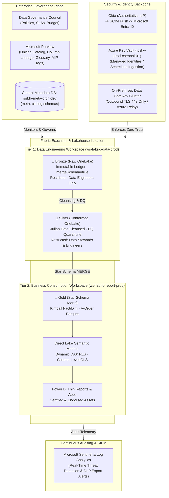
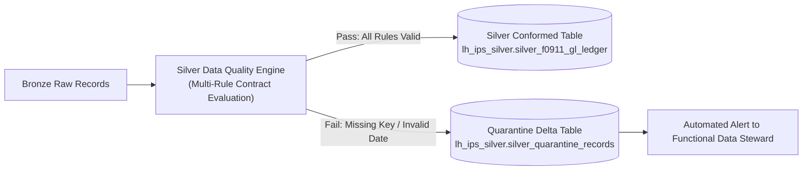

# Microsoft Fabric — Comprehensive Security & Governance Guide

> **Project:** IPS Corporation Enterprise Data Modernization  
> **Target Platform:** Microsoft Fabric (OneLake, Delta Lake, Data Factory), Azure Security Backbone, Power BI Direct Lake & Microsoft Purview  
> **Source Systems:** On-Premises IBM AS400 DB2 (JD Edwards EnterpriseOne ERP) & Enterprise Cloud Systems  
> **Document Location:** `docs/additional_docs/Fabric_Security_and_Governance_Comprehensive_Guide.md`  
> **Status:** Approved Enterprise Architecture Standard & Operational Runbook  
> **Version:** 1.0 (September 2026)  

---

## 📋 Table of Contents
1. [Executive Summary & Core Philosophy](#1-executive-summary--core-philosophy)
2. [Unified Security & Governance Architecture Blueprint](#2-unified-security--governance-architecture-blueprint)
3. [Part I: How Security is Applied (6-Layer Defense-in-Depth)](#3-part-i-how-security-is-applied-6-layer-defense-in-depth)
   - [Layer 1: Identity & Access Management (Okta $\rightarrow$ Entra ID)](#layer-1-identity--access-management-okta--entra-id)
   - [Layer 2: Network Perimeter & Hybrid Connectivity Security](#layer-2-network-perimeter--hybrid-connectivity-security)
   - [Layer 3: Cryptography, Secrets & Key Management](#layer-3-cryptography-secrets--key-management)
   - [Layer 4: Storage & Workspace Tier Isolation (Shielding Bronze & Silver)](#layer-4-storage--workspace-tier-isolation-shielding-bronze--silver)
   - [Layer 5: Semantic Layer Security (Direct Lake RLS & OLS)](#layer-5-semantic-layer-security-direct-lake-rls--ols)
   - [Layer 6: Continuous Auditing, SIEM & Data Loss Prevention (DLP)](#layer-6-continuous-auditing-siem--data-loss-prevention-dlp)
4. [Part II: How Governance is Applied (The 5 Enterprise Pillars)](#4-part-ii-how-governance-is-applied-the-5-enterprise-pillars)
   - [Pillar 1: Metadata-Driven Control Plane (`sqldb-meta-orch-dev`)](#pillar-1-metadata-driven-control-plane-sqldb-meta-orch-dev)
   - [Pillar 2: Automated Data Quality (DQ) & Quarantine Architecture](#pillar-2-automated-data-quality-dq--quarantine-architecture)
   - [Pillar 3: End-to-End Field-Level Lineage with Microsoft Purview](#pillar-3-end-to-end-field-level-lineage-with-microsoft-purview)
   - [Pillar 4: Enterprise Business Glossary & Asset Certification](#pillar-4-enterprise-business-glossary--asset-certification)
   - [Pillar 5: Capacity FinOps & Workspace Sprawl Management](#pillar-5-capacity-finops--workspace-sprawl-management)
5. [Governance Operating Model & RACI Responsibility Matrix](#5-governance-operating-model--raci-responsibility-matrix)
6. [Engineer Runbook: Day-to-Day Compliance Checklist](#6-engineer-runbook-day-to-day-compliance-checklist)

---

## 1. Executive Summary & Core Philosophy

Security and governance in the **IPS Modernization Platform** are not retrofitted administrative checks; they are **active, code-enforced architectural guardrails** embedded directly into every pipeline, Lakehouse, and semantic model from Day 1.

The platform unifies two foundational enterprise tenets:
1. **Zero Trust Security Architecture (NIST SP 800-207):** *"Never Trust, Always Verify"*. Every interaction—whether from an ETL pipeline, a developer notebook, an executive dashboard, or a cloud service principal—must be explicitly authenticated, strictly authorized under least privilege, and continuously audited.
2. **Active Data Governance:** Moving beyond static documentation to **automated policy enforcement**—driving ingestion through metadata, isolating corrupt records via quarantine tables, tracking field-level lineage, and enforcing business glossary definitions across all reports.

---

## 2. Unified Security & Governance Architecture Blueprint



---

## 3. Part I: How Security is Applied (6-Layer Defense-in-Depth)

---

### Layer 1: Identity & Access Management (Okta $\rightarrow$ Entra ID)

1. **Federated Identity Synchronization:**
   * **Okta** is the authoritative master identity provider for employee onboarding, role transitions, and terminations.
   * Automated **SCIM 2.0 Group Push** synchronizes enterprise security groups into **Microsoft Entra ID** in near real-time.
2. **Role-Based Access Control (RBAC) via Dedicated Security Groups:**
   No individual user is ever granted direct permissions on workspaces or Lakehouses. Access is mediated exclusively through Entra ID Security Groups:

| Entra ID Security Group | Fabric Workspace Role | Scope of Access & Justification |
| :--- | :--- | :--- |
| **`SG-Fabric-Admins`** | **Admin** | Restricted to Lead Data Architects. Full management of capacity, tenant settings, and CI/CD git connections. |
| **`SG-Fabric-Developers`** | **Contributor** | Data Engineers. Write access in `ws-fabric-data-dev` for notebooks, pipelines, and schema development. |
| **`SG-Fabric-LH-Bronze-Uploader`** | **Viewer** + OneLake Role | Business users who upload ad-hoc CSV/Excel files. Scoped strictly to path: `/Files/FlatFile_Repo/`. |
| **`SG-PBI-FinanceStewards`** | **Viewer** (Data) / **Member** (Report) | Financial Data Stewards. Read access to `lh_ips_silver` to inspect quarantine tables and validate business logic. |
| **`SG-PBI-ExecutiveConsumers`** | **Viewer** | Executive leadership. Read-only access to published Power BI Apps and Gold Direct Lake models. Zero Lakehouse access. |

3. **Secretless Pipeline Automation (Service Principals & Managed Identities):**
   * All unattended orchestrations (`pl_master_batch_orchestrator`, Fivetran CDC ingestion) authenticate using an Azure Entra ID Service Principal (`Fivetran-Fabric-Destination-SP`) or Fabric Workspace Managed Identity.
   * No developer personal accounts or plain-text passwords exist in any pipeline definition or notebook.

---

### Layer 2: Network Perimeter & Hybrid Connectivity Security

The platform connects to the on-premises IBM AS400 DB2 mainframe across a private enterprise network without exposing public endpoints.

```
[On-Prem AS400 DB2] ◄──(Port 446 / ACS ODBC)──► [OPDG Gateway VM] ──► [Outbound TLS 443 via Azure Relay] ──► [Fabric OneLake]
```

1. **Zero Inbound Ports on Corporate Datacenter:**
   * The **On-Premises Data Gateway (OPDG)** cluster (`gwips-fabric-prod-01`) communicates with Microsoft Fabric exclusively via **outbound TLS 443 connections** over Azure Service Bus Relay.
   * Inbound firewall ports into the on-premises datacenter are completely closed to cloud IPs.
2. **On-Premises Internal Segmentation:**
   * The Gateway VM is isolated in a secured management subnet (`10.100.8.0/24`).
   * Internal firewall rules strictly limit traffic between the Gateway VM and the AS400 host (`10.242.2.25`) to essential DB2 data ports: `446` (DRDA), `449` (Server Mapper), and `8471` (Database Server).
3. **OneLake Private Link & Managed VNet:**
   * Fabric compute engines (PySpark Spark pools) execute inside an Azure Managed Virtual Network with Private Endpoints, eliminating public internet egress.

---

### Layer 3: Cryptography, Secrets & Key Management

1. **Encryption Standards:**
   * **Data-in-Transit:** Enforced **TLS 1.3** (minimum TLS 1.2) across all connections—including ODBC gateway connections, OneLake REST APIs, and Power BI visual rendering.
   * **Data-at-Rest:** All OneLake Delta tables, Parquet files, and metadata repositories are encrypted using **AES-256** encryption with Azure Key Vault Customer-Managed Keys (CMK) and Microsoft platform keys.
2. **Azure Key Vault Architecture (`ipskv-prod-chennai-01`):**
   * AS400 database connection strings, Service Principal client secrets, and third-party API tokens are stored in Key Vault.
   * Fabric Data Pipelines retrieve secrets dynamically at runtime using Azure Key Vault Web Activities or Fabric Variable Libraries, ensuring secrets are **never hardcoded in PySpark scripts or committed to Git**.

---

### Layer 4: Storage & Workspace Tier Isolation (Shielding Bronze & Silver)

A core security vulnerability in poorly architected lakehouses is granting business analysts access to the raw lakehouse. In this project, raw data is physically separated:

```mermaid
flowchart LR
    subgraph DataEngineering ["Tier 1: Engineering Workspace (ws-fabric-data-prod)"]
        Bronze["lh_ips_bronze\n(Raw Immutable Data)"]
        Silver["lh_ips_silver\n(Cleansed / Quarantined)"]
    end

    subgraph Reporting ["Tier 2: Business Workspace (ws-fabric-report-prod)"]
        Gold["lh_ips_gold\n(Kimball Star Schemas)"]
        Semantic["Direct Lake Semantic Models"]
    end

    subgraph Users ["User Personas"]
        Engineers["Data Engineers"]
        Stewards["Data Stewards"]
        Analysts["Business Analysts & Executives"]
    end

    Engineers --> Bronze
    Engineers --> Silver
    Stewards --> Silver
    
    Analysts -.-x|BLOCKED (Zero Access)| Bronze
    Analysts -.-x|BLOCKED (Zero Access)| Silver
    Analysts --> Semantic
```

* **Tier 1 (Engineering Workspace):** Contains `lh_ips_bronze` and `lh_ips_silver`. Business users have **0% access** to this workspace, preventing accidental exposure of unmasked PII, un-reconciled GL rows, or raw payroll data.
* **Tier 2 (Reporting Workspace):** Houses `lh_ips_gold` and certified Direct Lake Semantic Models. Business users only query curated, Kimball-modeled, and masked data marts.
* **OneLake Folder-Level Data Access Roles:**
  * For flat-file uploaders (`SG-Fabric-LH-Bronze-Uploader`), access is restricted to `Files/FlatFile_Repo/` with Read/Write permissions, while `Tables/` and internal system folders remain completely blocked.

---

### Layer 5: Semantic Layer Security (Direct Lake RLS & OLS)

Security rules must be enforced at query time without degrading Power BI Direct Lake performance.

#### 1. Dynamic Row-Level Security (RLS) via DAX
Users only see the data corresponding to their assigned operating companies or cost centers:

```dax
// Applied on Security Bridge Table in Power BI Direct Lake Model
[UserEmail] = USERPRINCIPALNAME()
```
* **Filter Propagation:** The security bridge table filters the `Dim_Company` dimension, which cascades automatically down to `Fact_GeneralLedger` and `Fact_AR_Ledger` across Kimball relationships.
* **Direct Lake Fallback Prevention:** Security tables use simple 1:Many natural integer joins to ensure VertiPaq resolves the filter directly in memory, preventing queries from falling back to slow DirectQuery mode.

#### 2. Object-Level Security (OLS)
For sensitive financial measures or confidential columns (e.g., Executive Compensation, Bank Routing numbers, Customer Credit Ratings):
* OLS completely hides the column or measure from unauthorized roles.
* If a non-authorized user builds an ad-hoc report, the secured field does not appear in the field list, and existing visuals referencing it return a generic *"Field not found"* error rather than exposing metadata.

---

### Layer 6: Continuous Auditing, SIEM & Data Loss Prevention (DLP)

1. **Microsoft Purview Data Loss Prevention (DLP):**
   * Scans Direct Lake semantic models and OneLake files.
   * If an unencrypted export is attempted on a report containing columns classified as `IPS_Customer_Credit_Rating` or `IPS_JDE_Bank_Account`, Purview DLP intercepts the action and blocks the download to Excel.
2. **SIEM Integration (Microsoft Sentinel & Azure Log Analytics):**
   * Workspace diagnostic logs, capacity utilization events, and Key Vault access attempts are forwarded to `ips-law-southindia-01`.
   * Real-time Sentinel alert rules flag anomalous bulk downloads, off-hours administrative access, or failed service principal logins.

---

## 4. Part II: How Governance is Applied (The 5 Enterprise Pillars)

---

### Pillar 1: Metadata-Driven Control Plane (`sqldb-meta-orch-dev`)

Hardcoded pipelines are an anti-pattern. Governance requires that all ETL behavior be declaratively defined, version-controlled, and audited through an enterprise metadata metastore:

```
[Ingestion_metadata_load_template.xlsx] ──► [stage tables] ──► [meta tables] ──► [Fabric Dynamic DAG]
```

* **Authoritative Catalogs (`meta.*`):** Tables like `meta.dataset_src_to_brnz`, `meta.dataset_brnz_to_silver`, and `meta.dataquality_rule` define expected schemas, target tables, and schedules.
* **State Management (`ctl.*`):** Manages high watermarks (`ctl.watermark_state`) and operational locks (`ctl.dataset_state`) to guarantee deterministic incremental ingestion.
* **Execution Telemetry (`log.*`):** Every pipeline and notebook execution registers rows read, inserted, updated, and rejected in `log.pipeline_run` and `log.dataset_run`.

---

### Pillar 2: Automated Data Quality (DQ) & Quarantine Architecture

Data Governance is actively enforced in the **Silver Layer** ([`01_silver_cleansing_dq.py`](file:///Users/chandu/Documents/Python_practice/Fabric/src/notebooks/silver/01_silver_cleansing_dq.py)):



1. **In-Flight Validation Rules:**
   * **Rule 1 (Null Check):** Critical keys (`account_number`, `company_code`) must not be NULL or empty string.
   * **Rule 2 (Temporal Validity):** Dates must be valid and fall between fiscal boundaries (`2000-01-01` and `2030-12-31`).
   * **Rule 3 (Numeric Integrity):** Transaction amounts must not evaluate to NaN or null.
2. **The Quarantine Isolation Pattern:**
   * Records failing validation are **not dropped silently** and **do not abort the pipeline**.
   * Malformed records are tagged with an explicit failure reason (e.g., `QUARANTINE_NULL_ACCOUNT`, `QUARANTINE_INVALID_DATE`) and diverted into `lh_ips_silver.silver_quarantine_records`.
   * Clean records continue seamlessly into production Gold marts.
3. **Data Steward Remediation:** Functional data stewards review the quarantine log weekly and correct the originating transactional record in the AS400 ERP.

---

### Pillar 3: End-to-End Field-Level Lineage with Microsoft Purview

Data governance ensures that every visual tile on an executive report can be traced back to its raw accounting journal entry:

```
[AS400: F0911.GLAA (Unscaled Cents)]
       │
       ▼ (Fabric Pipeline: pl_ingest_as400_batch)
[Bronze: lh_ips_bronze.raw_f0911_gl_ledger]
       │
       ▼ (Spark AST: col("GLAA").cast("double") / 100.0)
[Silver: lh_ips_silver.silver_f0911_gl_ledger (amount_domestic)]
       │
       ▼ (Gold Star Mart MERGE on GLFactKey)
[Gold: lh_ips_gold.Fact_GeneralLedger (AmountDomestic)]
       │
       ▼ (Direct Lake DAX: -CALCULATE(SUM(AmountDomestic), ...))
[Semantic Model: Measure [Total Revenue]]
       │
       ▼ (Power BI Rendering)
[Executive Dashboard KPI Tile ($45,210,400)]
```

* **Proactive Impact Analysis:** Engineers open Purview’s **Impact Analysis** tab before modifying any notebook or table to inspect every downstream semantic model, DAX measure, and report that will be affected.

---

### Pillar 4: Enterprise Business Glossary & Asset Certification

1. **JDE AS400 Cryptic Code Decoder:**
   * The Purview Business Glossary provides official definitions for legacy 4-character column names:
     * `GLDOC` $\rightarrow$ **Document Number**
     * `GLDGJ` $\rightarrow$ **GL Julian Date**
     * `GLAA` $\rightarrow$ **Domestic Amount**
     * `RPAAP` $\rightarrow$ **Open AR Balance**
2. **Asset Endorsement Hierarchy:**
   * 🥇 **Certified (Gold Badge):** Curated Kimball Star Schemas and production Direct Lake semantic models approved by the Data Governance Council.
   * 🥈 **Promoted (Silver Badge):** Conformed Silver tables verified by Data Stewards.
   * 🥉 **Internal / Uncertified:** Raw Bronze tables, staging folders, and quarantine error tables.

---

### Pillar 5: Capacity FinOps & Workspace Sprawl Management

1. **Capacity Unit (CU) Allocation on F32 SKU:**
   * Fabric Capacity F32 provides 32 CUs/sec (115,200 CU-seconds/hour).
   * Background workloads (Pipelines, Spark notebooks, Fivetran commits) are smoothed over a **24-hour evaluation window**, preventing momentary bursts from throttling interactive Power BI users.
2. **Eliminating Polling Waste via EDAI:**
   * Using **Event-Driven Automated Ingestion (Real-Time Hub + Data Activator)** saves 144–288 CU-seconds/day by eliminating empty 15-minute polling runs on landing folders.
3. **Workspace Decommissioning Policy:**
   * Unused sandbox workspaces, stale semantic models, and orphaned shortcuts are automatically audited quarterly and purged after 30 days of inactivity.

---

## 5. Governance Operating Model & RACI Responsibility Matrix

| Governance & Security Activity | Data Governance Council | Domain Owners (Business) | Data Stewards (Functional) | Data Custodians (Engineers) | Report Consumers |
| :--- | :---: | :---: | :---: | :---: | :---: |
| **Security Policy & RBAC Approval** | **A** | C | I | **R** | I |
| **Key Vault & Secret Management** | I | I | I | **A / R** | I |
| **Data Quality Rule Definition** | C | **A** | **R** | C | I |
| **Quarantine Table Remediation** | I | **A** | **R** | C | I |
| **Business Glossary Definition Sign-Off** | C | **A** | **R** | C | I |
| **Direct Lake RLS / OLS Configuration** | C | **A** | C | **R** | I |
| **Pipeline & Metadata Framework Deployment** | I | I | I | **A / R** | I |
| **Capacity (F32) FinOps Monitoring** | **A** | I | I | **R** | I |

*Legend: **R** = Responsible for execution, **A** = Accountable / Sign-off, **C** = Consulted, **I** = Informed.*

---

## 6. Engineer Runbook: Day-to-Day Compliance Checklist

When adding a new table, pipeline, or report to the Fabric environment, engineers must satisfy the following checklist before promoting code to production:

- [ ] **Identity:** Have all workspace and lakehouse permissions been granted exclusively to Entra ID Security Groups (never personal user emails)?
- [ ] **Secrets:** Are all database connection strings and credentials retrieved dynamically from Azure Key Vault (`ipskv-prod-chennai-01`) or Fabric Variable Libraries?
- [ ] **Storage Permissiveness in Bronze:** Is the table ingested with `inferSchema = "false"` and `.option("mergeSchema", "true")` to provide a schema evolution cushion?
- [ ] **Data Cleansing in Silver:** Are trailing whitespaces trimmed, JDE Julian dates converted via `convert_julian_to_gregorian()`, and implied decimals divided by 100?
- [ ] **Data Quality Guardrails:** Are records validated against NULL keys and fiscal boundaries, with failures routed to `silver_quarantine_records`?
- [ ] **Direct Lake Optimization in Gold:** Is the table saved as a Kimball Fact/Dim with Fabric **V-Order** enabled (`spark.sql.parquet.vorder.enabled = true`)?
- [ ] **Lineage & Purview:** Has the table been scanned in Microsoft Purview, linked to the Business Glossary, and verified in the column-level lineage graph?
- [ ] **Row-Level Security:** If the table contains regional or entity-specific records, has dynamic DAX RLS (`USERPRINCIPALNAME()`) been configured and validated without causing Direct Lake fallback?
