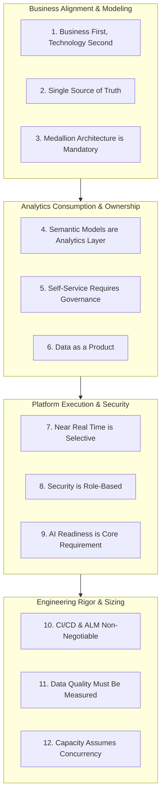
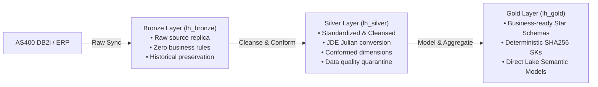
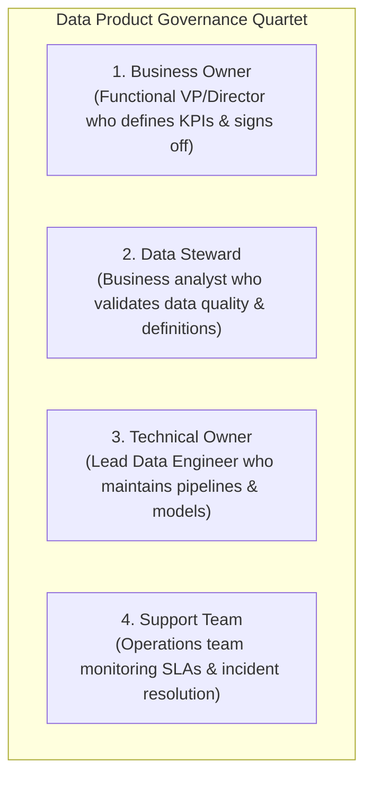

# Core Architecture Design Tenets & Governance Principles for IPS BI Modernization

> **Project:** IPS Corporation BI Modernization  
> **Topic:** Foundational Architectural Tenets, Single Source of Truth Enforcement, Mandatory Medallion Standards, and Fabric Governance Operating Model  
> **Target Platform:** Microsoft Fabric & Power BI Direct Lake Architecture  
> **Author:** IPS Data & Enterprise Architecture Team  
> **Date:** September 2026  
> **Status:** Approved Enterprise Architecture Charter  

---

## Executive Summary

The modernization of the **IPS Business Intelligence ecosystem** is governed by **12 Foundational Design Tenets**, **10 Executive-Level Fabric Principles**, and an active **Governance Operating Model**. 

In Microsoft Fabric, governance must be treated as a **foundational capability built in from Day 1**, rather than a post-go-live afterthought. A well-governed Fabric environment systematically delivers:
1. **A Single Source of Truth**: Eliminating conflicting metric definitions across business units.
2. **Trusted Self-Service Analytics**: Enabling business analysts without creating unmanaged report sprawl.
3. **Secure Access to Data**: Dynamic role-based security following enterprise business functions.
4. **Compliance & Auditability**: Traceable data lineage from source ERP to executive visual.
5. **AI-Ready Data Assets**: Establishing clean, discoverable semantics for Microsoft Fabric Copilot and Agentic AI.
6. **Controlled Platform Growth**: Predictable Capacity Unit (CU) consumption and FinOps cost optimization.

---

## Table of Contents
1. [The 12 Foundational Architectural Design Tenets](#1-the-12-foundational-architectural-design-tenets)
   - [Tenet 1: Business First, Technology Second](#tenet-1-business-first-technology-second)
   - [Tenet 2: Single Source of Truth](#tenet-2-single-source-of-truth)
   - [Tenet 3: Medallion Architecture is Mandatory](#tenet-3-medallion-architecture-is-mandatory)
   - [Tenet 4: Semantic Models are the Analytics Layer](#tenet-4-semantic-models-are-the-analytics-layer)
   - [Tenet 5: Self-Service Requires Governance](#tenet-5-self-service-requires-governance)
   - [Tenet 6: Data as a Product](#tenet-6-data-as-a-product)
   - [Tenet 7: Near Real Time is Selective](#tenet-7-near-real-time-is-selective)
   - [Tenet 8: Security is Role-Based](#tenet-8-security-is-role-based)
   - [Tenet 9: AI Readiness is a Core Requirement](#tenet-9-ai-readiness-is-a-core-requirement)
   - [Tenet 10: Dev/Test/Prod and CI/CD Are Non-Negotiable](#tenet-10-devtestprod-and-cicd-are-non-negotiable)
   - [Tenet 11: Data Quality Must Be Measured](#tenet-11-data-quality-must-be-measured)
   - [Tenet 12: Capacity Planning Must Assume Concurrency](#tenet-12-capacity-planning-must-assume-concurrency)
2. [The 10 Executive-Level Fabric Design Principles](#2-the-10-executive-level-fabric-design-principles)
3. [Fabric Governance Operating Model](#3-fabric-governance-operating-model)
   - [3.1 Establish Clear Data Ownership](#31-establish-clear-data-ownership)
   - [3.2 Govern Through Semantic Models](#32-govern-through-semantic-models)
   - [3.3 Implement Role-Based Security with Microsoft Entra ID](#33-implement-role-based-security-with-microsoft-entra-id)

---

## 1. The 12 Foundational Architectural Design Tenets



---

### Tenet 1: Business First, Technology Second


> **Design Tenet:** Business outcomes drive architecture decisions.

Technology exists solely to enable business agility, operational efficiency, and revenue realization. Architectural decisions—from ingestion sync frequencies to dimensional data models—must begin with the target business decision, not the underlying database technology.

* **Assumptions:**
  * Every dashboard maps to an operational business process (Order-to-Cash, Procure-to-Pay, Record-to-Report).
  * Every KPI has an agreed, documented business owner.
  * Definitions and calculation formulas are standardized *before* development begins.
  * Reports are designed for active decision support, not unstructured data exploration.

#### Concrete Example for IPS Corporation:
Data engineering must abstract the complexity of legacy ERP table structures away from business stakeholders:

| Legacy ERP / IT View (Hidden from Users) | Modernized Business View (What Users MUST See) |
| :--- | :--- |
| `Sales Order Detail` / `F4211` | **Revenue** (Recognized, Invoiced, Booked) |
| `Item Ledger` / `F4111` | **Gross Margin %** & **Price Realization** |
| Cryptic JDE Column Codes (`RPAG`, `RPAAP`, `GLAA`) | **OTIF** (On-Time, In-Full Delivery Performance) |
| Raw Julian Date Fields (`CYYDDD`) | **Inventory Turns** & **Days of Supply** |
| AS400 Journal CDC Tombstone Records | **DSO** (Days Sales Outstanding) & **Overdue AR** |

---

### Tenet 2: Single Source of Truth

> **Design Tenet:** One number should exist for one business concept.

Conflicting metric calculations across departments erode trust in executive analytics. Metric logic must be implemented once in certified data models and consumed everywhere.

* **Assumptions:**
  * **Revenue** is calculated once across all corporate entities.
  * **Gross margin** is calculated once using unified cost and pricing rules.
  * **Customer hierarchy** is standardized across all commercial divisions.
  * **Product hierarchy** is standardized across manufacturing, aftermarket, and product lines.

#### Implementation Enforcement:
* **Build calculation rules strictly in**:
  * **Fabric Gold Layer**: Conformed facts and dimension Delta tables.
  * **Direct Lake Semantic Models**: Centralized, certified DAX measures.
* **Calculation rules are strictly prohibited in**:
  * **Excel spreadsheets**: Desktop spreadsheets and manual VLOOKUP formulas are banned as calculation engines.
  * **Individual, fragmented Power BI reports**: Report authors must connect live to certified semantic models rather than creating custom visual-level logic.

---

### Tenet 3: Medallion Architecture is Mandatory

> **Design Tenet:** Separate raw data from business-ready data.

To balance high-speed near real-time ingestion with rigorous data quality and auditing, data processing is strictly partitioned across three Medallion tiers:



* **Bronze (`lh_bronze`)**: Raw source copy, zero business transformations, byte-level parity with source, append-only immutable history, audit tracking (`_ingested_at`, `_pipeline_run_id`).
* **Silver (`lh_silver`)**: Cleansed, standardized, JDE Julian date conversion (`CYYDDD`), trimmed whitespace, conformed dimensions, in-batch deduplication, data quality quarantine routing.
* **Gold (`lh_gold`)**: Business-ready Kimball dimensional star schemas, deterministic SHA256 surrogate keys, pre-aggregated marts, Direct Lake semantic consumption.

---

### Tenet 4: Semantic Models are the Analytics Layer


> **Design Tenet:** Users consume semantic models, not databases.

Business users and self-service report authors must never connect directly to SQL endpoints, Delta tables, or Lakehouse storage. They connect exclusively to certified **Direct Lake Semantic Models**.

* **Assumptions:**
  * Power BI connects to curated semantic models in Direct Lake mode (0-second caching delay).
  * Self-service analysts build custom reports exclusively from certified semantic models.
  * Business measures and calculation logic are centrally governed in DAX.
* **Enterprise Example**: A single certified **Sales Analytics Semantic Model** encapsulates:
  * Measures: `Revenue`, `Volume`, `Gross Margin`, `OTIF %`, `Price Realization`.
  * Dimensions: `Customer Hierarchy`, `Product Master`, `Sales Territory`, `Fiscal Calendar`.
  * *Result:* Hundreds of operational and executive reports reuse the same certified model with zero metric divergence.

---

### Tenet 5: Self-Service Requires Governance

> **Design Tenet:** Self-service does not mean unmanaged.

Democratizing data without governance creates chaos. To foster self-service without sacrificing reliability, Fabric implements strict certification controls.

* **Assumptions:**
  * Self-service authors build from **Certified Datasets only**.
  * A controlled workspace strategy isolates development from production consumption.
  * Data catalogs and business glossaries are published and searchable.
  * Formal KPI ownership is documented in the enterprise catalog.
* **Risk Without Governance:** If governance is omitted, multiple conflicting revenue numbers emerge, uncontrolled report proliferation explodes, and executive trust collapses rapidly.

---

### Tenet 6: Data as a Product

> **Design Tenet:** Each business subject area becomes a reusable data product.

Data is treated as a high-value internal product with clear consumer contracts, active maintenance, and lifecycle accountability.

#### Typical IPS Data Products:
| Business Domain | Core Metrics & Entities | Product Deliverables |
| :--- | :--- | :--- |
| **Sales** | Revenue, Orders, Backlog, OTIF Delivery | Certified semantic model, executive dashboard, Daily refresh SLA |
| **Pricing** | Price Realization, Rebates, Discounts, Margin Leakage | Margin waterfall model, customer discount matrix |
| **Inventory** | Inventory Turns, Aging Buckets, Stock Status, Availability | Working capital model, safety stock tracking |
| **Finance** | AR Aging, DSO, P&L Statements, Working Capital | Financial statement mart, cash flow forecasting |

Each data product must have: **(1) Business Owner**, **(2) Data Steward**, **(3) Timeliness SLA**, **(4) Data Quality Rules**, and **(5) Technical Documentation**.

---

### Tenet 7: Near Real Time is Selective


> **Design Tenet:** Not every dataset needs real-time processing.

Real-time data synchronization incurs compute overhead and architectural complexity. Latency requirements must be evaluated domain by domain:
* **Selective NRT (5–15 Minute SLA)**: Applied strictly to critical operational transaction ledgers (`F0911` General Ledger, `F03B11` AR Ledger, `F0411` AP Ledger) via Fivetran CDC.
* **Batch Ingestion (Daily / Twice Daily)**: Applied to master data, lookup codes, slowly changing dimensions, and non-volatile operational tables (`F0005` UDCs, `F0101` Address Book, `F0901` Chart of Accounts) via Fabric ODBC copy pipelines.

---

### Tenet 8: Security is Role-Based

> **Design Tenet:** Security follows business functions.

Data security aligns directly with organizational roles, commercial territories, and financial segregation requirements:
* **Assumptions:**
  * Finance professionals see corporate finance and GL data.
  * Regional sales teams see only territory-specific accounts and orders.
  * Corporate executives see enterprise-wide consolidated rollups.
* **Security Controls Applied:**
  * **Microsoft Entra ID Security Groups**: Driving all Fabric workspace and capacity RBAC.
  * **Row-Level Security (RLS)**: Enforced dynamically inside Direct Lake semantic models based on user principal names (`USERPRINCIPALNAME()`).
  * **Object-Level Security (OLS)**: Restricting sensitive cost, salary, and margin fields from unauthorized viewer roles.

---

### Tenet 9: AI Readiness is a Core Requirement

> **Design Tenet:** Everything built today should support AI tomorrow.

The modern data estate is engineered to serve as the unified context foundation for enterprise Artificial Intelligence:
* **Assumptions:** Data assets must be **Trusted**, **Governed**, **Well-Described**, and **Discoverable**.
* **Future Capabilities Enabled:**
  * **Microsoft Fabric Copilot**: Conversational DAX creation and automated dashboard authoring.
  * **Natural Language Querying**: Executive question-answering powered by certified semantic models.
  * **Agentic Analytics**: Autonomous AI agents analyzing daily inventory turns and flagging margin leakage.
  * **Predictive Forecasting & Supply Chain Optimization**.

---

### Tenet 10: Dev/Test/Prod and CI/CD Are Non-Negotiable


> **Design Tenet:** Fabric should be treated like a software platform.

Data pipelines, semantic models, and notebooks are software code. They must adhere to rigorous software engineering lifecycle standards:
* **Source Control**: Full Git integration with **GitHub** / Azure DevOps.
* **Pull Requests & Code Review**: Mandatory peer reviews and linting checks (Ruff for PySpark) prior to merging into `main`.
* **Release Pipelines**: Automated deployment via **Fabric Deployment Pipelines** across Dev (F32), UAT (F64), and Prod (F64).
* **Environment Isolation**: Complete separation of workspaces to prevent experimental development code from impacting live business operations.

---

### Tenet 11: Data Quality Must Be Measured

> **Design Tenet:** Users only trust what is measured.

Data trust cannot be assumed; it must be proven mathematically every day:
* **Assumptions:** Every Gold data product maintains:
  * **Completeness Score**: Validating zero missing foreign keys and mandatory business attributes.
  * **Accuracy Score**: Verifying balanced ledgers ($Debit - Credit = 0$) and hash checksums.
  * **Timeliness SLA**: Tracking watermark freshness against operational SLAs.
  * **Reconciliation Rules**: **Every Gold subject area must reconcile back to source AS400 JDE tables daily** before executive users consume the data.

---

### Tenet 12: Capacity Planning Must Assume Concurrency

> **Design Tenet:** Performance matters more than feature count.

A feature-rich report that takes 45 seconds to render will be abandoned by business executives. Capacity sizing must anticipate peak concurrency:
* **Assumptions:** Architecture must comfortably support:
  * **100+ concurrent enterprise users**.
  * Executive real-time dashboard interactions.
  * Scheduled morning batch refreshes running concurrently with ad-hoc analyst queries.
  * AI and Spark machine learning workloads.
* **Optimization Strategies:**
  * Universal adoption of **Power BI Direct Lake mode** (0-second caching lag, eliminating VertiPaq memory import limits).
  * Pre-aggregated summary marts in the Gold layer.
  * Workload isolation (Non-Prod F32 vs. Prod F64).

---

## 2. The 10 Executive-Level Fabric Design Principles

The 12 design tenets are operationalized through the **10 Executive Principles of the IPS BI Modernization Charter**:

| # | Executive Design Principle | Operational Meaning |
| :---: | :--- | :--- |
| **1** | **OneLake is the Single Enterprise Data Platform** | All enterprise structured, semi-structured, and streaming data converges into OneLake, eliminating data silos. |
| **2** | **Gold Layer is the Authoritative Source for Reporting** | No external reporting tool is permitted to read raw Bronze or staging data; Gold is the certified corporate truth. |
| **3** | **Semantic Models are the Only Analytics Consumption Layer** | Business users consume governed DAX models; direct database querying is restricted to certified data engineers. |
| **4** | **Business KPIs are Defined Once and Reused Everywhere** | Core corporate measures (`Revenue`, `Gross Margin`, `DSO`) are authored once in certified semantic models. |
| **5** | **Data Products are Owned by Business Functions** | Functional business leaders (Sales, Finance, Supply Chain) co-own their respective data products alongside IT. |
| **6** | **Governance and Security are Built In from Day One** | Entra ID RBAC, RLS, OLS, and data classification are implemented during sprint development, not post-go-live. |
| **7** | **Real-Time Processing is Applied Only Where Business Value Exists** | Near real-time CDC (5–15 min) is reserved for high-volatility financial ledgers; batch is used elsewhere. |
| **8** | **AI-Ready Architecture is Required for All New Solutions** | All datasets must be semantic-ready, curated, and annotated to support Fabric Copilot and AI agents. |
| **9** | **All Fabric Assets Follow DevOps and CI/CD Processes** | Zero manual editing in Production. All workspace artifacts are deployed via Git source control and deployment pipelines. |
| **10** | **Self-Service Analytics Must Remain Governed and Certified** | Certified dataset badges and governed workspace templates prevent data duplication and shadow IT sprawl. |

---

## 3. Fabric Governance Operating Model


### 3.1 Establish Clear Data Ownership
To ensure accountability, every Gold-layer data product is assigned four clear roles:



---

### 3.2 Govern Through Semantic Models
Governance is maintained by controlling the analytics consumption layer:
* **What Business Users MUST Consume**:
  * Certified Direct Lake Semantic Models.
  * Centrally approved DAX KPIs.
  * Standardized enterprise hierarchies (Customer, Product, Territory, Fiscal Date).
* **What Business Users MUST NOT Connect To**:
  * Raw Lakehouse tables.
  * Bronze raw landing files.
  * Silver staging and intermediate transformation layers.

---

### 3.3 Implement Role-Based Security with Microsoft Entra ID
Security follows organizational business functions using dedicated Microsoft Entra ID security groups:

| Entra ID Security Group | Target Role | Permitted Workspace & Data Access |
| :--- | :--- | :--- |
| **`sg-fabric-admins`** | **Fabric Administrators** | Full tenant admin, capacity administration, gateway cluster management, and root audit logging. |
| **`sg-fabric-developers`** | **Data Engineers & BI Devs** | Admin/Member access in **Dev (F32)** workspace; Contributor access to pipelines, notebooks, and Git repos. |
| **`sg-fabric-report-authors`** | **Power BI Report Authors** | Build permissions on **Certified Semantic Models**; Member access in departmental reporting workspaces. |
| **`sg-fabric-business-consumers`**| **Enterprise End-Users** | **Viewer** access to published Power BI Apps and UAT/Prod workspaces; dynamic RLS applied automatically. |

---


### 3.4 Control Workspace Sprawl
Unrestricted workspace creation across a Fabric tenant causes administrative chaos, resource fragmentation, and security blind spots. Workspaces must be systematically structured by:
1. **Business Domain** (e.g., Finance, Sales, Inventory, Pricing).
2. **Functional Area** (e.g., Corporate Reporting vs. Departmental Analytics).
3. **Lifecycle Environment** (`Dev`, `Test/UAT`, `Prod`).

#### Enterprise Workspace Topology Example:
```text
├── Finance-Dev      (Capacity: F32 | Engineering & Unit Testing)
├── Finance-Test     (Capacity: F64 | UAT & Business Validation)
├── Finance-Prod     (Capacity: F64 | Certified Financial Reporting)
├── Sales-Dev        (Capacity: F32 | Commercial Engineering)
└── Sales-Prod       (Capacity: F64 | Certified Commercial Dashboards)
```

---

### 3.5 Enforce Data Lineage and Cataloging
Every data asset in OneLake must be indexed, searchable, and fully traceable:
* **Microsoft Purview Integration**: Automates end-to-end data map ingestion, tracking schema drift, upstream dependencies, and downstream visual impact.
* **Enterprise Data Catalog**: Business glossaries define core KPIs (`OTIF`, `DSO`, `Price Realization`) with clear business owners.
* **Lineage & Impact Analysis**: Engineers can assess upstream AS400 schema changes before pushing pipeline updates, preventing broken reports.

---

### 3.6 Classify and Protect Sensitive Data
Enterprise data protection policies are applied dynamically across all Fabric workspaces:
* **Microsoft Information Protection (MIP) Sensitivity Labels**: Automatically inherit labels (`Confidential`, `Highly Confidential - Financial`) from source to downstream reports.
* **Data Loss Prevention (DLP) Policies**: Prevent unauthorized exporting of PII or proprietary pricing data into raw Excel files.
* **Audit Controls & Activity Logging**: All access, query executions, and export events are logged continuously to Azure Log Analytics.
* **Protected Data Domains**: Employee payroll, customer credit data, proprietary manufacturing costs, and customer rebate schedules.

---

### 3.7 Certify Trusted Data Assets
To eliminate duplicate metric definitions and conflicting departmental reports, Fabric implements an explicit two-tier asset endorsement workflow:
* **Certified ($\checkmark$ Trusted)**: Officially reviewed, tested, and certified by the Data Product Governance Quartet. Guaranteed to reflect the Single Source of Truth.
* **Promoted / Uncertified ($\Delta$ Use with Caution)**: Departmental or draft semantic models. Not certified for executive or external reporting.

---


### 3.8 Measure Data Quality
Data quality is measured and scored automatically across four operational dimensions:
1. **Completeness**: Zero orphaned foreign keys and full historical coverage.
2. **Accuracy**: Ledger balance checks ($\sum \text{Debit} - \sum \text{Credit} = 0$) and checksum validation.
3. **Timeliness**: Ingestion latency tracked against the 15-minute NRT SLA or daily batch schedules.
4. **Reconciliation Success**: **Every Gold subject area must reconcile back to source AS400 DB2 transactions daily** before business consumers access dashboards.

---

### 3.9 Govern Change Through DevOps
Microsoft Fabric workspace assets (notebooks, pipelines, semantic models) are treated as enterprise software:
* **Git Integration**: Workspace synchronization with GitHub (`main`, `dev`, feature branches).
* **Pull Requests & Code Reviews**: Peer review and automated linting (Ruff line-length 120) prior to promotion.
* **Deployment Pipelines**: Controlled, automated promotion across Dev $\rightarrow$ UAT $\rightarrow$ Prod.

---

### 3.10 Monitor Usage, Performance, and Cost
Operational governance requires continuous observability using the **Microsoft Fabric Capacity Metrics App**:
* **Capacity Unit (CU) Utilization**: Proactive detection of throttling, bursting, and long-running queries.
* **Dataset Refresh Monitoring**: Real-time alerts for scheduled refresh failures or Direct Lake fallback events.
* **Report Adoption & Usage Analytics**: Tracking viewer engagement to identify high-value dashboards versus idle reports.
* **Unused Asset Decommissioning**: Quarterly purges of orphaned workspaces, stale semantic models, and inactive shortcuts.

---

## 4. Recommended Governance Charter for IPS (The 8 Guiding Principles)

To balance enterprise agility with rigorous operational control, the IPS BI Modernization program establishes these eight foundational governance principles:

| # | Governance Principle | Implementation Standard |
| :---: | :--- | :--- |
| **1** | **OneLake is the Authoritative Enterprise Data Platform** | Single data lake across all corporate domains; eliminates shadow data marts. |
| **2** | **Only Gold-Layer Data is Approved for Enterprise Reporting** | Reporting tools connect strictly to curated Gold facts and conformed dimensions. |
| **3** | **Certified Semantic Models are the Preferred Analytics Layer** | Direct Lake semantic models enforce central DAX logic; direct SQL querying is restricted. |
| **4** | **All KPIs Have Designated Business Ownership** | Every metric has a named Business Owner and Data Steward accountable for accuracy. |
| **5** | **Security is Enforced Through Entra Groups and RBAC** | Identity-driven security with dynamic Row-Level Security (`USERPRINCIPALNAME()`). |
| **6** | **All Fabric Assets Must Follow Git-Based CI/CD Processes** | Zero manual production changes; version control and release pipelines are mandatory. |
| **7** | **Purview Lineage, Classification, and Cataloging are Mandatory** | Complete end-to-end data traceability from source ERP to executive dashboard. |
| **8** | **Data Quality, Usage, and Capacity Metrics are Continuously Monitored** | Continuous operational oversight via Fabric Capacity Metrics App and reconciliation audits. |

---

## Related Documentation
* **[Metadata-Driven Ingestion Framework Architecture Guide](file:///Users/chandu/Documents/Python_practice/Fabric/docs/additional_docs/IPS_Metadata_Driven_Ingestion_Framework_Architecture_Guide.md)**
* **[On-Premises Data Gateway Installation & Configuration Guide](file:///Users/chandu/Documents/Python_practice/Fabric/docs/additional_docs/IPS_On_Premises_Data_Gateway_Installation_and_Configuration_Guide.md)**
* **[Power BI Licensing, Fabric Capacity Planning & ALM Strategy Guide](file:///Users/chandu/Documents/Python_practice/Fabric/docs/additional_docs/PowerBI_Licensing_Fabric_Capacity_and_ALM_Strategy_Guide.md)**
* **[Fivetran Destination Architecture & Migration Guide](file:///Users/chandu/Documents/Python_practice/Fabric/docs/additional_docs/Fivetran_to_Microsoft_Fabric_Destination_Architecture_and_Migration_Guide.md)**
* **[Microsoft Fabric F32 Capacity: Development Environment Resource & Capability Guide](file:///Users/chandu/Documents/Python_practice/Fabric/docs/additional_docs/Microsoft_Fabric_F32_Capacity_Development_Resource_and_Capability_Guide.md)**
* **[Enterprise IT Ecosystem & JDE E1 Architecture Guide](file:///Users/chandu/Documents/Python_practice/Fabric/docs/additional_docs/IPS_Enterprise_IT_Architecture_and_JDE_E1_Ecosystem.md)**

