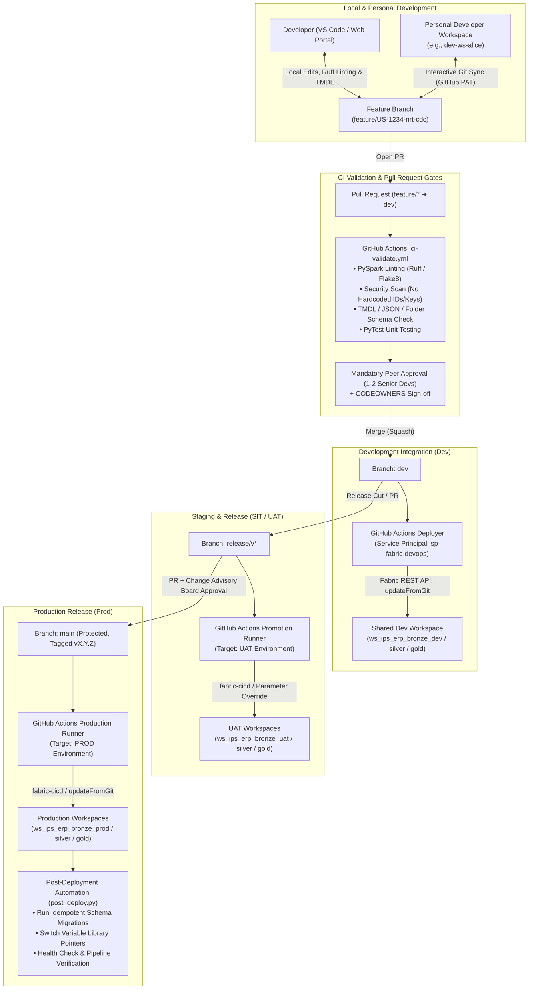
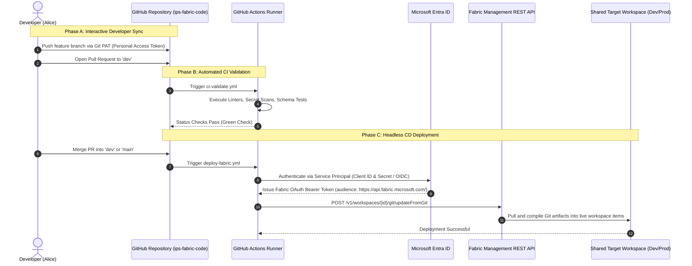
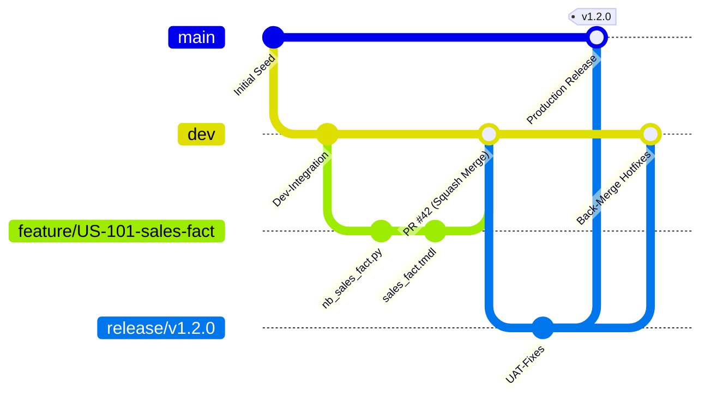

# IPS Enterprise Architecture: Microsoft Fabric CI/CD Process & Deployment Guide

> **Document Version:** 1.0  
> **Status:** Approved / Architecture Standard  
> **Target Platform:** Microsoft Fabric, GitHub Actions, Microsoft Entra ID, Azure Key Vault  
> **Author:** IPS Enterprise Data Architecture & DevOps Team  
> **Related Standards:** [IPS_Fabric_DevOps_GitHub_Integration.md](file:///Users/chandu/Documents/Python_practice/Fabric/docs/additional_docs/IPS_Fabric_DevOps_GitHub_Integration.md), [IPS_BI_Modernization_Project_Design_Document.md](file:///Users/chandu/Documents/Python_practice/Fabric/docs/additional_docs/IPS_BI_Modernization_Project_Design_Document.md), [Microsoft_Fabric_Naming_Convention_Standard.md](file:///Users/chandu/Documents/Python_practice/Fabric/docs/additional_docs/Microsoft_Fabric_Naming_Convention_Standard.md)

---

## 1. Executive Summary & Principles

The **IPS BI Modernization Platform** enforces strict Continuous Integration and Continuous Delivery (CI/CD) and Application Lifecycle Management (ALM) for all Microsoft Fabric artifacts—including PySpark Notebooks, Lakehouse metadata, Data Pipelines, TMDL Semantic Models, PBIR Reports, and Spark Environments.

### Core Architectural Tenets
1. **Tenet 10 (Non-Negotiable CI/CD):** Zero manual editing is permitted in Production or UAT shared workspaces. Every operational change originates from version-controlled Git branches and traverses automated deployment gates.
2. **Definition-as-Code:** Workspace artifacts are serialized into human-readable, diffable text formats (PySpark `.py` scripts, TMDL definitions, PBIR JSON files, and SQL DDL).
3. **Decoupled Configuration:** Environment identifiers, connection endpoints, and credentials are completely abstracted using Fabric **Variable Libraries** and **Spark Environment Variables**, preventing environment drift and hard-coded values.
4. **Automated Quality Gates:** Pull Requests undergo mandatory automated linting, anti-hardcoding secret scans, schema validation, and peer approvals before entering downstream integration branches.

---

## 2. End-to-End Architecture Overview



---

## 3. Dual-Identity Security & Access Model

To maintain maximum security compliance, the architecture separates **interactive developer syncing** from **headless CI/CD deployment execution**:



### Identity Specification Matrix

| Attribute | Interactive Sync Identity | Automated Deployment Identity |
| :--- | :--- | :--- |
| **Principal Type** | Dedicated GitHub Service User Account | Microsoft Entra ID App Registration (Service Principal) |
| **Identifier** | Machine user (e.g., `ips-fabric-devops-bot`) | `sp-fabric-devops` (`spn-fabric-cicd-prod`) |
| **Authentication Credential** | Personal Access Token (PAT Classic) with `repo` and `read:org` scopes | Client ID + Client Secret (or Workload Identity OIDC) |
| **Storage Location** | Securely provided to Microsoft Fabric Workspace Settings UI | Stored in GitHub Encrypted Secrets (`AZURE_CLIENT_SECRET`) |
| **Workspace Role** | Contributor / Member (Personal Workspaces) | **Admin / Contributor** on Shared Workspaces (`Dev`, `SIT`, `UAT`, `Prod`) |
| **Fabric Admin Setting** | User Access | Tenant Setting: *"Service principals can use Fabric APIs"* enabled for designated Security Group |

---

## 4. Git Serialization Standards & File Hierarchy

Microsoft Fabric serializes workspace items into declarative text files. The repository structure strictly isolates metadata from operational data:

```
ips-fabric-code/                          # Root Repository
├── .github/
│   ├── CODEOWNERS                        # Required code owners for deployments
│   └── workflows/
│       ├── ci-validate.yml               # PR validation pipeline
│       └── deploy-fabric.yml             # CD deployment pipeline
├── config/
│   ├── parameter-dev.yml                 # Environment variable replacements for Dev
│   ├── parameter-sit.yml                 # Environment variable replacements for SIT
│   ├── parameter-uat.yml                 # Environment variable replacements for UAT
│   └── parameter-prod.yml                # Environment variable replacements for Prod
├── deploy/
│   ├── deploy_workspace.py               # fabric-cicd Python deployment script
│   ├── validate_repo.py                  # Repo structure and anti-hardcoding validator
│   └── post_deploy.py                    # Post-deployment migration and verification
├── fabric/                               # Fabric synchronized workspace definitions
│   ├── lh_bronze.Lakehouse/
│   │   ├── item.metadata.json            # Lakehouse metadata definition
│   │   └── item.config.json              # Lakehouse configuration
│   ├── lh_silver.Lakehouse/
│   ├── lh_gold.Lakehouse/
│   ├── sqldb_meta_orch.SqlDatabase/      # Metadata repository SQL schemas
│   ├── lib_orch_config.VariableLibrary/  # Decoupled environment variables
│   ├── 01_Orchestration/
│   │   └── pl_master_pipeline.Pipeline/
│   │       └── pipeline-content.json     # Pipeline orchestration JSON
│   ├── 02_Ingestion_NRT/
│   │   └── nb_ingest_as400.Notebook/
│   │       └── notebook-content.py       # Serialized PySpark (.py)
│   ├── 03_Data_Engineering/
│   │   └── nb_transform_silver.Notebook/
│   │       └── notebook-content.py       # Serialized PySpark (.py)
│   ├── 04_Semantic_Models/
│   │   └── sm_financial_analytics.SemanticModel/
│   │       ├── model.bim                 # Or Tabular Model Definition Language (TMDL)
│   │       └── definition/
│   │           ├── database.tmdl
│   │           ├── tables/
│   │           └── relationships.tmdl
│   └── 05_Environments/
│       └── env_spark_runtime.Environment/
│           ├── item.config.json
│           └── requirements.txt          # Python dependencies
├── tests/
│   └── test_definitions.py               # Unit tests for transforms and definitions
├── requirements.txt                      # CI/CD runner dependencies
└── README.md
```

### Artifact Serialization Standards

| Workload Item | Git Extension | Serialization Format | Architectural Rule |
| :--- | :--- | :--- | :--- |
| **PySpark Notebooks** | `.Notebook/` | **`notebook-content.py`** | **Strictly `.py` format**. `.ipynb` is prohibited to prevent merge conflicts caused by Jupyter cell outputs and execution metadata. Cells are delimited using standard `# %%` comments. |
| **Semantic Models** | `.SemanticModel/` | **TMDL (`.tmdl`)** | Must have **TMDL format enabled**. Model is split into separate files per table and relationship, allowing concurrent modeling without Git merge conflicts. |
| **Power BI Reports** | `.Report/` | **PBIR (`.pbir`)** | Standardized JSON folder structure. Enables code review and visual diffing during PR inspections. |
| **Data Pipelines** | `.Pipeline/` | **`pipeline-content.json`** | Declarative activity DAG. All endpoints, lakehouse IDs, and credentials reference Variable Libraries rather than literal strings. |
| **Lakehouses / Warehouses** | `.Lakehouse/`, `.Warehouse/` | **JSON Metadata Containers** | **No data is committed to Git**. Delta tables and Parquet files live in OneLake. Schemas are created via idempotent SQL DDL scripts executed during post-deployment. |
| **Spark Environments** | `.Environment/` | **`requirements.txt` & JSON** | Pin explicit package versions (e.g., `requests==2.31.0`, `pyodbc==5.0.1`). Managed centrally per workspace. |

---

## 5. Branching Strategy & Release Governance

The team follows a modified **GitFlow / Branch-per-Environment Model**:



### Branch Roles & Policies

| Branch | Linked Environment | Deployment Trigger | Governance & Protection Rules |
| :--- | :--- | :--- | :--- |
| **`feature/*`** | Personal Developer Workspace | Manual Git Push / Fabric UI | Unprotected. Owned by individual developer. |
| **`dev`** | Shared Development Workspace | Push via PR Merge | **Protected.** Direct push blocked. Requires 1 peer review and passing `ci-validate.yml`. |
| **`release/*`** | SIT / UAT Workspaces | Branch Creation / Tag | **Protected.** Formal test candidate. QA sign-off required. |
| **`main`** | Production Workspace | Git Tag (`vX.Y.Z`) | **Strictly Protected.** Requires CAB (Change Advisory Board) approval, 2 Senior approvals, signed commits, and passing CI validation. |

---

## 6. Continuous Integration Workflow (`ci-validate.yml`)

The CI workflow runs on all Pull Requests targeting `dev` or `main`. It guarantees that no malformed artifacts, hard-coded credentials, or breaking changes enter the repository.

```yaml
# .github/workflows/ci-validate.yml
name: "CI - Fabric Artifact Validation"

on:
  pull_request:
    branches:
      - dev
      - main
      - release/**
    paths:
      - "fabric/**"
      - "deploy/**"
      - "config/**"
      - "tests/**"

permissions:
  contents: read
  pull-requests: read

jobs:
  validate-code-and-schema:
    name: "Validate Code, Schemas & Security"
    runs-on: ubuntu-latest

    steps:
      - name: "Checkout Repository"
        uses: actions/checkout@v4

      - name: "Set up Python Runtime"
        uses: actions/setup-python@v5
        with:
          python-version: "3.11"
          cache: "pip"

      - name: "Install Build & Test Dependencies"
        run: |
          python -m pip install --upgrade pip
          pip install ruff pytest jsonschema pyyaml requests fabric-cicd

      - name: "Lint PySpark Code (Ruff)"
        run: |
          echo "Linting PySpark scripts..."
          ruff check fabric/ --select E,F,W,I --exclude "*.json,*.bim,*.tmdl"

      - name: "Repository Structure & Anti-Hardcoding Audit"
        run: |
          echo "Running custom repository validation..."
          python deploy/validate_repo.py --strict

      - name: "Execute Unit Tests"
        run: |
          echo "Executing test suite..."
          pytest tests/ -v
```

### Repo Validation Script (`deploy/validate_repo.py`)
This script performs static analysis before deployment:
* **Anti-Hardcoding Check:** Rejects commits containing GUIDs matching development workspace IDs, internal storage account keys, or raw connection strings (`Server=tcp:...`).
* **Format Enforcement:** Verifies that all notebooks in `fabric/` end with `.Notebook/notebook-content.py` and rejects `.ipynb` files.
* **Variable Key Alignment:** Asserts that every variable key referenced in PySpark notebooks (`os.environ.get("KEY")`) is declared in `lib_orch_config.VariableLibrary` and across all `config/parameter-*.yml` files.

---

## 7. Continuous Deployment Workflow (`deploy-fabric.yml`)

The deployment workflow uses the **Microsoft Entra Service Principal** to promote changes across environments.

```yaml
# .github/workflows/deploy-fabric.yml
name: "CD - Deploy Microsoft Fabric Items"

on:
  push:
    branches:
      - dev
    paths:
      - "fabric/**"
      - "deploy/**"
      - "config/**"
  workflow_dispatch:
    inputs:
      target_env:
        description: "Target Deployment Environment"
        required: true
        default: "SIT"
        type: choice
        options:
          - SIT
          - UAT
          - PROD

concurrency:
  group: fabric-deploy-${{ github.event.inputs.target_env || 'DEV' }}
  cancel-in-progress: false

permissions:
  contents: read
  id-token: write

jobs:
  deploy:
    name: "Deploy to ${{ github.event.inputs.target_env || 'DEV' }}"
    runs-on: ubuntu-latest
    environment: ${{ github.event.inputs.target_env || 'DEV' }}

    steps:
      - name: "Checkout Code"
        uses: actions/checkout@v4

      - name: "Set up Python 3.11"
        uses: actions/setup-python@v5
        with:
          python-version: "3.11"
          cache: "pip"

      - name: "Install Deployment Packages"
        run: |
          pip install -r requirements.txt

      - name: "Authenticate to Azure Entra ID"
        uses: azure/login@v2
        with:
          client-id: ${{ secrets.AZURE_CLIENT_ID }}
          tenant-id: ${{ secrets.AZURE_TENANT_ID }}
          client-secret: ${{ secrets.AZURE_CLIENT_SECRET }}

      - name: "Execute Fabric Deployment"
        env:
          AZURE_TENANT_ID: ${{ secrets.AZURE_TENANT_ID }}
          AZURE_CLIENT_ID: ${{ secrets.AZURE_CLIENT_ID }}
          AZURE_CLIENT_SECRET: ${{ secrets.AZURE_CLIENT_SECRET }}
          FABRIC_WORKSPACE_ID: ${{ vars.FABRIC_WORKSPACE_ID }}
          FABRIC_ENVIRONMENT: ${{ vars.FABRIC_ENVIRONMENT }}
          FABRIC_ITEMS_IN_SCOPE: ${{ vars.FABRIC_ITEMS_IN_SCOPE }}
        run: |
          echo "Deploying items to Workspace: $FABRIC_WORKSPACE_ID ($FABRIC_ENVIRONMENT)..."
          python deploy/deploy_workspace.py

      - name: "Execute Post-Deployment Automations"
        env:
          FABRIC_WORKSPACE_ID: ${{ vars.FABRIC_WORKSPACE_ID }}
          FABRIC_ENVIRONMENT: ${{ vars.FABRIC_ENVIRONMENT }}
        run: |
          echo "Running post-deploy schema migrations and verification..."
          python deploy/post_deploy.py
```

---

## 8. Deployment Execution Engines

The platform supports two deployment engines depending on workspace configuration:

### Method A: Fabric Git REST API (`updateFromGit`)
Used when the target workspace is directly linked to a specific Git branch:
```bash
TOKEN=$(az account get-access-token --resource https://api.fabric.microsoft.com/ --query accessToken -o tsv)

curl -X POST "https://api.fabric.microsoft.com/v1/workspaces/${FABRIC_WORKSPACE_ID}/git/updateFromGit" \
  -H "Authorization: Bearer $TOKEN" \
  -H "Content-Type: application/json" \
  -d '{
    "remoteCommitHash": "'"${GITHUB_SHA}"'",
    "conflictResolutionPolicy": "WorkspaceWins"
  }'
```

### Method B: Code-First Item Deployment (`deploy_workspace.py`)
Used for unlinked target workspaces (e.g., UAT and Production) where parameter substitution is injected at deployment time:
```python
# deploy/deploy_workspace.py
import os
import sys
from azure.identity import ClientSecretCredential
from fabric_cicd import FabricWorkspace, publish_all_items

def main():
    tenant_id = os.environ["AZURE_TENANT_ID"]
    client_id = os.environ["AZURE_CLIENT_ID"]
    client_secret = os.environ["AZURE_CLIENT_SECRET"]
    workspace_id = os.environ["FABRIC_WORKSPACE_ID"]
    env_name = os.environ["FABRIC_ENVIRONMENT"]
    
    scope_str = os.environ.get("FABRIC_ITEMS_IN_SCOPE", "Notebook,Pipeline,Environment,SemanticModel")
    items_in_scope = [x.strip() for x in scope_str.split(",") if x.strip()]

    print(f"[CI/CD] Authenticating Service Principal {client_id} against Tenant {tenant_id}...")
    credential = ClientSecretCredential(
        tenant_id=tenant_id,
        client_id=client_id,
        client_secret=client_secret
    )

    print(f"[CI/CD] Initializing Fabric Workspace target: {workspace_id} [{env_name}]...")
    workspace = FabricWorkspace(
        workspace_id=workspace_id,
        environment=env_name,
        item_type_in_scope=items_in_scope,
        repository_directory="./fabric",
        parameter_file_path=f"./config/parameter-{env_name.lower()}.yml"
    )

    print("[CI/CD] Publishing all synchronized Fabric items...")
    publish_all_items(workspace)
    print("[CI/CD] Publication completed successfully.")

if __name__ == "__main__":
    main()
```

---

## 9. Post-Deployment Verification & Data Engine Synchronization

Item definitions deployed into Fabric are purely structural metadata. Post-deployment automation (`deploy/post_deploy.py`) ensures that the underlying storage and data quality engines are synchronized:

1. **Idempotent DDL Execution:** Executes SQL migration scripts against the lakehouse SQL Analytics Endpoint or Fabric SQL Database to add new columns, indexes, or metadata tables without dropping existing data.
2. **Variable Library Pointer Redirection:** Rebinds the Variable Library (`lib_orch_config`) keys to point to the current stage's resources (e.g., pointing `LAKEHOUSE_BRONZE` to `lh_bronze_prod` in production).
3. **Pipeline Smoke Test:** Triggers a dry-run or lightweight validation pipeline using the Fabric REST API (`/jobs/instances`) to verify end-to-end connectivity between the On-Premises Data Gateway (OPDG) and the newly deployed items.
4. **Purview Scan Trigger:** Initiates a Purview metadata scan to immediately index lineage and column transformations introduced by the new release.

---

## 10. Operational Runbook & Disaster Recovery

### Rollback Strategy
If a deployment defect is identified in Production:
1. **Never edit directly in the Fabric Production Workspace.**
2. In Git, checkout `main` and execute a revert commit:
   ```bash
   git revert <bad_commit_hash> -m 1
   git push origin main
   ```
3. The `deploy-fabric.yml` workflow automatically triggers, restoring all items in Production to the previous known-good commit.

### Secret & Credential Rollover
1. The Service Principal Client Secret is stored in **Azure Key Vault** and mapped to GitHub Secrets.
2. An automated Azure Event Grid alert triggers 30 days prior to secret expiration.
3. Zero-downtime rotation:
   * Generate secondary secret in Entra ID.
   * Update GitHub Secret `AZURE_CLIENT_SECRET`.
   * Verify pipeline deployment on `dev`.
   * Revoke the old expired secret.
