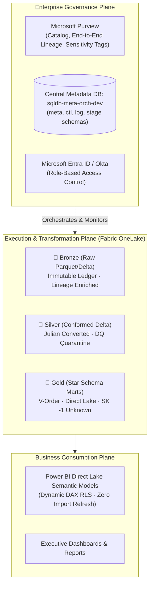
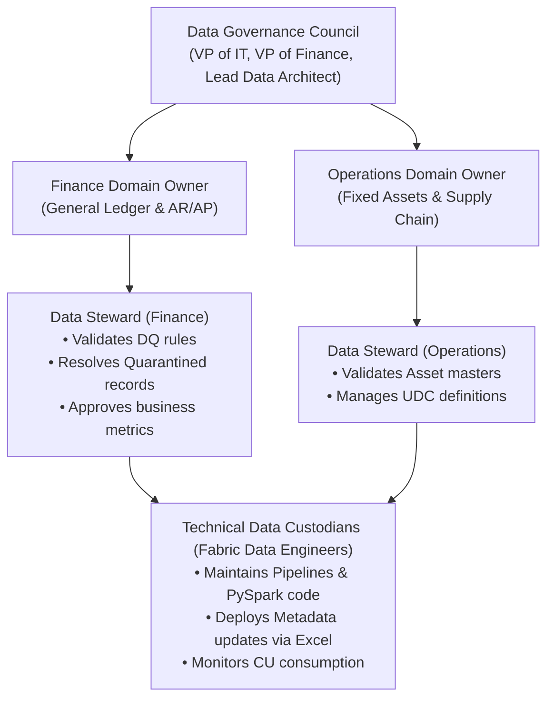
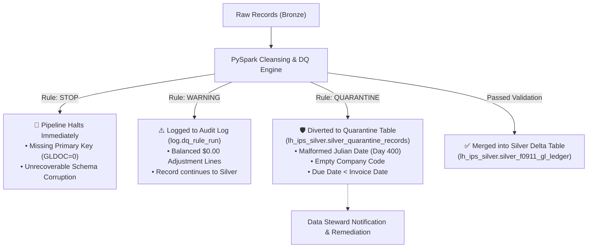
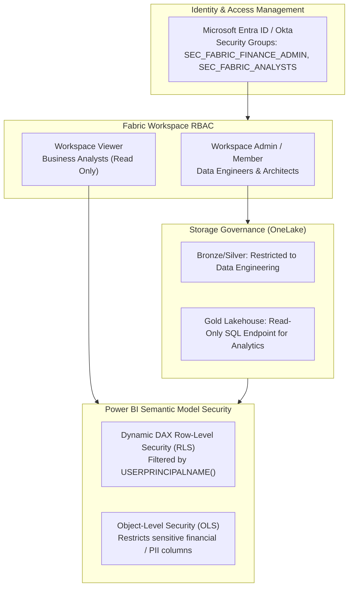
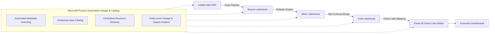
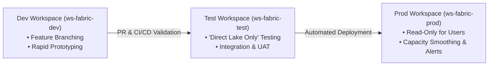

# IPS Corporation — Enterprise Data Governance Framework & Operating Model

> **Project:** IPS Corporation Enterprise Data Modernization  
> **Target Platform:** Microsoft Fabric, OneLake, Delta Lake, Power BI Direct Lake & Microsoft Purview  
> **Source Systems:** IBM AS400 DB2 (JD Edwards EnterpriseOne ERP)  
> **Document Location:** `docs/additional_docs/IPS_Data_Governance_Framework_and_Operating_Model.md`  
> **Status:** Enterprise Architectural Policy & Standard  

---

## 📋 Table of Contents
1. [Executive Summary & Governance Vision](#1-executive-summary--governance-vision)
2. [Data Governance Operating Model & Roles](#2-data-governance-operating-model--roles)
3. [The 5 Pillars of Enterprise Data Governance](#3-the-5-pillars-of-enterprise-data-governance)
4. [Pillar 1: Metadata Governance (The Control Plane)](#4-pillar-1-metadata-governance-the-control-plane)
5. [Pillar 2: Data Quality Governance & Quarantine Architecture](#5-pillar-2-data-quality-governance--quarantine-architecture)
6. [Pillar 3: Data Security, Privacy & Access Governance](#6-pillar-3-data-security-privacy--access-governance)
7. [Pillar 4: End-to-End Data Lineage & Microsoft Purview Catalog](#7-pillar-4-end-to-end-data-lineage--microsoft-purview-catalog)
8. [Pillar 5: Capacity FinOps & Workspace Sprawl Control](#8-pillar-5-capacity-finops--workspace-sprawl-control)
9. [Enterprise Governance Compliance Matrix](#9-enterprise-governance-compliance-matrix)

---

## 1. Executive Summary & Governance Vision

In Microsoft Fabric, **Data Governance is an active, automated architectural capability built into the ingestion pipelines and semantic models from Day 1**, rather than an administrative afterthought.



### The Three Mandates of IPS Governance:
1. **Single Source of Truth (SSOT):** Eliminate duplicate, conflicting business logic across departments by centralizing metric definitions in conformed Gold tables and Custom Semantic Models.
2. **Governed Self-Service:** Provide business analysts with trusted, certified semantic models while prohibiting ungoverned ad-hoc data extracts into unmonitored Excel sheets.
3. **Immutable Regulatory Compliance:** Maintain end-to-end auditability and field-level lineage from the green-screen AS400 journal transaction down to executive Power BI visual tiles.

---

## 2. Data Governance Operating Model & Roles

Governance operates across a clear hierarchy of responsibility:



| Role | Primary Responsibilities | Key Deliverables & Artifacts |
| :--- | :--- | :--- |
| **Data Governance Council** | Establishes strategic data policies, resolves cross-domain disputes, approves capacity budget allocations. | Enterprise Governance Charter, SLA policies |
| **Domain Owners (Business)** | Accountable for the business accuracy and regulatory compliance of domain data products. | KPI business definitions, metric sign-offs |
| **Data Stewards (Functional)** | Inspects daily Data Quality results, reviews quarantined records, updates business glossaries in Purview. | Quarantine remediation, business metadata |
| **Data Custodians (Engineers)** | Manages physical pipelines, Spark configurations, metadata repository changes, CI/CD deployments. | PySpark notebooks, SQL DDL, pipelines |
| **BI Consumers & Analysts** | Consumes certified Direct Lake models to build thin reports without modifying underlying models. | Power BI reports and executive apps |

---

## 3. The 5 Pillars of Enterprise Data Governance

```
                    ┌────────────────────────────────────────────────────────┐
                    │       Enterprise Data Governance Framework             │
                    └───────────────────────────┬────────────────────────────┘
         ┌───────────────────┬──────────────────┼───────────────────┬───────────────────┐
         ▼                   ▼                  ▼                   ▼                   ▼
┌─────────────────┐ ┌─────────────────┐ ┌─────────────────┐ ┌─────────────────┐ ┌─────────────────┐
│ 1. Metadata     │ │ 2. Data Quality │ │ 3. Security &   │ │ 4. Lineage &    │ │ 5. FinOps &     │
│    Governance   │ │    & Quarantine │ │    Privacy      │ │    Catalog      │ │    Capacity     │
└─────────────────┘ └─────────────────┘ └─────────────────┘ └─────────────────┘ └─────────────────┘
```

---

## 4. Pillar 1: Metadata Governance (The Control Plane)

Instead of distributed, unmanaged pipeline definitions, all orchestration rules are governed inside a centralized Microsoft Fabric SQL Database (`sqldb-meta-orch-dev`).

### A. Four-Schema Separation of Concerns
1. **`meta` (Static Configuration):** Read-only at runtime. Contains dataset definitions (`meta.dataset`), source system configurations (`meta.source_system`), execution schedules (`meta.schedule`), and Data Quality rules (`meta.dataquality_rule`).
2. **`ctl` (Operational Control State):** Read/write by runtime engines. Houses dynamic incremental watermarks (`ctl.watermark_state`) and pipeline execution locks (`ctl.dataset_state`).
3. **`log` (Append-Only Audit Telemetry):** Immutable logging tier capturing run timestamps, row counts (`rows_read`, `rows_inserted`, `rows_rejected`), and system error traces (`log.pipeline_run`, `log.dataset_run`, `log.dq_rule_run`, `log.error_event`).
4. **`stage` (Staging & Validation Tier):** Truncate-and-load tables populated by the Excel template staging pipeline (`stage.sp_UpsertMetadataFromStage`).

### B. Governed Change Management Workflow
* **No Direct SQL Inserts:** Data engineers are prohibited from issuing manual `INSERT` / `UPDATE` queries against `meta` tables in production.
* **Excel Template Deployment:** All dataset additions and DQ rule changes must be authored in [Ingestion_metadata_load_template.xlsx](file:///Users/chandu/Documents/Python_practice/Fabric/data/metadata/Ingestion_metadata_load_template.xlsx) and deployed through the automated stored procedure, guaranteeing schema validation and referential integrity.

---

## 5. Pillar 2: Data Quality Governance & Quarantine Architecture

Data Quality is measured, audited, and enforced during every pipeline execution using the **3-Tier Severity Policy**:



### Quarantine Governance Standards:
1. **Non-Blocking Ingestion:** Quarantining preserves batch pipeline execution. Valid financial records continue into Silver and Gold without delay, meeting the 15-minute SLA.
2. **Audit Attribution:** Every quarantined record is tagged with a descriptive code (e.g., `QUARANTINE_INVALID_DATE`, `QUARANTINE_NULL_ACCOUNT`) and timestamped (`_silver_processed_at`).
3. **Threshold Enforcement:** If `rows_rejected` exceeds `threshold_percent` in `meta.dataquality_rule` (e.g., > 1.0%), the pipeline issues an alert to the Data Steward team.
4. **Remediation Runbook:** Stewards inspect the quarantine table, resolve the root cause in AS400 DB2 or submit a staging reconciliation, and the record automatically flows to Silver on the next incremental sync.

---

## 6. Pillar 3: Data Security, Privacy & Access Governance

Security follows the principle of **least privilege** enforced across identity, workspace, storage, and semantic layers:



### Security Governance Rules:
* **Entra ID Security Groups:** Permissions are assigned strictly to security groups (e.g., `SEC_FABRIC_FIN_VIEWERS`), never to individual personal accounts.
* **Workspace Role Separation:**
  * **Dev Workspace:** Contributors have write/read access.
  * **Prod Workspace:** Strictly governed via Service Principals and CI/CD pipelines. Analysts receive **Viewer** roles or access through Power BI Apps.
* **Direct Lake Preserving RLS:**
  * Row-Level Security **must be defined in the Custom Semantic Model via DAX** using `USERPRINCIPALNAME()`.
  * *Critical Rule:* Never apply SQL-level view filters on the Lakehouse SQL Endpoint, as this forces the semantic model to fall back into slow **DirectQuery** mode.

---

## 7. Pillar 4: End-to-End Data Lineage & Microsoft Purview Catalog

Microsoft Purview acts as the unified enterprise governance and cataloging engine:



### Governance Capabilities Delivered by Purview:
1. **Interactive Column-Level Lineage:** Allows auditors to trace any metric (e.g., Gross Revenue) through DAX measures, Gold Delta files, Silver cleansing rules, Bronze raw parquet, down to the AS400 table and column.
2. **Upstream Impact Analysis:** Prior to modifying an AS400 source column or updating PySpark cleansing logic, engineers evaluate downstream dependencies to prevent breaking production dashboards.
3. **Standardized Business Glossary:** Authoritative definitions for enterprise terminology (e.g., *DSO, Gross Margin, Net Book Value, Operating Company 00000 Fallback*) mapped directly to technical data catalog assets.
4. **Automated Sensitive Data Classification:** Scans and tags credit ratings, financial balances, and PII across OneLake storage.

---

## 8. Pillar 5: Capacity FinOps & Workspace Sprawl Control

To ensure predictable cost management and optimal performance on Microsoft Fabric F-SKU Capacities (Development F32 / Production F64):



### FinOps & Operational Constraints:
* **Workspace Sprawl Prevention:** Workspaces are partitioned strictly by lifecycle environment (`dev`, `test`, `prod`) and domain (`finance`, `operations`), avoiding ad-hoc personal workspaces.
* **Target File Size Management:** Daily maintenance notebooks run `OPTIMIZE` and `VACUUM` to merge small Parquet files into optimal 128MB chunks, reducing OneLake transaction read costs and boosting VertiPaq caching speeds.
* **Capacity Smoothing & Throttling Mitigation:**
  * Fact ingestion jobs are scheduled off-peak or staggered (Dimensions first, Facts second with 3–5 thread throttling) to prevent Capacity Unit (CU) exhaustion.
  * Capacity alerts trigger when CU consumption exceeds 80% over a 10-minute window.

---

## 9. Enterprise Governance Compliance Matrix

| Governance Requirement | Solution Mechanism | Enforcement Level | Document / Code Reference |
| :--- | :--- | :--- | :--- |
| **Centralized Pipeline Catalog** | Microsoft Fabric SQL Database (`sqldb-meta-orch-dev`) | **Mandatory** | [metadata_tables_and_columns.md](file:///Users/chandu/Documents/Python_practice/Fabric/data/metadata/metadata_tables_and_columns.md) |
| **No Manual Prod DB Changes** | Excel Staging Workflow (`Ingestion_metadata_load_template.xlsx`) | **Mandatory** | [generate_metadata_excel_template.py](file:///Users/chandu/Documents/Python_practice/Fabric/scripts/generate_metadata_excel_template.py) |
| **Data Quality Enforcement** | PySpark DQ Engine with STOP / QUARANTINE / WARN | **Mandatory** | [01_silver_cleansing_dq.py](file:///Users/chandu/Documents/Python_practice/Fabric/src/notebooks/silver/01_silver_cleansing_dq.py) |
| **Referential Integrity** | Kimball Star Schema with `-1` Unknown Member Fallback | **Mandatory** | [IPS_Kimball_Dimensional_Warehouse_Specification.md](file:///Users/chandu/Documents/Python_practice/Fabric/docs/additional_docs/IPS_Kimball_Dimensional_Warehouse_Specification.md) |
| **Row-Level Security** | Custom Semantic Model DAX Filters (`USERPRINCIPALNAME`) | **Mandatory** | [IPS_PowerBI_Fabric_Security_Design.md](file:///Users/chandu/Documents/Python_practice/Fabric/docs/additional_docs/IPS_PowerBI_Fabric_Security_Design.md) |
| **End-to-End Lineage** | Injected Audit Columns + Microsoft Purview Scanners | **Mandatory** | [IPS_Data_Lineage_and_Linkage_Management_Guide.md](file:///Users/chandu/Documents/Python_practice/Fabric/docs/additional_docs/IPS_Data_Lineage_and_Linkage_Management_Guide.md) |
| **Direct Lake SLA Guarantee** | V-Order Parquet Writes + In-Memory DAX Measures | **Mandatory** | [IPS_Fabric_Gold_Layer_Semantic_Model_Design.md](file:///Users/chandu/Documents/Python_practice/Fabric/docs/additional_docs/IPS_Fabric_Gold_Layer_Semantic_Model_Design.md) |
