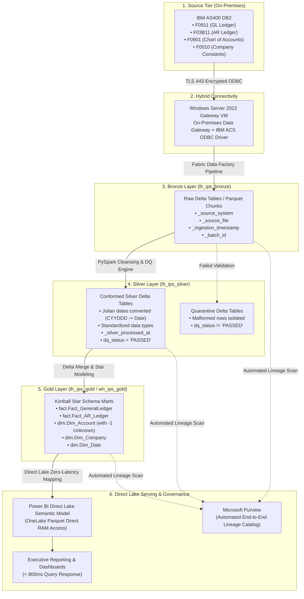
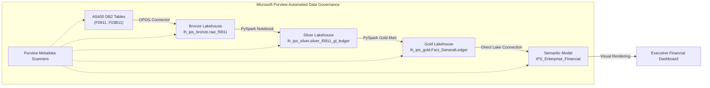
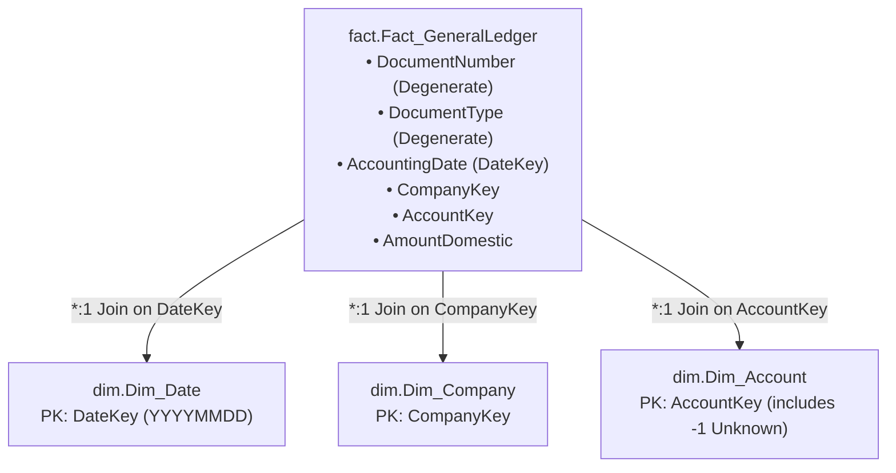
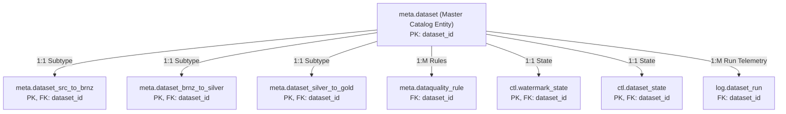
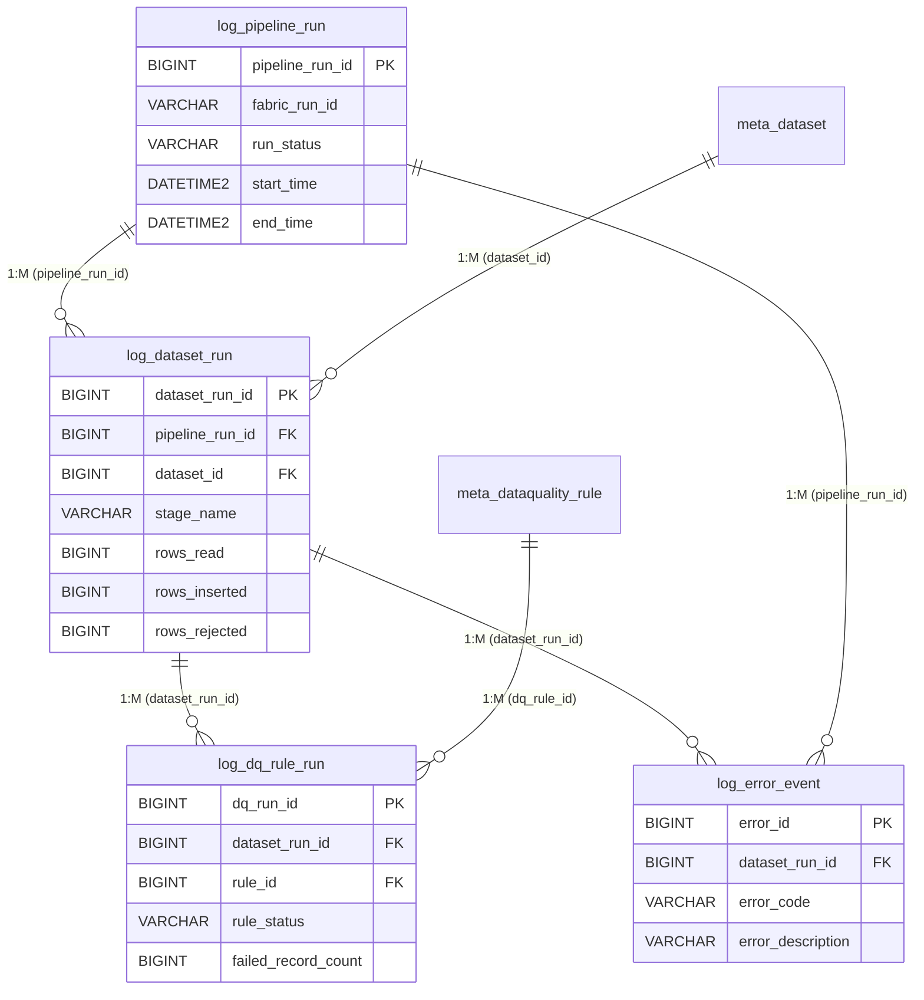

# IPS Corporation — Data Lineage & Linkage Management Architecture Guide

> **Document:** Enterprise Data Lineage, Referential Linkage & Operational Governance  
> **Platform:** Microsoft Fabric (OneLake, Delta Lake) & Microsoft Purview  
> **Source Systems:** IBM AS400 DB2 (JD Edwards EnterpriseOne ERP)  
> **Target Semantic Models:** Power BI Direct Lake Mode (Sub-800ms SLA)  
> **Document Location:** `docs/additional_docs/IPS_Data_Lineage_and_Linkage_Management_Guide.md`  

---

## 📋 Table of Contents
1. [Executive Summary & Core Governance Principles](#1-executive-summary--core-governance-principles)
2. [End-to-End Data Lineage Flow (AS400 to Power BI)](#2-end-to-end-data-lineage-flow-as400-to-power-bi)
3. [Layer-by-Layer Lineage & Audit Columns](#3-layer-by-layer-lineage--audit-columns)
   - [3.1 Bronze Raw Landing Zone](#31-bronze-raw-landing-zone)
   - [3.2 Silver Conformed & Cleansed Zone](#32-silver-conformed--cleansed-zone)
   - [3.3 Gold Kimball Dimensional Star Schema](#33-gold-kimball-dimensional-star-schema)
   - [3.4 Direct Lake Semantic Model](#34-direct-lake-semantic-model)
4. [Enterprise Governance & Microsoft Purview Integration](#4-enterprise-governance--microsoft-purview-integration)
5. [Kimball Dimensional Linkage Standards](#5-kimball-dimensional-linkage-standards)
   - [5.1 Deterministic SHA-256 Surrogate Keys](#51-deterministic-sha-256-surrogate-keys)
   - [5.2 The Unknown Member Pattern (-1 Fallback)](#52-the-unknown-member-pattern--1-fallback)
   - [5.3 Multi-Company Hierarchical Linkage Fallback (Company 00000)](#53-multi-company-hierarchical-linkage-fallback-company-00000)
   - [5.4 Degenerate Dimensions Linkage](#54-degenerate-dimensions-linkage)
6. [Metadata Framework Linkage (Subtype Inheritance Pattern)](#6-metadata-framework-linkage-subtype-inheritance-pattern)
7. [Operational Execution Lineage & Telemetry Hierarchy](#7-operational-execution-lineage--telemetry-hierarchy)
8. [Summary Reference Matrix](#8-summary-reference-matrix)

---

## 1. Executive Summary & Core Governance Principles

In modernizing the legacy IBM AS400 (DB2) ERP platform to Microsoft Fabric, **managing lineage and linkage** is essential to satisfy compliance audits, data governance, and operational reliability. 

This architecture addresses three distinct levels of linkage:
1. **Data Lineage (Horizontal Traceability):** The ability to track any report number back through Gold, Silver, Bronze, and to the exact AS400 source table, column, and batch load.
2. **Dimensional Linkage (Vertical Relational Integrity):** The join mechanics and foreign key relationships connecting transactional facts to conformed dimensions without losing orphaned or late-arriving records.
3. **Metadata Framework Linkage (Control Plane Consistency):** The normalized data model in the central metadata database (`sqldb-meta-orch-dev`) that binds source definitions, staging configurations, transformation rules, and run logs together under a single immutable identifier.

---

## 2. End-to-End Data Lineage Flow (AS400 to Power BI)



---

## 3. Layer-by-Layer Lineage & Audit Columns

Every dataset that traverses the Medallion architecture is enriched with metadata columns that permanently bind its operational lineage.

### 3.1 Bronze Raw Landing Zone (`lh_ips_bronze`)
The Bronze layer receives raw, immutable copies of source tables. It does not alter source column names or data types, but appends strict lineage metadata:

```python
# Implemented in: src/notebooks/bronze/01_ingest_as400_raw.py
bronze_df = raw_df.withColumn("_ingestion_timestamp", current_timestamp()) \
                  .withColumn("_source_system", lit("JDE_AS400_DB2")) \
                  .withColumn("_source_file", input_file_name()) \
                  .withColumn("_batch_id", lit(batch_run_id))
```

| Audit Column | Data Type | Purpose |
| :--- | :--- | :--- |
| `_source_system` | `VARCHAR(50)` | Identifies the physical source origin (e.g., `'JDE_AS400_DB2'`, `'SFDC'`). |
| `_source_file` | `VARCHAR(500)`| Absolute OneLake URI or source file path from which the row was read. |
| `_ingestion_timestamp` | `TIMESTAMP` | UTC timestamp of the exact moment the row was landed in Bronze. |
| `_batch_id` | `VARCHAR(100)`| Fabric pipeline execution Run ID for cross-system correlation. |

---

### 3.2 Silver Conformed & Cleansed Zone (`lh_ips_silver`)
The Silver layer cleanses data, converts legacy JDE 6-digit `CYYDDD` Julian dates to Gregorian calendar dates, enforces business typing, and evaluates Data Quality rules:

```python
# Implemented in: src/notebooks/silver/01_silver_cleansing_dq.py
cleaned_df = bronze_df.select(...) \
    .withColumn("accounting_date", convert_julian_to_gregorian(col("gl_julian_date"))) \
    .withColumn("dq_status", 
        when(col("account_number").isNull(), lit("QUARANTINE_NULL_ACCOUNT"))
        .when(col("accounting_date").isNull(), lit("QUARANTINE_INVALID_DATE"))
        .otherwise(lit("PASSED"))
    ) \
    .withColumn("_silver_processed_at", current_timestamp())
```

| Audit Column | Data Type | Purpose |
| :--- | :--- | :--- |
| `_silver_processed_at` | `TIMESTAMP` | UTC timestamp when transformation and validation occurred. |
| `dq_status` | `VARCHAR(50)` | Data quality evaluation status (`'PASSED'` or detailed quarantine reason code). |
| `record_hash` | `VARCHAR(64)` | SHA-256 hash of tracked attributes for change detection and SCD Type 2 tracking. |

---

### 3.3 Gold Kimball Dimensional Star Schema (`lh_ips_gold` / `wh_ips_gold`)
In the Gold layer, technical audit columns are decoupled from business users. Lineage is maintained via:
1. **Surrogate Keys:** Unambiguous dimensional links (`DateKey`, `CompanyKey`, `AccountKey`, `CustomerKey`).
2. **Degenerate Dimensions:** Original ERP business document identifiers (`GLDOC`, `GLDCT`, `GLJELN`) retained on the Fact table to support operational drill-back into the AS400 green-screen ledger.
3. **Lineage Views:** The SQL Analytics Endpoint exposes reporting views (in `rpt.*`) that can be audited directly using SQL query plans.

---

### 3.4 Direct Lake Semantic Model
Because **Power BI Direct Lake mode** reads Delta Parquet files directly from OneLake without importing them into proprietary `.pbix` memory caches:
* **Zero Lineage Disconnect:** Direct Lake maps model tables directly to Gold Delta tables in real time.
* **Metadata Inheritance:** Any column lineage established in Gold is automatically reflected in the semantic model.

---

## 4. Enterprise Governance & Microsoft Purview Integration

Microsoft Purview provides automated data cataloging, governance, and visual end-to-end lineage across the modernization platform:



### Key Capabilities Enabled by Purview:
1. **Impact Analysis:** Prior to altering an upstream AS400 column or Silver schema, engineers can trace downstream impact to all dependent Gold marts and Power BI visuals.
2. **Root Cause Diagnostics:** When an executive flags an anomalous figure on an executive dashboard, analysts can trace the lineage backwards:
   $$\text{Visual Metric} \rightarrow \text{Semantic Model DAX} \rightarrow \text{Gold Fact} \rightarrow \text{Silver Delta} \rightarrow \text{Bronze Parquet} \rightarrow \text{AS400 Journal Line}$$
3. **Data Classification & Sensitive Tags:** Automated tagging for PII and sensitive financial classifications across all layers.

---

## 5. Kimball Dimensional Linkage Standards

Ensuring reliable referential linkage between Fact tables and Dimension tables requires strict modeling standards:



### 5.1 Deterministic SHA-256 Surrogate Keys
Traditional sequential identity columns (`IDENTITY(1,1)`) cause write bottlenecks and synchronization locks across distributed Apache Spark executor nodes. Instead, surrogate keys are calculated deterministically:

$$\text{Surrogate Key} = \text{SHA2(CONCAT\_WS('\|\|', UPPER(TRIM(Key1)), UPPER(TRIM(Key2))), 256)}$$

* **Advantage:** Identical natural business keys generate identical surrogate keys across independent pipelines, enabling stateless and concurrent joins.

---

### 5.2 The Unknown Member Pattern (-1 Fallback)
In enterprise ERP systems, transactions frequently arrive before master data records are updated (late-arriving dimensions), or contain references to retired entities. 
* **The Problem:** Standard SQL `INNER JOIN` or relational integrity constraints would drop these orphan transactions, corrupting financial reporting.
* **The Solution:**
  1. Every dimension table includes a pre-seeded default record where `SurrogateKey = -1`.
  2. All descriptive text columns are populated with `'Unknown / Not Applicable'`.
  3. During Fact table construction in PySpark, dimension key lookups use `coalesce()`:
     ```python
     # Implemented in: src/notebooks/gold/01_gold_financial_gl_mart.py
     fact_df = silver_df.alias("gl").join(
         dim_account.alias("acc"),
         on="account_id",
         how="left"
     ).select(
         col("gl.doc_number").alias("document_number"),
         coalesce(col("acc.account_id"), lit("-1")).alias("account_key"),
         coalesce(col("gl.company_code"), lit("-1")).alias("company_key"),
         col("gl.amount_domestic")
     )
     ```
  4. In Power BI, orphaned transactions remain visible and reportable under the "Unknown" category, preserving 100% of financial totals.

---

### 5.3 Multi-Company Hierarchical Linkage Fallback (Company 00000)
In JD Edwards EnterpriseOne, master records (such as Customer Master `F03012` or Company Constants `F0010`) are frequently defined at corporate parent Company `00000` rather than the specific operating company (`00010`, `00020`).

* **Hierarchical Resolution Logic:**
  1. Join fact transaction on `Operating Company` + `Account / Customer ID`.
  2. If no match is found, fallback to `Company 00000` + `Account / Customer ID`.
  3. If still unmapped, assign to default member `-1`.
* **Result:** Eliminates false-positive orphan rejections for corporate shared services.

---

### 5.4 Degenerate Dimensions Linkage
Transactional identifiers (e.g., `GLDOC` journal number, `GLDCT` doc type, `GLJELN` line number) do not possess descriptive attributes requiring a standalone dimension table. They are preserved directly on the Fact table as **Degenerate Dimensions**, allowing seamless operational drill-down to source ERP transactions.

---

## 6. Metadata Framework Linkage (Subtype Inheritance Pattern)

In the central metadata repository database (`sqldb-meta-orch-dev`), linkage across configuration and operational state is maintained through the **Subtype Inheritance Pattern**:



### Why This Matters:
* **Single Source of Identification:** Every dataset across the enterprise has a single immutable identifier: `dataset_id`.
* **Elimination of Disconnected Identifiers:** Legacy architectures frequently used separate IDs for raw tables, cleansing jobs, and mart tables, destroying lineage tracking.
* **Unified Telemetry:** Every execution metric (`log.dataset_run`), watermark checkpoint (`ctl.watermark_state`), and DQ rule evaluation (`log.dq_rule_run`) references `dataset_id` directly.

---

## 7. Operational Execution Lineage & Telemetry Hierarchy

Execution linkage tracks every pipeline run down to the individual row metrics and error stack traces across a 4-tier logging model:



### Lineage Telemetry Drill-Down:
1. **Pipeline Execution:** `log.pipeline_run` records the Fabric Data Factory pipeline run ID and overall success/failure.
2. **Dataset Execution:** Spawns child records in `log.dataset_run` tracking `rows_read`, `rows_inserted`, `rows_updated`, and `rows_rejected`.
3. **Data Quality Linkage:** Individual rule violations link directly via `log.dq_rule_run` to show exact violation counts.
4. **Exception Traceability:** System exceptions link through `log.error_event` with complete stack traces tied directly to the offending dataset and pipeline run.

---

## 8. Summary Reference Matrix

| Dimension of Linkage | Mechanism | Core Advantage | Primary Location / Code Reference |
| :--- | :--- | :--- | :--- |
| **Physical Ingestion Lineage** | Injected metadata columns (`_source_system`, `_source_file`, `_ingestion_timestamp`) | Guarantees raw source traceability for compliance audits. | [01_ingest_as400_raw.py](file:///Users/chandu/Documents/Python_practice/Fabric/src/notebooks/bronze/01_ingest_as400_raw.py) |
| **Data Quality Lineage** | Column `dq_status` & Quarantine Delta table | Separates bad rows without failing batch pipelines. | [01_silver_cleansing_dq.py](file:///Users/chandu/Documents/Python_practice/Fabric/src/notebooks/silver/01_silver_cleansing_dq.py) |
| **Dimensional Linkage** | Strict Star Schema & Unknown Member `-1` fallback | Eliminates row loss from late-arriving dimensions; preserves 100% of financial totals. | [01_gold_financial_gl_mart.py](file:///Users/chandu/Documents/Python_practice/Fabric/src/notebooks/gold/01_gold_financial_gl_mart.py) |
| **Multi-Company Linkage** | Company `00000` corporate fallback | Resolves shared-services master records without orphan errors. | [test_scenarios_matrix.md (SC-04)](file:///Users/chandu/Documents/Python_practice/Fabric/data/scenarios/test_scenarios_matrix.md) |
| **Distributed Join Linkage** | Deterministic SHA-256 Surrogate Keys | Eliminates executor locks and identity sync bottlenecks in Spark. | [IPS_Kimball_Dimensional_Warehouse_Specification.md](file:///Users/chandu/Documents/Python_practice/Fabric/docs/additional_docs/IPS_Kimball_Dimensional_Warehouse_Specification.md) |
| **Metadata Framework Linkage** | Subtype Inheritance Pattern (`dataset_id`) | Centralizes dataset cataloging, control state, and run metrics. | [metadata_tables_and_columns.md](file:///Users/chandu/Documents/Python_practice/Fabric/data/metadata/metadata_tables_and_columns.md) |
| **Enterprise Governance Lineage** | Microsoft Purview Automated Scanners | Delivers interactive visual impact analysis from AS400 to Power BI. | [technical_stack.md](file:///Users/chandu/Documents/Python_practice/Fabric/docs/techstalk/technical_stack.md#L210) |
