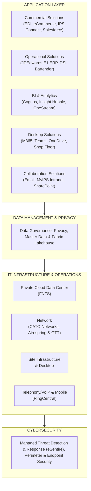
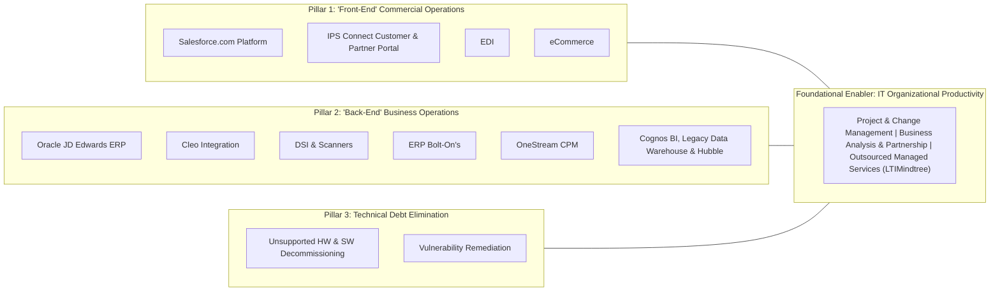
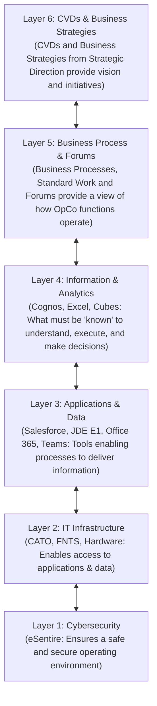
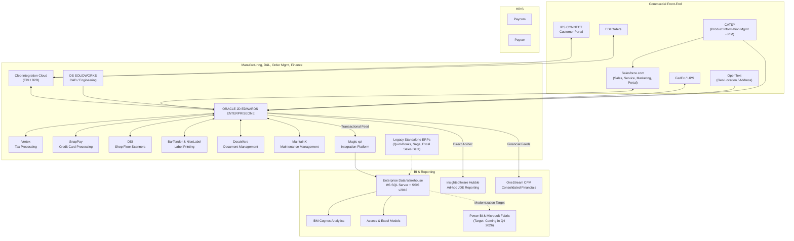
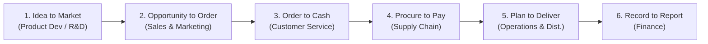
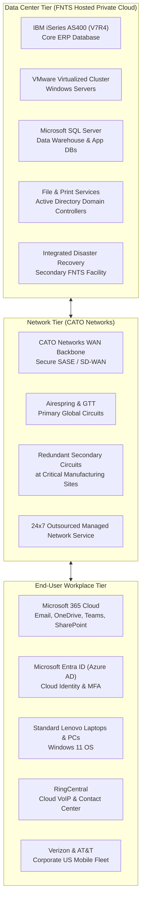
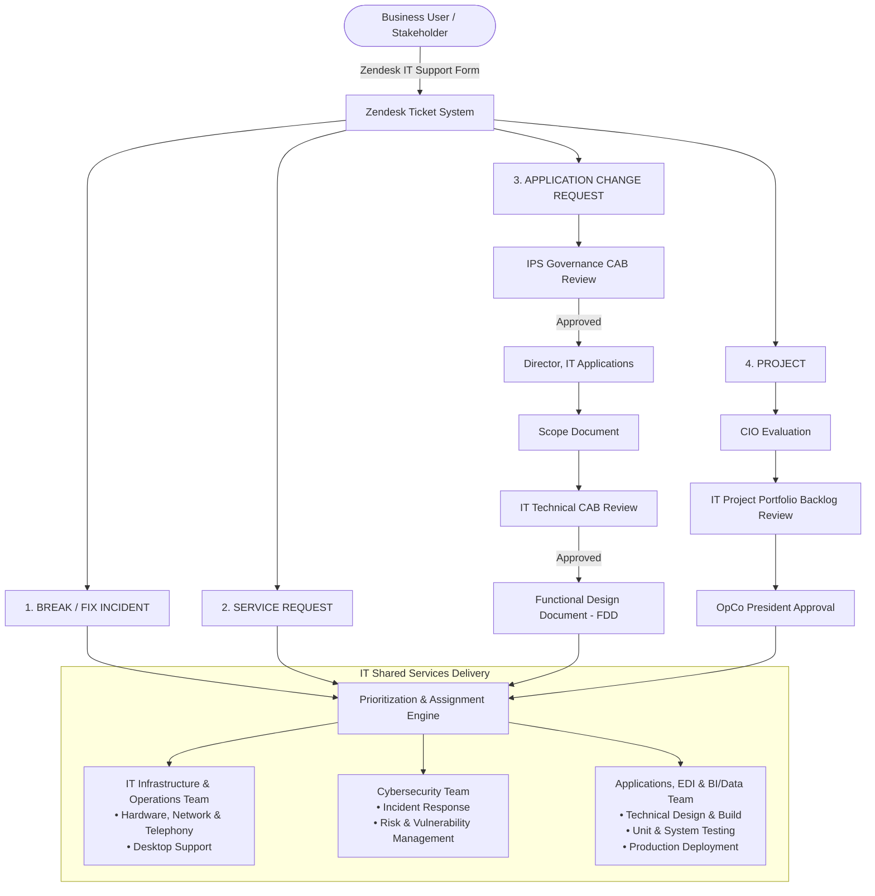
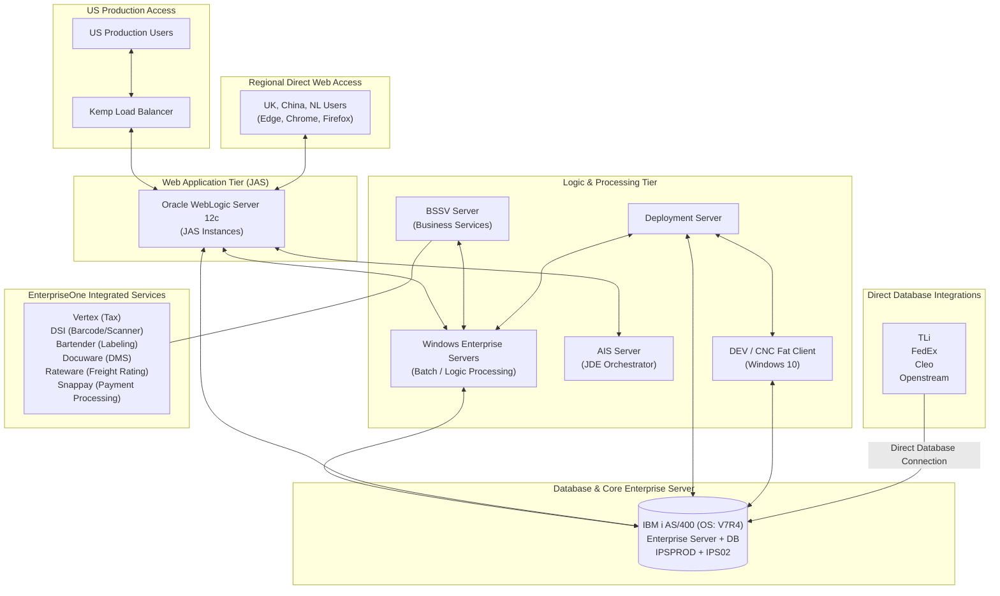
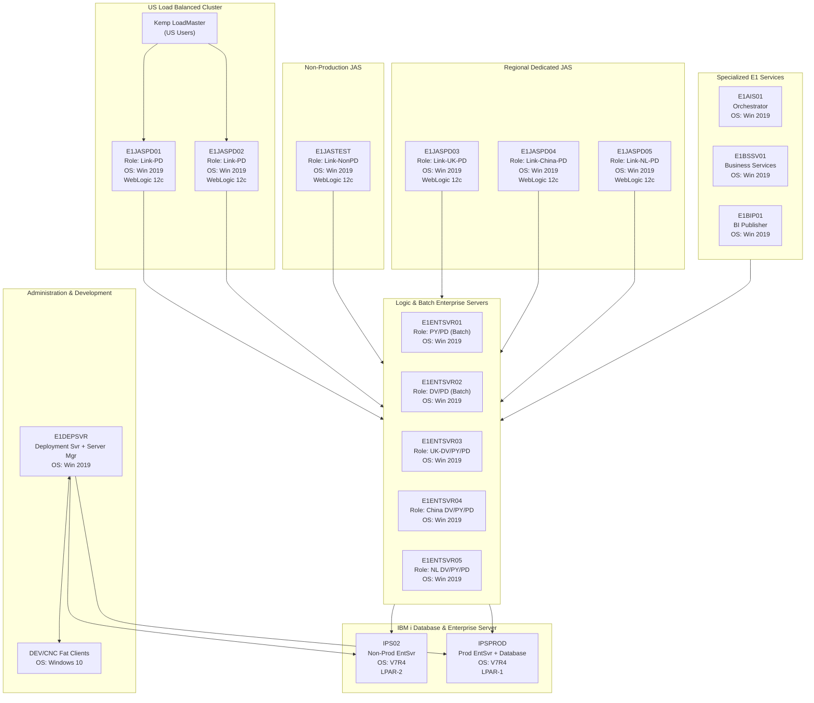

# IPS Corporation: Enterprise IT Ecosystem & Oracle JD Edwards E1 Architecture

This document provides a comprehensive technical breakdown of the IT ecosystem, business alignment model, strategic pillars, application footprint, business process mappings, infrastructure architecture, service delivery governance, and Oracle JD Edwards (JDE) EnterpriseOne (E1) topology for **IPS Corporation** (in collaboration with **LTIMindtree**), as captured in the 2026 architectural baselines.

---

## Table of Contents
1. [Executive Summary](#executive-summary)
2. [The Components of the IT Ecosystem](#1-the-components-of-the-it-ecosystem)
3. [IT Strategic Plan Pillars](#2-it-strategic-plan-pillars)
4. [Linking the Business and IT (6-Layer Architecture Stack)](#3-linking-the-business-and-it-6-layer-architecture-stack)
5. [Application Overview (as of January 2026)](#4-application-overview-as-of-january-2026)
6. [IPS Business Process & Application Details (End-to-End Value Chain)](#5-ips-business-process--application-details-end-to-end-value-chain)
7. [Enterprise Infrastructure Overview (Data Center, Network, Desktop)](#6-enterprise-infrastructure-overview-data-center-network-desktop)
8. [IT Service Delivery & Governance Model (Zendesk & CAB)](#7-it-service-delivery--governance-model-zendesk--cab)
9. [Oracle JD Edwards E1 Data Flow (as of March 2026)](#8-oracle-jd-edwards-e1-data-flow-as-of-march-2026)
10. [Oracle JD Edwards E1 Tools v9.2.5.6 Server & Topology Layout](#9-oracle-jd-edwards-e1-tools-v9256-server--topology-layout)
11. [System Integrations & Third-Party Bolt-Ons](#10-system-integrations--third-party-bolt-ons)
12. [Modernization Implications for Microsoft Fabric & Azure Migration](#11-modernization-implications-for-microsoft-fabric--azure-migration)

---

## Executive Summary

The enterprise architecture of IPS Corporation represents a multifaceted hybrid environment undergoing rapid digital modernization. Operational back-office systems center on an IBM i AS/400 hosting Oracle JD Edwards EnterpriseOne, surrounded by specialized bolt-on manufacturing and distribution tools (DSI, BarTender, Vertex, Cleo). Front-end commercial operations are driven by Salesforce, customer portals, and EDI, while enterprise reporting is transitioning from legacy SQL Server SSIS, IBM Cognos, and Hubble toward **Microsoft Fabric** and **Power BI** (scheduled for Q4 2026).

---

## 1. The Components of the IT Ecosystem

The enterprise IT ecosystem is structured into four primary architectural tiers: Applications, Data Management & Privacy, IT Infrastructure & Operations, and foundational Cybersecurity.

### 1.1 Application Layer
* **Commercial Solutions**: Enables seamless touchpoints between IPS and its business partners (e.g., EDI, eCommerce, IPS Connect Customer Portal, Salesforce.com).
* **Operational Solutions**: Supports ongoing operations of the core business (e.g., JDEdwards E1 ERP, DSI Mobile Scanning, BarTender Barcode Printing).
* **Business Intelligence & Analytics**: Monitors, manages, and optimizes business performance (e.g., Cognos, Insight Hubble, OneStream CPM, Microsoft Fabric).
* **Desktop Solutions**: Enables individual and group productivity (e.g., Microsoft 365, Teams, OneDrive, Shop Floor terminal systems).
* **Collaboration Solutions**: Establishes workforce collaboration and centralized knowledge sharing (e.g., Exchange Email, MyIPS Intranet, SharePoint, MS Teams).

### 1.2 Data Management & Privacy
* Sits horizontally between Applications and Infrastructure, governing data quality, regulatory compliance, role-based access, and enterprise data consolidation into OneLake.

### 1.3 IT Infrastructure & Operations
* **Private Cloud Data Center**: Hosted primarily via **FNTS** (First National Technology Solutions).
* **Enterprise Network**: Secured SD-WAN and connectivity powered by **CATO Networks**, with circuit connectivity through **Airespring** & **GTT**.
* **Site Infrastructure & Desktop**: On-premise local servers, shop floor PCs, RF scanning guns, and office endpoints.
* **Telephony / VoIP & Mobile Devices**: Enterprise cloud VoIP managed via **RingCentral**, supported by carrier contracts with Verizon and AT&T.

### 1.4 Cybersecurity
* Foundation across all layers, driven by **eSentire** for 24/7 Managed Detection and Response (MDR), security operations center (SOC), and endpoint protection.

---

## 2. IT Strategic Plan Pillars

The IPS IT Strategic Plan is anchored on three core vertical pillars supported by an organizational productivity foundation:

### Strategic Pillar Breakdown
1. **Pillar 1: Front-End Commercial Operations**:
   - Accelerate customer engagement, omni-channel ordering, and electronic document exchange.
   - Core tools: Salesforce CRM, IPS Connect Portal, EDI pipelines, and eCommerce storefronts.
2. **Pillar 2: Back-End Business Operations**:
   - Run robust supply chain, manufacturing, and financial ledger processes.
   - Core tools: Oracle JDE E1, Cleo Integration Suite, DSI Mobile Warehouse Data Collection, OneStream CPM, and Hubble/Cognos reporting.
3. **Pillar 3: Technical Debt Elimination**:
   - Systematically retire aging legacy systems, patch software vulnerabilities, upgrade OS/hardware (migrating off legacy Windows/SQL 2016), and eliminate unmaintained database connections.
4. **Foundational Enabler: IT Organizational Productivity**:
   - Shared horizontal capability providing standardized PMO governance, business analysis partnerships, and managed support services with partners (LTIMindtree).

---

## 3. Linking the Business and IT (6-Layer Architecture Stack)

A bi-directional strategic alignment model connects business strategy (vision/initiatives) down to security and infrastructure:

| Layer | Name | Description & Enterprise Assets |
| :--- | :--- | :--- |
| **Layer 6** | **CVDs & Business Strategies** | Critical Value Drivers (CVDs) and strategic business goals from Strategic Direction that define corporate targets and growth initiatives. |
| **Layer 5** | **Business Process & Forums** | Operating Company (OpCo) standard workflows, cross-functional steering forums, SOPs, and governance cadences. |
| **Layer 4** | **Information & Analytics** | Data warehouses, multidimensional cubes, IBM Cognos, Excel reporting, and Microsoft Fabric semantic models. |
| **Layer 3** | **Applications & Data** | Enterprise software suite: Oracle JD Edwards E1, Salesforce, Microsoft 365, SharePoint, and Teams. |
| **Layer 2** | **IT Infrastructure** | CATO SD-WAN, FNTS private cloud hosting, on-premises servers, telephony, and printing hardware. |
| **Layer 1** | **Cybersecurity** | eSentire 24/7 MDR, firewall policies, endpoint monitoring, Identity and Access Management (IAM). |

---

## 4. Application Overview (as of January 2026)

The application landscape consists of three primary business pillars (Commercial, Manufacturing/D&L/Finance, and BI/Reporting), supported by Human Resources Information Systems (HRIS).

### Detailed Application Breakdown

1. **Commercial Front-End**:
   - **Salesforce.com**: Core customer relationship platform supporting Sales, Service, Marketing, and Experience Partner Portal.
   - **IPS CONNECT**: Dedicated customer self-service portal for order status, account inquiry, and digital catalog interaction.
   - **Carrier Integrations**: Direct shipping APIs with **FedEx** and **UPS** for rate shopping and shipment execution.
   - **EDI Orders**: Electronic order placement utilizing standardized ANSI X12 / EDIFACT transaction sets.
   - **CATSY**: Enterprise Product Information Management (PIM) system governing digital asset taxonomy and e-commerce product catalogs.
   - **OpenText**: Address validation, geo-location enrichment, and document integration.

2. **Core Operations, Manufacturing & Finance**:
   - **Oracle JD Edwards EnterpriseOne**: Central ERP engine managing inventory, work orders, procurement, GL/AP/AR, and order fulfillment.
   - **Magic xpi**: Integration middleware orchestrating real-time transactions between JDE and auxiliary databases.
   - **Cleo Integration Cloud**: EDI and B2B translation hub routing retail and distributor orders into JDE.
   - **Vertex**: Automated sales, use, and value-added tax calculation engine.
   - **SnapPay**: Tokenized credit card processing and PCI-compliant payment gateway.
   - **DSI**: RF wireless data capture and barcode scanning on shop floors and warehouses.
   - **BarTender & NiceLabel**: Thermal barcode labeling and industrial shipping compliance tag generation.
   - **DocuWare**: Enterprise Content Management (ECM) for AP invoice scanning, routing, and approvals.
   - **MaintainX**: Plant asset maintenance, preventative work orders, and safety inspections.
   - **DS SOLIDWORKS**: 3D computer-aided design (CAD) generating engineering Bills of Materials (BOMs).
   - **Legacy ERP Footprint**: Sub-business units operating on **QuickBooks**, **Sage**, and static Excel sales trackers.

3. **BI & Reporting Tier**:
   - **Enterprise Data Warehouse (EDW)**: Microsoft SQL Server running SSIS v2016, ingesting nightly transactional batches and flat Excel files via FTP.
   - **IBM Cognos**: Enterprise BI reporting portal delivering scheduled operational reports and cubes.
   - **Hubble (insightsoftware)**: Real-time ad-hoc query and reporting tool running against JDE transactional tables.
   - **OneStream Software**: Corporate Performance Management (CPM) platform for financial close, consolidations, and forecasting.
   - **Microsoft Fabric / Power BI**: The next-generation target analytics platform slated for **Q4 2026** enterprise rollout.

4. **Human Resources Information Systems (HRIS)**:
   - **Paycom** and **Paycor**: Cloud-based payroll, benefits administration, and workforce management.

---

## 5. IPS Business Process & Application Details (End-to-End Value Chain)

The operating company workflows follow an end-to-end enterprise value chain mapped directly against underlying operational applications:

### 5.1 Operating Company Value Chain

#### Process Details & Software Mapping

| Value Stream Stage | Functional Focus Areas | Key Enterprise Applications |
| :--- | :--- | :--- |
| **1. Idea to Market** *(Product Dev / R&D)* | • Gather Market Insights & Customer Needs • Concept / Idea Initiation & Feasibility • Product Design & CAD Modeling • Laboratory Testing & Compliance Mgmt • Prototype Development & Trial Batches • Production Design & Tooling Setup • Commercialization & Launch Planning • Product Portfolio & Lifecycle Mgmt (PLM) | • DS SOLIDWORKS • CATSY (PIM) • JDE Engineering BOMs |
| **2. Opportunity to Order** *(Sales & Marketing)* | • Contact & Lead Management • Opportunity Tracking & Pipeline Stages • Account Management & Tiering • Product Sampling Management • Customer Technical Spec Capture • Cost Estimating & Custom Quoting • Contract Pricing Rules • Item Catalog Deployment | • Salesforce.com • Cursor AI • IPS Connect Portal |
| **3. Order to Cash** *(Customer Service)* | • Customer Master Data & Price Records • Order Entry (Direct, E-commerce, EDI) • Pricing Override Approvals • Credit Card Pre-Authorization • Credit Hold Evaluation & Release • Finished Goods (FG) Inventory Visibility • Returns / RMA Processing • Billing & Invoice Generation • Customer Complaints & Case Mgmt • Sales & Customer Service SLA Reporting | • Salesforce.com • Oracle JDE EnterpriseOne • SnapPay • Vertex Tax • Cleo Integration |
| **4. Procure to Pay** *(Supply Chain)* | • Supplier Master Data & Contracts • Supplier Performance Management • Sourcing & Vendor Certification • Direct (Raw/FG) Material MRP Purchasing • Indirect Purchasing (MRO) • Dock Receiving & PO Matching • Raw Material QA Inspection & Quarantine • Supply Chain Lead Time Reporting | • Oracle JDE EnterpriseOne • DSI Mobile Receiving • DocuWare |
| **5. Plan to Deliver** *(Operations & Distribution)* | • Item Master (Raw, WIP, FG, BOMs, Costing) • SIOP & Demand Forecasting • Material Requirements Planning (MRP) • Production Scheduling & Work Orders • Warehouse Inventory Management • Scrap Tracking & Quality Holds • Backflush / Raw Material Consumption • Finished Goods QA Testing • Pick / Pack / Ship Execution • Freight Management & Bill of Lading • Vendor Managed Inventory (VMI) • Capacity Planning & OEE Tracking • Contract / Toll Manufacturing Support | • Oracle JDE EnterpriseOne • DSI Scanners • BarTender / NiceLabel • FedEx / UPS APIs • MaintainX |
| **6. Record to Report** *(Finance)* | • OpCo P&L / Balance Sheet Management • Credit & Debit Memo Processing • Intercompany Balancing & Eliminations • Inventory Cost Valuation (Standard/Actual) • Cost Accounting & Variance Analysis • OpCo FP&A and Budget Planning • Fixed Asset Depreciation & Capitalization • OpCo Financial Performance Reporting | • Oracle JDE EnterpriseOne • Hubble (insightsoftware) • IBM Cognos • OneStream CPM • **Microsoft Fabric / Power BI** *(Q4 2026)* |

### 5.2 IPS Consolidated Finance & Accounting Shared Services
A centralized corporate shared services model operates underneath the operating companies, managing enterprise-wide financial administration:
* **Cash Application**: Managed via Oracle JDE and DocuWare for automated lockbox matching.
* **Credit & Collections**: Centralized credit risk management and aging collections tracking.
* **AP Voucher Processing & Approval**: Invoice scanning, 3-way matching, and routing via DocuWare and JDE.
* **Vendor Payment Execution**: ACH, wire, and check disbursement runs through Oracle JDE.
* **Enterprise Chart of Accounts**: Standardized GL hierarchy, enterprise P&L, and balance sheet consolidation.
* **Tax Governance**: Corporate multi-jurisdictional tax filings supported by Vertex.
* **Treasury & Cash Management**: Banking integrations and cash flow forecasting.
* **Corporate FP&A**: Enterprise rollups, consolidations, and board reporting powered by **OneStream** and **Hubble**.

---

## 6. Enterprise Infrastructure Overview (Data Center, Network, Desktop)

IPS Corporation’s underlying infrastructure leverages managed service partnerships to minimize on-premises data center footprints while maintaining high-availability enterprise connectivity.

### Technical Infrastructure Specifications
1. **Data Center & Hosting**:
   - **Provider**: **FNTS** (First National Technology Solutions) operates as the primary Private Cloud and Managed Service Provider (MSP).
   - **Workloads**:
     - IBM iSeries AS/400 partitions running OS version **V7R4**.
     - VMware virtualized Windows Server clusters (Windows Server 2019/2022).
     - Dedicated Microsoft SQL Server instances.
     - On-premise infrastructure footprint is intentionally minimized, limited to local caching and print/scan appliances.
   - **Disaster Recovery (DR)**: Fully integrated hot/warm disaster recovery replication hosted across redundant FNTS data center locations.

2. **Enterprise Network & SD-WAN**:
   - **WAN Backbone**: Managed **CATO Networks** Cloud SASE / SD-WAN platform providing low-latency, encrypted corporate routing.
   - **Circuit Providers**: **Airespring** and **GTT** deliver high-speed primary internet DIA circuits globally, with secondary failover circuits deployed at critical manufacturing and distribution plants.
   - **Managed Service**: 24/7 outsourced network operations monitoring circuit health, bandwidth QoS, and edge firewall rules.

3. **Workplace & Desktop Computing**:
   - **Productivity & Collaboration**: Microsoft 365 SaaS (Exchange Online, OneDrive, Microsoft Teams, SharePoint Online).
   - **Identity Management**: Hybrid Active Directory federated to **Microsoft Entra ID** (Azure AD) in the cloud.
   - **Hardware Standard**: Lenovo commercial notebooks (ThinkPad) and desktop workstations running **Microsoft Windows 11**.
   - **Telephony & Contact Center**: Cloud-native VoIP and customer service call queues powered by **RingCentral**.
   - **Mobile Carrier Standards**: Corporate cellular standard managed via **Verizon Wireless** and **AT&T**.

---

## 7. IT Service Delivery & Governance Model (Zendesk & CAB)

The IT department operates a structured, ITIL-aligned service delivery framework centered on the **Zendesk Help Desk** platform, enforcing Change Advisory Board (CAB) controls for all production alterations.

### Ticket Classification & Routing Paths
1. **Break / Fix Incidents**: Production outages or broken functionality bypass lengthy approval cycles and route directly through Prioritization & Assignment to the appropriate IT Shared Services queue.
2. **Service Requests**: Standard requests (hardware provisioning, access rights, routine setups) route directly to operational teams.
3. **Application Change Requests**:
   - Must be submitted to the **IPS Governance CAB** for business justification and prioritization.
   - Upon governance approval, the **Director of IT Applications** evaluates feasibility and generates a formal **Scope Document**.
   - The **IT Technical CAB** conducts architectural, security, and schema review.
   - Upon technical approval, a **Functional Design Document (FDD)** is finalized prior to build scheduling.
4. **Capital Projects**:
   - Initiated through Zendesk and reviewed directly by the **CIO**.
   - Formally prioritized within the enterprise IT Project Portfolio Backlog.
   - Must secure final authorization from the **Operating Company President** before resources are mobilized.

### Ticket Status Lifecycle
* **Open**: IT team is actively analyzing or executing work.
* **Pending**: Work is paused awaiting third-party vendor action, user acceptance testing (UAT), or CAB committee approval.
* **On-Hold**: Ticket approved but waiting for resource scheduling or dependency completion.
* **Solved**: Implementation completed, validated by the requester, and closed.

---

## 8. Oracle JD Edwards E1 Data Flow (as of March 2026)

The data flow topology illustrates how user communities, application servers, integration engines, and backend databases communicate across the enterprise:

### Key Data Flow Characteristics:
1. **US Production Traffic**: Routed via **Kemp Load Balancer** across redundant WebLogic JAS server instances (`E1JASPD01` / `E1JASPD02`) for high availability and session persistence.
2. **Regional Users (UK, China, NL)**: Connect over WAN directly to dedicated regional JAS WebLogic instances using modern web browsers (Edge, Chrome, Firefox).
3. **Enterprise Logic Processing**: Windows Enterprise Servers execute business functions and Universal Batch Engine (UBE) jobs, interfacing with the IBM i AS/400 database server.
4. **External Direct DB Connections**: Legacy third-party systems (**TLi**, **FedEx**, **Cleo**, **Openstream**) maintain direct database connections to DB2 on IBM i AS/400.
5. **Modern API Integrations**: Rateware and SnapPay connect through **BSSV (Business Services)**, while mobile applications and REST automations interact via the **AIS Server (Orchestrator)**.

---

## 9. Oracle JD Edwards E1 Tools v9.2.5.6 Server & Topology Layout

The technical topology runs **JDE Tools Release v9.2.5.6** with **Oracle WebLogic Server 12c (12.2.1.4.0)** on **Windows Server 2019** application tiers and **IBM i V7R4** database partitions.

### Complete Server Inventory & Specifications

| Server Hostname | Primary Role / Environment | Operating System | Middleware / Stack | Purpose |
| :--- | :--- | :--- | :--- | :--- |
| **Kemp LoadMaster** | Network Load Balancer | Firmware Appliance | Kemp LoadMaster | Distributes inbound US web sessions across JAS01 & JAS02 |
| **E1JASPD01** | Production JAS (US Primary) | Windows Server 2019 | WebLogic 12c (12.2.1.4.0) | Interactive user session management (PD) |
| **E1JASPD02** | Production JAS (US Secondary) | Windows Server 2019 | WebLogic 12c (12.2.1.4.0) | High availability and failover for US PD users |
| **E1JASTEST** | Non-Production JAS | Windows Server 2019 | WebLogic 12c (12.2.1.4.0) | Development (DV) & Prototype (PY) user web access |
| **E1JASPD03** | Production JAS (UK Region) | Windows Server 2019 | WebLogic 12c (12.2.1.4.0) | Dedicated web server for UK business operations |
| **E1JASPD04** | Production JAS (China Region) | Windows Server 2019 | WebLogic 12c (12.2.1.4.0) | Dedicated web server for China manufacturing/sales |
| **E1JASPD05** | Production JAS (NL Region) | Windows Server 2019 | WebLogic 12c (12.2.1.4.0) | Dedicated web server for Netherlands operations |
| **E1AIS01** | AIS Server (Orchestrator) | Windows Server 2019 | JDE AIS / REST Services | Mobile applications, orchestrations, and external REST APIs |
| **E1BSSV01** | Business Services (BSSV) | Windows Server 2019 | WebLogic BSSV Engine | SOAP/XML web services (SnapPay, Rateware) |
| **E1BIP01** | BI Publisher | Windows Server 2019 | Oracle BI Publisher | Transaction document formatting and invoice bursting |
| **E1ENTSVR01** | Enterprise Logic / Batch Server | Windows Server 2019 | JDE Enterprise Tools | UBE batch job execution for PY and PD |
| **E1ENTSVR02** | Enterprise Logic / Batch Server | Windows Server 2019 | JDE Enterprise Tools | UBE batch job execution for DV and PD |
| **E1ENTSVR03** | Regional Logic Server (UK) | Windows Server 2019 | JDE Enterprise Tools | Regional batch processing for UK (DV/PY/PD) |
| **E1ENTSVR04** | Regional Logic Server (China) | Windows Server 2019 | JDE Enterprise Tools | Regional batch processing for China (DV/PY/PD) |
| **E1ENTSVR05** | Regional Logic Server (NL) | Windows Server 2019 | JDE Enterprise Tools | Regional batch processing for Netherlands (DV/PY/PD) |
| **IPSPROD** | Production Database & EntServer | IBM i V7R4 (LPAR-1) | IBM DB2 for i | Primary production transactional database & logic engine |
| **IPS02** | Non-Prod Database & EntServer | IBM i V7R4 (LPAR-2) | IBM DB2 for i | Test, Development, and Staging database partitions |
| **E1DEPSVR** | Deployment & Server Manager | Windows Server 2019 | Server Manager Console | Package builds, deployments, and configuration synchronization |
| **DEV/CNC Clients**| Fat Clients (Development / CNC)| Windows 10 Enterprise | JDE Development Client | OMW development, package compiles, system maintenance |

---

## 10. System Integrations & Third-Party Bolt-Ons

The architecture highlights operational integrations interfacing with JD Edwards and AS/400:

| Integration / System | Interface Mechanism | Target Layer / Server | Business Function |
| :--- | :--- | :--- | :--- |
| **Vertex** | EnterpriseOne Shared Object / Dynamic Link | Windows Ent Servers / JDE | Automated sales and use tax calculation |
| **DSI (Digital Springboard)** | Direct DB2 & JDE Business Functions | AS/400 & Windows Ent Servers | Mobile warehouse scanning, inventory transfers, shop floor |
| **BarTender & NiceLabel** | File Drop / Database Trigger | Windows Enterprise Servers | Industrial barcode printing and shipping compliance tags |
| **DocuWare** | EnterpriseOne Connector | AS/400 & Web Tier | Document management, invoice archiving, and AP matching |
| **Rateware** | BSSV Web Services | `E1BSSV01` | LTL freight rating calculation |
| **SnapPay** | BSSV Web Services | `E1BSSV01` | PCI-compliant credit card processing |
| **Cleo** | Direct Database & Flat-File EDI | IBM i AS/400 (`IPSPROD`) | B2B EDI communication (850, 810, 856, etc.) |
| **TLi / FedEx** | Direct Database Connection | IBM i AS/400 (`IPSPROD`) | Shipping rate shopping, tracking, and manifest execution |
| **Openstream** | Direct Database Connection | IBM i AS/400 (`IPSPROD`) | Mobile work execution and legacy wireless integration |
| **OneStream** | Staging Tables / Flat File ETL | Data Lakehouse / Financial DB | Financial consolidation, budgeting, and corporate reporting |

---

## 11. Modernization Implications for Microsoft Fabric & Azure Migration

Based on the full set of architectural baselines, the following engineering principles guide the ongoing **IPS BI Modernization & Microsoft Fabric Lakehouse Project**:

1. **AS/400 DB2 Ingestion & Lock Mitigation**:
   - The primary data source is `IPSPROD` running on **IBM i V7R4**.
   - Multiple unmanaged direct connections (TLi, FedEx, Openstream, Magic) cause table lock contentions during heavy batch windows. Fabric data ingestion pipelines must avoid direct table locking by utilizing **dedicated read-only views**, **Change Data Capture (CDC)**, or staging via **Azure Data Factory Self-Hosted Integration Runtime (SHIR)**.
2. **Decommissioning Legacy BI (Cognos, Hubble, SSIS 2016)**:
   - As documented in *Pillar 2 (Back-End Operations)*, *Pillar 3 (Technical Debt)*, and *Application Overview*, legacy SQL Server 2016 SSIS ETL, IBM Cognos, and Hubble are slated for replacement by Microsoft Fabric (Bronze $\rightarrow$ Silver $\rightarrow$ Gold Medallion architecture) and Power BI Premium Direct Lake semantic models.
3. **Decoupling Legacy Direct Database Connections**:
   - Direct database access from external systems to AS/400 represents a security and concurrency vulnerability. These should be decoupled using the **JDE AIS Server (Orchestrator REST APIs)** or Azure Event Hubs / Kafka pub-sub streaming.
4. **Unified Value Chain Analytics**:
   - Merging data across the value chain—from Salesforce (Opportunity to Order), JDE (Order to Cash, Procure to Pay, Plan to Deliver), to OneStream (Record to Report)—into Fabric OneLake establishes a single source of truth for OpCo executive scorecards and consolidated P&L reporting.
