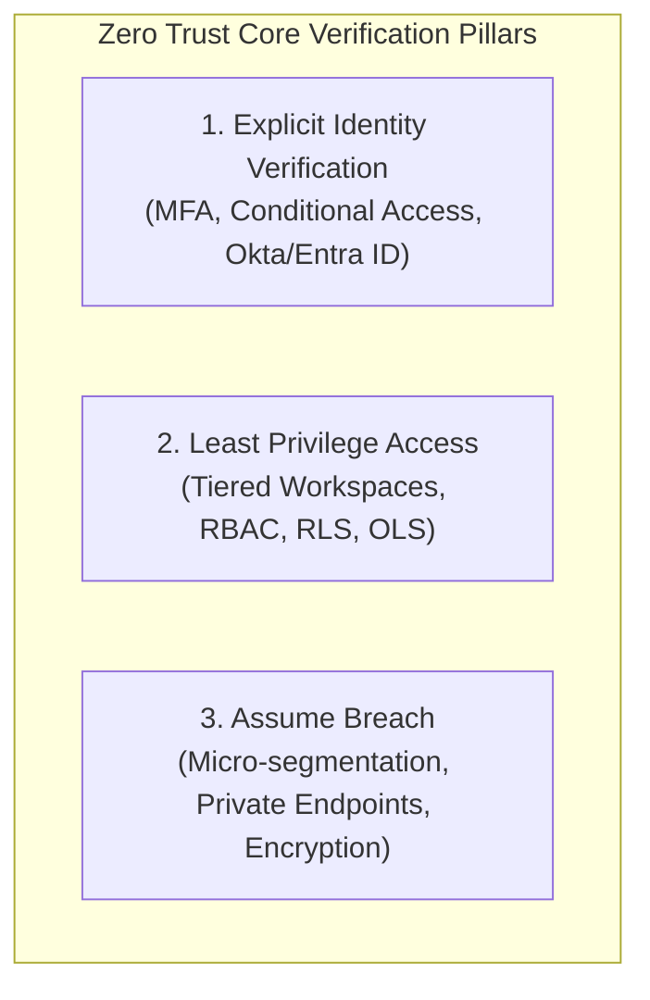
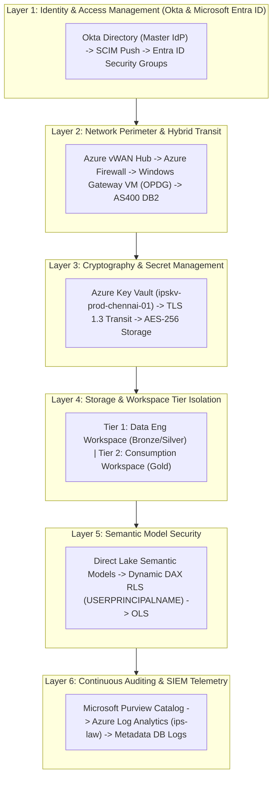
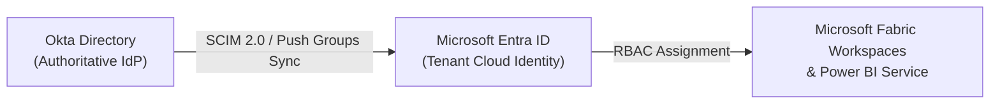
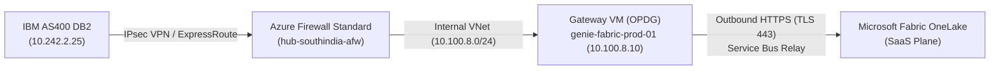
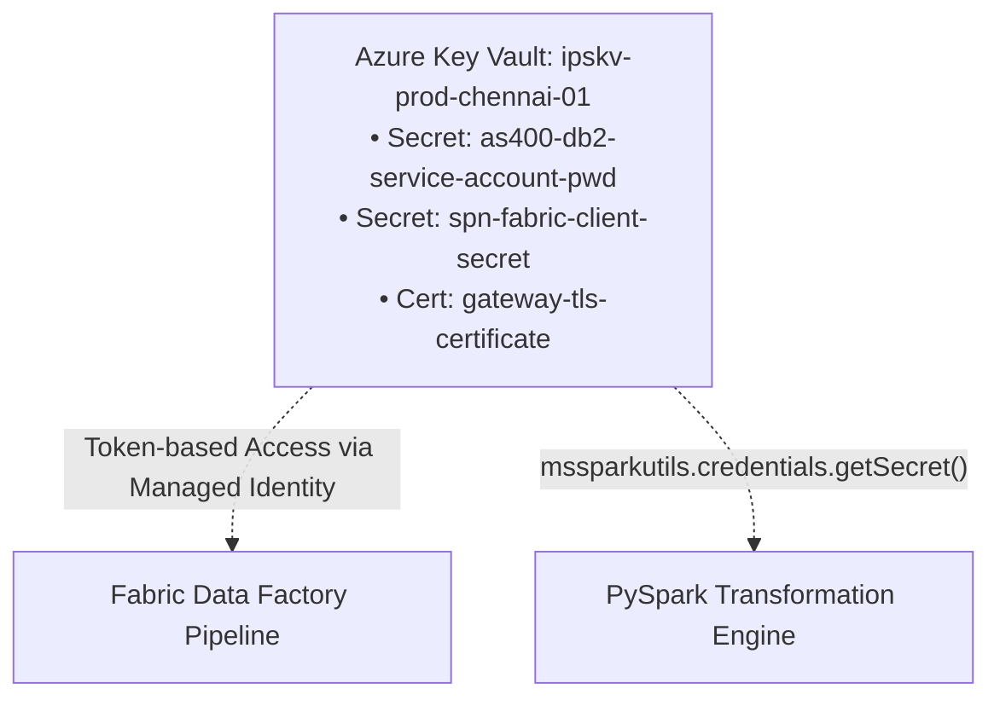
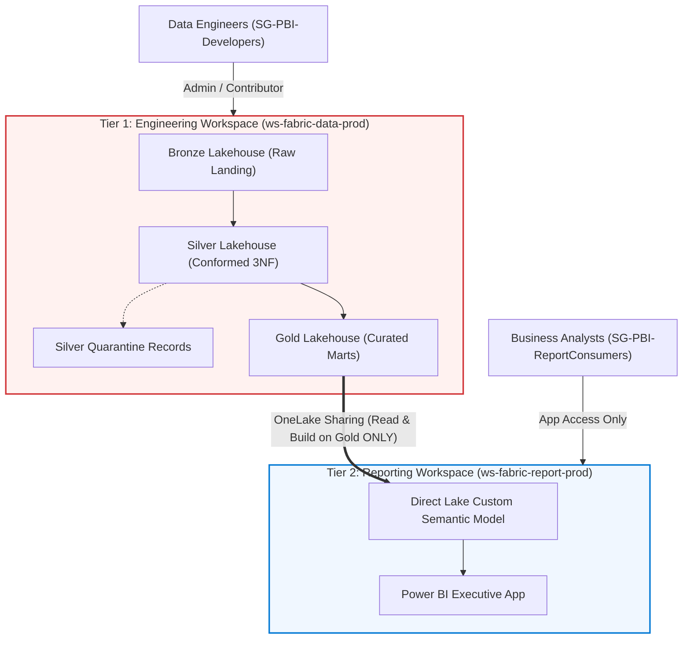
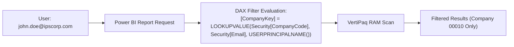
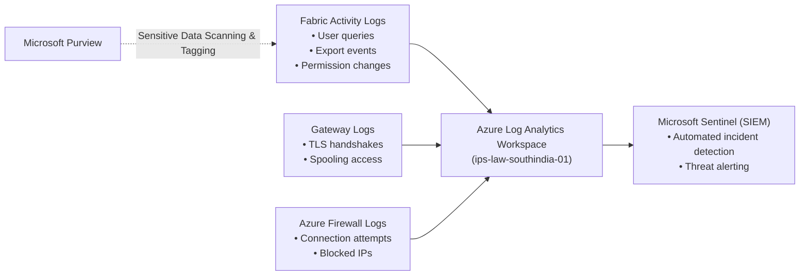

# IPS Corporation — Enterprise Security Architecture & Compliance Guide

> **Project:** IPS Corporation Enterprise Data Modernization  
> **Platform:** Microsoft Fabric, OneLake, Azure Security Backbone & Power BI Direct Lake  
> **Security Model:** Defense-in-Depth & Zero Trust Architecture (NIST SP 800-207)  
> **Document Location:** `docs/additional_docs/IPS_Enterprise_Security_Architecture_and_Compliance_Guide.md`  
> **Classification:** Confidential / Internal Enterprise Security Standard  

---

## 📋 Table of Contents
1. [Executive Summary & Zero Trust Philosophy](#1-executive-summary--zero-trust-philosophy)
2. [6-Layer Defense-in-Depth Architecture](#2-6-layer-defense-in-depth-architecture)
3. [Layer 1: Identity & Access Governance (Okta $\rightarrow$ Entra ID)](#3-layer-1-identity--access-governance-okta--entra-id)
   - [3.1 Federated Identity & Group Push Synchronization](#31-federated-identity--group-push-synchronization)
   - [3.2 Standard Security Groups Architecture](#32-standard-security-groups-architecture)
   - [3.3 Service Principals & Secretless Pipeline Execution](#33-service-principals--secretless-pipeline-execution)
4. [Layer 2: Network Perimeter & Hybrid Connectivity Security](#4-layer-2-network-perimeter--hybrid-connectivity-security)
   - [4.1 Hub-and-Spoke Topology & Azure Virtual WAN](#41-hub-and-spoke-topology--azure-virtual-wan)
   - [4.2 On-Premises Data Gateway (OPDG) Hardening](#42-on-premises-data-gateway-opdg-hardening)
   - [4.3 Inbound/Outbound Port Matrix](#43-inboundoutbound-port-matrix)
5. [Layer 3: Cryptography, Secrets & Key Management](#5-layer-3-cryptography-secrets--key-management)
   - [5.1 Azure Key Vault Architecture](#51-azure-key-vault-architecture)
   - [5.2 Data-at-Rest & In-Transit Encryption Standards](#52-data-at-rest--in-transit-encryption-standards)
6. [Layer 4: Data Layer Isolation (Shielding Bronze & Silver)](#6-layer-4-data-layer-isolation-shielding-bronze--silver)
7. [Layer 5: Semantic Security (Direct Lake RLS & OLS)](#7-layer-5-semantic-security-direct-lake-rls--ols)
   - [5.1 Dynamic Row-Level Security via DAX](#71-dynamic-row-level-security-via-dax)
   - [5.2 Direct Lake Fallback Prevention Standards](#72-direct-lake-fallback-prevention-standards)
8. [Layer 6: Continuous Auditing, SIEM & Microsoft Purview](#8-layer-6-continuous-auditing-siem--microsoft-purview)
9. [Enterprise Security & Compliance Mapping Matrix](#9-enterprise-security--compliance-mapping-matrix)

---

## 1. Executive Summary & Zero Trust Philosophy

The modernization of the **IPS Data Platform** adheres strictly to the **Zero Trust Security Model**: *"Never Trust, Always Verify"*. 

Security controls are not confined to the network boundary; instead, every access request—whether initiated by an engineer, an executive visual, an ETL pipeline, or a machine-to-machine API call—must be explicitly authenticated, authorized within fine-grained boundaries, and continuously audited.



### Core Security Objectives:
1. **Shield Legacy Infrastructure:** Protect on-premises IBM AS400 DB2 systems from public IP exposure or unauthorized ad-hoc extraction.
2. **Raw Layer Confidentiality:** Isolate Bronze (raw) and Silver (cleansed) Lakehouses from business users, exposing only certified Gold semantic models.
3. **Preserve Direct Lake In-Memory Performance:** Enforce fine-grained row security without triggering slow DirectQuery database fallbacks.
4. **End-to-End Encryption & Secretless Automation:** Eliminate plain-text credentials, passwords, or connection strings from notebooks and git repositories.

---

## 2. 6-Layer Defense-in-Depth Architecture



---

## 3. Layer 1: Identity & Access Governance (Okta $\rightarrow$ Entra ID)

### 3.1 Federated Identity & Group Push Synchronization
* **Identity Provider Master:** **Okta** serves as the authoritative enterprise identity provider for all employee life-cycle events (hire, transfer, termination).
* **SCIM Push Synchronization:** Okta utilizes automated SCIM / Group Push connectors to synchronize enterprise security groups into **Microsoft Entra ID (Azure AD)** in near real-time.



---

### 3.2 Standard Security Groups Architecture
Access to Fabric resources is governed strictly by **5 standardized Entra ID Security Groups**. Direct user assignments to workspaces or datasets are **prohibited by enterprise policy**:

| Security Group Name | Scope & Operational Authority | Assigned Role in Fabric |
| :--- | :--- | :--- |
| **`SG-PBI-FabricAdmins`** | Tenant-wide settings, capacity allocation, Fabric admin portal governance. | **Fabric Tenant Administrator** |
| **`SG-PBI-WorkspaceAdmins`** | Workspace lifecycle, deployment pipelines, ALM promotions. | **Workspace Admin** |
| **`SG-PBI-Developers`** | PySpark notebook authoring, data factory pipeline development, semantic modeling. | **Workspace Contributor / Member** |
| **`SG-PBI-ReportConsumers`** | Interactive view-only access to published reports, executive apps, and dashboards. | **Power BI App Viewer** |
| **`SG-PBI-GatewayAdmins`** | Gateway cluster configuration, ODBC driver updates, on-premises data source bindings. | **Gateway Administrator** |

---

### 3.3 Service Principals & Secretless Pipeline Execution
* **Automated CI/CD:** Azure DevOps and GitHub Actions pipelines authenticate into Fabric using a dedicated **Service Principal Name (SPN)**: `spn-fabric-cicd-prod`.
* **Zero User Credentials in Code:** Pipelines and notebooks authenticate against Azure Key Vault and OneLake via Microsoft Entra Service Principal tokens or Managed Identities (MI).

---

## 4. Layer 2: Network Perimeter & Hybrid Connectivity Security

### 4.1 Hub-and-Spoke Topology & Azure Virtual WAN
To isolate data transmission between on-premises datacenters and Microsoft Fabric:
* **Azure Virtual WAN (`hub-centralindia-vwan`):** Connects the on-premises datacenter via encrypted IPsec VPN / ExpressRoute.
* **Azure Firewall Standard (`hub-southindia-afw`):** Inspects all inter-subnet and outbound internet traffic, enforcing strict application rules.
* **No Public Inbound Access:** No public IPs are provisioned on any gateway virtual machine or database endpoint.



---

### 4.2 On-Premises Data Gateway (OPDG) Hardening
The gateway VM (`genie-fabric-prod-01`) acts as a secure, outbound-only reverse proxy relay:
1. **Outbound-Only Communication:** The gateway establishes outbound WebSocket connections over TLS 443 to the Azure Service Bus relay. **Zero inbound firewall ports are opened into the corporate network.**
2. **Spooling Directory Encryption:** The local buffer path (`C:\GatewaySpooling`) is hosted on an encrypted BitLocker volume with NTFS access restricted exclusively to the `NT SERVICE\PBIEgwService` account.

---

### 4.3 Inbound/Outbound Port Matrix

| Direction | Source | Destination | Protocol / Ports | Purpose |
| :--- | :--- | :--- | :--- | :--- |
| **Internal (Inbound to AS400)** | Gateway VM (`10.100.8.10`) | AS400 DB2 (`10.242.2.25`) | TCP `446`, `449`, `8471`, `9471` | IBM ACS ODBC database connection and host server communication. |
| **Outbound to Azure** | Gateway VM (`10.100.8.10`) | Azure Service Bus / OneLake | TCP `443` (TLS 1.2/1.3) | Encrypted outbound relay to Microsoft Fabric endpoints. |
| **External Inbound** | Public Internet | Entire Platform | **ALL PORTS BLOCKED** | Complete isolation from inbound internet threats. |

---

## 5. Layer 3: Cryptography, Secrets & Key Management

### 5.1 Azure Key Vault Architecture (`ipskv-prod-chennai-01`)
All database credentials, service principal secrets, and connection strings are stored inside Azure Key Vault:



#### Secret Retrieval Standard in PySpark:
```python
# Securely retrieve database credentials at runtime without plaintext exposure
as400_pwd = mssparkutils.credentials.getSecret("ipskv-prod-chennai-01", "as400-db2-service-account-pwd")
```

---

### 5.2 Data-at-Rest & In-Transit Encryption Standards
* **Encryption in Transit:** All network traffic across VNets, gateways, and Fabric services is strictly enforced over **TLS 1.3 / TLS 1.2** with strong cipher suites (`ECDHE-RSA-AES256-GCM-SHA384`).
* **Encryption at Rest:**
  * All files in OneLake and Delta tables are encrypted at rest using **FIPS 140-2 compliant 256-bit AES encryption**.
  * Encrypted transparently at the physical storage subsystem level.

---

## 6. Layer 4: Data Layer Isolation (Shielding Bronze & Silver)

To maintain regulatory confidentiality and prevent unvetted data exploration, IPS implements **Tiered Workspace Segregation**:



### Access Isolation Rules:
1. **Tier 1 (Data Engineering):** Only accessible to members of `SG-PBI-Developers` and `SG-PBI-WorkspaceAdmins`. Business analysts have **zero read or browse permissions** in this workspace.
2. **Tier 2 (Consumption):** Houses certified Direct Lake semantic models and thin `.pbix` reports.
3. **OneLake Granular Sharing:** Only Gold tables (`Fact_*`, `Dim_*`) are shared from Tier 1 to Tier 2 using OneLake item-level sharing. Raw Bronze tables and quarantine error tables remain completely invisible to business users.

---

## 7. Layer 5: Semantic Security (Direct Lake RLS & OLS)

### 7.1 Dynamic Row-Level Security via DAX
Security filtering is applied dynamically at the semantic layer based on the authenticated user's Entra ID email (`USERPRINCIPALNAME()`):



#### Production DAX RLS Filter Pattern:
Applied to `Dim_Company` or `Dim_Customer`:
```dax
[CompanyKey] = 
LOOKUPVALUE(
    UserSecurityMapping[CompanyCode],
    UserSecurityMapping[UserEmail],
    USERPRINCIPALNAME()
)
```

---

### 7.2 Direct Lake Fallback Prevention Standards
> [!CAUTION]
> **Direct Lake Fallback Hazard:** Applying SQL Row-Level Security (CREATE SECURITY POLICY) or SQL Views with `SESSION_USER` filters on the Lakehouse SQL Analytics Endpoint immediately disables Direct Lake mode, forcing queries into slow **DirectQuery Fallback** mode.

#### The Mandatory Architectural Standard:
* **Keep Lakehouse SQL Endpoint Completely Unfiltered:** The physical Delta tables in `lh_ips_gold` remain read-only without SQL-level security policies.
* **Enforce 100% of RLS in the Semantic Model:** DAX-based RLS is natively executed in memory by VertiPaq, preserving the **< 800ms query latency SLA**.
* **Object-Level Security (OLS):** Restrict sensitive financial fields (e.g., profit margins, executive compensation) directly in the semantic model using TMDL / Tabular Editor.

---

## 8. Layer 6: Continuous Auditing, SIEM & Microsoft Purview

Security operations and threat detection are governed through centralized auditing:



### Auditing & Threat Monitoring Capabilities:
1. **Activity Logging:** Every user report interaction, dataset refresh, export-to-Excel action, and permission update is logged and retained for 365 days in Azure Log Analytics.
2. **Microsoft Purview Data Loss Prevention (DLP):** Automatically detects unencrypted Social Security Numbers, banking credentials, or customer credit ratings and flags policy alerts.
3. **Automated Anomaly Alerts:** Sentinel alerts on unusual export volumes, unauthorized gateway access attempts, or off-hours bulk downloads.

---

## 9. Enterprise Security & Compliance Mapping Matrix

| Regulatory / Security Domain | Compliance Standard | Platform Implementation Mechanism | Reference |
| :--- | :--- | :--- | :--- |
| **Identity & Authentication** | NIST SP 800-63B / SOC 2 | Okta SCIM Push to Microsoft Entra ID with mandatory MFA and Conditional Access. | [Section 3.1](#31-federated-identity--group-push-synchronization) |
| **Network Isolation** | ISO/IEC 27001 / PCI-DSS | Azure Virtual WAN, Azure Firewall, zero public inbound IPs, outbound-only OPDG relay. | [Section 4.1](#41-hub-and-spoke-topology--azure-virtual-wan) |
| **Secret Protection** | CIS Benchmark Level 1 | Azure Key Vault (`ipskv-prod-chennai-01`); zero credentials stored in code or notebooks. | [Section 5.1](#51-azure-key-vault-architecture) |
| **Data Encryption at Rest** | FIPS 140-2 / HIPAA | 256-bit AES storage encryption across all OneLake Delta tables and gateway spooling caches. | [Section 5.2](#52-data-at-rest--in-transit-encryption-standards) |
| **Data Layer Separation** | SOX 404 Internal Controls | Strict 2-tier workspace isolation: Bronze/Silver data engineering hidden from report viewers. | [Section 6](#6-layer-4-data-layer-isolation-shielding-bronze--silver) |
| **Data Privacy (Need-to-Know)** | GDPR Art. 32 / CCPA | Dynamic DAX Row-Level Security (`USERPRINCIPALNAME`) and Object-Level Security (OLS). | [Section 7.1](#71-dynamic-row-level-security-via-dax) |
| **Auditability & Traceability** | SOX / HIPAA Security Rule | Comprehensive logging in Log Analytics Workspace (`ips-law-southindia-01`) + Purview. | [Section 8](#8-layer-6-continuous-auditing-siem--microsoft-purview) |
