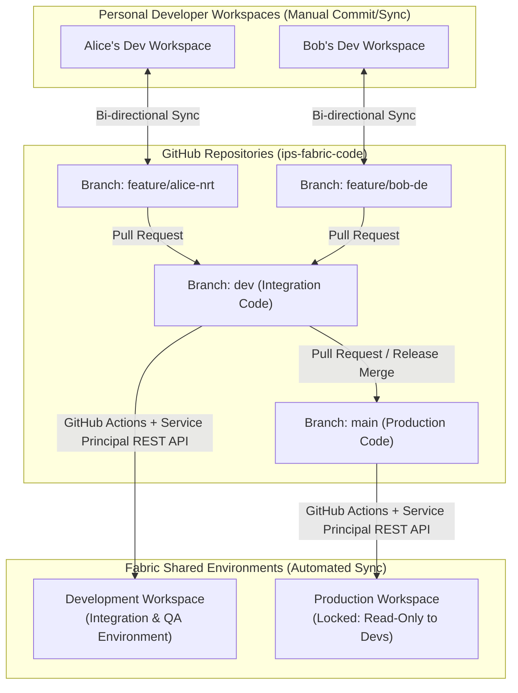
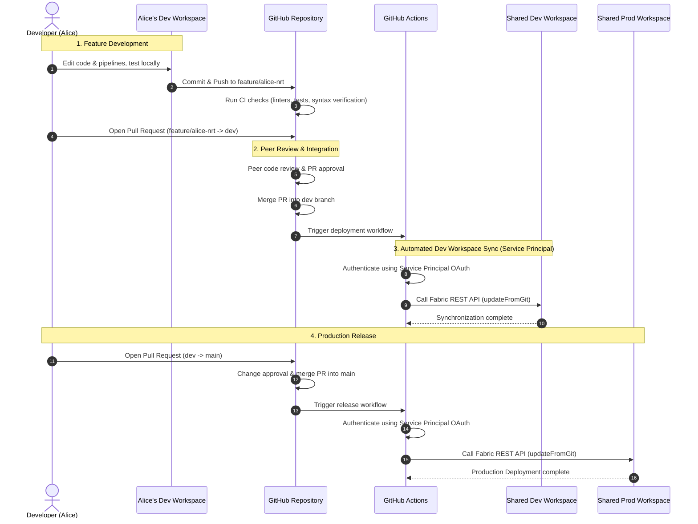

# DevOps Roadmap: Microsoft Fabric & GitHub Integration

This document outlines the step-by-step implementation roadmap for establishing a robust CI/CD pipeline and collaborative development workflow using **Microsoft Fabric**, **GitHub**, and **VS Code**.

As a DevOps Architect, this roadmap is structured in three phases to guide the team of 10 developers and testers:
- **Phase 1:** Setting up the GitHub Repository for Fabric Workloads
- **Phase 2:** Workspace Linking & Branch-Out Development Workflow
- **Phase 3:** Automated CI/CD Deployment Pipelines *(Deployment Automation)*

---

## Phase 1: GitHub Repository Setup & Fabric Serialization (Approved Configuration)

This phase focuses on the configuration of the GitHub repository (`ips-fabric-code`) to store, version, and organize Fabric workload items according to the approved architecture.

### 1. Repository Directory Structure & Branching Strategy

The team has adopted **Repository Pattern A: Single Workspace per Repository/Branch**:
- The `dev` branch directly maps to the **Development Workspace**.
- The `main` branch directly maps to the **Production Workspace**.
- Developers create isolated feature branches (e.g., `feature/user-story-123`) from `dev` and map them to their personal Fabric developer workspaces for parallel development.

#### Directory Folder Structure in Repository

```
ips-fabric-code/ [Root of Repository]
├── .github/
│   └── workflows/
│       ├── ci-validate.yml
│       └── deploy-to-prod.yml
├── lh_bronze_dev.Lakehouse/
│   ├── item.metadata.json
│   └── item.config.json
├── lh_silver_dev.Lakehouse/
│   ├── item.metadata.json
│   └── item.config.json
├── lh_gold_dev.Lakehouse/
│   ├── item.metadata.json
│   └── item.config.json
├── sqldb-meta-orch-dev.SqlDatabase/
│   └── [Database schema scripts & properties]
├── 01.Orchestration/
│   └── pl_orchestrate.Pipeline/
│       └── pipeline-content.json
├── 02.Ingestion_NRT/
│   └── nb_nrt_stream.Notebook/
│       └── notebook-content.py
├── 03.Data_Engineering/
│   └── nb_bronze_to_silver.Notebook/
│       └── notebook-content.py
└── 04.Environments/
    └── env-spark-config.Environment/
        ├── item.config.json
        └── requirements.txt
```

> [!NOTE]
> **Important Note on SQL Analytics Endpoints:**  
> In Microsoft Fabric, every Lakehouse and SQL Database automatically generates a corresponding **SQL Analytics Endpoint**. In Git source control, these endpoints **do not exist as separate folders**. They are implicitly represented and managed as part of the parent `lh_bronze_dev.Lakehouse`, `lh_silver_dev.Lakehouse`, `lh_gold_dev.Lakehouse`, and `sqldb-meta-orch-dev.SqlDatabase` metadata. Connecting to their SQL endpoints is handled dynamically in client tools (like VS Code or SSMS) via their unique connection strings.

---

### 2. Fabric Workload Item Serialization & Git Representation

Microsoft Fabric converts workspace items into text-based files when syncing with GitHub. Under our approved design, the items behave as follows:

#### A. Lakehouse (`.Lakehouse`)
- **Representation:** `item.metadata.json` and `item.config.json`.
- **DevOps Practice:** Data files (Parquet/Delta tables in OneLake) are excluded from Git. The Lakehouse in Git acts as a metadata container. Lakehouse tables and schemas are created dynamically at runtime by PySpark notebooks or SQL Warehouse DDL scripts.

#### B. Fabric SQL Database (`.SqlDatabase`)
- **Representation:** Database schema scripts and properties.
- **DevOps Practice:** DDL modifications (tables, views, stored procedures) must be committed as declarative SQL scripts.

#### C. Notebooks (`.Notebook`)
- **Representation:** `notebook-content.py` containing the PySpark code, cells (marked with comments), and cell metadata.
- **Enforcement:** The team has decided to enforce the **`.py` format** rather than `.ipynb`. This ensures that Pull Requests show clean line-by-line diffs of PySpark code and prevents merge conflicts caused by Jupyter Notebook metadata noise.

#### D. Pipelines (`.Pipeline`)
- **Representation:** `pipeline-content.json` detailing the orchestration flow, activities, parameters, and execution settings.
- **DevOps Practice:** Modify pipelines in the Fabric UI, commit changes to your feature branch, and let Fabric handle the JSON serialization.

#### E. Environments (`.Environment`)
- **Representation:** Spark runtime config, compute settings, and `requirements.txt` listing Python dependencies.
- **DevOps Practice:** Manage Python library updates directly in `requirements.txt` under this folder.

#### F. Configuration & Variables (Spark Environment Variables)
- **Standardization:** The team has standardized on **Spark Environment Variables** for environment configuration (e.g., target paths, API keys, URLs).
- **Implementation:**
  - Define custom environment variables (e.g., `ENV_TARGET_LAKEHOUSE`, `ENV_API_URL`) in `MyEnvironment.Environment/item.config.json` or through the Fabric UI environment settings.
  - At runtime, retrieve these variables in PySpark using `os.environ.get("ENV_TARGET_LAKEHOUSE")`.
  - For sensitive parameters and connection secrets, integrate with **Azure Key Vault** dynamically rather than storing them in plain text in Spark configurations.

#### G. Warehouse (`.Warehouse`)
- **Representation:** SQL Warehouse definition properties.
- **DevOps Practice:** Warehouse tables are data-bearing. DDL schema updates should be committed as migration scripts.

#### H. Semantic Models (`.SemanticModel`)
- **Representation:** TMDL (Tabular Model Definition Language) files.
- **DevOps Practice:** Always verify that **TMDL** is enabled in your developer options. This splits the model into clean, human-readable text files (`database.tmdl`, `tables.tmdl`) that allow parallel development without merge conflicts.

#### I. Power BI Reports (`.Report`)
- **Representation:** PBIR (Power BI Report) folder structure with report visuals serialized as JSON files.
- **DevOps Practice:** Enable **PBIR format** to allow reports to be diffed and reviewed during PRs.

---

### 3. Git Configuration & Best Practices

To ensure a smooth workflow for the 10 developers/testers, the repository must be configured with appropriate ignore rules and branch policies.

#### `.gitignore` File for Fabric Projects
A `.gitignore` file is placed at the root of the repository to prevent local development artifacts, system files, and sensitive credentials from being committed:

```gitignore
# Core OS / IDE files
.DS_Store
Thumbs.db
.vscode/
.idea/
*.suo
*.user

# Python/PySpark artifacts
__pycache__/
*.pyc
*.pyo
*.pyd
.ipynb_checkpoints/
.pytest_cache/
.tox/
venv/
env/

# Power BI Desktop local cache and backup files
*.tmp
*.log
*.zip
*.bak
*.pbix.user
.pbiviewer
msmdsrv.log

# Exclude actual data extracts or local databases
*.csv
*.parquet
*.json.tmp
*.db
```

#### Repository Configuration Checklist

1. **Default Branch:** Set the default repository branch to `dev` (where active integration occurs).
2. **Branch Protection Rules on `dev` and `main`:**
   - **Require a Pull Request before merging:** Prevent direct pushes to integration branches.
   - **Require approvals:** At least 1 (ideally 2) peer reviews required before merge.
   - **Require status checks to pass:** Block merges if automated CI validation (to be defined in Phase 3) fails.
   - **Dismiss stale reviews** when new commits are pushed.
3. **Commit Message Conventions:** Standardize commit messages (e.g., Conventional Commits: `feat(pipeline): add incremental load for ERP`, `fix(notebook): handle nulls in customer transform`). This helps in automated changelog generation and clear audit trails.

---

## Phase 2: Workspace Linking & Branch-Out Development Workflow

This phase details how to connect Fabric workspaces to GitHub, establish a secure Service Principal authentication flow for automated deployments, and set up a branch-out development cycle that enables the 10 developers/testers to work concurrently without overwriting each other's configurations.

### Identity Strategy: Dual Authentication Model

To achieve end-to-end automation and security, this architecture requires **two distinct identities** working in parallel:
1. A **GitHub user account** (for interactive Portal syncing).
2. An **Azure Service Principal** (for headless API orchestration).

| Identity | Authentication Type | Managed in | Primary Responsibility | Target Environment |
|---|---|---|---|---|
| **GitHub User Account** | Personal Access Token (PAT) | GitHub.com | Authenticating the interactive Microsoft Fabric Portal link to pull/push workspace items. | Developer workspaces & initial seeding workspace (`bim-data-dev`) |
| **Azure App Registration (Service Principal)** | Client ID & Client Secret | Azure Portal (Entra ID) | Authenticating non-interactive GitHub Actions runners to execute Fabric REST APIs. | CI/CD automation pipelines for shared workspaces (`dev`, `prod`) |

#### Why We Need Both:

- **The GitHub PAT Account (Interactive Portal Link):**  
  Microsoft Fabric's workspace Git Integration setting is designed for interactive users. It requires a standard Git username and PAT to establish the directory mapping and serialize portal items. Since a shared bot account cannot be created in your organization due to email restrictions, a dedicated human user account (e.g., the DevOps Lead/Workspace Admin) will generate this PAT.
  
  > [!WARNING]
  > Because this PAT is tied to a human user account, if that user leaves the organization or changes their password, the workspace's Git connection will be interrupted. Ensure the PAT is documented and rotated systematically.

- **The Azure App Registration / Service Principal (CI/CD Automation):**  
  During automated deployments (e.g., when a PR is merged into `dev` or `main`), there is no human operator to log into the portal. The GitHub Actions runner uses the Azure App Registration to acquire an OAuth token for the Fabric API resource (`https://api.fabric.microsoft.com/`) and triggers the sync API (`updateFromGit`) in the background.

---

### Architectural Workflows & Mapping Diagrams

The following diagrams illustrate the environment topology and development lifecycles.

#### Environment & Branch Topology

This diagram illustrates how branches map between developer workspaces and shared Fabric environments:



---

#### B. Development to Deployment Sequence

This diagram details the sequence of events from writing code to deploying to Production:



---

## 2. Step-by-Step Implementation Guide

### Step 0: Initial Seeding of the Repository from an Existing Workspace (`bim-data-dev`)

Before developers can branch out, the existing code and configurations (pipelines, notebooks, etc.) in the active `bim-data-dev` workspace must be committed to the `dev` branch in the GitHub repository.

#### 1. Prerequisite Setup in GitHub:
- Ensure the repository `https://github.com/IPS-Corporation/ips-fabric-code` is created.
- Create a base branch named `dev`. *(Open GitHub, click the branch drop-down, type `dev` and select "Create branch")*.

#### 2. Organize Workspace Folders (Optional but Recommended):
- In Microsoft Fabric, open the `bim-data-dev` workspace.
- To organize items, create folders (`01_Orchestration`, `02_Ingestion_NRT`, `03_Data_Engineering`, `04_Environments`) directly within the Fabric UI.
- Drag and drop your pipelines and notebooks into these folders. Fabric will preserve this folder structure in GitHub.

#### 3. Generate a GitHub Personal Access Token (PAT) for the Service Account:
To establish a reliable connection independent of any individual employee's account lifecycle, generate a PAT using a dedicated **GitHub Service Account** (e.g., `ips-fabric-devops-bot` or similar machine account) with write access:
- Log in to GitHub as the Service Account user.
- Go to your profile photo in the top right $\rightarrow$ **Settings**.
- Scroll to the bottom of the left sidebar and click **Developer settings**.
- Under **Personal access tokens**, select **Tokens (classic)**. *(Do not use Fine-grained tokens as some Fabric API features require classic tokens)*.
- Click **Generate new token $\rightarrow$ Generate new token (classic)**.
- Provide a name (e.g., `Fabric-Workspace-Sync-Token`), choose an expiration date (e.g., 90 days, or as per company security policy), and select the following scopes:
  - `repo` *(Full control of private repositories - Mandatory for Fabric to read/write files)*.
  - `read:org` *(Read org data - Recommended if the repo is under a GitHub Organization)*.
- Click **Generate token** and immediately copy the token string (it will only be displayed once). Store it securely.

#### 4. Establish the GitHub Connection in the Fabric Portal:
- Open the `bim-data-dev` workspace in the Fabric Portal.
- Click on **Workspace settings (gear icon)** in the top-right corner.
- Select the **Git integration** tab on the left menu.
- If there is no existing connection, select **GitHub** and fill out the connection fields:
  - **Display name:** Give it a descriptive name (e.g., `GitHub-IPS-DevOps-Service-Account`).
  - **PAT:** Paste the copied Personal Access Token.
  - **Repository URL:** `https://github.com/IPS-Corporation/ips-fabric-code`.
  - *Note:* Once credentials are saved, Fabric will authenticate and load the repository parameters.
- In the subsequent fields, select/enter:
  - **Branch:** `dev` *(maps the workspace to the development branch)*
  - **Folder path:** `/` *(seeding to the root folder)*
- Click **Connect**.

#### 5. Commit Existing Work to GitHub (Seeding):
- Once connected, Microsoft Fabric will analyze the differences between the workspace (which contains notebooks/pipelines) and the empty `dev` branch in GitHub.
- A blue indicator will appear on the **Source control** panel (top-right side menu or left-hand tab). Click it to open the panel.
- Under the **Changes** tab, you will see a list of all your developed notebooks, pipelines, and environment items marked as **New**.
- Input a commit message, such as: `Initial Seed: Commit existing pipelines and notebooks from bim-data-dev`.
- Select all items and click the **Commit** button.
- Fabric will serialize these items into their `.Notebook` (using `.py` format) and `.Pipeline` folder structures, and push them directly to the `dev` branch on GitHub.

#### 6. Verify and Lock the Integration Branch:
- Go to GitHub and confirm that the directories (e.g., `01_Orchestration`, `03_Data_Engineering`) and their files are visible.
- In GitHub repository settings, apply **Branch Protection Rules** to `dev` to prevent developers from directly pushing changes to it in the future.

---

### Step 1: Set Up Azure AD App Registration (Service Principal)

Since direct Git integration in the Fabric Portal relies on user OAuth credentials, we must use a **Service Principal** to execute automated deployment API calls in the CI/CD pipeline.

#### 1. Register the Application:
- Navigate to the **Azure Portal $\rightarrow$ Microsoft Entra ID $\rightarrow$ App registrations $\rightarrow$ New registration**.
- Name the application (e.g., `sp-fabric-devops`) and register it.
- Copy the **Application (client) ID** and **Directory (tenant) ID**.

#### 2. Generate Secret:
- Go to **Certificates & secrets $\rightarrow$ New client secret**.
- Copy the secret value immediately and save it in your GitHub repository secrets as `AZURE_CLIENT_SECRET`.

#### 3. Configure Fabric Tenant Settings for Service Principals:
- Open the **Fabric Admin Portal** (Microsoft Fabric admin credentials required).
- Navigate to **Tenant settings $\rightarrow$ Developer settings**.
- Find the setting **Service principals can use Fabric APIs**.
- Switch the toggle to **Enabled**.
- Under **Apply to**, choose **Specific security groups** and add a security group that contains your Service Principal (`sp-fabric-devops`).

#### 4. Grant Workspace Access:
- In Microsoft Fabric, navigate to the shared **Development Workspace** and **Production Workspace**.
- Go to **Manage access**.
- Add the Service Principal (`sp-fabric-devops`) as a **Contributor** (or **Admin** if required to run git configurations).

---

### Step 2: Establish the Branch-Out Workflow for Developers

For the team of 10 developers/testers, parallel development is managed by isolating workspace changes.

#### 1. Provision Personal Workspaces:
- Assign each developer their own workspace in the Fabric tenant (e.g., `dev-workspace-alice`, `dev-workspace-bob`).
- Assign the appropriate Fabric licenses (Fabric Capacity or Premium Per User) to these workspaces.

#### 2. Link Workspace to GitHub Feature Branch:
- The developer opens their personal workspace in the Fabric Portal.
- Go to **Workspace settings $\rightarrow$ Git integration**.
- Enter the repository URL: `https://github.com/IPS-Corporation/ips-fabric-code`.
- Select **Branch:** create a new branch or select their existing feature branch (e.g., `feature/alice-nrt`).
- Click **Connect and sync**.

#### 3. Making Changes and Committing:
- The developer builds or edits items (e.g., PySpark notebooks, SQL DB schemas, or data pipelines) inside their personal workspace.
- Fabric detects modifications and highlights them in the **Source control** panel (denoted by a blue status notification on the left menu bar).
- In the panel, the developer selects the modified items, inputs a commit message, and clicks **Commit**. Fabric serializes the items and pushes the commits directly to their GitHub feature branch.

#### 4. Local Sync to VS Code (Optional, for Copilot & local editing):
- The developer runs `git clone https://github.com/IPS-Corporation/ips-fabric-code.git` locally.
- Checks out their feature branch: `git checkout feature/alice-nrt`.
- Open VS Code. They can edit `.py` notebooks, TMDL semantic models, or SQL files directly.
- Once edited, they run `git commit` and `git push`.
- The developer returns to the Fabric Portal workspace, goes to the **Source control** panel, and clicks **Update**. Fabric pulls the code changes from the GitHub feature branch and compiles them into active workspace items.

---

### Step 3: Implement Automated Sync via GitHub Actions and Fabric REST API

To protect the shared Development and Production workspaces from direct human modification, sync is automated via GitHub Actions using the Fabric REST API.

#### 1. Authentication (Obtaining Azure Access Token):
The GitHub Actions workflow logs into Azure using the Service Principal credentials:

```bash
az login --service-principal \
  -u ${{ secrets.AZURE_CLIENT_ID }} \
  -p ${{ secrets.AZURE_CLIENT_SECRET }} \
  --tenant ${{ secrets.AZURE_TENANT_ID }}
```

Request an access token for the Fabric API resource scope (`https://api.fabric.microsoft.com/.default`):

```bash
TOKEN=$(az account get-access-token --resource https://api.fabric.microsoft.com/ --query accessToken -o tsv)
```

#### 2. Triggering Workspace Sync (Git Update API):
Call the Fabric Git synchronization API endpoint to force the target workspace to pull the latest code from its linked branch:

```bash
curl -X POST "https://api.fabric.microsoft.com/v1/workspaces/${{ secrets.DEV_WORKSPACE_ID }}/git/updateFromGit" \
  -H "Authorization: Bearer $TOKEN" \
  -H "Content-Type: application/json" \
  -d '{
    "remoteCommitHash": "${{ github.sha }}",
    "conflictResolutionPolicy": "WorkspaceWins"
  }'
```

> [!NOTE]
> **Note on conflict resolution:** In an automated pipeline, the Git branch is the source of truth, so `"conflictResolutionPolicy": "WorkspaceWins"` is used to override any local drift in the shared target workspace.

