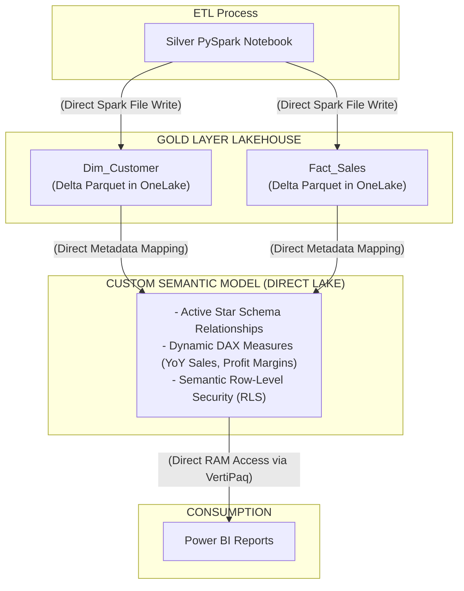
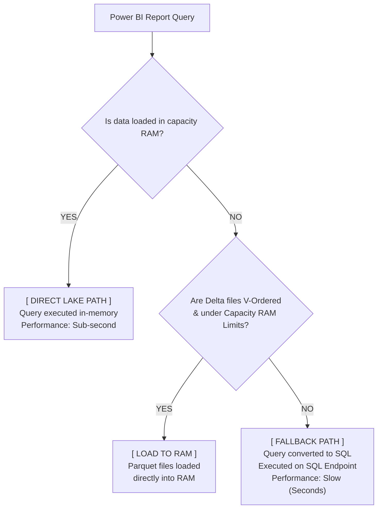
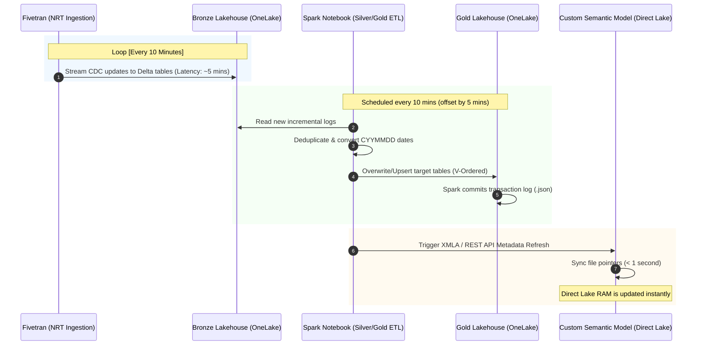

# Architectural Specification: Fabric Gold Layer & Semantic Model Design

> **Project:** Legacy BI Modernization to Microsoft Fabric  
> **Client:** IPS Corporation  
> **Document Version:** 1.0 (Initial Draft)  
> **Author:** Nirmalya Chakraborty  
> **Date:** August 2, 2026  

---

## Executive Summary

This architectural specification defines the design, storage strategy, and semantic layer configuration for the **Gold Layer** within IPS Corporation's Microsoft Fabric enterprise data platform.

The primary business goal is to serve transactional and operational data sourced from the legacy AS400 mainframe (via Fivetran CDC and Fabric Data Factory) with a **15-minute SLA** and sub-second report query performance. To achieve this without duplicate data storage or processing overhead, all enterprise reports will utilize **Power BI Direct Lake Mode** to connect to the Gold layer.

This document resolves the architectural choices around the Gold layer's storage format (Lakehouse vs. Data Warehouse), details the semantic layer architecture, and outlines critical optimization considerations for Direct Lake interactions.

---

## 1. Gold Layer Storage: Lakehouse vs. Data Warehouse

A core design decision for the Gold layer is whether to host the dimensional star schemas in a **Fabric Lakehouse** or a **Fabric Data Warehouse**.

### 1.1 Comparative Analysis

| Evaluation Dimension | Fabric Lakehouse (SQL Analytics Endpoint) | Fabric Data Warehouse |
|---|---|---|
| **Primary Write Engine** | Spark (Notebooks / Spark Jobs), Dataflows Gen2 | T-SQL (`INSERT`, `UPDATE`, `DELETE`, `MERGE`, `CTAS`) |
| **File Format** | Delta Parquet in OneLake | Delta Parquet in OneLake (managed) |
| **Write Performance** | **High** for large-scale Spark batch and stream writes | **Medium-High** (processed via SQL transactional engine) |
| **T-SQL Write Capability** | None (SQL Analytics Endpoint is read-only) | Full DDL/DML support |
| **Direct Lake Support** | **Native** (reads Delta tables directly from OneLake folder) | **Supported** (via Warehouse Delta tables) |
| **Auto-Sync Metadata** | **Automatic** (Spark commits immediately register in the SQL endpoint and Default Model) | **Automatic** (SQL commits update metadata) |
| **Security Boundaries** | Read-only SQL access protects tables from ad-hoc user modification | Write access is governed at database level; risk of ad-hoc SQL modifications |
| **ETL Alignment** | **Perfect alignment** with PySpark notebooks used for Silver-to-Gold processing | Requires JDBC/ODBC connector from Spark, adding network hops and latency |

---

### 1.2 Architectural Recommendation: Gold Lakehouse

The Gold layer for IPS Corporation will be implemented as a **Fabric Lakehouse** (preferred to as the `Gold_Lakehouse` / `lh_gold`).



---

### 1.3 Technical Justifications

1. **Alignment with Upstream Processing:**  
   The Medallion architecture relies on PySpark notebooks in Fabric to clean and reshape data from Silver to Gold. A Lakehouse allows Spark to write Delta tables directly to OneLake with maximum performance. Writing from Spark into a Data Warehouse requires a JDBC connection, which routes data through the Warehouse SQL engine, creating an unnecessary double-hop and performance bottleneck.

2. **Direct Lake Optimization:**  
   Direct Lake reads raw Delta Parquet files directly from OneLake. In a Lakehouse, Spark writes can easily be optimized at the file level (V-Ordering, Z-Ordering, compaction) directly within the notebooks.

3. **Data Protection (Read-Only SQL):**  
   The Gold layer serves as the single source of truth for reporting. A Lakehouse SQL Analytics Endpoint is read-only, which guarantees that business users, analysts, and external applications cannot execute accidental or unauthorized updates (`INSERT`, `UPDATE`, `DELETE`) on the Gold tables. All modifications must run through the automated pipeline.

---

## 2. Gold Layer Creation & Optimization Strategy

Creating the Gold Lakehouse requires structured star-schema design and physical data layout optimization to ensure Direct Lake operates at peak performance.

### 2.1 Dimensional Star Schema Design

To maximize Power BI performance, the Gold layer must be modeled as a strict star schema:
- **Fact Tables (`Fact_Sales`, `Fact_Inventory`):** Contain numeric measures and foreign keys linking to dimensions. Fact tables are optimized for column-oriented aggregation.
- **Dimension Tables (`Dim_Customer`, `Dim_Product`, `Dim_Date`):** Contain descriptive attributes used for slicing and filtering.

> **Rule:** Avoid Snowflake designs (normalized dimensions) to minimize the join depth inside the Power BI query engine.

---

### 2.2 V-Ordering (Microsoft's Write Optimization)

Direct Lake performance is heavily dependent on how quickly the VertiPaq engine can load Delta Parquet files into memory. **V-Order** is a proprietary write-time optimization that applies sorting, distribution, and compression algorithms to the Parquet files, making them directly compatible with VertiPaq's in-memory format.

- **Implementation:** Spark sessions processing the Gold layer must have V-Order enabled.

#### PySpark Code for Writing Optimized Gold Tables:

```python
# Enable V-Order in the Spark Session
spark.conf.set("spark.sql.parquet.vorder.enabled", "true")

# Write the Gold Fact table as Delta with V-Order enabled
(df_gold_fact
 .write
 .format("delta")
 .mode("overwrite")
 .option("optimizeWrite", "true") # Compacts files during write
 .save("Tables/Fact_Sales"))
```

---

### 2.3 Compaction & Maintenance (The "Small File" Problem)

Because the Near Real-Time (NRT) pipeline writes incremental data frequently, the Delta tables can accumulate hundreds of small Parquet files. This degrades Direct Lake performance because the engine has to open and read many file headers.

> **Architectural Rule:** Run the `OPTIMIZE` and `VACUUM` commands in a daily maintenance Spark notebook to merge small files and clean up deleted file history.

#### PySpark Table Maintenance Script:

```python
from delta.tables import DeltaTable

# Optimize layout (compact files) and apply Z-Ordering on primary search key
spark.sql("OPTIMIZE Gold_Lakehouse.Fact_Sales ZORDER BY (TransactionDate)")

# Clean up files older than 7 days (default retention is 7 days)
deltaTable = DeltaTable.forName(spark, "Gold_Lakehouse.Fact_Sales")
deltaTable.vacuum(168)  # 168 hours = 7 days
```

---

## 3. Semantic Layer Architecture & Modeling

### 3.1 Is a Semantic Model Required on Top of Gold?

**Yes, it is strictly required.** Power BI reports cannot connect directly to raw Delta files in OneLake. The semantic model (formerly dataset) is the logical abstraction layer that translates raw database tables into a business-consumable analytical model. It is responsible for:

1. **Relationships:** Defining 1-to-many active relationships between dimension keys and fact foreign keys.
2. **Calculations:** Housing DAX (Data Analysis Expressions) measures (e.g., `YTD Sales = TOTALYTD([Total Revenue], 'Dim_Date'[Date])`). Direct Lake executes DAX calculations in memory.
3. **Hierarchies:** Creating drill-down paths (e.g., Product Category $\rightarrow$ Product Subcategory $\rightarrow$ Product Name).
4. **Metadata & Formatting:** Storing column descriptions, user-friendly renames, and default formatting (e.g., currency symbols, percentages).
5. **Security Mapping:** Enforcing Row-Level Security (RLS) rules.

---

### 3.2 Default vs. Custom Semantic Models

When a Fabric Lakehouse is created, the system automatically generates a **Default Semantic Model** (`[Lakehouse_Name]`).

> [!IMPORTANT]
> **Architectural Anti-Pattern:** Utilizing the Default Semantic Model for corporate enterprise reporting is an anti-pattern and is not recommended for IPS Corporation's production reports.

#### Comparison: Default vs. Custom Semantic Models

| Feature | Default Semantic Model | Custom Semantic Model |
|---|---|---|
| **Table Inclusion** | Automatically includes **every** table created in the Lakehouse (Bronze, Silver, Gold, Staging). | Developer selects **only** the curated Gold dimension and fact tables. |
| **Schema Drift** | Automatically appends new tables/columns as they appear in the Lakehouse. | **Controlled schema updates;** prevents breaking changes from propagating to reports. |
| **Object-Level Security** | Cannot hide tables or columns from users. | **Supported;** developers can restrict sensitive columns (e.g., profit margins). |
| **Workspace Boundary** | Lives strictly in the same workspace as the Lakehouse. | Can be deployed in separate downstream reporting workspaces for governance. |
| **Direct Lake Support** | Native. | Native *(as long as all tables reside in the same Fabric workspace/Lakehouse)*. |

---

### 3.3 Custom Semantic Model Design Rules

1. **Defer all reports to connect to Custom Semantic Models** defined via the Fabric Web UI or Power BI Desktop (using the XMLA read/write endpoint).
2. **Include only tables prefixed with `Dim_` and `Fact_`.** Exclude all raw, staging, or intermediate processing tables.
3. **Standardize column names** (e.g., rename `CUSTNUM` to `Customer ID`).
4. **Establish relationships using integer surrogate keys** rather than long string keys to minimize memory footprints in RAM.

---

## 4. Direct Lake Interaction & Performance Considerations

Direct Lake Mode provides the performance of Import Mode with the real-time access of DirectQuery. However, because it loads files directly into the Fabric capacity's RAM, data architects must design models to prevent **DirectQuery Fallback**.



---

### 4.1 Memory Limits & Capacity Constraints

Direct Lake models are hosted in the RAM allocated to the Fabric Capacity. If the model's active columns exceed these limits, the model will fallback to **DirectQuery**.

- **IPS Development Capacity (F32):**
  - Max Memory per Semantic Model: **10 GB** (in-memory size of active columns).
- **IPS Production Capacity (F64):**
  - Max Memory per Semantic Model: **25 GB**.

#### Mitigations for Memory Limitations:
- **Column Selection:** Only load columns required for reporting. Do not select `SELECT *` from Silver tables. Exclude high-cardinality keys, raw system timestamps, and long text columns from the semantic model.
- **Aggressive Data Types:** Convert high-precision decimals to standard floating points or integers if currency precision is not required.
- **Auto-Sync Metadata Settings:** Ensure the Lakehouse properties have *"Keep client-cached data in sync"* enabled. This ensures that when the Spark notebook completes, the semantic model updates its file pointers instantly without reloading the entire model.

---

### 4.2 Handling Row-Level Security (RLS)

Security is a vital requirement for IPS corporate reporting. However, how security is implemented dictates whether Direct Lake mode is preserved.

> [!WARNING]
> **Direct Lake Fallback Warning:** Defining Row-Level Security (RLS) on the SQL Analytics Endpoint or using SQL views with security filters will force the semantic model to fall back to **DirectQuery** mode for all queries.

#### Recommended RLS Architecture:
- **Location:** Implement RLS **exclusively inside the Custom Semantic Model** using DAX filters.
- **Mechanism:** Use dynamic DAX security rules combined with Microsoft Entra ID logins.
- **Example DAX Filter (applied to `Dim_Sales_Territory`):**
  ```dax
  [Region_Code] = LOOKUPVALUE(
      UserMapping[Region_Code],
      UserMapping[User_Email],
      USERPRINCIPALNAME()
  )
  ```
- This ensures that security rules are evaluated in-memory by the VertiPaq engine, maintaining the Direct Lake path.

---

### 4.3 Fallback Behavior Configuration

During report development and testing, architects should configure the fallback behavior to identify performance bottlenecks.

- **Setting:** In the semantic model properties, locate **Direct Lake Behavior**.
- **Choices:**
  - `Automatic` (Default): Falls back to DirectQuery if memory limits are exceeded or schema errors occur. This can mask performance degradation during testing.
  - `Direct Lake Only`: Fails the query and throws an error if it cannot be served via Direct Lake.
- **Architectural Standard:** Set behavior to **`Direct Lake Only` in the Test workspace**. This forces developers to resolve memory, DAX, or driver issues before moving reports to the Production environment where the setting is set to `Automatic` to guarantee report availability.

---

### 4.4 Direct Lake Limitations & Constraints (DAX & Modeling)

While Direct Lake offers exceptional performance, developers must strictly adhere to the following limitations to prevent silent or forced fallback to DirectQuery mode:

#### 1. DAX Calculations Constraints (Calculated Columns & Tables):
- **Calculated Columns:** Direct Lake mode does **not** support calculated columns created using DAX within the semantic model. Attempting to add a DAX calculated column to a table will force that table—and any visual referencing it—to immediately fall back to DirectQuery mode.
  - *Architectural Rule:* All columnar calculations (e.g., date conversions, string concatenations, flags) must be processed upstream in the PySpark Silver or Gold notebooks and stored physically as columns in the Delta tables.
- **Calculated Tables:** Defining or creating tables using DAX (e.g., `Calculated_Date_Table = CALENDARAUTO()`) is not supported in Direct Lake.
  - *Architectural Rule:* All tables must be physical tables in the Gold Lakehouse.
- *Exception:* **DAX Measures** (e.g., dynamic aggregates, time intelligence calculations) are fully supported and executed in-memory in Direct Lake mode.

#### 2. Single Lakehouse Source Constraint:
- A Direct Lake semantic model can only reference tables from a **single Fabric Lakehouse** (or Data Warehouse SQL Endpoint).
- *Impact:* You cannot build a single Direct Lake model that combines tables from different Lakehouses, or mixes Lakehouse tables with Warehouse tables.
- *Mitigation:* If cross-source modeling is required, tables must be loaded or referenced (via shortcuts) into the single target `Gold_Lakehouse` first.

#### 3. Unsupported SQL and Physical Data Types:
- Direct Lake does not support certain specialized database data types. If these are present in a table, the engine will fallback to DirectQuery for any query targeting that table.
- *Unsupported Types:* `Binary`/`Varbinary`, Spatial types (`Geometry`/`Geography`), and legacy `XML`/`LOB` types.
- *Architectural Rule:* Spark transformations must cast or drop these types before saving to the Gold layer (e.g., convert binary flags to Boolean or Integer).

#### 4. Semantic Model Partitioning and Incremental Refresh:
- Power BI's native **Incremental Refresh** (configured via Power BI Desktop partitioning) is **not supported** in Direct Lake mode.
- *Architectural Rule:* All data partition slicing, aging, and historical deletion must be managed physically at the Delta table level in OneLake using Spark partition strategies, not within the semantic model configuration.

#### 5. Schema Out-of-Sync and Transaction Lock Contention:
- **Schema Drift:** If a column is added, renamed, or deleted in the Gold Lakehouse, but the semantic model's metadata is not refreshed, report queries will fail or fall back to DirectQuery.
- **Transaction Locking:** If a massive Spark notebook update is actively writing/committing transaction files (`.json` delta logs) in OneLake, a concurrent report query may trigger a fallback to DirectQuery to ensure it reads a consistent snapshot of the data.

---

## 5. System Integration & SLA Alignment

To meet the 15-minute SLA, the ingestion, transformation, and semantic refresh steps must be synchronized. Because Direct Lake does not require a traditional data refresh, the semantic model only needs to be notified of schema/metadata changes.

### 5.1 End-to-End Execution Sequence



---

### 5.2 Automating the Metadata Refresh

Although Direct Lake reads files directly, the semantic model must query the latest transaction logs to discover newly written Parquet files. To ensure this happens instantly upon Spark notebook completion, the ETL pipeline must trigger a metadata sync.

This is accomplished by adding a **Web Activity** at the end of the Fabric Pipeline that calls the Power BI REST API to refresh the semantic model. Because this is a metadata-only sync (not a data load), the execution completes in **under 1 second**.

#### REST API Refresh Configuration:
- **Endpoint:**  
  `https://api.powerbi.com/v1.0/myorg/groups/{workspace_id}/datasets/{dataset_id}/refreshes`
- **Method:** `POST`
- **Request Body:**
  ```json
  {
    "type": "clearCacheAndRehydrate"
  }
  ```
- *(Note: This forces the VertiPaq engine to clear the internal cache for modified tables and load the new Delta files into RAM upon the next report query).*

---

## 6. Architectural Readiness Checklist

The following checklist must be signed off by the lead developer and data architect before deploying the Gold and Semantic layers:

- [ ] **Storage Type:** Gold layer established as a **Fabric Lakehouse** (`Gold_Lakehouse`).
- [ ] **V-Order Enabled:** PySpark session property `spark.sql.parquet.vorder.enabled` set to `true` in all Gold notebooks.
- [ ] **Maintenance Schedule:** Daily Spark notebook scheduled to execute `OPTIMIZE` and `VACUUM` on all Gold tables to prevent small file accumulation.
- [ ] **Model Selection:** A **Custom Semantic Model** is created containing only Gold fact and dimension tables.
- [ ] **RLS Definition:** Row-Level Security defined in the semantic model using DAX `USERPRINCIPALNAME()` filtering, with zero security filters on the SQL Analytics Endpoint.
- [ ] **Fallback Test:** Default fallback behavior set to `Direct Lake Only` in the Test workspace to validate that all queries execute in-memory.
- [ ] **Pipeline Orchestration:** REST API metadata refresh activity configured in the Fabric pipeline immediately following the Spark Gold write notebook.
- [ ] **Memory Sizing:** Checked that the total estimated memory footprint of active reporting columns is under the F32 limit (10 GB) and F64 limit (25 GB).

---

## 7. Medallion Architecture Strategy: Append-Only Bronze Layer & Deduplication

In modern Data Engineering and the **Medallion Architecture (Bronze $\rightarrow$ Silver $\rightarrow$ Gold)** on platforms like **Microsoft Fabric**, maintaining an append-only Bronze layer containing duplicate / historical snapshot records across incremental loads is not only advisable—it is the industry-standard best practice.

### Key Architectural Concepts: Raw Ledger vs. Conformed Mirror

- **Bronze Layer Goal:** Act as an **immutable, append-only audit ledger** of raw ingested data as it arrived from the source system at a given point in time.
- **Silver Layer Goal:** Act as the **single source of truth** where business key deduplication, data cleaning, schema enforcement, validation, and UPSERT (SCD Type 1 or Type 2) logic are applied.

---

### 7.1 Pros of Append-Only (Duplicates in) Bronze

1. **Immutable Audit Trail & Complete Lineage:**
   - Preserves exact point-in-time snapshots for every extraction from JDE/DB2i.
   - If a record in JDE was modified 5 times over 5 days, Bronze records all 5 states along with ingestion metadata (`_ingested_at`, `_batch_id`). This provides full regulatory auditability and change traceability.

2. **Replayability & Resiliency (Fault Tolerance):**
   - If downstream Silver/Gold PySpark transformation logic changes or encounters a bug, you can drop the Silver table and **reprocess the entire historical Silver layer from Bronze** without ever needing to touch legacy JDE/DB2i source tables again.

3. **Decoupled & Ultra-Fast Ingestion (Source Protection):**
   - Fabric Copy Activity running a simple **APPEND** into Delta Parquet requires zero lookup, zero deduplication, and zero lock overhead against DB2i during ingestion. This minimizes operational impact on JDE transactional workloads.

4. **Schema Evolution Cushion:**
   - Source schema drifts or raw payload corruptions can be isolated in Bronze. Because Bronze does not enforce strict Silver deduplication or primary key constraints, ingestion rarely fails due to source-side data quality anomalies.

---

### 7.2 Cons & Challenges of Duplicates in Bronze

1. **Storage Accumulation over Time:**
   - Appending every batch incremental load increases Delta Lake storage volume over time compared to maintaining a 1:1 overwrite/upsert mirror.
   - *Mitigation:* Parquet / Delta compression with Fabric's V-Order reduces this footprint significantly. Furthermore, cold historical partitions can be archived or vacuumed according to data retention policies.

2. **Silver Processing Cost if Full-Scanned:**
   - If your PySpark Silver notebook reads the entire historical Bronze table on every pipeline execution, deduplication (`row_number()` window functions or Delta MERGE) will grow increasingly expensive as Bronze expands.
   - *Mitigation:* Implement **incremental watermarking** (e.g., filtering Bronze by `_ingested_at > last_processed_timestamp`).

3. **Bronze Must Not Be Used for Business Reporting:**
   - Ad-hoc queries directly against Bronze will return duplicate primary keys, requiring analysts to write deduplication logic.
   - *Mitigation:* Strictly enforce security access policies so business users only query **Silver and Gold** layers.

---

### 7.3 Architectural Comparison Matrix

| Feature / Criteria | Append-Only Bronze (Recommended) | 1:1 Source Mirror Bronze (Overwrite/UPSERT) |
|---|---|---|
| **Auditability & History** | **High** (Complete change log preserved) | **Low** (Overwrites past source states) |
| **Replayability** | **Yes** — can rebuild Silver anytime | **No** — lost past states |
| **Ingestion Pipeline Speed** | **Fast** (Simple append copy activity) | **Slower** (Requires source locks or merge logic) |
| **Storage Usage** | Higher (Grows with incremental batches) | Lower (Maintains current source volume) |
| **Processing Complexity** | Simple ingestion; deduplication pushed to Silver | Duplicate logic executed in Bronze AND Silver |

---

### 7.4 Final Recommendation & Best Practices for IPS BI Modernization

> **Recommendation:** Keep Bronze as an **Append-Only store containing duplicates over time**, and continue using PySpark in Silver for deduplication.

#### Recommended Best Practices to Implement:

1. **Enrich Bronze with System Metadata Columns:**  
   Always append operational metadata columns in the Fabric Copy Activity / Bronze load:
   - `_ingested_at` (Timestamp of copy execution)
   - `_batch_id` (Pipeline Run ID)
   - `_source_file` (Filename or query source identifier)

2. **Deduplicate in Silver via PySpark Windowing or MERGE INTO:**  
   In your Silver PySpark notebook, partition by the JDE Business Key (e.g., `UKID`, `AN8`, `DOCO`) and order by source update timestamp / `_ingested_at` descending:

   ```python
   from pyspark.sql import Window
   from pyspark.sql.functions import col, row_number

   windowSpec = Window.partitionBy("JDE_BUSINESS_KEY").orderBy(
       col("UPDATED_AT").desc(), 
       col("_ingested_at").desc()
   )

   silver_deduped_df = bronze_df.withColumn("rn", row_number().over(windowSpec)) \
       .filter(col("rn") == 1) \
       .drop("rn")
   ```

3. **Incremental Processing (Watermarking):**  
   Do not read the full Bronze table every run. Store the `max(_ingested_at)` processed in Silver and load only new incremental slices from Bronze:
   ```sql
   WHERE _ingested_at > max_silver_watermark
   ```

4. **Maintenance & Optimization in Fabric:**  
   Organize Bronze Delta tables by partitioning (e.g., `_ingested_date`) and schedule routine Delta maintenance (`OPTIMIZE` / V-Order and `VACUUM`) to manage file sizes and retention.


