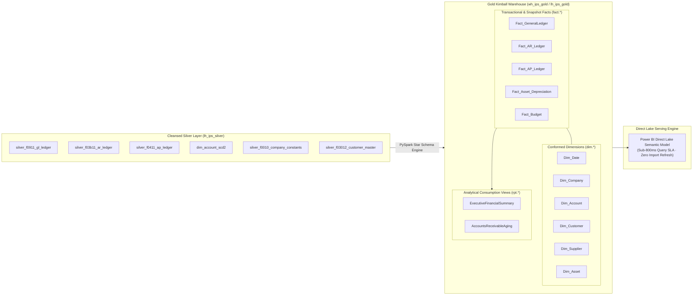

# IPS Corporation — Kimball Dimensional Data Warehouse Specification

> **Warehouse Name:** `wh_ips_gold` / `lh_ips_gold`  
> **Platform:** Microsoft Fabric Lakehouse & SQL Analytics Endpoint (OneLake)  
> **Methodology:** Ralph Kimball Dimensional Modeling Lifecycle & Enterprise Data Bus Matrix  
> **Serving Mode:** Power BI Direct Lake Mode (Sub-800ms Query SLA via VertiPaq)  
> **Document Location:** `docs/additional_docs/IPS_Kimball_Dimensional_Warehouse_Specification.md`  

---

## 📋 Table of Contents
1. [Executive Summary & Kimball Philosophy](#1-executive-summary--kimball-philosophy)
2. [Enterprise Data Warehouse Bus Matrix](#2-enterprise-data-warehouse-bus-matrix)
3. [Physical Architecture & Schema Separation](#3-physical-architecture--schema-separation)
4. [Dimensional Modeling Standards & Patterns](#4-dimensional-modeling-standards--patterns)
   - [4.1 Surrogate Keys & Deterministic Hashing](#41-surrogate-keys--deterministic-hashing)
   - [4.2 The Unknown Member Pattern (-1 Fallback)](#42-the-unknown-member-pattern--1-fallback)
   - [4.3 Slowly Changing Dimensions (SCD Type 1 & 2)](#43-slowly-changing-dimensions-scd-type-1--2)
   - [4.4 Degenerate Dimensions](#44-degenerate-dimensions)
5. [Dimension Tables Data Dictionary](#5-dimension-tables-data-dictionary)
   - [5.1 dim.Dim_Date (Shared Calendar)](#51-dimdim_date-shared-calendar)
   - [5.2 dim.Dim_Company (JDE F0010)](#52-dimdim_company-jde-f0010)
   - [5.3 dim.Dim_Account (Chart of Accounts JDE F0901)](#53-dimdim_account-chart-of-accounts-jde-f0901)
   - [5.4 dim.Dim_Customer (JDE F03012 / F0101)](#54-dimdim_customer-jde-f03012--f0101)
   - [5.5 dim.Dim_Supplier (JDE F0401)](#55-dimdim_supplier-jde-f0401)
   - [5.6 dim.Dim_Asset (JDE F1201)](#56-dimdim_asset-jde-f1201)
6. [Fact Tables Data Dictionary](#6-fact-tables-data-dictionary)
   - [6.1 fact.Fact_GeneralLedger (JDE F0911)](#61-factfact_generalledger-jde-f0911)
   - [6.2 fact.Fact_AR_Ledger (JDE F03B11)](#62-factfact_ar_ledger-jde-f03b11)
   - [6.3 fact.Fact_AP_Ledger (JDE F0411)](#63-factfact_ap_ledger-jde-f0411)
   - [6.4 fact.Fact_Asset_Depreciation (JDE F1202)](#64-factfact_asset_depreciation-jde-f1202)
   - [6.5 fact.Fact_Budget (Corporate Financial Planning)](#65-factfact_budget-corporate-financial-planning)
7. [Reporting & Aggregation Views (`rpt` Schema)](#7-reporting--aggregation-views-rpt-schema)
8. [Direct Lake & VertiPaq Physical Optimizations](#8-direct-lake--vertipaq-physical-optimizations)
9. [Complete DDL & View Definitions](#9-complete-ddl--view-definitions)

---

## 1. Executive Summary & Kimball Philosophy

The **IPS Gold Analytics Layer** is designed following the **Kimball Dimensional Modeling Methodology**. The warehouse delivers intuitive, high-performance analytical datasets organized around business processes rather than operational normalization (3NF).



### Core Tenets of the Kimball Design:
1. **Strict Star Schema:** Normalized "snowflake" hierarchies are collapsed into single, wide conformed dimensions to minimize join depth and maximize memory scan speed in VertiPaq.
2. **Conformed Dimensions:** Dimensions such as `Dim_Date`, `Dim_Company`, and `Dim_Account` share identical schemas and business definitions across all business processes, allowing cross-mart drill-across analysis.
3. **Grain Declaration:** Every Fact table explicitly defines its atomic atomic grain (e.g., *one row per General Ledger journal line* or *one row per AR invoice pay item*).

---

## 2. Enterprise Data Warehouse Bus Matrix

The Bus Matrix defines the relationship between enterprise business processes (Fact tables) and shared Conformed Dimensions:

| Business Process / Fact Table | Grain | Dim_Date | Dim_Company | Dim_Account | Dim_Customer | Dim_Supplier | Dim_Asset | Fact Type |
| :--- | :--- | :---: | :---: | :---: | :---: | :---: | :---: | :--- |
| **General Ledger (`Fact_GeneralLedger`)** | One row per posted/unposted journal entry line (`GLDOC`, `GLDCT`, `GLKCO`, `GLJELN`) | **X** | **X** | **X** | | | | **Transaction** |
| **Accounts Receivable (`Fact_AR_Ledger`)** | One row per customer invoice pay item (`RPDOC`, `RPDCT`, `RPKCO`, `RPSFX`) | **X** | **X** | | **X** | | | **Accumulating / Transaction** |
| **Accounts Payable (`Fact_AP_Ledger`)** | One row per supplier voucher pay item (`RPDOC`, `RPDCT`, `RPKCO`, `RPSFX`) | **X** | **X** | | | **X** | | **Accumulating / Transaction** |
| **Fixed Assets (`Fact_Asset_Depreciation`)** | One row per asset per fiscal year / period (`FA#UMB`, `FAFY`, `FAPN`) | **X** | **X** | **X** | | | **X** | **Periodic Snapshot** |
| **Corporate Budget (`Fact_Budget`)** | One row per account per company per fiscal month | **X** | **X** | **X** | | | | **Periodic Snapshot** |

---

## 3. Physical Architecture & Schema Separation

Inside the Microsoft Fabric workspace, the Gold tier is accessible through both the **Gold Lakehouse (`lh_ips_gold`)** for Spark read/writes and the **SQL Analytics Endpoint (`wh_ips_gold`)** for ANSI T-SQL queries.

The SQL database implements four logical schemas:

| Schema | Purpose | Access Governance |
| :--- | :--- | :--- |
| **`dim`** | Conformed Kimball Dimension tables with clean, business-friendly column aliases. | Read-Only to Analysts & Power BI |
| **`fact`** | Transactional, accumulating, and snapshot Fact tables. | Read-Only to Analysts & Power BI |
| **`rpt`** | Pre-calculated business views, financial summaries, and executive KPI queries. | Read-Only to Reporting Users |
| **`staging`** | Ephemeral or zero-copy transition views mapping directly to Lakehouse Delta files. | Administrative / Internal ETL |

---

## 4. Dimensional Modeling Standards & Patterns

### 4.1 Surrogate Keys & Deterministic Hashing
* **Surrogate Key Standard:** Every dimension has a single-column integer or deterministic hash surrogate key (e.g., `account_key`, `customer_key`).
* **Distributed Spark Optimization:** To prevent locking bottlenecks and auto-increment synchronization across distributed Spark executors, natural keys are hashed using `SHA2(CONCAT_WS('||', KeyColumns), 256)`.

### 4.2 The Unknown Member Pattern (-1 Fallback)
To guarantee that orphaned fact records (transactions referencing late-arriving or invalid master data) are never dropped or excluded during inner/equi-joins:
* Every dimension table seeds a default row with `SurrogateKey = -1`.
* Text fields default to `'Unknown / Not Applicable'`.
* Numeric fields default to `0`.
* In PySpark fact extraction, joins resolve missing dimension keys via:
  ```python
  coalesce(col("dim.account_key"), lit("-1")).alias("account_key")
  ```

### 4.3 Slowly Changing Dimensions (SCD Type 1 & 2)
* **SCD Type 1 (Overwrite):** Applied to attributes where history is not required (e.g., phone numbers, spelling corrections).
* **SCD Type 2 (Full History Preservation):** Applied to core business entities like [Dim_Customer](file:///Users/chandu/Documents/Python_practice/Fabric/src/notebooks/silver/02_silver_scd2_dimensions.py) (credit limits, address relocations) and [Dim_Account](file:///Users/chandu/Documents/Python_practice/Fabric/src/notebooks/silver/02_silver_scd2_dimensions.py) (posting edit codes).
  * System tracking columns: `valid_from (DATETIME2)`, `valid_to (DATETIME2)`, `is_current (BIT)`.

### 4.4 Degenerate Dimensions
Operational transaction identifiers that do not warrant separate dimension tables are stored directly in Fact tables:
* `document_number` (`GLDOC` / `RPDOC`)
* `document_type` (`GLDCT` / `RPDCT`)
* `line_number` (`GLJELN`)
* `pay_item_suffix` (`RPSFX`)

---

## 5. Dimension Tables Data Dictionary

### 5.1 `dim.Dim_Date` (Shared Calendar)
The central temporal dimension powering time intelligence measures (YTD, YoY, QTD).

| Column Name | Data Type | Nullable | Description |
| :--- | :--- | :---: | :--- |
| `DateKey` | `INT` | No | Surrogate integer key in `YYYYMMDD` format (e.g., `20260925`). |
| `CalendarDate` | `DATE` | No | Standard Gregorian calendar date (`YYYY-MM-DD`). |
| `CalendarYear` | `INT` | No | 4-digit calendar year (e.g., `2026`). |
| `CalendarQuarter` | `VARCHAR(10)` | No | Quarter notation (e.g., `'Q3'`, `'2026-Q3'`). |
| `CalendarMonth` | `INT` | No | Month integer (`1` to `12`). |
| `MonthName` | `VARCHAR(20)` | No | Full month name (e.g., `'September'`). |
| `DayOfMonth` | `INT` | No | Day of month (`1` to `31`). |
| `DayOfWeek` | `INT` | No | Day of week integer (`1` = Sunday, `7` = Saturday). |
| `DayName` | `VARCHAR(20)` | No | Day name (e.g., `'Friday'`). |
| `FiscalYear` | `INT` | No | IPS Corporation fiscal year. |
| `FiscalPeriod` | `INT` | No | Financial period (`1` to `12`). |
| `IsWeekday` | `BIT` | No | Indicator: `1` if Monday–Friday; `0` if Saturday/Sunday. |
| `IsHoliday` | `BIT` | No | Indicator: `1` if official corporate holiday. |

---

### 5.2 `dim.Dim_Company` (JDE F0010)
Corporate operating companies and currency definitions.

| Column Name | Data Type | Nullable | Description |
| :--- | :--- | :---: | :--- |
| `CompanyKey` | `VARCHAR(50)` | No | Primary business key (e.g., `'00010'`, or `'-1'` for unknown). |
| `CompanyName` | `VARCHAR(200)` | No | Full corporate legal entity name. |
| `BaseCurrency` | `VARCHAR(10)` | No | Operating ledger base currency code (e.g., `'USD'`, `'EUR'`). |
| `FiscalYearStartMonth` | `INT` | No | Calendar month defining the start of fiscal reporting. |

---

### 5.3 `dim.Dim_Account` (Chart of Accounts JDE F0901)
Financial accounts categorized for P&L and Balance Sheet executive reporting.

| Column Name | Data Type | Nullable | Description |
| :--- | :--- | :---: | :--- |
| `AccountKey` | `VARCHAR(50)` | No | Surrogate key or natural account key (`AID`, or `'-1'`). |
| `CompanyCode` | `VARCHAR(50)` | No | Associated company code. |
| `BusinessUnit` | `VARCHAR(50)` | No | Cost center / branch / plant (`MCU`). |
| `ObjectAccount` | `VARCHAR(50)` | No | Main account identifier (`OBJ`, e.g., `'5010'`). |
| `SubLedger` | `VARCHAR(50)` | Yes | Sub-account identifier (`SUB`). |
| `AccountDescription` | `VARCHAR(250)`| No | Account master description. |
| `PostingEditCode` | `VARCHAR(10)` | Yes | JDE posting control flag (e.g., `' '` = Postable, `'N'` = Non-postable). |
| `AccountFinancialClass`| `VARCHAR(50)` | No | Derived reporting class: `Assets`, `Liabilities`, `Equity`, `Revenue`, `Cost of Goods Sold`, `Operating Expenses`, `Other`. |

---

### 5.4 `dim.Dim_Customer` (JDE F03012 / F0101)
Conformed customer entity with credit limits and address profiles.

| Column Name | Data Type | Nullable | Description |
| :--- | :--- | :---: | :--- |
| `CustomerKey` | `VARCHAR(100)`| No | Surrogate hash key (`SHA256`) or `'-1'`. |
| `CustomerNumber` | `BIGINT` | No | JDE Address Book Number (`AN8`). |
| `CustomerName` | `VARCHAR(200)`| No | Legal customer name (`ALPH`). |
| `CompanyCode` | `VARCHAR(50)` | No | Assigned operating company (supports Company `00000` fallback). |
| `CreditLimit` | `DECIMAL(18,2)`| Yes| Authorized credit limit. |
| `CreditRating` | `VARCHAR(20)` | Yes | Internal credit rating (e.g., `'A1'`, `'B2'`). |
| `PaymentTerms` | `VARCHAR(50)` | Yes | Default invoice terms code (e.g., `'NET30'`). |
| `BillingCity` | `VARCHAR(100)`| Yes | Customer headquarters city. |
| `BillingState` | `VARCHAR(50)` | Yes | State / province. |
| `BillingCountry` | `VARCHAR(50)` | Yes | Country ISO code. |
| `ValidFrom` | `DATETIME2` | No | SCD Type 2 start effective date. |
| `ValidTo` | `DATETIME2` | Yes | SCD Type 2 expiration date (`NULL` if current). |
| `IsCurrent` | `BIT` | No | Indicator: `1` if current active record; `0` if superseded. |

---

### 5.5 `dim.Dim_Supplier` (JDE F0401)
Supplier master profiles and procurement payment terms.

| Column Name | Data Type | Nullable | Description |
| :--- | :--- | :---: | :--- |
| `SupplierKey` | `VARCHAR(100)`| No | Surrogate hash key or `'-1'`. |
| `SupplierNumber` | `BIGINT` | No | JDE Vendor Address Book Number (`AN8`). |
| `SupplierName` | `VARCHAR(200)`| No | Vendor trade name. |
| `SearchType` | `VARCHAR(20)` | No | UDC search categorization (`'V'` = Vendor). |
| `PaymentTerms` | `VARCHAR(50)` | Yes | Default voucher payment terms (`'210NET30'`). |
| `CurrencyCode` | `VARCHAR(10)` | No | Default vendor payment currency. |

---

### 5.6 `dim.Dim_Asset` (JDE F1201)
Fixed Assets register for plant equipment, tooling, and facilities.

| Column Name | Data Type | Nullable | Description |
| :--- | :--- | :---: | :--- |
| `AssetKey` | `VARCHAR(100)`| No | Surrogate key or `'-1'`. |
| `AssetNumber` | `VARCHAR(50)` | No | JDE Equipment / Asset ID (`FA#UMB`). |
| `AssetDescription` | `VARCHAR(250)`| No | Equipment description. |
| `SerialNumber` | `VARCHAR(100)`| Yes| Manufacturer serial number. |
| `DepreciationMethod` | `VARCHAR(50)` | Yes| Financial depreciation calculation rule. |
| `InstallationDate` | `DATE` | Yes| Date equipment was commissioned. |

---

## 6. Fact Tables Data Dictionary

### 6.1 `fact.Fact_GeneralLedger` (JDE F0911)
**Grain:** One row per journal line transaction.

| Column Name | Data Type | Nullable | Description |
| :--- | :--- | :---: | :--- |
| `GLFactKey` | `VARCHAR(100)`| No | Surrogate primary key. |
| `DocumentNumber` | `BIGINT` | No | Degenerate Dimension: Journal entry number (`GLDOC`). |
| `DocumentType` | `VARCHAR(10)` | No | Degenerate Dimension: Document type (`GLDCT`, e.g., `'JE'`). |
| `LineNumber` | `INT` | No | Degenerate Dimension: Journal line sequence (`GLJELN`). |
| `CompanyKey` | `VARCHAR(50)` | No | Foreign Key $\rightarrow$ `dim.Dim_Company(CompanyKey)`. |
| `AccountKey` | `VARCHAR(50)` | No | Foreign Key $\rightarrow$ `dim.Dim_Account(AccountKey)`. |
| `AccountingDate` | `DATE` | No | Converted calendar date (from Julian `GLDGJ`). |
| `DateKey` | `INT` | No | Foreign Key $\rightarrow$ `dim.Dim_Date(DateKey)`. |
| `AmountDomestic` | `DECIMAL(18,2)`| No | Ledger transaction amount in domestic operating currency. |
| `AmountForeign` | `DECIMAL(18,2)`| Yes| Ledger transaction amount in original transaction currency. |
| `CurrencyCode` | `VARCHAR(10)` | No | Currency code (`GLCRCD`). |
| `PostedCode` | `VARCHAR(10)` | No | Posting status (`'P'` = Posted, `'D'` = Draft). |

---

### 6.2 `fact.Fact_AR_Ledger` (JDE F03B11)
**Grain:** One row per customer invoice pay item.

| Column Name | Data Type | Nullable | Description |
| :--- | :--- | :---: | :--- |
| `ARFactKey` | `VARCHAR(100)`| No | Surrogate primary key. |
| `DocumentNumber` | `BIGINT` | No | Degenerate Dimension: Invoice number (`RPDOC`). |
| `DocumentType` | `VARCHAR(10)` | No | Degenerate Dimension: Document type (`RPDCT`, e.g., `'RI'`). |
| `CompanyKey` | `VARCHAR(50)` | No | Foreign Key $\rightarrow$ `dim.Dim_Company(CompanyKey)`. |
| `CustomerKey` | `VARCHAR(100)`| No | Foreign Key $\rightarrow$ `dim.Dim_Customer(CustomerKey)`. |
| `InvoiceDate` | `DATE` | No | Invoice issuance date (from Julian `RPDIVJ`). |
| `DueDate` | `DATE` | No | Payment due date (from Julian `RPDDJ`). |
| `GrossAmount` | `DECIMAL(18,2)`| No | Total invoiced transaction amount (`RPAG`). |
| `OpenAmount` | `DECIMAL(18,2)`| No | Outstanding unpaid invoice amount (`RPAAP`). |
| `PaidAmount` | `DECIMAL(18,2)`| No | Computed amount: `GrossAmount - OpenAmount`. |
| `IsOpen` | `BIT` | No | Flag: `1` if `OpenAmount != 0`; `0` if fully settled. |
| `AgingBucket` | `VARCHAR(30)` | No | Dynamic bucket: `'Current'`, `'1-30'`, `'31-60'`, `'61-90'`, `'90+'`. |

---

### 6.3 `fact.Fact_AP_Ledger` (JDE F0411)
**Grain:** One row per supplier voucher pay item.

| Column Name | Data Type | Nullable | Description |
| :--- | :--- | :---: | :--- |
| `APFactKey` | `VARCHAR(100)`| No | Surrogate primary key. |
| `DocumentNumber` | `BIGINT` | No | Degenerate Dimension: Voucher number (`RPDOC`). |
| `DocumentType` | `VARCHAR(10)` | No | Degenerate Dimension: Voucher type (`RPDCT`, e.g., `'PV'`). |
| `CompanyKey` | `VARCHAR(50)` | No | Foreign Key $\rightarrow$ `dim.Dim_Company(CompanyKey)`. |
| `SupplierKey` | `VARCHAR(100)`| No | Foreign Key $\rightarrow$ `dim.Dim_Supplier(SupplierKey)`. |
| `VoucherDate` | `DATE` | No | Voucher creation date. |
| `DiscountDueDate`| `DATE` | Yes| Cut-off date to capture cash discount (`210NET30`). |
| `NetDueDate` | `DATE` | No | Final liability due date. |
| `GrossAmount` | `DECIMAL(18,2)`| No | Gross voucher amount. |
| `OpenAmount` | `DECIMAL(18,2)`| No | Unpaid voucher liability. |
| `DiscountAvailable`| `DECIMAL(18,2)`| Yes| Cash discount amount if paid within discount window. |
| `IsOpen` | `BIT` | No | Flag: `1` if unpaid; `0` if cleared. |

---

### 6.4 `fact.Fact_Asset_Depreciation` (JDE F1202)
**Grain:** One row per asset per fiscal year / period (Periodic Snapshot).

| Column Name | Data Type | Nullable | Description |
| :--- | :--- | :---: | :--- |
| `AssetSnapshotKey`| `VARCHAR(100)`| No | Surrogate primary key. |
| `AssetKey` | `VARCHAR(100)`| No | Foreign Key $\rightarrow$ `dim.Dim_Asset(AssetKey)`. |
| `CompanyKey` | `VARCHAR(50)` | No | Foreign Key $\rightarrow$ `dim.Dim_Company(CompanyKey)`. |
| `AccountKey` | `VARCHAR(50)` | No | Foreign Key $\rightarrow$ `dim.Dim_Account(AccountKey)`. |
| `FiscalYear` | `INT` | No | Fiscal year of balance snapshot (`FAFY`). |
| `FiscalPeriod` | `INT` | No | Fiscal period of balance snapshot (`FAPN`). |
| `HistoricalCost` | `DECIMAL(18,2)`| No | Original acquisition cost of asset. |
| `AccumulatedDepreciation`| `DECIMAL(18,2)`| No | Total cumulative depreciation recorded through this period. |
| `NetBookValue` | `DECIMAL(18,2)`| No | Computed: `HistoricalCost - AccumulatedDepreciation`. |

---

### 6.5 `fact.Fact_Budget` (Corporate Financial Planning)
**Grain:** One row per account per company per fiscal month.

| Column Name | Data Type | Nullable | Description |
| :--- | :--- | :---: | :--- |
| `BudgetFactKey` | `VARCHAR(100)`| No | Surrogate primary key. |
| `AccountKey` | `VARCHAR(50)` | No | Foreign Key $\rightarrow$ `dim.Dim_Account(AccountKey)`. |
| `CompanyKey` | `VARCHAR(50)` | No | Foreign Key $\rightarrow$ `dim.Dim_Company(CompanyKey)`. |
| `DateKey` | `INT` | No | Foreign Key $\rightarrow$ `dim.Dim_Date(DateKey)`. |
| `BudgetAmountDomestic`| `DECIMAL(18,2)`| No | Planned target budget in operating currency. |

---

## 7. Reporting & Aggregation Views (`rpt` Schema)

To provide out-of-the-box analytical aggregates without requiring analysts to re-write complex group-by queries, the warehouse provides views in the `rpt` schema:

### 7.1 `rpt.ExecutiveFinancialSummary`
Aggregates actual General Ledger figures across fiscal calendar periods and financial classes:
```sql
CREATE OR ALTER VIEW rpt.ExecutiveFinancialSummary AS
SELECT 
    c.CompanyName,
    f.AccountingDate,
    YEAR(f.AccountingDate) AS FiscalYear,
    MONTH(f.AccountingDate) AS FiscalMonth,
    a.AccountFinancialClass,
    SUM(f.AmountDomestic) AS TotalAmountDomestic
FROM fact.Fact_GeneralLedger f
INNER JOIN dim.Dim_Company c ON f.CompanyKey = c.CompanyKey
INNER JOIN dim.Dim_Account a ON f.AccountKey = a.AccountKey
GROUP BY 
    c.CompanyName,
    f.AccountingDate,
    YEAR(f.AccountingDate),
    MONTH(f.AccountingDate),
    a.AccountFinancialClass;
```

---

## 8. Direct Lake & VertiPaq Physical Optimizations

To ensure Power BI Direct Lake queries consistently execute in under **800 milliseconds**, the PySpark jobs creating Gold tables apply three core optimizations:

1. **Microsoft V-Order Sorting:**
   V-Order applies in-memory sorting algorithms during file write so VertiPaq can memory-map Parquet chunks directly into RAM without decompressing or transcoding.
   ```python
   spark.conf.set("spark.sql.parquet.vorder.enabled", "true")
   ```
2. **Delta Lake Z-ORDER Clustering:**
   Clustering on date keys optimizes file-skipping metrics in the Delta transaction log (`_delta_log`):
   ```sql
   OPTIMIZE lh_ips_gold.Fact_GeneralLedger ZORDER BY (DateKey, CompanyKey);
   OPTIMIZE lh_ips_gold.Fact_AR_Ledger ZORDER BY (InvoiceDate, CustomerKey);
   ```
3. **Target Parquet File Compaction (100MB – 250MB):**
   Small files degrade VertiPaq column dictionary reads. Writing via `optimizeWrite` consolidates output partitions into optimal 128MB chunks.

---

## 9. Complete DDL & View Definitions

```sql
-- ===================================================================================================
-- Microsoft Fabric SQL Analytics Endpoint / Warehouse DDL
-- Database: wh_ips_gold
-- Schemas: dim, fact, rpt
-- Description: Production Kimball Star Schema DDL
-- ===================================================================================================

CREATE SCHEMA IF NOT EXISTS dim;
GO
CREATE SCHEMA IF NOT EXISTS fact;
GO
CREATE SCHEMA IF NOT EXISTS rpt;
GO

-- 1. Dim_Company View
CREATE OR ALTER VIEW dim.Dim_Company AS
SELECT 
    company_code AS CompanyKey,
    company_name AS CompanyName,
    currency_code AS BaseCurrency,
    fiscal_year_start_month AS FiscalYearStartMonth
FROM lh_ips_gold.Dim_Company;
GO

-- 2. Dim_Account View (Handling Unknown Member -1)
CREATE OR ALTER VIEW dim.Dim_Account AS
SELECT 
    account_id AS AccountKey,
    company_code AS CompanyCode,
    business_unit AS BusinessUnit,
    object_account AS ObjectAccount,
    sub_ledger AS SubLedger,
    account_description AS AccountDescription,
    posting_edit_code AS PostingEditCode,
    CASE 
        WHEN object_account BETWEEN '1000' AND '1999' THEN 'Assets'
        WHEN object_account BETWEEN '2000' AND '2999' THEN 'Liabilities'
        WHEN object_account BETWEEN '3000' AND '3999' THEN 'Equity'
        WHEN object_account BETWEEN '5000' AND '5999' THEN 'Revenue'
        WHEN object_account BETWEEN '6000' AND '6999' THEN 'Cost of Goods Sold'
        WHEN object_account BETWEEN '7000' AND '8999' THEN 'Operating Expenses'
        ELSE 'Other'
    END AS AccountFinancialClass
FROM lh_ips_gold.Dim_Account;
GO

-- 3. Fact_GeneralLedger View
CREATE OR ALTER VIEW fact.Fact_GeneralLedger AS
SELECT 
    document_number AS DocumentNumber,
    document_type AS DocumentType,
    line_number AS LineNumber,
    accounting_date AS AccountingDate,
    account_key AS AccountKey,
    company_key AS CompanyKey,
    amount_domestic AS AmountDomestic,
    amount_foreign AS AmountForeign,
    currency_code AS CurrencyCode,
    posted_code AS PostedCode
FROM lh_ips_gold.Fact_GeneralLedger;
GO

-- 4. Executive Summary Reporting View
CREATE OR ALTER VIEW rpt.ExecutiveFinancialSummary AS
SELECT 
    c.CompanyName,
    f.AccountingDate,
    YEAR(f.AccountingDate) AS FiscalYear,
    MONTH(f.AccountingDate) AS FiscalMonth,
    a.AccountFinancialClass,
    SUM(f.AmountDomestic) AS TotalAmountDomestic
FROM fact.Fact_GeneralLedger f
INNER JOIN dim.Dim_Company c ON f.CompanyKey = c.CompanyKey
INNER JOIN dim.Dim_Account a ON f.AccountKey = a.AccountKey
GROUP BY 
    c.CompanyName,
    f.AccountingDate,
    YEAR(f.AccountingDate),
    MONTH(f.AccountingDate),
    a.AccountFinancialClass;
GO
```

---

### Related Code & Artifacts:
* **PySpark Gold Mart Builder:** [01_gold_financial_gl_mart.py](file:///Users/chandu/Documents/Python_practice/Fabric/src/notebooks/gold/01_gold_financial_gl_mart.py)
* **Gold Warehouse T-SQL Views:** [ddl_gold_warehouse.sql](file:///Users/chandu/Documents/Python_practice/Fabric/src/sql/ddl_gold_warehouse.sql)
* **Power BI Direct Lake DAX Measures:** [financial_executive_measures.dax](file:///Users/chandu/Documents/Python_practice/Fabric/src/semantic_models/financial_executive_measures.dax)
* **Metadata Schema Reference:** [metadata_tables_and_columns.md](file:///Users/chandu/Documents/Python_practice/Fabric/data/metadata/metadata_tables_and_columns.md)
