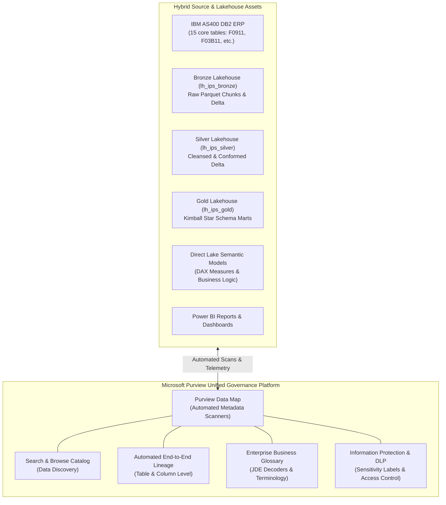
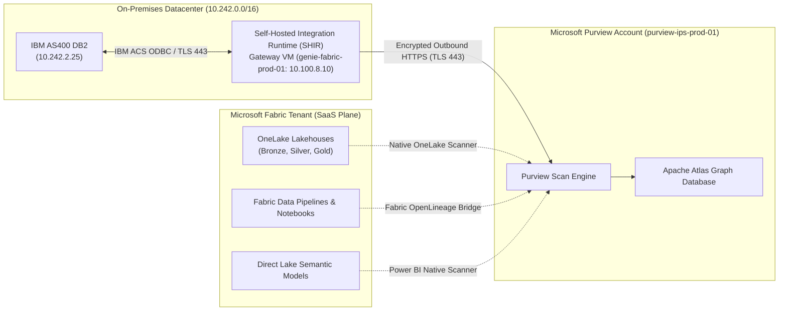
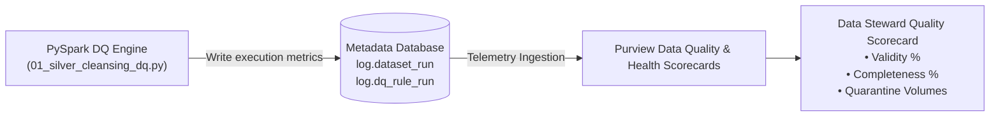

# IPS Corporation — Microsoft Purview Implementation & Operations Guide

> **Project:** IPS Corporation Enterprise Data Modernization  
> **Platform:** Microsoft Purview Unified Data Governance, Microsoft Fabric OneLake & IBM AS400 DB2  
> **Scope:** Enterprise Data Catalog, End-to-End Lineage, Business Glossary, Sensitive Data Classification & DLP  
> **Document Location:** `docs/additional_docs/IPS_Microsoft_Purview_Implementation_and_Operations_Guide.md`  
> **Status:** Operational Runbook & Architecture Specification  

---

## 📋 Table of Contents
1. [Executive Summary & Purpose of Purview](#1-executive-summary--purpose-of-purview)
2. [Microsoft Purview Architecture in the Modern Data Platform](#2-microsoft-purview-architecture-in-the-modern-data-platform)
3. [Use Case 1: Automated Data Cataloging & Discovery](#3-use-case-1-automated-data-cataloging--discovery)
4. [Use Case 2: End-to-End Lineage & Upstream Impact Analysis](#4-use-case-2-end-to-end-lineage--upstream-impact-analysis)
   - [4.1 Visualizing the Full Ingestion & Consumption Path](#41-visualizing-the-full-ingestion--consumption-path)
   - [4.2 Column-Level Lineage Tracing](#42-column-level-lineage-tracing)
   - [4.3 Proactive Impact Analysis Before Schema Modifications](#43-proactive-impact-analysis-before-schema-modifications)
5. [Use Case 3: Enterprise Business Glossary & Semantic Translation](#5-use-case-3-enterprise-business-glossary--semantic-translation)
   - [5.1 Translating Cryptic JDE AS400 Codes to Business Terms](#51-translating-cryptic-jde-as400-codes-to-business-terms)
   - [5.2 Glossary Approval Workflows](#52-glossary-approval-workflows)
6. [Use Case 4: Data Classification, Sensitivity Labels & DLP](#6-use-case-4-data-classification-sensitivity-labels--dlp)
   - [6.1 Custom Classification Rules (JDE Specific)](#61-custom-classification-rules-jde-specific)
   - [6.2 Microsoft Information Protection (MIP) Labels](#62-microsoft-information-protection-mip-labels)
   - [6.3 Data Loss Prevention (DLP) Policies for OneLake & Power BI](#63-data-loss-prevention-dlp-policies-for-onelake--power-bi)
7. [Use Case 5: Data Quality Telemetry Integration](#7-use-case-5-data-quality-telemetry-integration)
8. [Step-by-Step Operational Runbook](#8-step-by-step-operational-runbook)
   - [8.1 Enabling Purview in the Microsoft Fabric Tenant](#81-enabling-purview-in-the-microsoft-fabric-tenant)
   - [8.2 Configuring AS400 DB2 Scanning via Self-Hosted IR](#82-configuring-as400-db2-scanning-via-self-hosted-ir)
   - [8.3 Setting Automated Scan Schedules](#83-setting-automated-scan-schedules)
9. [Purview RBAC & Governance Roles Matrix](#9-purview-rbac--governance-roles-matrix)

---

## 1. Executive Summary & Purpose of Purview

In the **IPS Modernization Platform**, **Microsoft Purview** acts as the central data governance nervous system. It unites legacy on-premises **IBM AS400 (DB2)** environments with the cloud-native **Microsoft Fabric Medallion Architecture (OneLake)** and **Power BI Direct Lake Semantic Models**.



### Why Purview is Critical in this Project:
1. **Demystifies JDE Mainframe Legacy Data:** Decodes cryptic AS400 table and column names (e.g., `F0911.GLAA`, `F03B11.RPAAP`) into standardized business terms for report authors.
2. **Regulatory Audit Lineage:** Provides auditors with proof of data provenance, tracing numbers on financial executive dashboards back to exact DB2 journal lines.
3. **Automated Zero-ETL Lineage:** Microsoft Fabric items (Lakehouses, Notebooks, Pipelines, Semantic Models) register their operational lineage into Purview automatically without writing custom lineage extractors.
4. **Data Loss Prevention (DLP):** Prevents unauthorized export of sensitive customer credit ratings, employee payroll adjustments, and supplier banking details.

---

## 2. Microsoft Purview Architecture in the Modern Data Platform

Purview coordinates scanning across both on-premises network boundaries and SaaS cloud boundaries:



---

## 3. Use Case 1: Automated Data Cataloging & Discovery

The **Purview Enterprise Data Catalog** eliminates data silos by providing a searchable inventory of all assets across the enterprise:

### How Users Discover Data in Purview:
1. **Search by Business Concept:** Business analysts search for `"Revenue by Customer"`, and Purview surfaces:
   - Certified Semantic Model: `sm_ips_enterprise_financial`
   - Underlying Gold Fact: `lh_ips_gold.Fact_GeneralLedger`
   - Conformed Silver Table: `lh_ips_silver.silver_f0911_gl_ledger`
   - Raw AS400 Source Table: `CRPOTA.F0911`
2. **Asset Ownership & Certification:** Assets are assigned endorsement badges:
   - **Certified (Gold Star):** Production Gold star schemas and certified Direct Lake models approved by the Data Governance Council.
   - **Promoted:** Silver conformed tables validated by Data Stewards.
   - **Uncertified / Internal:** Bronze raw tables and quarantine error tables.
3. **Data Asset Schema Inspection:** Users can review column descriptions, source data types, nullability, and primary key definitions without needing database read access.

---

## 4. Use Case 2: End-to-End Lineage & Upstream Impact Analysis

### 4.1 Visualizing the Full Ingestion & Consumption Path
Purview automatically compiles the end-to-end visual graph across hybrid tiers:

```mermaid
flowchart LR
    A["AS400 DB2: CRPOTA.F0911"] 
    -->|Fabric Pipeline: pl_ingest_as400_batch| B["Bronze: lh_ips_bronze.raw_f0911_gl_ledger"]
    B -->|Spark Notebook: nb_silver_cleansing_dq| C["Silver: lh_ips_silver.silver_f0911_gl_ledger"]
    C -->|Spark Notebook: nb_gold_financial_gl_mart| D["Gold: lh_ips_gold.Fact_GeneralLedger"]
    D -->|Direct Lake Zero-Copy Link| E["Semantic Model: sm_ips_enterprise_financial"]
    E -->|Live DAX Connection| F["Power BI Report: Executive_Financial_Overview.pbix"]
```



---

### 4.2 Column-Level Lineage Tracing
Purview traces transformations down to the individual field:

```
[AS400: GLAA (Unscaled Amount in Cents)]
       │
       ▼ (PySpark: col("GLAA").cast("double") / 100.0)
[Silver: amount_domestic (Standardized USD)]
       │
       ▼ (Gold Mart Delta MERGE on GLFactKey)
[Gold: AmountDomestic (Fact_GeneralLedger)]
       │
       ▼ (DAX: -CALCULATE(SUM(AmountDomestic), ObjectAccount BETWEEN 5000 AND 5999))
[Semantic Model: Measure [Total Revenue]]
       │
       ▼ (Visual Rendering: Executive Card KPI)
[Power BI Dashboard: Total Revenue Tile ($45,210,400)]
```

---

### 4.3 Proactive Impact Analysis Before Schema Modifications
* **The Problem:** In legacy operations, an AS400 DBA would alter a column or drop an index, causing silent failures on downstream reporting pipelines.
* **The Purview Solution:** Before modifying table `F0911` or updating `01_silver_cleansing_dq.py`, engineers open the **Lineage tab** in Purview:
  1. Click on the asset (e.g., `silver_f0911_gl_ledger`).
  2. Select **Impact Analysis**.
  3. Purview renders every downstream dependent table, semantic model, report, and dashboard.
  4. The engineer immediately identifies that changing `accounting_date` will affect 3 semantic models and 12 executive dashboards.

---

## 5. Use Case 3: Enterprise Business Glossary & Semantic Translation

### 5.1 Translating Cryptic JDE AS400 Codes to Business Terms
JD Edwards EnterpriseOne utilizes abbreviated column codes. Purview's **Business Glossary** establishes an authoritative dictionary that maps these technical terms to approved corporate definitions:

| JDE Technical Code | Table | Purview Glossary Term | Official Business Definition |
| :--- | :--- | :--- | :--- |
| **`GLDOC`** | `F0911` | **Document Number** | The primary tracking transaction sequence number for journal vouchers. |
| **`GLDCT`** | `F0911` | **Document Type** | 2-character code classifying transactions (`JE` = Journal Entry, `RI` = Invoice, `PV` = Voucher). |
| **`GLDGJ`** | `F0911` | **GL Julian Date** | 6-digit `CYYDDD` date indicating when the financial transaction was posted to the general ledger. |
| **`GLAA`** | `F0911` | **Domestic Amount** | Financial value expressed in the local operating company's functional ledger currency. |
| **`GLACR`** | `F0911` | **Foreign Amount** | Financial transaction value expressed in the original transacting currency. |
| **`RPAG`** | `F03B11` / `F0411` | **Gross Amount** | Total original billing amount of an accounts receivable invoice or payable voucher. |
| **`RPAAP`** | `F03B11` / `F0411` | **Open Amount** | Remaining unpaid balance on an open receivable or payable record. |
| **`RPDDJ`** | `F03B11` / `F0411` | **Net Due Date** | Final contractual payment deadline before delinquency or credit penalty. |
| **`FA#UMB`** | `F1201` | **Asset Number** | Unique 8-digit identification number assigned to a fixed physical plant asset. |
| **`FAHISTCOST`** | `F1202` | **Historical Asset Cost**| Original capitalized acquisition expense of a fixed physical asset. |

---

### 5.2 Glossary Approval Workflows
1. **Proposal:** A data analyst or developer drafts a new term (e.g., *Days Sales Outstanding - DSO*).
2. **Review:** The Purview workflow routes an automated approval notification to the **Finance Data Steward**.
3. **Approval:** Once approved, the term is published to the catalog and linked to the DAX measure `[Days Sales Outstanding (DSO)]` in [financial_executive_measures.dax](file:///Users/chandu/Documents/Python_practice/Fabric/src/semantic_models/financial_executive_measures.dax#L59).

---

## 6. Use Case 4: Data Classification, Sensitivity Labels & DLP

### 6.1 Custom Classification Rules (JDE Specific)
Purview scans OneLake and automatically classifies sensitive columns using custom regex and dictionary patterns:

| Classification Rule Name | Target Columns / Pattern | Data Sensitivity Category | Action on Discovery |
| :--- | :--- | :--- | :--- |
| **`IPS_JDE_Tax_ID`** | `ABTAX`, `AIAN8` (matching 9-digit SSN / EIN) | PII / Confidential | Tag column as `Confidential - PII` |
| **`IPS_JDE_Bank_Account`** | `CBNUMB`, `CBBK` (matching IBAN / Routing #) | Financial Confidential | Apply `Highly Confidential - Banking` |
| **`IPS_Customer_Credit_Rating`**| `AICRCA`, `AICRAL` (values `A1`, `B2`, credit limits) | Commercial Confidential | Restrict export via DLP |
| **`IPS_Executive_Compensation`**| `GLANI` linked to object accounts `7010`-`7050` | Highly Confidential | Enforce Object-Level Security (OLS) |

---

### 6.2 Microsoft Information Protection (MIP) Labels
Purview extends MIP sensitivity labels across Microsoft Fabric items:

```
[Public]
   │
   ▼
[General - Internal] (Default for conformed Silver tables)
   │
   ▼
[Confidential - Financial] (Applied to Fact_GeneralLedger, Fact_Budget)
   │
   ▼
[Highly Confidential - Executive] (Applied to Executive P&L and Banking feeds)
```

* **Label Inheritance:** When a Power BI report queries a Gold Lakehouse labeled `Confidential - Financial`, the report and any downstream PowerPoint or PDF exports **automatically inherit the exact same sensitivity label and encryption protections**.

---

### 6.3 Data Loss Prevention (DLP) Policies for OneLake & Power BI
DLP policies configured in Microsoft Purview enforce active data security controls:
1. **Block Public Sharing:** Prevents users from sharing Direct Lake semantic models or reports with external guest users.
2. **Restrict Export to Excel:** If a user tries to click *"Export to Excel (Data with live connection)"* on a report containing columns classified as `IPS_Customer_Credit_Rating`, Purview DLP intercepts the action and requires business justification or blocks the download.
3. **Automated Audit Alert:** Unauthorized bulk export attempts trigger real-time incident alerts in the **Microsoft Sentinel SIEM**.

---

## 7. Use Case 5: Data Quality Telemetry Integration

Microsoft Purview connects with the **Metadata Ingestion Framework's** audit logging schema in `sqldb-meta-orch-dev`:



* **Data Asset Health Score:** Purview reads `failed_record_count` from `log.dq_rule_run` to compute a dynamic **Quality Score** (e.g., `99.8% Healthy`) on `lh_ips_silver.silver_f0911_gl_ledger`.
* **Steward Attention Indicators:** If an asset drops below 98% validity, Purview flags the asset with an "Under Remediation" warning badge in the search catalog.

---

## 8. Step-by-Step Operational Runbook

### 8.1 Enabling Purview in the Microsoft Fabric Tenant
1. In the **Microsoft Fabric Admin Portal**, navigate to **Tenant Settings**.
2. Locate **Microsoft Purview** settings:
   - Enable: **"Users can view Purview data lineage"** $\rightarrow$ Enabled for `SG-PBI-Developers` and `SG-PBI-ReportConsumers`.
   - Enable: **"Automatically scan OneLake items into Microsoft Purview"** $\rightarrow$ Enabled for the entire organization.
3. In the Azure Portal, open the Purview account (`purview-ips-prod-01`) and grant the **Fabric Tenant Service Principal** the role of **Purview Data Curator**.

---

### 8.2 Configuring AS400 DB2 Scanning via Self-Hosted IR
To enable Purview to scan the upstream on-premises IBM AS400 DB2 system:
1. Log in to the Gateway VM ([genie-fabric-prod-01: 10.100.8.10](file:///Users/chandu/Documents/Python_practice/Fabric/docs/techstalk/networking_concepts.md)).
2. Install the **Microsoft Purview Self-Hosted Integration Runtime (SHIR)** alongside the On-Premises Data Gateway.
3. Register the SHIR node with the authentication key from `purview-ips-prod-01`.
4. In Purview Studio, navigate to **Data Map $\rightarrow$ Register $\rightarrow$ IBM DB2**.
5. Configure the connection:
   - **Host:** `10.242.2.25` (Internal AS400 host)
   - **Database:** `IPSPROD`
   - **Port:** `446`
   - **Credential:** Reference secret `as400-db2-service-account-pwd` hosted in Azure Key Vault ([ipskv-prod-chennai-01](file:///Users/chandu/Documents/Python_practice/Fabric/docs/additional_docs/IPS_Enterprise_Security_Architecture_and_Compliance_Guide.md#51-azure-key-vault-architecture)).
   - **Libraries / Schemas:** `CRPOTA`, `CRPCTL`.

---

### 8.3 Setting Automated Scan Schedules
* **AS400 On-Premises DB2:** Scheduled **Weekly on Sunday at 01:00 AM UTC** (to avoid source locking during business hours).
* **Fabric OneLake Workspaces (`ws-fabric-data-prod`, `ws-fabric-report-prod`):** Scheduled **Daily Incremental Scan at 03:00 AM UTC** immediately following batch pipeline completion.

---

## 9. Purview RBAC & Governance Roles Matrix

Access within Microsoft Purview Studio is governed by role-based assignments linked to Entra ID Security Groups:

| Purview Security Role | Assigned Entra ID Security Group | Permissions & Capabilities |
| :--- | :--- | :--- |
| **Purview Data Source Administrator** | `SG-PBI-GatewayAdmins` | Register new data sources, configure SHIR gateway clusters, manage Key Vault scan credentials. |
| **Purview Data Curator** | `SG-PBI-Developers` + Data Stewards | Author Business Glossary terms, approve schema mappings, assign sensitivity labels, curate catalog assets. |
| **Purview Data Reader** | `SG-PBI-ReportConsumers` | Search and discover certified assets, inspect column descriptions, view end-to-end lineage graphs. |
| **Purview Policy Author** | `SG-PBI-FabricAdmins` | Define and enforce Data Loss Prevention (DLP) policies and sensitivity label enforcement rules. |

---

### Related Documentation References:
* **Enterprise Security Architecture:** [IPS_Enterprise_Security_Architecture_and_Compliance_Guide.md](file:///Users/chandu/Documents/Python_practice/Fabric/docs/additional_docs/IPS_Enterprise_Security_Architecture_and_Compliance_Guide.md)
* **Data Governance Framework:** [IPS_Data_Governance_Framework_and_Operating_Model.md](file:///Users/chandu/Documents/Python_practice/Fabric/docs/additional_docs/IPS_Data_Governance_Framework_and_Operating_Model.md)
* **End-to-End Lineage & Linkage Guide:** [IPS_Data_Lineage_and_Linkage_Management_Guide.md](file:///Users/chandu/Documents/Python_practice/Fabric/docs/additional_docs/IPS_Data_Lineage_and_Linkage_Management_Guide.md)
