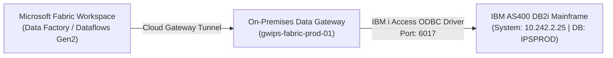

# On-Premises Data Gateway (OPDG) Installation & Configuration Guide: IPS Corporation for IBM AS400 DB2i

> **Project:** IPS Corporation BI Modernization  
> **Topic:** On-Premises Data Gateway (OPDG) Standard Mode Setup, IBM i Access Client Solutions (ACS) ODBC Drivers, Gateway Tuning & Microsoft Fabric Connectivity  
> **Target System:** IBM AS400 DB2 (v7r4) Mainframe | Host IP: `10.242.2.25` | DB: `IPSPROD`  
> **Gateway Host:** Windows Server 2022 Datacenter VM (`gwips-fabric-prod-01`)  
> **Author:** IPS Data Engineering & Infrastructure Team  
> **Date:** September 2026  
> **Status:** Production Standard  

---

## Executive Summary

This guide provides a comprehensive, step-by-step procedure for installing, configuring, and performance-tuning the **Microsoft On-Premises Data Gateway (OPDG)** in **Standard Mode** on the designated Windows Server Virtual Machine.

This setup is required to establish secure hybrid connectivity between **Microsoft Fabric** (Data Factory Copy Pipelines, Dataflows Gen2, and PySpark Notebooks) and the on-premises hosted **IBM AS400 DB2 (v7r4) mainframe**. The architecture standardizes on the official **IBM i Access Client Solutions (ACS) 64-bit ODBC Driver** on the gateway VM and the **Fabric ODBC Connector**, which is the enterprise-standard pattern for integrating Microsoft Fabric with IBM AS400 systems.

---

## Table of Contents
1. [Prerequisites Checklist](#1-prerequisites-checklist)
2. [Step-by-Step Installation Procedure](#2-step-by-step-installation-procedure)
   - [Step 1: Grant "Log on as a service" to Service Account](#step-1-grant-log-on-as-a-service-to-service-account)
   - [Step 2: Test Network Ports to IBM AS400 Mainframe](#step-2-test-network-ports-to-ibm-as400-mainframe)
   - [Step 3: Install & Verify IBM i Access (ACS) 64-bit Drivers](#step-3-install--verify-ibm-i-access-acs-64-bit-drivers)
   - [Step 4: Download & Install Microsoft On-Premises Data Gateway](#step-4-download--install-microsoft-on-premises-data-gateway)
   - [Step 5: Register Gateway & Service Configuration](#step-5-register-gateway--service-configuration)
   - [Step 6: Configure Gateway Performance & Local Disk Spooling](#step-6-configure-gateway-performance--local-disk-spooling)
3. [Registering Gateway & Creating Connection in Microsoft Fabric](#3-registering-gateway--creating-connection-in-microsoft-fabric)
4. [End-to-End Verification Checklist](#4-end-to-end-verification-checklist)

---

## 1. Prerequisites Checklist


Before beginning installation, verify that the following infrastructure, network, and account requirements are met on the Gateway Virtual Machine and across the corporate network:

| Category | Requirement Specification | Architectural Justification |
| :--- | :--- | :--- |
| **Operating System** | **Windows Server 2022 Datacenter** (64-bit) | Modern OS with enhanced TLS 1.3 security and Windows Service isolation. |
| **Hardware Resources** | **Minimum 4 vCPUs, 16 GB RAM, 100 GB SSD storage** | Essential for handling concurrent high-throughput query spooling and large JDE table extracts. |
| **Software Runtime** | **.NET Framework 4.8 or later** | Mandatory runtime required by both the Gateway service and the IBM .NET data provider. |
| **Local Permissions** | **Local Administrator rights on the VM** | Required to install kernel-level ODBC drivers, register Windows services, and edit config files. |
| **Service Account** | **`NT Service\PBIEgwService`** (Default local virtual account) | A dedicated Active Directory domain service account is **not required**. The virtual account is registered automatically during gateway extraction and minimizes credential rotation overhead. |
| **User Rights** | **`Log on as a service`** | Automatically configured by the Gateway installer for `NT Service\PBIEgwService`. |
| **Fabric Account** | **Fabric/Power BI Tenant Admin or Gateway Creator** | Required during initial gateway registration to bind the gateway cluster to the Microsoft Fabric tenant. |
| **Network Firewall Ports** | Bidirectional TCP connectivity from VM to AS400:<br>• **Port 446**: DRDA (Distributed Relational Database Architecture)<br>• **Port 449**: AS400 Server Mapper<br>• **Port 8471**: Central Database Server | Required for initial handshake, port resolution, and high-speed data transmission with DB2 v7r4. |
| **Driver Software** | **IBM i Access Client Solutions (ACS) Windows Application Package (64-bit)** | Contains the 64-bit ODBC Driver, OLE DB Provider (`cwbprov.dll`), and .NET Data Provider. |

---

## 2. Step-by-Step Installation Procedure

### Step 1: Grant "Log on as a service" to Service Account

> [!NOTE]
> When using the default virtual service account (`NT Service\PBIEgwService`), the installation wizard automatically configures these security rights. If using a custom local service account, configure it manually:

1. On the Gateway VM, open the **Start Menu**, type `secpol.msc` (**Local Security Policy**), and press Enter.
2. In the left navigation pane, expand **Local Policies** $\rightarrow$ select **User Rights Assignment**.
3. In the right panel, double-click **Log on as a service**.
4. Click **Add User or Group...**.
5. Enter the service account name and click **OK**.
6. Click **Apply** and then **OK**.

---

### Step 2: Test Network Ports to IBM AS400 Mainframe


Open **PowerShell as Administrator** and execute network connectivity validation against the IBM AS400 host (replace `<AS400-Host-or-IP>` with the corporate mainframe IP `10.242.2.25`):

```powershell
# Test DRDA Port 446
Test-NetConnection -ComputerName "10.242.2.25" -Port 446

# Test Server Mapper Port 449
Test-NetConnection -ComputerName "10.242.2.25" -Port 449

# Test Database Server Port 8471
Test-NetConnection -ComputerName "10.242.2.25" -Port 8471
```

> [!IMPORTANT]
> Verify that the output **`TcpTestSucceeded : True`** for all three ports. If any port test returns `False`, coordinate immediately with the IPS Network Security team to update on-premises firewall routing rules before proceeding.

---

### Step 3: Install & Verify IBM i Access (ACS) 64-bit Drivers

The official **IBM i Access Client Solutions (ACS) Windows Application Package** contains the essential 64-bit drivers to communicate with the DB2 database:

1. Obtain the installation package (`IBMiAccess_v1r1_WindowsAP_English.zip`) from the IBM Entitled Systems Support (ESS) portal or corporate software repository.
2. Copy the ZIP archive to a temporary directory on the Gateway VM (e.g., `C:\Temp`).
3. Right-click the ZIP file and select **Extract All...**.
4. Navigate to the extracted folder and open the **`Image64`** directory (the On-Premises Data Gateway runs as a 64-bit Windows process).
5. Right-click **`setup.exe`** and select **Run as Administrator**.
6. On the Welcome screen, click **Next**, and accept the License Agreement.
7. On the **Setup Type** screen, choose **Custom** and click Next.
8. In the custom feature selection tree, ensure the following core components are selected:
   * **ODBC Driver** (Required for the Fabric ODBC connector and Fivetran HVA connection).
   * **OLE DB Provider** (Registers `cwbprov.dll` required for legacy applications).
   * **.NET Provider** (Registers the iSeries .NET provider in the Global Assembly Cache).
9. Click **Next** $\rightarrow$ **Install**.
10. Once installation finishes, click **Finish**. If prompted, reboot the VM.

#### Verify Driver Installation via PowerShell:
Verify that the database provider DLLs and ODBC drivers are registered in the Windows Global Assembly Cache (GAC):

```powershell
# Verify .NET Provider Registration
[System.Reflection.Assembly]::LoadWithPartialName("IBM.Data.DB2.iSeries")

# Verify 64-bit ODBC Driver Registration
Get-OdbcDriver -Name "IBM i Access ODBC Driver"
```

*Expected Result:* The command returns `Name: IBM i Access ODBC Driver`, confirming driver availability.

---

### Step 4: Download & Install Microsoft On-Premises Data Gateway


1. Download the latest standard gateway installer (`GatewayInstall.exe`) from the official Microsoft Gateway download page.
2. Run `GatewayInstall.exe` on the Gateway VM as Administrator.
3. Accept the default installation directory:
   ```text
   C:\Program Files\On-premises data gateway
   ```
4. Accept the terms of use and click **Install**.
5. When prompted, choose **On-premises data gateway (recommended) (Standard Mode)**. *(Do NOT select Personal Mode)*.
6. Click **Next**.
7. When prompted, enter the corporate email address of the Fabric Administrator / Gateway Creator account to authenticate against the Microsoft Entra ID tenant.

---

### Step 5: Register Gateway & Service Configuration

1. After sign-in, select **Register a new gateway on this computer** and click **Next**.
2. Configure the gateway registration parameters:
   * **Name**: `gwips-fabric-prod-01` *(or corporate naming convention)*.
   * **Recovery Key**: Enter a strong recovery password.
     > [!IMPORTANT]
     > Document and store this Recovery Key securely in **Azure Key Vault**. This key is strictly required to restore, migrate, or take over gateway clusters during disaster recovery.
3. Click **Configure**.
4. Once completed, the gateway status screen will display: **"The gateway is now online and ready to be used"**.
5. Verify that the gateway service runs under the default virtual account: **`NT Service\PBIEgwService`**.

---

### Step 6: Configure Gateway Performance & Local Disk Spooling

Microsoft Fabric batch extraction workloads pull millions of transactional records from AS400 DB2 tables (e.g., `F0911`, `F4211`), requiring optimized local query spooling and concurrency settings.

1. Open the gateway core configuration file in Notepad (Run as Administrator):
   ```text
   C:\Program Files\On-premises data gateway\Microsoft.PowerBI.DataMovement.Pipeline.GatewayCore.dll.config
   ```
2. **Configure High-Performance Disk Spooling**: If the VM has a secondary dedicated high-performance SSD drive (e.g., `D:\`), redirect query spooling to prevent OS system drive bottlenecks:
   ```xml
   <setting name="SpoolingDirectory" serializeAs="String">
       <value>D:\GatewaySpooling</value>
   </setting>
   ```
3. **Tune Query Concurrency & Resource Balancing**:
   ```xml
   <!-- Enable CPU and memory spreading across concurrent Mashup evaluation containers -->
   <setting name="ResourceSpreadingIsEnabled" serializeAs="String">
       <value>True</value>
   </setting>
   ```
4. **Extend Query Timeout for Historical Backfills**:
   ```xml
   <!-- Set max mashup execution timeout to 2 hours for large historical table syncs -->
   <setting name="MashupMaxRunTime" serializeAs="String">
       <value>02:00:00</value>
   </setting>
   ```
5. Save the file and restart the Windows Service:
   * Open `services.msc`.
   * Right-click **On-premises data gateway service** $\rightarrow$ select **Restart**.

---

## 3. Registering Gateway & Creating Connection in Microsoft Fabric

Once the gateway is active on the VM, configure the connection inside the Microsoft Fabric SaaS portal:



### Configuration Steps:
1. Navigate to **Microsoft Fabric** (`https://app.fabric.microsoft.com`).
2. Click the **Gear icon (Settings)** in the top-right banner $\rightarrow$ select **Manage connections and gateways**.
3. Under the **On-premises data gateways** tab, verify that **`gwips-fabric-prod-01`** is listed with an **Online** status.
4. Select the **Connections** tab $\rightarrow$ click **+ New** to create the AS400 connection:

| Connection Configuration Field | Required Parameter Value | Architectural Notes |
| :--- | :--- | :--- |
| **Gateway Cluster** | `gwips-fabric-prod-01` | Target gateway cluster |
| **Connection Name** | `conn-as400-db2-prod` | Standard enterprise connection name |
| **Connection Type** | **ODBC** | **DO NOT select IBM DB2** (The generic DB2 connector uses IBM DRDA Direct which encounters protocol incompatibilities with AS400 v7r4). |
| **Connection String** | `Driver={IBM i Access ODBC Driver};System=10.242.2.25;Port=6017;Database=IPSPROD;Naming=1;` | `Naming=1` enables standard SQL dot notation (`SCHEMA.TABLE`) instead of AS400 slash notation (`LIB/FILE`). |
| **Authentication Method** | **Basic** | Mainframe database credentials |
| **Username** | *(UPPERCASE DB2 user profile, e.g., `FABRIC_INGEST`)* | AS400 user IDs must be provided in uppercase |
| **Password** | *(Enterprise database password)* | Securely stored in Fabric credentials vault |

5. Click **Create**.
6. Click **Test connection**. Once validated, this connection is ready to be referenced directly by **Fabric Data Factory Copy Activity Pipelines** and **Dataflows Gen2** across your workspace.

---

## 4. End-to-End Verification Checklist


Before releasing the gateway for production batch workloads, execute the formal verification checklist:

| Phase | Test Action | Expected Result | Operational Sign-off |
| :--- | :--- | :--- | :---: |
| **Network** | Telnet / PowerShell `Test-NetConnection` to AS400 ports `446`, `449`, and `8471`. | `TcpTestSucceeded : True` across all three ports. | [ $\checkmark$ ] |
| **Driver** | Check Windows Registry and PowerShell for IBM OLE DB (`cwbprov`) and ODBC drivers. | Registry entry exists; `IBM i Access ODBC Driver` is listed and operational. | [ $\checkmark$ ] |
| **Service** | Inspect Windows Services (`services.msc`) for `On-premises data gateway service`. | Service status is **Running** under the `NT Service\PBIEgwService` virtual account. | [ $\checkmark$ ] |
| **SaaS Portal** | View gateways in Microsoft Fabric Admin Portal under *Manage connections and gateways*. | Gateway `gwips-fabric-prod-01` is listed with a green **Online** status indicator. | [ $\checkmark$ ] |
| **Data Ingestion** | Create a basic Copy Activity pipeline in Fabric referencing `conn-as400-db2-prod`. | Small test table (e.g., `F0005` or `F0101`) is read and loaded successfully into `lh_bronze`. | [ $\checkmark$ ] |
