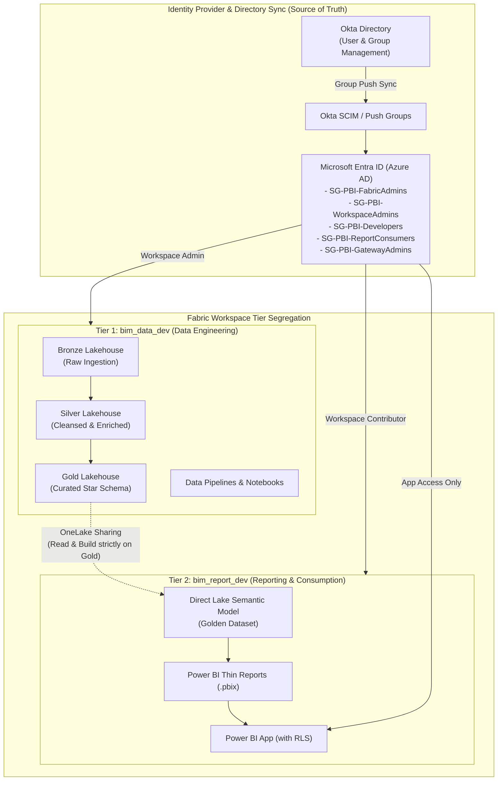
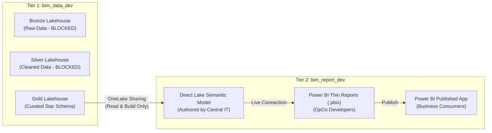

# Power BI & Microsoft Fabric Security Design: End-to-End Implementation Guide

## Table of Contents
- [Executive Summary & Architecture Overview](#executive-summary--architecture-overview)
- [1. Step-by-Step: Entra Role-Based Security Groups via Okta](#1-step-by-step-entra-role-based-security-groups-via-okta)
  - [1.1 Target Security Group Architecture](#11-target-security-group-architecture)
  - [1.2 Okta Configuration (Source of Truth)](#12-okta-configuration-source-of-truth)
  - [1.3 Entra ID Verification & Conditional Access](#13-entra-id-verification--conditional-access)
- [2. Step-by-Step: Secure Workspaces & Tenant Governance](#2-step-by-step-secure-workspaces--tenant-governance)
  - [2.1 Restrict Workspace Creation](#21-restrict-workspace-creation)
  - [2.2 Restrict Capacity Administration](#22-restrict-capacity-administration)
  - [2.3 Restrict Development Access & Content Modification](#23-restrict-development-access--content-modification)
    - [A. Segregate Workspaces into Tiers](#a-segregate-workspaces-into-tiers)
    - [B. Cross-Workspace Data Access: Shielding Bronze & Silver](#b-cross-workspace-data-access-how-tier-2-reads-tier-1-without-exposing-bronzesilver)
- [3. Step-by-Step: Certify Semantic Models & Shield Bronze/Silver Layers](#3-step-by-step-certify-semantic-models--shield-bronzesilver-layers)
  - [3.1 Shielding Bronze and Silver Data Layers](#31-shielding-bronze-and-silver-data-layers)
  - [3.2 Restrict Certification Permission in Tenant Settings](#32-restrict-certification-permission-in-tenant-settings)
  - [3.3 Endorsement & Certification Process](#33-endorsement--certification-process)

---

## Executive Summary & Architecture Overview
This implementation guide translates the five core governance requirements into an actionable, enterprise-ready security blueprint for **Power BI and Microsoft Fabric**.

---

## 1. Step-by-Step: Entra Role-Based Security Groups via Okta

### 1.1 Target Security Group Architecture
To ensure role separation and prevent user sprawl, map all access through five standardized Entra ID Security Groups:

| Group Name | Scope & Purpose | Target Membership | Fabric / Power BI Target Role |
|---|---|---|---|
| **SG-PBI-FabricAdmins** | Tenant-wide configuration, capacity management, tenant settings | Central IT BI Administrators | Fabric Tenant Administrator |
| **SG-PBI-WorkspaceAdmins** | Workspace lifecycle, deployment pipelines, admin rights | Central IT BI Operations | Workspace Admin |
| **SG-PBI-Developers** | Report authoring, semantic model modeling, pipeline deployment | IT BI Developers + Designated OpCo Analysts | Workspace Contributor / Member |
| **SG-PBI-ReportConsumers** | View-only consumption of reports, dashboards, and apps | All business users across OpCos | Power BI App Viewer / Workspace Viewer |
| **SG-PBI-GatewayAdmins** | On-premises data gateway installation, clusters, connections | Central IT Infrastructure & DBA Team | Gateway Administrator |

---

### 1.2 Okta Configuration (Source of Truth)

#### 1. Create Okta User Groups:
- Navigate to **Okta Admin Console $\rightarrow$ Directory $\rightarrow$ Groups**.
- Create the 5 groups:
  - `OKTA-PBI-FabricAdmins`
  - `OKTA-PBI-WorkspaceAdmins`
  - `OKTA-PBI-Developers`
  - `OKTA-PBI-ReportConsumers`
  - `OKTA-PBI-GatewayAdmins`

#### 2. Assign Membership in Okta:
- Assign central IT personnel to Admin groups.
- Assign authorized OpCo developers and business consumers using Okta group rules (e.g., based on department attribute `Department == "Operations"` or explicit group assignment).

#### 3. Configure Okta to Entra ID (Azure AD) Push Groups:
- Navigate to **Applications $\rightarrow$ Microsoft Entra ID / Office 365** application in Okta.
- Click the **Push Groups** tab.
- Map each Okta group to its corresponding Entra ID group:
  - `OKTA-PBI-FabricAdmins` $\rightarrow$ `SG-PBI-FabricAdmins`
  - `OKTA-PBI-WorkspaceAdmins` $\rightarrow$ `SG-PBI-WorkspaceAdmins`
  - `OKTA-PBI-Developers` $\rightarrow$ `SG-PBI-Developers`
  - `OKTA-PBI-ReportConsumers` $\rightarrow$ `SG-PBI-ReportConsumers`
  - `OKTA-PBI-GatewayAdmins` $\rightarrow$ `SG-PBI-GatewayAdmins`
- Set push rule to: **Create Group / Link Group** and verify push status is **Active**.

---

### 1.3 Entra ID Verification & Conditional Access

1. In **Microsoft Entra Admin Center** (`entra.microsoft.com`), navigate to **Groups $\rightarrow$ All groups**.
2. Verify that `SG-PBI-*` groups appear with **Membership type = Assigned** and **Source = Windows Server AD / External (Okta)**.
3. **Apply Conditional Access Policy:**
   - Navigate to **Protection $\rightarrow$ Conditional Access**.
   - **Target cloud apps:** **Microsoft Power BI Service** and **Microsoft Azure Management**.
   - **Target users:** Include `SG-PBI-FabricAdmins`, `SG-PBI-WorkspaceAdmins`, and `SG-PBI-GatewayAdmins`.
   - **Access controls:** Require **Phishing-resistant MFA (FIDO2 / Okta Verify FastPass)** and **Compliant Device**.

---

## 2. Step-by-Step: Secure Workspaces & Tenant Governance

### 2.1 Restrict Workspace Creation
By default, any user in Microsoft Fabric can create a workspace, leading to governance sprawl.

1. Sign in to **Power BI Service** (`app.powerbi.com`) or Fabric Portal as a Fabric Admin.
2. Click **Settings (Gear icon) $\rightarrow$ Admin portal $\rightarrow$ Tenant settings**.
3. Under **Workspace settings**, locate **Create workspaces (new workspace experience)**:
   - Toggle to **Enabled**.
   - Select **Apply to: Specific security groups**.
   - Add: `SG-PBI-WorkspaceAdmins` and `SG-PBI-FabricAdmins`.
   - Ensure the rest of the organization is **Excluded**.
4. Click **Apply**.

---

### 2.2 Restrict Capacity Administration

1. In the Admin portal, navigate to **Capacity settings $\rightarrow$ Fabric Capacity** (or Power BI Premium).
2. Select your provisioned capacity (e.g., F64 / P1 / F32).
3. Click **Capacity administrators** (gear or pencil icon).
4. Remove individual user accounts.
5. Add exclusively: `SG-PBI-FabricAdmins`.
6. Under **Tenant Settings $\rightarrow$ Capacity settings**:
   - Locate **Fabric Capacity Admins can delegate management**.
   - Restrict to `SG-PBI-FabricAdmins`.

---

### 2.3 Restrict Development Access & Content Modification
To enforce that only authorized admins and developers can modify datasets and reports:

#### A. Segregate Workspaces into Tiers
> **Rule:** Never mix data engineering/transformation with end-user consumption.

##### Security Group Access Matrix by Workspace Tier

| Security Group | Tier 1: `bim_data_dev` *(Lakehouse, Warehouses, Pipelines)* | Tier 2: `bim_report_dev` *(Semantic Models, Reports, Apps)* | Rationale & Governance Rule |
|---|---|---|---|
| **SG-PBI-FabricAdmins** | **Admin** *(via Tenant Role)* | **Admin** *(via Tenant Role)* | Central IT oversight, capacity allocation, tenant configuration. |
| **SG-PBI-WorkspaceAdmins** | **Admin** | **Admin** | Manages workspace lifecycle, Git integration, and CI/CD pipelines. IT only. |
| **SG-PBI-DataEngineers** *(Central IT)* | **Contributor** | **Contributor or Member** | Develops ingestion pipelines, notebooks, and Gold Delta tables. |
| **SG-PBI-Developers** *(OpCo + IT Report Devs)* | **NO ACCESS** *(Blocked)* | **Contributor** | Can create and edit reports and non-certified datasets in `bim_report_dev`. **Strictly blocked** from viewing Bronze/Silver tables or ETL notebooks. |
| **SG-PBI-ReportConsumers** *(OpCo Business Users)* | **NO ACCESS** *(Blocked)* | **NO WORKSPACE ACCESS** *(Access strictly via Power BI App)* | Consumers must never receive a workspace role (Admin, Member, Contributor, or Viewer). They consume read-only reports through the published Power BI App with RLS applied. |
| **SG-PBI-GatewayAdmins** | **Connection Admin** | **No Access** | Manages on-premises data gateway credentials and connections for hybrid data sources. |

---

#### B. Cross-Workspace Data Access: How Tier 2 Reads Tier 1 Without Exposing Bronze/Silver
A critical architectural challenge is allowing `bim_report_dev` semantic models to query Gold tables in `bim_data_dev` without granting OpCo developers access to raw ingestion pipelines or sensitive Bronze/Silver data.

##### 7. Item-Level Granular Permissions (OneLake Sharing):
- Within `bim_data_dev`, navigate to the **Gold Lakehouse / SQL Analytics Endpoint $\rightarrow$ Click ... $\rightarrow$ Manage Permissions**.
- Grant **Read and Build** permissions specifically on the Gold Lakehouse to `SG-PBI-Developers`.
- **Do NOT** grant permissions on Bronze Lakehouse, Silver Lakehouse, or Data Pipelines.

##### 8. Direct Lake Connection Decoupling:
- The Direct Lake Semantic Model is stored inside `bim_report_dev`, but references Delta Lake Parquet files physically located in `bim_data_dev`'s Gold tables.
- Queries from reports bypass Spark clusters and execute directly against Gold Parquet files using the Analysis Services engine.

##### 9. Decoupled Thin Report Authoring (Golden Dataset Pattern):
- Central IT authors and publishes the authoritative Direct Lake Semantic Model in `bim_report_dev`.
- OpCo Developers in `SG-PBI-Developers` connect to this semantic model via **Live Connection / Power BI Thin Reports (.pbix)**.
- OpCo Developers build their visualizations without needing direct SQL or storage access to the underlying Lakehouse.

---

## 3. Step-by-Step: Certify Semantic Models & Shield Bronze/Silver Layers

### 3.1 Shielding Bronze and Silver Data Layers
To prevent business consumers from querying raw or unvalidated data:

#### 1. Physical & Logical Isolation:
- Store **Bronze** and **Silver** tables in a dedicated Fabric Lakehouse (e.g., `lh_bronze`, `lh_silver`) within the IT Data Workspace (`bim_data_dev`).
- Store **Gold** star-schema tables in `lh_gold`.

#### 2. Revoke Direct SQL Analytics Endpoint Access:
- **Do NOT** grant workspace permissions or SQL connection strings for Bronze/Silver Lakehouses to developers outside IT or consumers.
- **Lakehouse item permissions:** Only grant **Read** on the Semantic Model. Do not grant ReadData or SQL Endpoint access on Bronze/Silver items.

#### 3. Decouple Reporting from Data Engineering:
- Developers build Power BI Semantic Models in **Direct Lake** mode connecting exclusively to **Gold Delta tables**.
- **Hide technical surrogate keys, ETL timestamps, and raw staging columns** in the Model View (mark as *Hidden*).

---

### 3.2 Restrict Certification Permission in Tenant Settings
Certification signifies an organizational endorsement of accuracy and compliance. Only authorized governance bodies should certify models.

1. Navigate to **Admin portal $\rightarrow$ Tenant settings $\rightarrow$ Export and sharing settings**.
2. Locate **Certification**:
   - Toggle to **Enabled**.
   - Select **Apply to: Specific security groups**.
   - Add: `SG-PBI-FabricAdmins` (or a dedicated Data Governance Group).
   - Enter your internal documentation URL in the **URL for documentation** field (guides authors on certification criteria).
3. Click **Apply**.

---

### 3.3 Endorsement & Certification Process
*(Note: Labeled as 4.3 in process catalog)*

1. Open the **Semantic Model** in the Power BI Service.
2. Click **Settings $\rightarrow$ Expand Endorsement and discovery**.
3. Three levels exist:
   - **None:** Default state during initial development.
   - **Promoted:** Can be set by `SG-PBI-Developers` when tested and validated across their OpCo.
   - **Certified:** Can **only** be set by `SG-PBI-FabricAdmins` after verifying:
     - All KPIs match approved enterprise business logic.
     - Standard measures (e.g., YTD Revenue, Gross Margin %) are centralized and documented.
     - Model documentation and descriptions are populated.
     - RLS rules are active and verified.
4. Select **Certified $\rightarrow$ Click Apply**.
5. The **certified green badge** appears across the OneLake Data Hub, Excel (*"Analyze in Excel"*), and Power BI Desktop.

