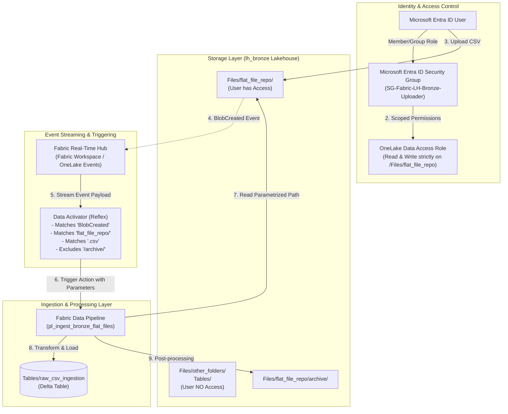
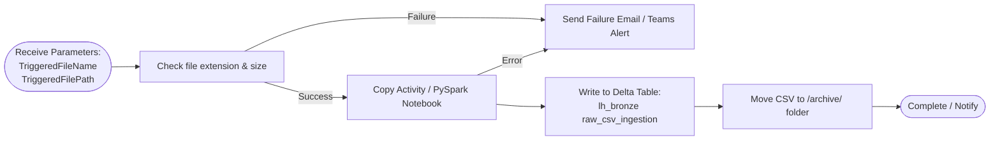
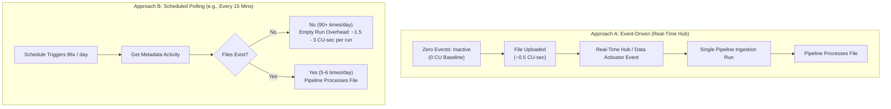

# End-to-End Design: Secure File Upload and Automated Ingestion

There are two requirements in this excel upload process:
1. **User Identity & Folder-Level Access Control (Least Privilege)**
2. **Automated Ingestion** which eliminates the latency involved with scheduled trigger of ingestion pipeline.

Let’s address each of them sequentially.

---

## A. User Identity & Folder-Level Access Control

### Design Challenge
We are targeting the user to be able to directly upload the files to `FlatFile_Repo` folder created specifically for this excel upload functionality with the caveat that the user will only have access to this folder.

Now, by default, workspace roles (*Contributor*, *Member*, *Admin*) give broad access to all workspace items. To restrict a user strictly to `Files/FlatFile_Repo` folder in lakehouse we have to go through the below steps.

### Implementation Steps

#### 1. Create an Entra ID Security Group
- **Name:** `SG-Fabric-LH-Bronze-Uploader`
- Assign the user(s) to this group.

#### 2. Workspace & Item-Level Permissions
- Grant the security group **Viewer** permission at the workspace level (or **Read** only on `lh_bronze` Lakehouse via Item Sharing).
- *Do not* grant Write or Admin access at the workspace or Lakehouse root.

#### 3. Configure OneLake Folder-Level Data Access Roles
- Open `lh_bronze` Lakehouse in Fabric.
- Go to **Manage OneLake data access (preview / GA)** or use ADLS Gen2 ACLs:
  - Create a role: `FlatFileRepo_Contributor`.
  - Grant **Read & Write** permission explicitly to path: `Files/FlatFile_Repo/`.
  - **Deny / leave unassigned** all other paths (`Files/other_internal_data/`, `Tables/`).
  - Assign `SG-Fabric-LH-Bronze-Uploader` to `FlatFileRepo_Contributor`.

### Client Upload Interfaces for the User
Users will be provided with the following upload method:

#### Microsoft Fabric Web Portal (Direct UI)
- The user logs into `app.fabric.microsoft.com` with Entra ID.
- Navigates to `lh_bronze` Lakehouse $\rightarrow$ `Files` $\rightarrow$ `FlatFile_Repo`.
- Uses the **Upload $\rightarrow$ Upload Files** button.

---

## B. Automated Ingestion

### Architecture Blueprint
The architecture blueprint is discussed as below:

We will capture events in **Real-Time Hub** which is Fabric's central command center for streaming data and system events. Then we will create/configure **Data Activator (Reflex)** which evaluates event patterns in real time and invokes downstream Fabric actions. That in our case will be a Fabric pipeline which will ingest/transform and load the data into the destination. The diagram below illustrates that.

---

## The Steps Involved

### Step 1: Event Stream Capture in Real-Time Hub
Capture file creation events seamlessly inside Microsoft Fabric.

1. **Navigate to Real-Time Hub:**
   - In Fabric, click the **Real-Time hub** icon on the left navigation panel.
2. **Locate Fabric / OneLake Storage Events:**
   - Under **Fabric events / Azure events**, select **OneLake storage events** (or your Fabric Workspace event stream).
3. **Select Event Type:**
   - Filter for event: `Microsoft.Storage.BlobCreated`.
4. **Subscribe to Workspace:**
   - Target the Workspace and the `lh_bronze` Lakehouse.
5. **Connect to Data Activator:**
   - Click **Set alert** or **Create Data Activator rule** from the stream.

---

### Step 2: Event Filtering & Trigger Action in Data Activator (Reflex)
Configure Data Activator to evaluate the event stream and invoke the ingestion pipeline dynamically.

#### 2.1 Create Data Activator Item
1. In your workspace, click **+ New Item $\rightarrow$ Data Activator (Reflex)**.
2. Name: `act_flat_file_upload_trigger`.
3. Connect the event stream from Real-Time Hub.

#### 2.2 Define Extracted Properties
Map key fields from the event payload:

| Property Name | Source Field in Event Payload | Sample Value |
|---|---|---|
| **FullSubject** | `subject` | `/.../Files/flat_file_repo/sales_2026_09_01.csv` |
| **EventType** | `eventType` | `Microsoft.Storage.BlobCreated` |
| **FileName** | Text extraction after last `/` in `subject` | `sales_2026_09_01.csv` |

#### 2.3 Configure Trigger Condition
Create a new trigger named `On_CSV_Uploaded_FlatFileRepo`:
- **When EventType:** Is equal to `Microsoft.Storage.BlobCreated`
- **And FullSubject:** Contains `Files/flat_file_repo/`
- **And FullSubject:** Ends with `.csv`
- **And FullSubject:** Does **NOT** contain `/archive/` *(Critical: prevents loops when moving files)*

#### 2.4 Set the Action (Execute Pipeline)
1. **Action:** Choose **Run Fabric Item $\rightarrow$ Pipeline**.
2. **Select Pipeline:** `pl_ingest_bronze_flat_files`.
3. **Map Dynamic Parameters:**
   - `TriggeredFileName` $\leftarrow$ `[Property] FileName`
   - `TriggeredFilePath` $\leftarrow$ `[Property] FullSubject`
4. Click **Start / Activate** on the top toolbar to begin continuous monitoring.

---

### Step 3: Parameterized Fabric Ingestion Pipeline Design
Create the data pipeline `pl_ingest_bronze_flat_files` in your Fabric workspace.

#### Define Pipeline Parameters
In the pipeline canvas, switch to the **Parameters** tab and create:
- `TriggeredFileName` *(Type: String, Default: blank)*
- `SourceFolderPath` *(Type: String, Default: `Files/flat_file_repo`)*

#### Post-Processing & Archival Activity
1. **Add a Copy / Delete Activity on success of the ingestion step:**
   - **Source:** `Files/flat_file_repo/@{pipeline().parameters.TriggeredFileName}`
   - **Target:** `Files/flat_file_repo/archive/@{pipeline().parameters.TriggeredFileName}`
2. **Delete the original file** from `Files/flat_file_repo/` to keep the folder clean and avoid reprocessing.

---

## C. Capacity Unit (CU) Consumption Analysis on F32 SKU

### 1. Understanding Capacity Units (CU) on an F32 SKU
On an **F32 SKU**, your workspace has:
- **32 CUs per second.**
- **Budget per hour:** 32 CUs × 3,600 seconds = **115,200 CU-seconds/hour** (or 32 CU-hours).
- **Fabric Smoothing:** Fabric smooths background operations (like Pipelines, Notebooks, and Data Activator actions) over **24 hours**, which prevents sudden spikes from throttling your capacity.

### CU Consumption Breakdown: Event-Driven vs. Scheduled

---

### 2. Component-by-Component CU Comparison

#### A. Real-Time Hub & Data Activator (Event-Driven)
- **Real-Time Hub (Fabric Workspace / OneLake System Events):**
  - System event capture (such as `BlobCreated`) operates on Fabric's managed event plane.
  - For low-volume file uploads (e.g., 5–50 files/day), event ingestion and routing consume minimal throughput CU-seconds (< 0.1% of F32 hourly budget).
- **Data Activator (Reflex Rules):**
  - Data Activator is billed based on active event evaluations and fired actions.
  - When no files are uploaded, rules remain dormant and consume negligible background CUs.
  - When an event fires, Data Activator consumes ≈ **0.2 – 0.5 CU-seconds** to evaluate the rule and invoke the pipeline REST endpoint.
- **Pipeline Execution:**
  - Runs **only when a file is actually present**.
  - **0 wasted runs**.

#### B. Scheduled Fabric Pipeline (Polling Approach)
A scheduled pipeline must run periodically (e.g., every 15 minutes) to check if a user has uploaded a file:
1. Pipeline fires on schedule.
2. Executes **Get Metadata** activity to inspect `Files/flat_file_repo/`.
3. Executes an **If Condition** activity:
   - If empty $\rightarrow$ Terminates.
   - If file exists $\rightarrow$ Executes Copy/Notebook activity.
- **The "Empty Run" Penalty:**
  - Every pipeline run has a base orchestration cost for spinning up activity executors.
  - Even an empty run with just a *Get Metadata* + *If Condition* consumes ≈ **1.5 – 3 CU-seconds per run**.
  - Running every 15 minutes = 96 runs/day $\rightarrow$ ≈ **144 – 288 CU-seconds/day** spent purely checking empty folders.
  - Running every 5 minutes = 288 runs/day $\rightarrow$ ≈ **430 – 860 CU-seconds/day** in idle overhead.

---

### 3. Head-to-Head Comparison Matrix

| Metric / Dimension | Approach 1: Real-Time Hub + Data Activator | Approach 2: Scheduled Pipeline (Every 15 min) | Approach 3: Scheduled Pipeline (Daily Batch) |
|---|---|---|---|
| **Trigger Mechanism** | Reactive (Push notification on upload) | Proactive Polling (Pull) | Fixed batch schedule (e.g., 8:00 PM) |
| **End-to-End Latency** | Near-Instant (≈ 15–45 seconds after upload) | Delayed (0–15 minutes wait time) | High Delay (Up to 24 hours) |
| **CU Consumption (Idle State)** | ≈ 0 CUs (Zero waste) | Continuous drain (≈ 150–300 CU-sec/day on empty checks) | 0 CU during the day |
| **CU Consumption (Active Ingestion)** | Exactly proportional to number of files | Same ingestion CU + polling overhead | Same ingestion CU, processed in batch |
| **Impact on F32 Capacity** | Negligible (< 0.05% capacity) | Constant background heartbeat runs | One moderate batch spike (smoothed over 24h) |
| **Risk of Throttling / Smoothing Impact** | Minimal (lightweight event execution) | Cumulative micro-burn from 96 runs/day | Low (batch smoothed across 24 hours) |
| **Handling Multiple Rapid Uploads** | Triggers immediately per file or batches naturally | Processes all accumulated files in the next 15-min window | Processes all accumulated files once per day |
| **Setup & Maintenance Overhead** | Requires setup of Real-Time Hub & Data Activator item | Simple (Native pipeline timer schedule) | Simplest (Single cron trigger) |

---

### 4. Mathematical Scenario on F32 Capacity
Suppose **5 CSV files** are uploaded randomly by users throughout the business day:

#### Scenario A: Real-Time Hub + Data Activator
- **Event routing + Activator evaluations (5 events):** ≈ 2.5 CU-seconds
- **Pipeline Ingestion runs (5 actual processing runs):** ≈ 5 × 15 CU-seconds = 75 CU-seconds
- **Total CU-seconds used:** ≈ **77.5 CU-seconds**
- **User Experience:** Every user sees their data in the Delta table within **30 seconds**.

#### Scenario B: Scheduled Pipeline (Every 15 Mins)
- **91 Empty runs (91 × 2 CU-seconds):** ≈ 182 CU-seconds
- **5 Successful runs with ingestion (5 × 17 CU-seconds):** ≈ 85 CU-seconds
- **Total CU-seconds used:** ≈ **267 CU-seconds** (≈ **3.5× higher compute burn** for idle polling)
- **User Experience:** Users wait an average of **7.5 minutes** for data to appear.

