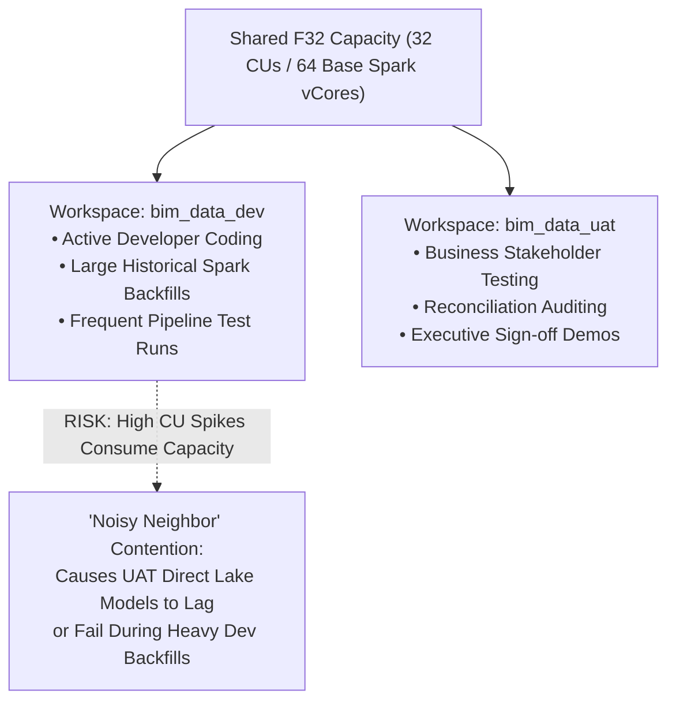

# Microsoft Fabric F32 Capacity: Development Environment Resource & Capability Guide

> **Project:** IPS Corporation BI Modernization  
> **Topic:** Non-Production Compute Sizing, Workload Boundaries, Spark vCore Allocation, Direct Lake Limits & FinOps Sizing  
> **Capacity SKU:** Microsoft Fabric F32 (32 Capacity Units) | Region: Azure Central US  
> **Author:** IPS Data Engineering & Cloud Architecture Team  
> **Date:** September 2026  
> **Status:** Production Standard  

---

## Executive Summary

This guide provides a comprehensive technical and financial specification for utilizing a **Microsoft Fabric F32 Capacity (32 Capacity Units)** to host non-production workloads (**Development**, **SIT**, and **UAT**) for the **IPS BI Modernization project**.

In Microsoft Fabric, compute capacity is completely virtualized and decoupled from underlying storage. An F32 SKU provides dedicated, dynamically smoothed processing power shared across all data workloads—including **Data Factory Copy Pipelines**, **PySpark Notebooks**, **Lakehouse SQL Analytics Endpoints**, and **Power BI Direct Lake Semantic Models**.

This document details official sizing pathways, exact compute metrics, workload concurrency limits, Spark vCore burst ratios, Direct Lake table row thresholds, licensing access rules, and FinOps cost models.

---

## Table of Contents
1. [Official Sizing & Monitoring Pathways](#1-official-sizing--monitoring-pathways)
2. [Compute Capacity & Performance Architecture (CUs)](#2-compute-capacity--performance-architecture-cus)
3. [Workload-Specific Capabilities & Technical Guardrails](#3-workload-specific-capabilities--technical-guardrails)
   - [3.1 Power BI & Direct Lake Semantic Models](#31-power-bi--direct-lake-semantic-models)
   - [3.2 Apache Spark & Data Engineering (vCore Bursting)](#32-apache-spark--data-engineering-vcore-bursting)
   - [3.3 Data Factory Orchestration (Pipelines & Dataflows Gen2)](#33-data-factory-orchestration-pipelines--dataflows-gen2)
4. [OneLake Storage Architecture & Decoupled Billing](#4-onelake-storage-architecture--decoupled-billing)
5. [Licensing Threshold: The F64 Boundary Warning](#5-licensing-threshold-the-f64-boundary-warning)
6. [FinOps Pricing & Cost Analysis](#6-finops-pricing--cost-analysis)
7. [Sharing F32 Across Dev & SIT/UAT Workspaces (Trade-Offs & Noisy Neighbors)](#7-sharing-f32-across-dev--situat-workspaces-trade-offs--noisy-neighbors)

---

## 1. Official Sizing & Monitoring Pathways


Microsoft provides four primary tools and documentation pathways for estimating, calculating, and monitoring Fabric capacity performance:

1. **The Interactive Sizing Calculator (Fabric SKU Estimator)**:
   * Web-based planning tool to input anticipated workloads (data size, daily batch refreshes, Spark intensities) to calculate the recommended Fabric SKU (`F8`, `F32`, `F64`, `F128`).
2. **The Financial Pricing Calculator (Azure Pricing Calculator - Microsoft Fabric)**:
   * Used to model regional costs, compare Pay-As-You-Go hourly rates against 1-Year/3-Year Capacity Reservations, and calculate OneLake storage costs ($0.023/GB/month).
3. **Microsoft Learn: Fabric Capacity Planning Roadmap**:
   * Official architectural best practices on multi-workspace staging, capacity sharing, and regional allocation.
4. **Microsoft Learn: Fabric Capacity Metrics App**:
   * Tenant-level Power BI monitoring application required to track real-time Capacity Unit (CU) consumption, evaluate 24-hour background smoothing, and audit throttling events.

---

## 2. Compute Capacity & Performance Architecture (CUs)

Microsoft Fabric decouples compute from storage and virtualizes compute into **Capacity Units (CUs)**. All workloads share this unified pool:

$$\text{F32 Compute Baseline} = \mathbf{32\text{ Capacity Units per second (CU/sec)}}$$

### Capacity Evaluation Windows & Smoothing Mechanisms:
Fabric monitors compute utilization across two distinct time windows to allow bursting while preventing unexpected throttling:

| Evaluation Window | Available Processing Power | Operational Purpose |
| :--- | :--- | :--- |
| **30-Second Window** | **$960\text{ CU-seconds}$**<br>($32\text{ CUs} \times 30\text{ sec}$) | Evaluates interactive workloads (Power BI report rendering, DAX queries, notebook execution). |
| **24-Hour Window** | **$2,764,800\text{ CU-seconds}$**<br>($32\text{ CUs} \times 86,400\text{ sec}$) | Evaluates scheduled background workloads (Data Factory pipelines, batch Spark jobs). Background jobs are smoothed across 24 hours. |

---

## 3. Workload-Specific Capabilities & Technical Guardrails

### 3.1 Power BI & Direct Lake Semantic Models

* **Maximum In-Memory Semantic Model Size:** **10 GB per individual semantic model**.
  > [!NOTE]
  > This is a **per-model limit**, not a cumulative workspace limit. An F32 workspace can simultaneously host multiple 8 GB semantic models.
* **Memory Refresh Overhead (2x Spike):**
  * During a full dataset refresh, Fabric keeps the existing model in memory to serve live user queries while loading the new model into memory.
  * **Warning:** If a semantic model exceeds **5 GB**, a full refresh may spike over the 10 GB limit and fail. **Incremental Refresh** must be enabled on models $> 5\text{ GB}$ to mitigate this risk.
* **Direct Lake Table Row Cap:** **Maximum 300 million rows per table**.
  * **Behavior on Exceeding Limit:** If a table exceeds 300 million rows, Fabric automatically **falls back to DirectQuery mode** (querying the Lakehouse Delta Parquet files on the fly), increasing query response latency.

---

### 3.2 Apache Spark & Data Engineering (vCore Bursting)


In Microsoft Fabric, CUs are mapped to Apache Spark virtual cores (vCores) at a **$1:2\text{ ratio}$**:

$$\text{Base Spark vCores} = 32\text{ CUs} \times 2 = \mathbf{64\text{ Base vCores}}$$
$$\text{Burst Spark vCores} = 64\text{ Base} \times 3 = \mathbf{192\text{ Max Burst vCores}}$$

```mermaid
flowchart LR
    F32["Fabric F32 Capacity\n(32 CUs)"]
    -->|1:2 Ratio| BASE["64 Base Spark vCores"]
    BASE -->|Auto-Bursting (3x)| BURST["192 Max Burst Spark vCores"]

    BURST --> P1["Option A: High-Power Pools\n(64 vCores/pool = 3 Concurrent Jobs)"]
    BURST --> P2["Option B: Optimized Dev Pools\n(8 vCores/pool = Up to 24 Concurrent Jobs)"]
```

#### Spark Concurrency Profiles (Optimistic Job Admission):
* **High-Power Configuration:** Standard large node pools (e.g., 64 vCores total per pool) allow running **3 concurrent jobs at full capacity** before jobs are queued.
* **Optimized Dev Configuration (Recommended):** Smaller developer pools (e.g., 8 vCores total per pool) can **sustain up to 24 concurrent interactive notebooks/jobs simultaneously**.
* **Fabric Starter Pools:** Pre-warmed Spark executor pools spin up in **$< 10\text{ seconds}$**. For an F32 SKU, the default node size is **Medium (8 vCores per node / 56 GB memory)**.

---

### 3.3 Data Factory Orchestration (Pipelines & Dataflows Gen2)

* **Smoothing Behavior:** Pipeline activities are classified as background tasks and smoothed over a 24-hour evaluation window, preventing pipeline bursts from causing interactive report throttling.
* **Concurrency:** Excellent concurrency headroom. An F32 capacity easily handles hundreds of scheduled pipeline activity executions per hour.
* **Dataflows Gen2:** Translates Power Query M operations into optimized SQL or Spark execution under the hood, with ample headroom for parallel runs.

---

## 4. OneLake Storage Architecture & Decoupled Billing

Storage in Microsoft Fabric is **completely decoupled from compute (F-SKUs)** and does not enforce artificial size caps:
* **No Maximum Storage Limit:** An F32 capacity is not restricted to a fixed storage limit. Organizations can store 100 GB or 100 TB of Delta Parquet files in OneLake.
* **Pricing Baseline:** OneLake storage is billed on actual consumption, at approximately **$0.023 per GB / month** (standard Azure ADLS Gen2 equivalent rates).

---

## 5. Licensing Threshold: The F64 Boundary Warning

> [!WARNING]
> **The Critical F64 Licensing Boundary:**  
> An F32 capacity sits directly below Microsoft's free report viewing threshold.
>
> * **On F64 and Higher Capacities:** Unlimited business users holding **Power BI Free accounts** can view and interact with reports published in that capacity.
> * **On F32 and Lower Capacities:** **Every single user** who views, interacts with, or edits reports in the Power BI service **strictly requires a Power BI Pro ($14/user/month) or Premium Per User (PPU) license**.
>
> *(Refer to the [Power BI Licensing & ALM Strategy Guide](file:///Users/chandu/Documents/Python_practice/Fabric/docs/additional_docs/PowerBI_Licensing_Fabric_Capacity_and_ALM_Strategy_Guide.md) for architectural solutions to enable free business user UAT testing).*

---

## 6. FinOps Pricing & Cost Analysis

The table below summarizes indicative pricing for a Microsoft Fabric F32 capacity in standard Azure commercial regions:

| Pricing Plan | Approximate Monthly Cost | Hourly Equivalent | Best Use Case |
| :--- | :--- | :--- | :--- |
| **Pay-As-You-Go (PAYG)** | **~$4,205.00 / month** | **$5.76 / hour** | **Implementation & Sprint Development:** Variable dev workloads; pause nights and weekends to save up to 60%. |
| **1-Year Reserved Capacity** | **~$2,501.00 / month** | **$3.42 / hour** | **Steady-State Operations:** Continuous 24/7 development and integration testing (~40.5% discount). |

---

## 7. Sharing F32 Across Dev & SIT/UAT Workspaces (Trade-Offs & Noisy Neighbors)

Sharing a single F32 capacity across both a **Development (`bim_data_dev`)** workspace and a **SIT/UAT workspace** is a highly cost-effective strategy for non-production environments. However, enterprise architects must manage the operational trade-offs:



### Operational Recommendations to Mitigate Contention:
1. **Schedule Heavy Data Backfills Off-Peak:** Schedule heavy historical table re-ingestion and full Silver/Gold processing runs after 6:00 PM CET when business testers are offline.
2. **Restrict Developer Spark Pool Sizes:** Enforce **Medium (8 vCore)** nodes for interactive notebook development to prevent a single developer from exhausting the entire 64-vCore pool.
3. **Adopt 3-Tier Production-Backed UAT (Recommended):** Place the official UAT testing workspace on the **Production F64 capacity** using Fabric Deployment Pipelines. This completely isolates development experimentation from business UAT testing and unlocks free viewer access for testers.

---

## Related Documentation
* **[Power BI Licensing, Fabric Capacity Planning & ALM Strategy Guide](file:///Users/chandu/Documents/Python_practice/Fabric/docs/additional_docs/PowerBI_Licensing_Fabric_Capacity_and_ALM_Strategy_Guide.md)**
* **[Microsoft Fabric Capacity & Cost: FinOps Financial Analysis & Sizing Guide](file:///Users/chandu/Documents/Python_practice/Fabric/docs/additional_docs/IPS_Fabric_Capacity_Cost_Analysis.md)**
* **[Metadata-Driven Ingestion Framework Architecture Guide](file:///Users/chandu/Documents/Python_practice/Fabric/docs/additional_docs/IPS_Metadata_Driven_Ingestion_Framework_Architecture_Guide.md)**
* **[Core Architecture Design Tenets & Governance Principles Guide](file:///Users/chandu/Documents/Python_practice/Fabric/docs/additional_docs/IPS_BI_Core_Architecture_Design_Tenets_and_Governance_Principles.md)**
