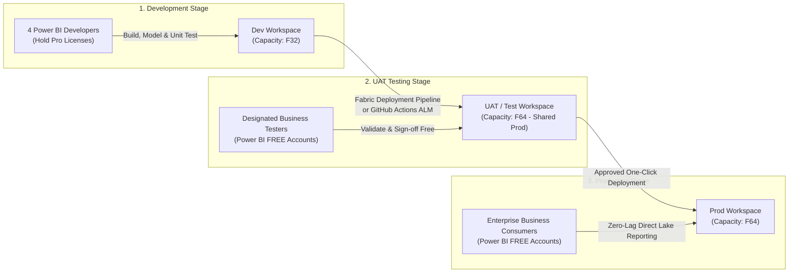

# Power BI Licensing, Fabric Capacity Planning & ALM Strategy Guide

> **Project:** IPS Corporation BI Modernization  
> **Topic:** Power BI Pro Authoring vs. Consumer Viewing, Fabric Capacity Interplay (F32 vs. F64), UAT Testing Strategies & 3-Tier ALM Governance Matrix  
> **Target Environment:** Microsoft Fabric (`F32` Non-Prod, `F64` Prod) | Microsoft 365 Enterprise  
> **Author:** IPS BI & Cloud Architecture Team (in collaboration with BI Lead Prathibha)  
> **Date:** September 2026  
> **Status:** Approved Enterprise Architecture Standard  

---

## Executive Summary

A critical architectural consideration in modernizing the **IPS BI Ecosystem** is the distinction between **Microsoft Fabric Compute Capacity (F-SKUs)** and **Power BI User Licensing (Free, Pro, Premium Per User)**. While acquiring Microsoft Fabric capacity (such as an F32 or F64) provides unified compute, storage, and Direct Lake acceleration, **Fabric capacity does not eliminate the need for individual developer authoring licenses**.

Furthermore, because free consumer report viewing is only supported on **F64 and above**, hosting non-production environments on an **F32 capacity** introduces a major challenge: business stakeholders holding free licenses cannot access or validate reports published to the Dev workspace during User Acceptance Testing (UAT).

This guide resolves this dilemma by detailing:
1. Exact licensing requirements and financial costs for the IPS development team (4 Power BI developers including BI Lead Prathibha).
2. The licensing interplay between Fabric capacities (F32 vs. F64) and Power BI authoring vs. consumption.
3. Three architectural solutions to enable cost-effective UAT testing without purchasing redundant Pro viewer licenses.
4. The **Recommended Best Practice (Solution 1)**: A clean 3-tier Application Lifecycle Management (ALM) pipeline utilizing a dedicated UAT workspace on the Production F64 capacity.

---

## Table of Contents
1. [Developer Licensing Requirements & Acquisition](#1-developer-licensing-requirements--acquisition)
2. [Fabric Capacity vs. Power BI Licensing Matrix](#2-fabric-capacity-vs-power-bi-licensing-matrix)
3. [The Financial Cost Analysis for IPS Modernization](#3-the-financial-cost-analysis-for-ips-modernization)
4. [The Non-Production Sizing Dilemma (F32 Dev vs. F64 Prod)](#4-the-non-production-sizing-dilemma-f32-dev-vs-f64-prod)
5. [Evaluation of UAT Testing Architectural Solutions](#5-evaluation-of-uat-testing-architectural-solutions)
   - [Solution 1: Dedicated UAT Workspace on F64 Capacity (Recommended Best Practice)](#solution-1-dedicated-uat-workspace-on-f64-capacity-recommended-best-practice)
   - [Solution 2: Dynamically Scale Dev to F64 During UAT Windows](#solution-2-dynamically-scale-dev-to-f64-during-uat-windows)
   - [Solution 3: 60-Day Power BI Pro Individual Trials for Business Testers](#solution-3-60-day-power-bi-pro-individual-trials-for-business-testers)
6. [Access Governance & Workspace Sizing Matrix](#6-access-governance--workspace-sizing-matrix)

---

## 1. Developer Licensing Requirements & Acquisition

### Do Power BI Developers Need Power BI Pro Licenses?
**YES.** All Power BI developers must hold an individual **Power BI Pro license** (or Power BI Premium Per User [PPU], or Microsoft 365 E5).

### Optimum Way to Acquire & Implement:

#### Step 1: Audit Existing Microsoft 365 Licensing
Before purchasing standalone licenses, conduct an audit of the organization's existing Microsoft 365 tenant assignments:
* If developers already hold **Microsoft 365 E5**, **Power BI Pro is already included** at no additional cost.
* If developers hold **Microsoft 365 E3**, **Business Premium**, or **Office 365**, standalone Power BI Pro add-ons must be procured.

#### Step 2: Acquisition Method
* **Via Microsoft 365 Admin Center**: Navigate to **Billing > Purchase services**, search for **Power BI Pro**, and assign 4 licenses to developer user accounts.
* **Via Enterprise Agreement (EA) or Cloud Solution Provider (CSP) Partner**: Request 4x Power BI Pro user add-ons from your corporate licensing provider to align with existing billing cycles.

---

## 2. Fabric Capacity vs. Power BI Licensing Matrix

A frequent point of confusion is: *"If IPS has already purchased Microsoft Fabric capacity (F32 or F64), why do we need Power BI Pro licenses?"*

### Key Principle:
> [!IMPORTANT]
> **Microsoft Fabric Capacity does NOT replace authoring licenses.**  
> Any user who creates, edits, publishes, or manages Power BI reports and Direct Lake semantic models into the Power BI Service **strictly requires an individual Power BI Pro license**, regardless of whether the workspace is assigned to an F32, F64, or F128 capacity.

The table below clarifies the exact distinction made by Microsoft licensing:

| User Persona | What F64+ Fabric Capacity Provides | Does F64 Eliminate the Need for Pro? | Does F32 Eliminate the Need for Pro? |
| :--- | :--- | :--- | :--- |
| **Report Viewers (Business Consumers)** | **FREE Access**: End-users with a free Fabric account can view, interact with, and slice-and-dice published reports. | **YES** *(Viewers do not need Pro on F64)* | **NO** *(Viewers on F32 MUST hold a Pro license)* |
| **Report Authors (BI Developers)** | **NOT INCLUDED**: Building reports, editing data models, creating DAX measures, and publishing to workspaces. | **NO** *(Developers ALWAYS need Pro)* | **NO** *(Developers ALWAYS need Pro)* |

---

## 3. The Financial Cost Analysis for IPS Modernization

### Pricing Baseline:
* **Current List Price:** **$14.00 USD per user / month**  
  *(Note: Microsoft officially increased the list price of Power BI Pro from $10.00 to $14.00 USD/month, effective April 1, 2025. Organizations on existing active annual agreements retain the legacy $10.00 USD rate until contract renewal).*

### Total Licensing Cost for IPS BI Team:
The typical project footprint requires licenses for **4 individuals** (3 BI Developers + 1 BI Lead Prathibha):

$$\text{Monthly Cost} = 4 \times \$14.00 = \mathbf{\$56.00\text{ USD / month}}$$
$$\text{Annual Cost} = \$56.00 \times 12 = \mathbf{\$672.00\text{ USD / year}}$$

*(Note: Total incremental cost is **$0 extra** if developers already hold Microsoft 365 E5 licenses).*

---

## 4. The Non-Production Sizing Dilemma (F32 Dev vs. F64 Prod)

In the IPS BI architecture:
1. **Production (PROD)** is assigned to **F64 capacity** ($11.52/hr). This allows hundreds of corporate business users across IPS to consume reports for free without purchasing individual Pro licenses.
2. **Development (DEV)** is assigned to an **F32 capacity** ($5.76/hr) to optimize Azure infrastructure spending (saving ~$4,204/month vs. running F64).

### The UAT Testing Problem:
Because business users possess only **Power BI Free licenses**, when a developer publishes a dashboard to the Dev workspace (assigned to F32), **Power BI blocks access** and prompts business users to upgrade to a paid Pro license. 

Business testers cannot view or validate reports in Dev unless:
* The company purchases expensive Pro licenses for every business tester (unjustified expense), OR
* The architecture implements an intelligent ALM testing pattern.

---

## 5. Evaluation of UAT Testing Architectural Solutions

Three distinct solutions address this challenge:

---

### Solution 1: Dedicated UAT Workspace on F64 Capacity (Recommended Best Practice)

Set up a standard 3-tier Application Lifecycle Management (ALM) pipeline utilizing **Fabric Deployment Pipelines** and **GitHub Actions**:

$$\text{[Dev Workspace (F32 Capacity)]} \xrightarrow{\text{Deploy via Pipeline}} \text{[UAT Workspace (F64 Capacity)]} \xrightarrow{\text{Deploy via Pipeline}} \text{[Prod Workspace (F64 Capacity)]}$$

#### How It Operates:
1. **Dev Workspace** is assigned to the lower-cost **F32 capacity**. The 4 licensed developers build semantic models, code PySpark transformations, and perform unit testing.
2. **UAT (Test) Workspace** is assigned to the **F64 capacity** (sharing the Production capacity or deployed as an isolated F64 container).
3. When development completes, the report and Direct Lake semantic model are pushed with **one click** from Dev to UAT via the Fabric Deployment Pipeline.
4. **Business users test and sign off in UAT completely free** using their existing Power BI Free accounts.
5. Upon formal sign-off, the release is promoted to the **Prod Workspace** on F64.

#### Cost & Operational Impact:
* **$0 extra licensing cost** for business testers.
* Developers build freely in Dev without fear of disrupting business testers.
* Clean separation of concerns with full Git version control and rollback capability.

---

### Solution 2: Dynamically Scale Dev to F64 During UAT Windows

Microsoft Fabric capacities are billed on a pay-as-you-go per-second basis and can be dynamically scaled up or down in Azure **within seconds with zero downtime**:

#### How It Operates:
1. Keep the Dev workspace at **F32** during normal sprint coding days (Monday through Wednesday).
2. When formal UAT testing begins (e.g., Thursday & Friday), scale the Dev capacity up to **F64** via the Azure Portal, CLI, or automated Azure REST API call.
3. Business users can now log into the Dev workspace with their **Free licenses** and review reports.
4. Scale Dev back down to **F32** once testing concludes Friday evening.

#### Cost & Operational Impact:
* **Cost Impact:** You only pay the hourly difference between F32 ($5.76/hr) and F64 ($11.52/hr), which is **$5.76/hr**. For a 16-hour testing window across two days, the total extra cost is **~$92.16**.
* Requires operational discipline to ensure the capacity is scaled back down.

---

### Solution 3: 60-Day Power BI Pro Individual Trials for Business Testers

Microsoft allows individual tenant users to activate an automated **60-day Power BI Pro trial** directly inside the Power BI Service web portal without requiring a credit card or administrator intervention.

#### How It Operates:
* When business testers first access the F32 Dev workspace, they click **Upgrade to Pro Trial**.
* They receive 60 days of fully functional Pro access to participate in the development sprint.

#### Cost & Operational Impact:
* **$0 cost** for a temporary 2-month development sprint.
* **Not viable for long-term operations**: Once the 60-day trial expires, testers lose access permanently unless converted to paid Pro licenses.

---

## 6. Access Governance & Workspace Sizing Matrix

To maintain rigorous data governance, security, and cost control across the enterprise, access permissions are structured according to the matrix below:

| Environment | Purpose | Capacity Allocation | User Access & Permissions | Licensing Requirement |
| :--- | :--- | :--- | :--- | :--- |
| **Dev Workspace** | Development, data engineering, PySpark notebook development, and unit testing | **F32** ($5.76/hr) | **Only 4 BI Developers** *(3 Developers + Lead Prathibha)* | **Power BI Pro Required** ($14/user/mo) |
| **UAT (Test) Workspace** | User Acceptance Testing, data validation, business reconciliation, and sign-off | **F64** ($11.52/hr) | **4 Developers** (Admin/Member) + **Designated Business Testers / QA Lead** (Viewer) | **Power BI Free** for Business Testers *(Covered by F64)* |
| **Prod Workspace** | Live enterprise reporting, executive dashboards, and operational decision-making | **F64** ($11.52/hr) | **Developers** (Publishers via CI/CD) + **All Enterprise End-Users** (Viewer) | **Power BI Free** for all End-Users *(Covered by F64)* |

### Strategic Recommendation Summary:
Adopt **Solution 1** as the permanent enterprise architecture standard. Combining **Fabric Deployment Pipelines** with an **F64-backed UAT Workspace** delivers full ALM rigor, zero extra licensing cost for business users, and enterprise-grade change governance.
