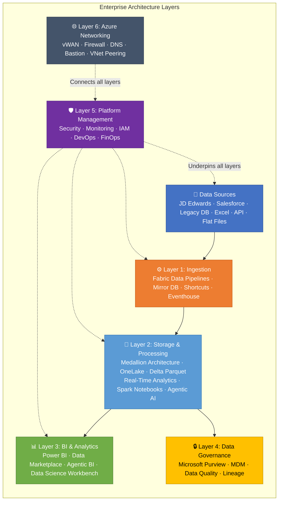
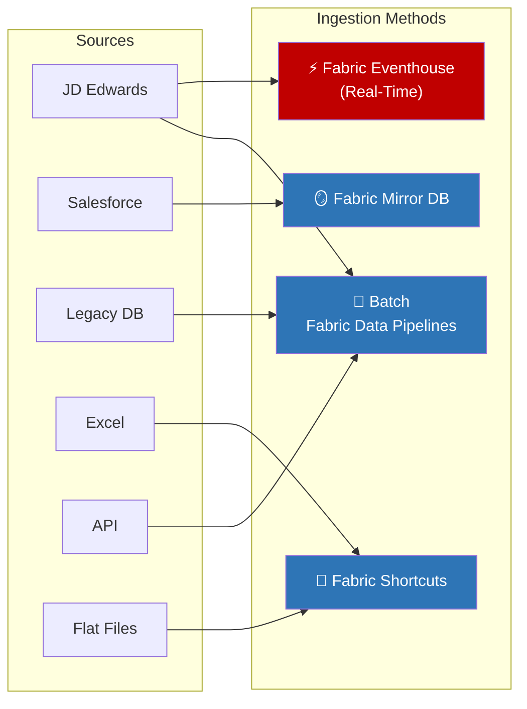
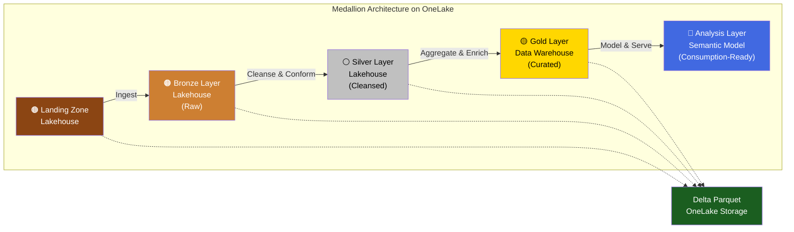
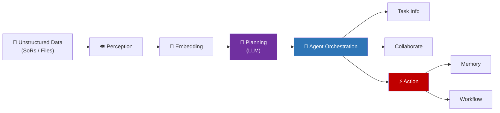
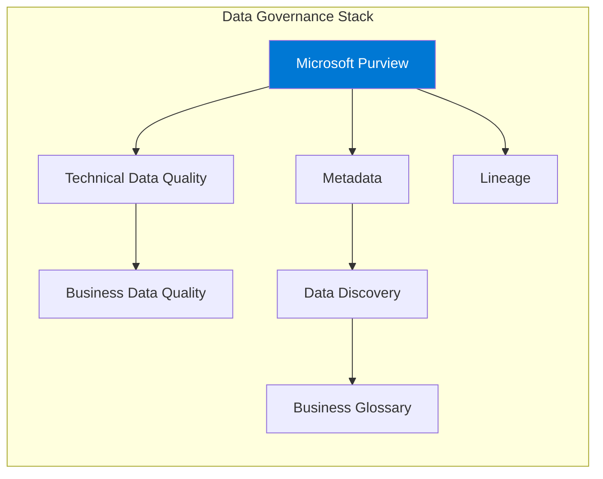
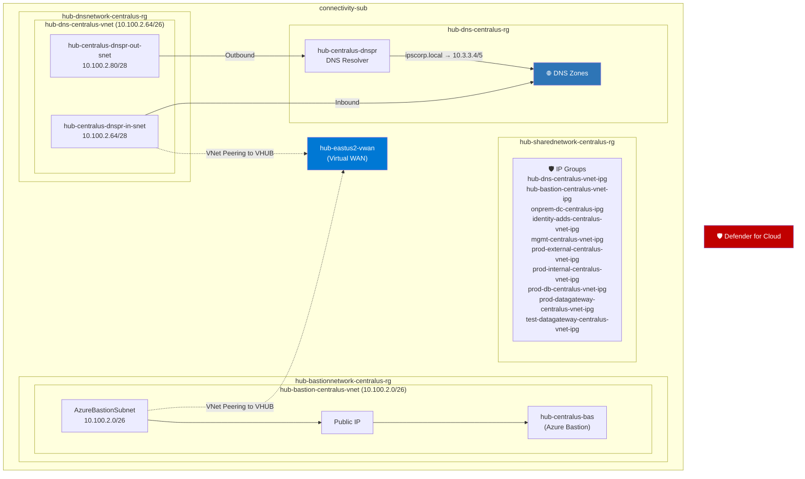
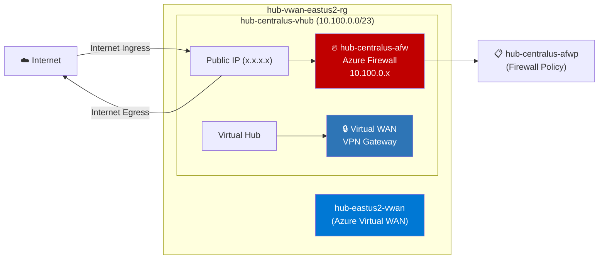
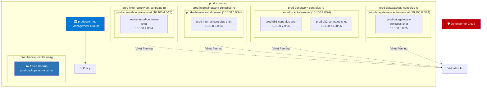
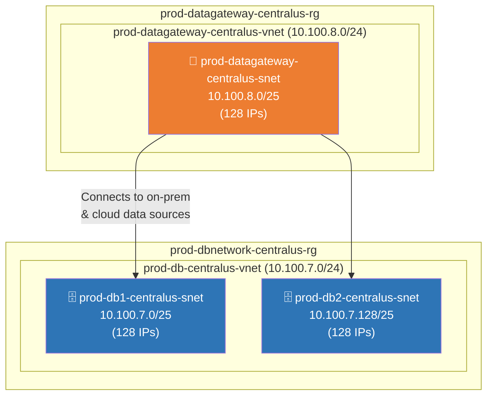
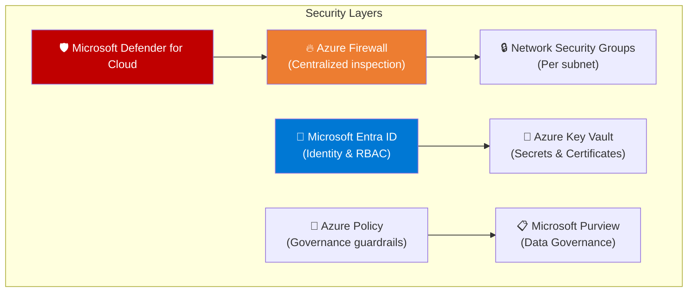

# Enterprise Azure Data Platform — Architecture Document

> **Derived from project architecture diagrams (5 images)**
> Generated: 2026-09-22

---

## Table of Contents

1. [High-Level Overview](#1-high-level-overview)
2. [Layer 1 — Data Platform Architecture (Microsoft Fabric)](#2-layer-1--data-platform-architecture-microsoft-fabric)
3. [Layer 2 — Network Topology (Connectivity Subscription)](#3-layer-2--network-topology-connectivity-subscription)
4. [Layer 3 — Firewall & Virtual WAN](#4-layer-3--firewall--virtual-wan)
5. [Layer 4 — Production Subscription & Workloads](#5-layer-4--production-subscription--workloads)
6. [Layer 5 — Database & Data Gateway Networks](#6-layer-5--database--data-gateway-networks)
7. [IP Address Plan](#7-ip-address-plan)
8. [Security & Governance Summary](#8-security--governance-summary)

---

## 1. High-Level Overview

This architecture represents an **enterprise-grade Azure landing zone** integrated with **Microsoft Fabric** for data analytics. It follows a **Hub-Spoke network topology** using **Azure Virtual WAN (vWAN)**, with centralized firewall, DNS, and bastion services in the **Connectivity subscription**, and workload VNets in the **Production subscription**.



---

## 2. Layer 1 — Data Platform Architecture (Microsoft Fabric)

This layer covers the end-to-end data lifecycle built on **Microsoft Fabric**, from ingestion through consumption.

### 2.1 Data Sources

| Source | Type | Description |
|--------|------|-------------|
| **JD Edwards** | ERP | Enterprise Resource Planning system |
| **Salesforce** | CRM / SaaS | Customer Relationship Management |
| **Legacy DB** | Database | On-premises / legacy databases |
| **Excel** | Files | Spreadsheet-based data |
| **API** | Service | REST / SOAP API endpoints |
| **Flat Files** | Files | CSV, JSON, XML, etc. |

### 2.2 Ingestion (Layer 1)



| Method | Use Case | Mode |
|--------|----------|------|
| **Fabric Data Pipelines** | Batch ETL/ELT from ERP, DB, APIs | Batch / Scheduled |
| **Fabric Mirror DB** | Near-real-time database replication (e.g., Salesforce) | CDC / Mirror |
| **Fabric Shortcuts** | Zero-copy references to external storage (Excel, flat files) | On-Demand |
| **Fabric Eventhouse** | Streaming / real-time event ingestion | Real-Time |

### 2.3 Storage & Processing (Layer 2) — Medallion Architecture



| Layer | Store Type | Format | Purpose |
|-------|-----------|--------|---------|
| **Landing Zone** | Lakehouse | Delta Parquet | Raw ingested data as-is |
| **Bronze** | Lakehouse | Delta Parquet | Immutable raw data with metadata |
| **Silver** | Lakehouse | Delta Parquet | Cleansed, conformed, deduplicated |
| **Gold** | Data Warehouse | Delta Parquet | Business-level aggregates & dimensions |
| **Analysis** | Semantic Model | In-memory | Optimized for BI consumption |

> [!NOTE]
> All layers are stored in **OneLake** using **Delta Parquet** format, enabling unified governance and cross-layer access.

### 2.4 Processing Capabilities

| Capability | Technology | Description |
|-----------|-----------|-------------|
| **Real-Time Analytics** | Kusto Query Database | Streaming analytics and time-series queries |
| **Data Transformation** | Fabric Spark Notebooks | PySpark / SQL-based transformations |
| **Orchestration & Scheduling** | Fabric Pipelines | Workflow orchestration and scheduling |

### 2.5 Agentic AI / Gen AI



### 2.6 Master Data Management (MDM)

| Step | Description |
|------|-------------|
| **Source Data** | SaaS / Other source systems |
| **Cleanse / DQ** | Data quality and cleansing rules |
| **Deploy Rules** | Apply transformation and matching rules |
| **Publish** | Publish golden master records |

### 2.7 Data Governance (Layer 4)



### 2.8 Business Intelligence & Analytical Solutions (Layer 3 — Consumption)

| Solution | Technology | Description |
|----------|-----------|-------------|
| **Business Operational Reporting** | Power BI | Operational dashboards and reports |
| **Data Marketplace** | Fabric | Self-service data catalog for consumers |
| **BI Analytical Reporting** | Power BI | Advanced analytical reports |
| **Self-Service Analytics** | Power BI | User-driven ad-hoc analysis |
| **Agentic BI** | Co-Pilot | AI-powered natural language BI |
| **Data Science Workbench** | Azure AI | ML model development and experimentation |
| **Business Rule Engine** | Custom | Automated business logic execution |

### 2.9 Platform Management & Monitoring (Layer 5)

| Domain | Services |
|--------|----------|
| **Security** | Azure Security Center, Azure Key Vault |
| **Monitoring & Observability** | Azure Log Analytics (Insights), Azure Monitor |
| **Identity & Access Management** | Microsoft Entra ID (formerly Azure AD) |
| **DevOps** | Azure DevOps (CI/CD, Repos, Boards) |
| **FinOps** | Cost Optimization Framework & Reporting |
| **Accelerators** | Tech & Process Accelerator |

---

## 3. Layer 2 — Network Topology (Connectivity Subscription)

The network uses a **Hub-Spoke architecture** with **Azure Virtual WAN** as the hub.

### 3.1 Connectivity Subscription Overview



### 3.2 Resource Groups in Connectivity Subscription

| Resource Group | Purpose | Key Resources |
|---------------|---------|---------------|
| `hub-sharednetwork-centralus-rg` | Shared network IP groups | IP Groups for all VNets |
| `hub-bastionnetwork-centralus-rg` | Bastion host access | Azure Bastion, Public IP |
| `hub-dnsnetwork-centralus-rg` | DNS resolver network | DNS VNet with inbound/outbound subnets |
| `hub-dns-centralus-rg` | DNS zones & resolver | Private DNS Zones, DNS Resolver |
| `hub-vwan-eastus2-rg` | Virtual WAN hub | vWAN, vHUB, Azure Firewall |

### 3.3 DNS Architecture

| Component | Detail |
|-----------|--------|
| **DNS Resolver** | `hub-centralus-dnspr` |
| **Inbound Endpoint** | `10.100.2.64/28` — receives DNS queries from Azure |
| **Outbound Endpoint** | `10.100.2.80/28` — forwards queries to on-prem |
| **Forwarding Rule** | `ipscorp.local` → `10.3.3.4` / `10.3.3.5` (on-prem DCs) |

---

## 4. Layer 3 — Firewall & Virtual WAN

### 4.1 Virtual WAN & Hub Architecture



### 4.2 Azure Firewall Policy — Network Rules

| # | Action | Source | Destination | Port | Protocol |
|---|--------|--------|-------------|------|----------|
| 1 | **Allow** | Azure Vnets | AzureCloud | Any | Any |
| 2 | **Allow** | All DC's, Azure Vnets | DNS Resolver Vnet | 53 | TCP/UDP |
| 3 | **Allow** | All DC's | All DC's | Any | Any |
| 4 | **Allow** | Azure Vnets, On-prem IPs | All DC's | AD | TCP/UDP |
| 5 | **Allow** | DNS Resolver | ADCS Vnet, On-prem DC's | 53 | TCP/UDP |
| 6 | **Allow** | Azure Prod Vnets | Azure Prod Vnets | Any | Any |
| 7 | **Allow** | Bastion Vnet | Azure Vnets | 3389, 22 | TCP |
| 8 | **Allow** | Prod Data Gateway VNET | TBD Data Sources | TBD | TCP |
| 9 | **Allow** | Test Data Gateway VNET | TBD Data Sources | TBD | TCP |

### 4.3 Azure Firewall Policy — Application Rules

| # | Action | Source | Destination | Protocol |
|---|--------|--------|-------------|----------|
| 1 | **Allow** | Azure Vnets | Business Use | HTTP, HTTPS |
| 2 | **Allow** | Azure Vnets | Office365 FQDN Tags | HTTPS |

### 4.4 DNAT Rules

> [!NOTE]
> No DNAT rules are currently configured.

---

## 5. Layer 4 — Production Subscription & Workloads

### 5.1 Production Subscription Overview



### 5.2 Production Resource Groups

| Resource Group | VNet | CIDR | Purpose |
|---------------|------|------|---------|
| `prod-externalnetwork-centralus-rg` | `prod-external-centralus-vnet` | `10.100.4.0/23` | External-facing workloads |
| `prod-internalnetwork-centralus-rg` | `prod-internal-centralus-vnet` | `10.100.6.0/24` | Internal application workloads |
| `prod-dbnetwork-centralus-rg` | `prod-db-centralus-vnet` | `10.100.7.0/24` | Database tier (2 subnets) |
| `prod-datagateway-centralus-rg` | `prod-datagateway-centralus-vnet` | `10.100.8.0/24` | Data gateway for Fabric connectivity |
| `prod-backup-centralus-rg` | — | — | Azure Backup Recovery Services Vault |

---

## 6. Layer 5 — Database & Data Gateway Networks

### 6.1 Database Network



> [!IMPORTANT]
> The **Data Gateway VNet** (`10.100.8.0/24`) enables **Microsoft Fabric** to securely connect to on-premises and private network data sources through the Azure Firewall.

---

## 7. IP Address Plan

### 7.1 Complete CIDR Allocation

| VNet | CIDR | Subnet(s) | Subscription | Purpose |
|------|------|-----------|-------------|---------|
| `hub-centralus-vhub` | `10.100.0.0/23` | Virtual Hub | Connectivity | vWAN Hub + Firewall |
| `hub-bastion-centralus-vnet` | `10.100.2.0/26` | `10.100.2.0/26` | Connectivity | Azure Bastion |
| `hub-dns-centralus-vnet` | `10.100.2.64/26` | `10.100.2.64/28`, `10.100.2.80/28` | Connectivity | DNS Resolver |
| `prod-external-centralus-vnet` | `10.100.4.0/23` | `10.100.4.0/24` | Production | External workloads |
| `prod-internal-centralus-vnet` | `10.100.6.0/24` | `10.100.6.0/24` | Production | Internal workloads |
| `prod-db-centralus-vnet` | `10.100.7.0/24` | `10.100.7.0/25`, `10.100.7.128/25` | Production | Database tier |
| `prod-datagateway-centralus-vnet` | `10.100.8.0/24` | `10.100.8.0/25` | Production | Data Gateway |

### 7.2 Address Space Visualization

```
10.100.0.0/16 (Supernet)
├── 10.100.0.0/23   → Virtual Hub (vWAN)
├── 10.100.2.0/26   → Bastion
├── 10.100.2.64/26  → DNS Resolver
├── 10.100.4.0/23   → Prod External
├── 10.100.6.0/24   → Prod Internal
├── 10.100.7.0/24   → Prod Database
└── 10.100.8.0/24   → Prod Data Gateway

On-Premises DNS:
└── 10.3.3.4/5      → On-prem Domain Controllers (ipscorp.local)
```

---

## 8. Security & Governance Summary

### 8.1 Security Controls



### 8.2 Network Security Design Principles

| Principle | Implementation |
|-----------|---------------|
| **Zero Trust** | All traffic inspected through centralized Azure Firewall |
| **Least Privilege** | IP Groups + firewall rules scope access per VNet |
| **Segmentation** | Separate VNets for external, internal, DB, and gateway workloads |
| **Secure Remote Access** | Azure Bastion (no public RDP/SSH exposure) |
| **Hybrid DNS** | Private DNS resolver with conditional forwarding to on-prem |
| **Centralized Logging** | Azure Monitor + Log Analytics |
| **Backup & DR** | Azure Backup Recovery Services Vault |

### 8.3 Governance Stack

| Domain | Tool | Scope |
|--------|------|-------|
| **Data Governance** | Microsoft Purview | Metadata, lineage, data discovery, business glossary |
| **Data Quality** | Purview + Custom | Technical DQ + business DQ rules |
| **Identity** | Microsoft Entra ID | SSO, RBAC, conditional access |
| **Policy** | Azure Policy | Subscription-level compliance guardrails |
| **Cost Management** | FinOps Framework | Cost optimization & reporting |
| **DevOps** | Azure DevOps | CI/CD pipelines, source control, boards |

---

> [!TIP]
> **Next Steps to Consider:**
> - Define NSG rules for each production subnet
> - Complete the TBD firewall rules for Data Gateway sources
> - Implement Azure Private Endpoints for Fabric ↔ Data Gateway connectivity
> - Set up Azure Monitor workbooks for network flow analytics
> - Define disaster recovery strategy across regions (currently Central US only)
