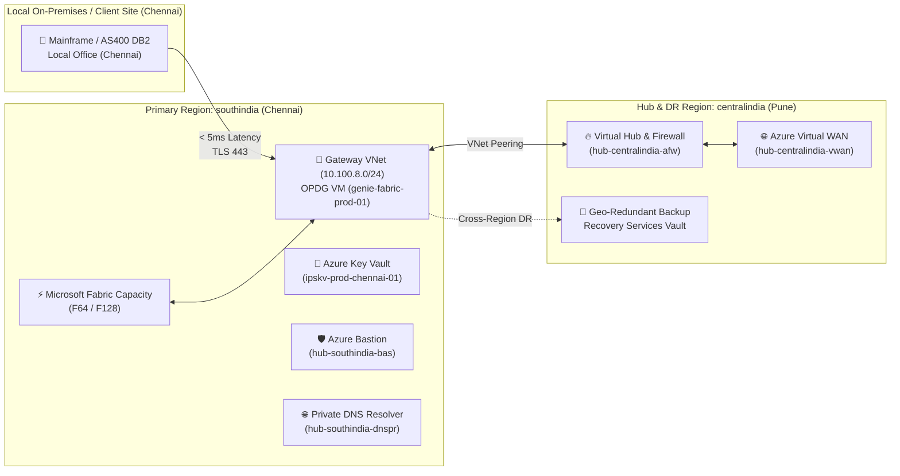

# Phase-Wise Azure CLI Implementation Guide (India Region — Chennai & Pune)

> **Project:** IPS BI Modernization to Microsoft Fabric  
> **Target Cloud:** Microsoft Azure & Microsoft Fabric  
> **Primary Region:** `southindia` (Chennai — Physical Location for Local Datacenter & Gateway)  
> **Secondary / Hub / DR Region:** `centralindia` (Pune — Paired Disaster Recovery & vWAN Hub)  
> **Document Location:** `techstalk/azure_commands.md`  

---

## Regional Architecture Analysis: Why `southindia` & `centralindia`?

Being located **near Chennai**, selecting **South India (`southindia`)** as your primary Azure region provides critical architectural advantages over US/EU regions:

1. **Ultra-Low Network Latency (< 5ms):**
   - Connecting from Chennai to `southindia` yields sub-5ms round-trip latency (compared to ~230ms+ to `centralus`).
   - Ensures Power BI Direct Lake reports consistently hit the **sub-800ms query response SLA**.
   - Drastically accelerates On-Premises Data Gateway (OPDG) batch ingestion and CDC sync from local AS400 mainframes.
2. **Official Azure Regional Disaster Recovery Pair:**
   - **South India (`southindia` - Chennai)** is paired with **Central India (`centralindia` - Pune)**.
   - Provides enterprise cross-region disaster recovery, geo-redundant backups (GRS), and Virtual WAN transit routing across Microsoft's dedicated high-speed India optical backbone.
3. **Data Residency & Sovereignty (DPDP Act Compliance):**
   - Keeps all enterprise transactional, customer, and financial data strictly within the sovereign borders of India, adhering to India's **Digital Personal Data Protection Act (DPDP)** and RBI financial data localization norms.



---

## Prerequisites & Initial Configuration

```bash
# 1. Install Azure CLI on macOS (if not already installed)
brew install azure-cli

# 2. Log in interactively to Azure
az login

# 3. List available subscriptions and identify Subscription IDs
az account list --output table

# 4. Set the active subscription & Regional Environment Variables
export CONNECTIVITY_SUB_ID="<your-connectivity-subscription-id>"
export PRODUCTION_SUB_ID="<your-production-subscription-id>"

# India Regional Pair Configuration:
export PRIMARY_LOCATION="southindia"    # Chennai (Local primary datacenter)
export HUB_LOCATION="centralindia"      # Pune (Paired vWAN & DR region)

az account set --subscription "$CONNECTIVITY_SUB_ID"
```

---

## Phase 0: Resource Provider Registration

Ensure that all required Azure Resource Providers are registered in your subscriptions.

```bash
# Register required Resource Providers
az provider register --namespace Microsoft.Fabric
az provider register --namespace Microsoft.Network
az provider register --namespace Microsoft.Compute
az provider register --namespace Microsoft.KeyVault
az provider register --namespace Microsoft.Storage
az provider register --namespace Microsoft.Purview
az provider register --namespace Microsoft.OperationalInsights
az provider register --namespace Microsoft.RecoveryServices
az provider register --namespace Microsoft.Automation

# Verify registration status
az provider show --namespace Microsoft.Fabric --query "registrationState" -o tsv
az provider show --namespace Microsoft.Network --query "registrationState" -o tsv
```

---

## Phase 1: Resource Groups & Tagging Setup (India Regions)

```bash
# -------------------------------------------------------------
# 1.1 Connectivity Subscription Resource Groups (Hub & Shared)
# -------------------------------------------------------------
az account set --subscription "$CONNECTIVITY_SUB_ID"

# Shared Network Resource Group in South India (Chennai)
az group create \
  --name "hub-sharednetwork-southindia-rg" \
  --location "$PRIMARY_LOCATION" \
  --tags Environment=Hub Tier=Network Project=IPS-BI Region=SouthIndia

# Bastion Network Resource Group in South India (Chennai)
az group create \
  --name "hub-bastionnetwork-southindia-rg" \
  --location "$PRIMARY_LOCATION" \
  --tags Environment=Hub Tier=Management Project=IPS-BI Region=SouthIndia

# DNS Network & Resolver Resource Groups in South India (Chennai)
az group create \
  --name "hub-dnsnetwork-southindia-rg" \
  --location "$PRIMARY_LOCATION" \
  --tags Environment=Hub Tier=DNS Project=IPS-BI Region=SouthIndia

az group create \
  --name "hub-dns-southindia-rg" \
  --location "$PRIMARY_LOCATION" \
  --tags Environment=Hub Tier=DNS Project=IPS-BI Region=SouthIndia

# Virtual WAN Hub Resource Group in Central India (Pune - Transit Hub)
az group create \
  --name "hub-vwan-centralindia-rg" \
  --location "$HUB_LOCATION" \
  --tags Environment=Hub Tier=Transit Project=IPS-BI Region=CentralIndia

# -------------------------------------------------------------
# 1.2 Production Subscription Resource Groups (Workloads)
# -------------------------------------------------------------
az account set --subscription "$PRODUCTION_SUB_ID"

# Data Gateway Resource Group in South India (Chennai - Low Latency to On-Prem)
az group create \
  --name "prod-datagateway-southindia-rg" \
  --location "$PRIMARY_LOCATION" \
  --tags Environment=Prod Tier=Gateway Project=IPS-BI Region=SouthIndia

# Database Network Resource Group in South India (Chennai)
az group create \
  --name "prod-dbnetwork-southindia-rg" \
  --location "$PRIMARY_LOCATION" \
  --tags Environment=Prod Tier=Database Project=IPS-BI Region=SouthIndia

# Internal Application Workloads Resource Group in South India (Chennai)
az group create \
  --name "prod-internalnetwork-southindia-rg" \
  --location "$PRIMARY_LOCATION" \
  --tags Environment=Prod Tier=Application Project=IPS-BI Region=SouthIndia

# Backup & Recovery Services Resource Group in South India (Chennai)
az group create \
  --name "prod-backup-southindia-rg" \
  --location "$PRIMARY_LOCATION" \
  --tags Environment=Prod Tier=DisasterRecovery Project=IPS-BI Region=SouthIndia
```

---

## Phase 2: Hybrid Network & Security Hub Setup

Deploys Azure Virtual WAN in `centralindia`, Virtual Hub with Azure Firewall, and Bastion/DNS in `southindia`.

### 2.1 Azure Virtual WAN & Virtual Hub

```bash
az account set --subscription "$CONNECTIVITY_SUB_ID"

# 1. Create Virtual WAN in Central India (Pune)
az network vwan create \
  --name "hub-centralindia-vwan" \
  --resource-group "hub-vwan-centralindia-rg" \
  --location "$HUB_LOCATION" \
  --type Standard \
  --branch-to-branch-traffic true

# 2. Create Virtual Hub in South India (Chennai) (CIDR: 10.100.0.0/23)
az network vhub create \
  --name "hub-southindia-vhub" \
  --resource-group "hub-vwan-centralindia-rg" \
  --location "$PRIMARY_LOCATION" \
  --address-prefix "10.100.0.0/23" \
  --vwan "hub-centralindia-vwan" \
  --sku Standard
```

### 2.2 Centralized Azure Firewall & Firewall Policy

```bash
# 1. Create Public IP for Azure Firewall in South India
az network public-ip create \
  --name "hub-southindia-afw-pip" \
  --resource-group "hub-vwan-centralindia-rg" \
  --location "$PRIMARY_LOCATION" \
  --sku Standard \
  --allocation-method Static

# 2. Create Azure Firewall Policy
az network firewall policy create \
  --name "hub-southindia-afwp" \
  --resource-group "hub-vwan-centralindia-rg" \
  --location "$PRIMARY_LOCATION" \
  --threat-intel-mode Alert

# 3. Create Rule Collection Group
az network firewall policy rule-collection-group create \
  --name "DefaultNetworkRuleCollectionGroup" \
  --resource-group "hub-vwan-centralindia-rg" \
  --policy-name "hub-southindia-afwp" \
  --priority 1000

# 4. Add Network Rules: Allow DNS
az network firewall policy rule-collection-group collection add-filter-collection \
  --resource-group "hub-vwan-centralindia-rg" \
  --policy-name "hub-southindia-afwp" \
  --rule-collection-group-name "DefaultNetworkRuleCollectionGroup" \
  --name "HubSpokeNetworkRules" \
  --collection-priority 1100 \
  --action Allow \
  --rule-name "Allow-DNS" \
  --rule-type NetworkRule \
  --source-addresses "10.100.0.0/16" \
  --destination-addresses "10.100.2.64/28" "10.3.3.4" "10.3.3.5" \
  --destination-ports "53" \
  --ip-protocols UDP TCP

# Add rule allowing OPDG Gateway to AS400 DB2 ports (6017, 8471, 449, 1422)
az network firewall policy rule-collection-group collection add-filter-collection \
  --resource-group "hub-vwan-centralindia-rg" \
  --policy-name "hub-southindia-afwp" \
  --rule-collection-group-name "DefaultNetworkRuleCollectionGroup" \
  --name "OPDGToAS400Rules" \
  --collection-priority 1200 \
  --action Allow \
  --rule-name "Allow-Gateway-To-AS400" \
  --rule-type NetworkRule \
  --source-addresses "10.100.8.0/24" \
  --destination-addresses "10.342.2.26" \
  --destination-ports "449" "1422" "6017" "8471" "8476" \
  --ip-protocols TCP

# 5. Deploy Azure Firewall inside the Virtual Hub (Secure Hub)
# Note: Virtual Hub requires '--sku AZFW_Hub' and '--public-ip-count'
az network firewall create \
  --name "hub-southindia-afw" \
  --resource-group "hub-vwan-centralindia-rg" \
  --location "$PRIMARY_LOCATION" \
  --sku AZFW_Hub \
  --tier Standard \
  --vhub "hub-southindia-vhub" \
  --firewall-policy "hub-southindia-afwp" \
  --public-ip-count 1


### 2.3 Azure Bastion Host Setup (South India — Chennai)

```bash
# 1. Create Bastion VNet (10.100.2.0/26)
az network vnet create \
  --name "hub-bastion-southindia-vnet" \
  --resource-group "hub-bastionnetwork-southindia-rg" \
  --location "$PRIMARY_LOCATION" \
  --address-prefixes "10.100.2.0/26" \
  --subnet-name "AzureBastionSubnet" \
  --subnet-prefix "10.100.2.0/26"

# 2. Create Public IP for Bastion
az network public-ip create \
  --name "hub-southindia-bas-pip" \
  --resource-group "hub-bastionnetwork-southindia-rg" \
  --location "$PRIMARY_LOCATION" \
  --sku Standard

# 3. Create Azure Bastion
az network bastion create \
  --name "hub-southindia-bas" \
  --resource-group "hub-bastionnetwork-southindia-rg" \
  --location "$PRIMARY_LOCATION" \
  --vnet-name "hub-bastion-southindia-vnet" \
  --public-ip-address "hub-southindia-bas-pip" \
  --sku Standard
```

### 2.4 Azure Private DNS Resolver (South India — Chennai)

```bash
# 1. Create DNS VNet (10.100.2.64/26)
az network vnet create \
  --name "hub-dns-southindia-vnet" \
  --resource-group "hub-dnsnetwork-southindia-rg" \
  --location "$PRIMARY_LOCATION" \
  --address-prefixes "10.100.2.64/26"

# 2. Create Inbound Subnet
az network vnet subnet create \
  --name "hub-southindia-dnspr-in-snet" \
  --resource-group "hub-dnsnetwork-southindia-rg" \
  --vnet-name "hub-dns-southindia-vnet" \
  --address-prefixes "10.100.2.64/28"

# 3. Create Outbound Subnet
az network vnet subnet create \
  --name "hub-southindia-dnspr-out-snet" \
  --resource-group "hub-dnsnetwork-southindia-rg" \
  --vnet-name "hub-dns-southindia-vnet" \
  --address-prefixes "10.100.2.80/28"

# 4. Deploy Private DNS Resolver
az dns-resolver create \
  --name "hub-southindia-dnspr" \
  --resource-group "hub-dns-southindia-rg" \
  --location "$PRIMARY_LOCATION" \
  --id "/subscriptions/$CONNECTIVITY_SUB_ID/resourceGroups/hub-dnsnetwork-southindia-rg/providers/Microsoft.Network/virtualNetworks/hub-dns-southindia-vnet"

# 5. Create Inbound Endpoint
az dns-resolver inbound-endpoint create \
  --name "hub-southindia-dnspr-in-ep" \
  --dns-resolver-name "hub-southindia-dnspr" \
  --resource-group "hub-dns-southindia-rg" \
  --location "$PRIMARY_LOCATION" \
  --ip-configurations [{private-ip-allocation-method:Dynamic,id:/subscriptions/$CONNECTIVITY_SUB_ID/resourceGroups/hub-dnsnetwork-southindia-rg/providers/Microsoft.Network/virtualNetworks/hub-dns-southindia-vnet/subnets/hub-southindia-dnspr-in-snet}]

# 6. Create Outbound Endpoint
az dns-resolver outbound-endpoint create \
  --name "hub-southindia-dnspr-out-ep" \
  --dns-resolver-name "hub-southindia-dnspr" \
  --resource-group "hub-dns-southindia-rg" \
  --location "$PRIMARY_LOCATION" \
  --id "/subscriptions/$CONNECTIVITY_SUB_ID/resourceGroups/hub-dnsnetwork-southindia-rg/providers/Microsoft.Network/virtualNetworks/hub-dns-southindia-vnet/subnets/hub-southindia-dnspr-out-snet"

# 7. Add Forwarding Ruleset for On-Prem Domain (ipscorp.local -> 10.3.3.4, 10.3.3.5)
# Note: Azure CLI uses 'az dns-resolver forwarding-ruleset'
az dns-resolver forwarding-ruleset create \
  --name "hub-southindia-dns-ruleset" \
  --resource-group "hub-dns-southindia-rg" \
  --location "$PRIMARY_LOCATION" \
  --outbound-endpoints "[{id:/subscriptions/$CONNECTIVITY_SUB_ID/resourceGroups/hub-dns-southindia-rg/providers/Microsoft.Network/dnsResolvers/hub-southindia-dnspr/outboundEndpoints/hub-southindia-dnspr-out-ep}]"

# 8. Add Forwarding Rule inside the Ruleset
az dns-resolver forwarding-rule create \
  --name "forward-ipscorp-local" \
  --ruleset-name "hub-southindia-dns-ruleset" \
  --resource-group "hub-dns-southindia-rg" \
  --domain-name "ipscorp.local." \
  --target-dns-servers "[{ip-address:10.3.3.4,port:53},{ip-address:10.3.3.5,port:53}]"

# 9. Link Forwarding Ruleset to the DNS VNet
az dns-resolver vnet-link create \
  --name "dns-ruleset-vnet-link" \
  --ruleset-name "hub-southindia-dns-ruleset" \
  --resource-group "hub-dns-southindia-rg" \
  --id "/subscriptions/$CONNECTIVITY_SUB_ID/resourceGroups/hub-dnsnetwork-southindia-rg/providers/Microsoft.Network/virtualNetworks/hub-dns-southindia-vnet"
```

### 2.5 Spoke VNets Note
> Spoke Virtual Networks (such as the Data Gateway VNet `prod-datagateway-southindia-vnet`) are deployed and peered in **Phase 4** directly alongside their Network Security Groups (NSGs) and Gateway VM for a clean, sequential setup.

---

## Phase 3: Security, IAM & Key Vault (South India — Chennai)

```bash
az account set --subscription "$PRODUCTION_SUB_ID"

# 1. Create Azure Key Vault in South India (Name must be 3-24 characters)
export KEYVAULT_NAME="ipskv-prod-chennai-01"

az keyvault create \
  --name "$KEYVAULT_NAME" \
  --resource-group "prod-datagateway-southindia-rg" \
  --location "$PRIMARY_LOCATION" \
  --enable-rbac-authorization true \
  --retention-days 90

# 1.1 Assign 'Key Vault Secrets Officer' role to your current user (Required for RBAC-enabled vaults)
export USER_ID=$(az ad signed-in-user show --query id -o tsv)
export KV_ID=$(az keyvault show --name "$KEYVAULT_NAME" --query id -o tsv)

az role assignment create \
  --role "Key Vault Secrets Officer" \
  --assignee "$USER_ID" \
  --scope "$KV_ID"

# (Wait ~30 seconds for RBAC propagation)

# 2. Store Application & Database Secrets
az keyvault secret set \
  --vault-name "$KEYVAULT_NAME" \
  --name "as400-db2-host" \
  --value "10.342.2.26"

az keyvault secret set \
  --vault-name "$KEYVAULT_NAME" \
  --name "as400-db2-port" \
  --value "6017"

az keyvault secret set \
  --vault-name "$KEYVAULT_NAME" \
  --name "as400-db2-service-account" \
  --value "SVC_FABRIC_INGEST"
```

---

## Phase 4: On-Premises Data Gateway VM & Backup Setup (Chennai)

Provisions the Windows Server 2022 gateway VM in **South India** for minimum latency to local infrastructure.

```bash
az account set --subscription "$PRODUCTION_SUB_ID"

# 1. Create Network Security Group (NSG) for Gateway Subnet
az network nsg create \
  --name "prod-datagateway-nsg" \
  --resource-group "prod-datagateway-southindia-rg" \
  --location "$PRIMARY_LOCATION"

# 2. Allow Inbound RDP from Bastion Subnet (10.100.2.0/26)
az network nsg rule create \
  --name "Allow-Bastion-RDP" \
  --nsg-name "prod-datagateway-nsg" \
  --resource-group "prod-datagateway-southindia-rg" \
  --priority 100 \
  --direction Inbound \
  --access Allow \
  --protocol Tcp \
  --source-address-prefixes "10.100.2.0/26" \
  --destination-port-ranges 3389

# 3. Create Gateway VNet with Subnet and NSG Directly Attached
az network vnet create \
  --name "prod-datagateway-southindia-vnet" \
  --resource-group "prod-datagateway-southindia-rg" \
  --location "$PRIMARY_LOCATION" \
  --address-prefixes "10.100.8.0/24" \
  --subnet-name "prod-datagateway-southindia-snet" \
  --subnet-prefix "10.100.8.0/25" \
  --network-security-group "prod-datagateway-nsg"

# 4. Peer Gateway VNet with Virtual Hub (hub-southindia-vhub)
az network vhub connection create \
  --name "prod-datagateway-to-vhub" \
  --resource-group "hub-vwan-centralindia-rg" \
  --vhub-name "hub-southindia-vhub" \
  --remote-vnet "/subscriptions/$PRODUCTION_SUB_ID/resourceGroups/prod-datagateway-southindia-rg/providers/Microsoft.Network/virtualNetworks/prod-datagateway-southindia-vnet" \
  --enable-internet-security true

# 5. Create Gateway NIC with Static Private IP
az network nic create \
  --name "genie-fabric-prod-01-nic" \
  --resource-group "prod-datagateway-southindia-rg" \
  --location "$PRIMARY_LOCATION" \
  --vnet-name "prod-datagateway-southindia-vnet" \
  --subnet "prod-datagateway-southindia-snet" \
  --private-ip-address "10.100.8.10"

# 5. Provision Windows Server 2022 VM in South India (Standard_D16s_v5)
# az vm create \
#   --name "genie-fabric-prod-01" \
#   --resource-group "prod-datagateway-southindia-rg" \
#   --location "$PRIMARY_LOCATION" \
#   --nics "genie-fabric-prod-01-nic" \
#   --image "MicrosoftWindowsServer:WindowsServer:2022-datacenter-azure-edition:latest" \
#   --size "Standard_D16s_v5" \
#   --admin-username "azureadmin" \
#   --os-disk-size-gb 350
  az vm create \
  --name "genie-fabric-prod-01" \
  --resource-group "prod-datagateway-southindia-rg" \
  --location "$PRIMARY_LOCATION" \
  --nics "genie-fabric-prod-01-nic" \
  --image "MicrosoftWindowsServer:WindowsServer:2022-datacenter-azure-edition:latest" \
  --size "Standard_D2s_v5" \
  --admin-username "azureadmin" \
  --computer-name "genie-fab-prd01"


# 6. Create Recovery Services Vault in South India (Chennai)
az backup vault create \
  --name "prod-backup-southindia-rsv" \
  --resource-group "prod-backup-southindia-rg" \
  --location "$PRIMARY_LOCATION"

# 7. Enable Daily VM Backup with Geo-Redundant Storage (GRS to Central India)
az backup protection enable-for-vm \
  --resource-group "prod-backup-southindia-rg" \
  --vault-name "prod-backup-southindia-rsv" \
  --vm "/subscriptions/$PRODUCTION_SUB_ID/resourceGroups/prod-datagateway-southindia-rg/providers/Microsoft.Compute/virtualMachines/genie-fabric-prod-01" \
  --policy-name "DefaultPolicy"
```

---

## Phase 5: Microsoft Fabric Environment Setup

Microsoft Fabric architecture distinguishes between **Practice/Developer Trial Setup** (via your existing Entra tenant) and **Enterprise Production Capacity** (via Azure ARM).

---

### Path A: Developer Learning Environment (Recommended 60-Day Free Trial)

You do **not** need to purchase or provision paid F-SKUs (F2/F4/F64/F128) on your Azure credit. Your existing Azure account already includes a default Entra ID tenant: **`plchandugcp48gmail.onmicrosoft.com`**.

#### Architecture:
```
Gmail Account (plchandugcp48@gmail.com)
  │
  ▼
Azure Subscription 1 (Active / Owner / $200 Azure Credit for Infra: VM, VNet, Firewall)
  │
  ▼
Existing Entra Tenant (plchandugcp48gmail.onmicrosoft.com)
  │
  ▼
Entra Fabric User: fabricadmin@plchandugcp48gmail.onmicrosoft.com
  │
  ▼
Microsoft Fabric 60-Day Trial (F64 Capacity Units - $0 Cost)
  ├── OneLake
  ├── Data Factory (Pipelines & Dataflows Gen2)
  ├── Lakehouse (Bronze / Silver / Gold Delta Tables)
  ├── Data Warehouse (SQL Analytics Endpoint)
  ├── Real-Time Intelligence (Eventhouse / KQL)
  └── Power BI (Direct Lake Mode)
```

---

#### Step 1: Create the Fabric Admin User in your Existing Tenant

Run this command in your Azure CLI or create it in the Azure Portal:

```bash
# Set Tenant Variables
export TENANT_DOMAIN="plchandugcp48gmail.onmicrosoft.com"
export FABRIC_USER="fabricadmin"
export FABRIC_UPN="${FABRIC_USER}@${TENANT_DOMAIN}"

# 1. Create the dedicated organizational Fabric user in Entra ID
az ad user create \
  --display-name "Fabric Admin" \
  --user-principal-name "$FABRIC_UPN" \
  --mail-nickname "$FABRIC_USER" \
  --password 'FabricAdmin@2026!Prc' \
  --force-change-password-next-sign-in false
```

> **Via Azure Portal UI:**
> 1. Go to [Azure Portal](https://portal.azure.com) $\rightarrow$ **Microsoft Entra ID**.
> 2. Select **Users** $\rightarrow$ **+ New user** $\rightarrow$ **Create new user**.
> 3. **User principal name:** `fabricadmin` @ `plchandugcp48gmail.onmicrosoft.com`.
> 4. **Display name:** `Fabric Admin`.
> 5. **Password:** Set a strong password (uncheck *Auto-generate*).
> 6. Click **Review + create** $\rightarrow$ **Create** (no role assignments required).

---

#### Step 2: Open Incognito & Sign In to Microsoft Fabric

> [!IMPORTANT]
> Do **not** stay signed in with your personal `@gmail.com` account for this session.

1. Open a **Private / Incognito** browser window.
2. Navigate to: **[https://app.fabric.microsoft.com](https://app.fabric.microsoft.com)**.
3. Sign in using the new organizational credentials:
   - **Username:** `fabricadmin@plchandugcp48gmail.onmicrosoft.com`
   - **Password:** *(the password you set above)*

---

#### Step 3: Activate Your 60-Day Free Fabric Trial (Completed ✅)

- **Active Fabric Admin:** `fabricadmin@plchandugcp48gmail.onmicrosoft.com`
- **Active Tenant:** `plchandugcp48gmail.onmicrosoft.com`
- **Capacity:** Free 60-Day Fabric Trial (64 Capacity Units / F64 equivalent)
- **Status:** Provisioned and active at [app.fabric.microsoft.com](https://app.fabric.microsoft.com)

---

#### Step 4: Automated Medallion Workspaces & Lakehouses Provisioning via Fabric REST API

You do not need to click through the portal UI. You can create all workspaces and Lakehouses directly from your local Mac terminal using the **Microsoft Fabric REST API** (`https://api.fabric.microsoft.com/v1`).

##### 4.1 Authenticate & Obtain Fabric Bearer Token
* **Command Purpose:** Authenticates the Azure CLI session as `fabricadmin` and requests an OAuth 2.0 access token scoped specifically to Microsoft Fabric's API resource (`https://api.fabric.microsoft.com`).
* **Why it matters:** Standard Azure ARM tokens only manage Azure resources; Fabric workspace items require a Fabric-scoped token.

```bash
# Interactive Browser Login targeting your Entra Tenant (supports MFA)
az login --tenant "plchandugcp48gmail.onmicrosoft.com" --allow-no-subscriptions

# Acquire Fabric REST API Bearer Token
export FABRIC_TOKEN=$(az account get-access-token --resource "https://api.fabric.microsoft.com" --query accessToken -o tsv)

# Verify token acquisition (prints first 25 characters)
echo "Token acquired: ${FABRIC_TOKEN:0:25}..."
```

---

##### 4.2 Provision the 3 Medallion Architecture Workspaces
* **Command Purpose:** Calls Fabric's `POST /v1/workspaces` endpoint to create three logically separated environments:
  1. `ws_ips_erp_bronze`: Landing and immutable raw storage for AS400 DB2 tables (`F0911`, `F0901`, `F0010`, etc.).
  2. `ws_ips_erp_silver`: Cleaned, validated, Julian date-converted, and SCD2 dimension historical Delta tables.
  3. `ws_ips_erp_gold`: Curated dimensional Star Schema models, aggregates, and Power BI Direct Lake semantic models.

```bash
# Helper function to create workspace via Fabric REST API
create_fabric_workspace() {
  local ws_name=$1
  echo "==> Creating Fabric Workspace: $ws_name ..."
  curl -s -X POST "https://api.fabric.microsoft.com/v1/workspaces" \
    -H "Authorization: Bearer $FABRIC_TOKEN" \
    -H "Content-Type: application/json" \
    -d "{\"displayName\": \"$ws_name\"}"
  echo -e "\n"
}

# Execute workspace creations
create_fabric_workspace "ws_ips_erp_bronze"
create_fabric_workspace "ws_ips_erp_silver"
create_fabric_workspace "ws_ips_erp_gold"
```

---

##### 4.3 Query Workspace IDs
* **Command Purpose:** Calls `GET /v1/workspaces` to retrieve the unique GUIDs of the newly created workspaces, which are required as route parameters to create items inside them.

```bash
# List all workspaces and extract IDs
curl -s -X GET "https://api.fabric.microsoft.com/v1/workspaces" \
  -H "Authorization: Bearer $FABRIC_TOKEN" | \
  python3 -c "
import sys, json
data = json.load(sys.stdin)
for ws in data.get('value', []):
    if 'ws_ips_erp' in ws.get('displayName', ''):
        print(f\"{ws['displayName']} = {ws['id']}\")
"
```

*Set the output GUIDs into your local environment:*
```bash
export BRONZE_WS_ID="<paste-bronze-workspace-guid-here>"
export SILVER_WS_ID="<paste-silver-workspace-guid-here>"
export GOLD_WS_ID="<paste-gold-workspace-guid-here>"
```

---

##### 4.4 Provision Delta Lakehouses in Each Workspace
* **Command Purpose:** Calls `POST /v1/workspaces/{workspaceId}/lakehouses` to provision a native Delta Lakehouse inside each workspace.
* **Why it matters:** Every Lakehouse automatically creates a unified OneLake storage location and an auto-synchronized **SQL Analytics Endpoint** allowing cross-database T-SQL queries and Power BI Direct Lake reports.

```bash
# 1. Create Bronze Lakehouse (Raw Parquet/Delta & File Landing)
echo "Creating Bronze Lakehouse (lh_ips_bronze)..."
curl -s -X POST "https://api.fabric.microsoft.com/v1/workspaces/${BRONZE_WS_ID}/lakehouses" \
  -H "Authorization: Bearer $FABRIC_TOKEN" \
  -H "Content-Type: application/json" \
  -d '{"displayName": "lh_ips_bronze", "description": "Raw AS400 DB2 ERP ingestion landing Lakehouse"}'

# 2. Create Silver Lakehouse (Conformed & Cleansed Delta Tables)
echo -e "\nCreating Silver Lakehouse (lh_ips_silver)..."
curl -s -X POST "https://api.fabric.microsoft.com/v1/workspaces/${SILVER_WS_ID}/lakehouses" \
  -H "Authorization: Bearer $FABRIC_TOKEN" \
  -H "Content-Type: application/json" \
  -d '{"displayName": "lh_ips_silver", "description": "Cleaned, Julian-converted, and SCD2 historical Delta Lakehouse"}'

# 3. Create Gold Lakehouse (Star Schema & Power BI Semantic Models)
echo -e "\nCreating Gold Lakehouse (lh_ips_gold)..."
curl -s -X POST "https://api.fabric.microsoft.com/v1/workspaces/${GOLD_WS_ID}/lakehouses" \
  -H "Authorization: Bearer $FABRIC_TOKEN" \
  -H "Content-Type: application/json" \
  -d '{"displayName": "lh_ips_gold", "description": "Star Schema enterprise reporting Lakehouse with Direct Lake mode"}'
```

---

#### Step 5: Automated Gateway Host Configuration via `az vm run-command` (Zero RDP Needed!)

Instead of opening RDP or Azure Bastion, use **`az vm run-command invoke`** to remotely execute PowerShell scripts directly inside the Windows VM (`genie-fabric-prod-01`) through the Azure VM Guest Agent.

##### 5.1 Pre-Flight Outbound TLS 443 Connectivity Validation
* **Command Purpose:** Remotely triggers network socket tests on the VM to verify outbound connectivity across the Azure Firewall (`hub-southindia-afw`) to Fabric Service Bus relays, Entra ID, and Azure Key Vault.
* **Expected Output:** `TcpTestSucceeded: True` for all endpoints.

```bash
az vm run-command invoke \
  --resource-group "prod-datagateway-southindia-rg" \
  --name "genie-fabric-prod-01" \
  --command-id RunPowerShellScript \
  --scripts '
    $endpoints = @(
      "wabi-south-india-redirect.analysis.windows.net",
      "login.microsoftonline.com",
      "ipskv-prod-chennai-01.vault.azure.net"
    )
    foreach ($ep in $endpoints) {
      $test = Test-NetConnection -ComputerName $ep -Port 443 -WarningAction SilentlyContinue
      [PSCustomObject]@{
        TargetHost     = $ep
        Port           = 443
        TcpTestSuccess = $test.TcpTestSucceeded
      } | Format-Table -AutoSize
    }
  '
```

---

##### 5.2 Download the On-Premises Data Gateway Installer on the VM
* **Command Purpose:** Instructs the VM to directly fetch Microsoft's official Gateway installer binary into `C:\GatewayInstall.exe` over outbound HTTPS.

```bash
az vm run-command invoke \
  --resource-group "prod-datagateway-southindia-rg" \
  --name "genie-fabric-prod-01" \
  --command-id RunPowerShellScript \
  --scripts '
    $url = "https://go.microsoft.com/fwlink/?LinkId=2116849"
    $dest = "C:\GatewayInstall.exe"
    Write-Output "Starting download of On-Premises Data Gateway..."
    Invoke-WebRequest -Uri $url -OutFile $dest -UseBasicParsing
    Write-Output "Download finished. File exists: $(Test-Path $dest). Size: $((Get-Item $dest).Length / 1MB) MB"
  '
```

---

##### 5.3 Silent Installation of the Gateway Service on the VM
* **Command Purpose:** Runs the gateway setup in headless silent mode (`/quiet /norestart`), installing the Windows system service `EnterpriseGatewayService` without requiring GUI user interaction.

```bash
az vm run-command invoke \
  --resource-group "prod-datagateway-southindia-rg" \
  --name "genie-fabric-prod-01" \
  --command-id RunPowerShellScript \
  --scripts '
    Write-Output "Installing Gateway binaries silently..."
    Start-Process -FilePath "C:\GatewayInstall.exe" -ArgumentList "/quiet", "/norestart" -Wait
    $service = Get-Service -Name "EnterpriseGatewayService" -ErrorAction SilentlyContinue
    Write-Output "Installation complete. Service Status: $($service.Status)"
  '
```

---

##### 5.4 One-Time Gateway Registration & Online Status Verification
* **Command Purpose:** Completes the cryptographic association between the VM's local gateway service and your Microsoft Fabric tenant using your admin identity.
* **Options:**
  1. **Option A (Azure Bastion / RDP Quick Setup):** Log in to the VM desktop, launch the On-Premises Data Gateway configurator, sign in as `fabricadmin@plchandugcp48gmail.onmicrosoft.com`, and name the gateway `ips-gateway-southindia-01`.
  2. **Option B (Verify in Fabric Portal):**
     - Navigate to [https://app.fabric.microsoft.com](https://app.fabric.microsoft.com).
     - Click **Settings (Gear Icon)** $\rightarrow$ **Manage connections and gateways**.
     - Verify that **`ips-gateway-southindia-01`** shows **Status: Online (Green)** with South India region affinity.

---


### Path B: Enterprise Production Capacity (Azure ARM Deployment)

For enterprise production deployments (e.g. at IPS Corp under corporate licensing):

```bash
# 1. Register Microsoft.Fabric Resource Provider on the subscription
az provider register --namespace Microsoft.Fabric
az provider show --namespace Microsoft.Fabric --query "registrationState" -o tsv

# 2. Install Microsoft Fabric CLI extension
az extension add --name microsoft-fabric

# 3. Provision Production Fabric Capacity (F64) in South India
az fabric capacity create \
  --capacity-name "ipsfabricprodf64" \
  --resource-group "prod-datagateway-southindia-rg" \
  --location "$PRIMARY_LOCATION" \
  --sku "{name:F64,tier:Fabric}" \
  --administration "{members:['$FABRIC_UPN']}"

# 4. FinOps Commands: Suspend & Resume to optimize compute costs
# Suspend capacity during off-hours:
az fabric capacity suspend \
  --capacity-name "ipsfabricprodf64" \
  --resource-group "prod-datagateway-southindia-rg"

# Resume capacity:
az fabric capacity resume \
  --capacity-name "ipsfabricprodf64" \
  --resource-group "prod-datagateway-southindia-rg"
```


---

## Phase 6: Monitoring, Governance & Log Analytics

```bash
# 1. Create Log Analytics Workspace in South India (Chennai)
az monitor log-analytics workspace create \
  --workspace-name "ips-law-southindia-01" \
  --resource-group "hub-sharednetwork-southindia-rg" \
  --location "$PRIMARY_LOCATION" \
  --retention-time 30

export LAW_ID=$(az monitor log-analytics workspace show \
  --workspace-name "ips-law-southindia-01" \
  --resource-group "hub-sharednetwork-southindia-rg" \
  --query id -o tsv)

# 2. Route Azure Firewall Diagnostics to Log Analytics
az monitor diagnostic-settings create \
  --name "afw-to-loganalytics" \
  --resource "/subscriptions/$CONNECTIVITY_SUB_ID/resourceGroups/hub-vwan-centralindia-rg/providers/Microsoft.Network/azureFirewalls/hub-southindia-afw" \
  --workspace "$LAW_ID" \
  --logs '[{"category":"AzureFirewallNetworkRule","enabled":true},{"category":"AzureFirewallApplicationRule","enabled":true}]'

# 3. Create Microsoft Purview Governance Account in Central India / South India
az purview account create \
  --account-name "ips-purview-prod-01" \
  --resource-group "hub-sharednetwork-southindia-rg" \
  --location "$PRIMARY_LOCATION" \
  --managed-resources-group-name "ips-purview-managed-rg"
```

---

## Regional Summary Matrix

| Capability | Chosen Azure Region | Location | Architectural Rationale |
| :--- | :--- | :--- | :--- |
| **Primary Workloads & Gateway** | **`southindia`** | **Chennai** | **< 5ms ultra-low latency** to local user/client datacenter, OPDG host, Key Vault, and Fabric Lakehouse. |
| **Transit Network & DR Hub** | **`centralindia`** | **Pune** | Official paired disaster recovery region, Azure Virtual WAN transit backbone, geo-redundant backups. |
| **Regulatory Compliance** | **India Sovereign Boundary** | **India** | Full compliance with India DPDP Act & RBI financial data localization regulations. |

---

## Related Project Artifacts

- [Simple Azure Services Table](file:///Users/chandu/Documents/Python_practice/Fabric/docs/techstalk/azure_services_table.md)
- [Simple Azure Services Guide](file:///Users/chandu/Documents/Python_practice/Fabric/docs/techstalk/azure_services.md)
- [Technical Stack Specification](file:///Users/chandu/Documents/Python_practice/Fabric/docs/techstalk/technical_stack.md)
- [Networking Concepts Guide](file:///Users/chandu/Documents/Python_practice/Fabric/docs/techstalk/networking_concepts.md)
- [Project Implementation Plan](file:///Users/chandu/Documents/Python_practice/Fabric/docs/techstalk/implementation_plan.md)
