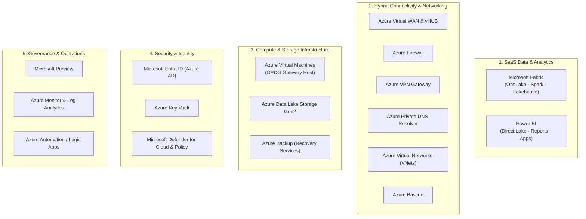

# Simple Azure Services Guide — IPS BI Modernization Platform

> **Project:** IPS BI Modernization to Microsoft Fabric  
> **Client:** IPS Corporation  
> **Document Purpose:** Clear, simplified breakdown of every Azure service required for the project and its exact purpose.  
> **Document Location:** `techstalk/azure_services.md`  

---

## Quick Reference Summary

The following **16 core Azure & Microsoft services** power the IPS BI Modernization platform across Networking, Compute, Storage, Security, Governance, and Operations:

                         BUSINESS SYSTEMS
                              │
            ┌─────────────────┼──────────────────┐
            │                 │                  │
            ▼                 ▼                  ▼
       Salesforce           JDE              SQL Server
          CRM              ERP/DB2             DW
            │                 │                  │
            │                 │                  │
            └─────────────────┼──────────────────┘
                              │
                              ▼
                    Fabric Data Factory
                              │
                  ┌───────────┴───────────┐
                  │                       │
             Gateway Cluster         API Connectors
                  │                       │
                  └───────────┬───────────┘
                              ▼
                         OneLake
                              │
                    ┌─────────┴─────────┐
                    │                   │
                 Bronze               Metadata
                    │
                    ▼
                 Silver
                    │
             PySpark / SQL
                    │
                    ▼
                  Gold
                    │
          ┌─────────┴─────────┐
          │                   │
     Semantic Model      Power BI
          │                   │
          └─────────┬─────────┘
                    ▼
             Business Users

       ┌─────────────────────────────┐
       │ Cross-cutting               │
       │                             │
       │ Entra ID                    │
       │ Key Vault                   │
       │ Purview                     │
       │ Defender / Azure Policy     │
       │ Monitor / Log Analytics     │
       │ Networking / Firewall       │
       └─────────────────────────────┘

---

## Detailed Azure Services & Purpose Matrix

### 1. Core Analytics & Presentation Tier

| # | Azure Service | Description | Exact Purpose in This Project |
| :---: | :--- | :--- | :--- |
| **1** | **Microsoft Fabric** | All-in-one SaaS analytics platform. | Serves as the central data platform hosting the Medallion Architecture (Bronze, Silver, and Gold Lakehouses), PySpark transformation pipelines, and the Metadata-Driven Ingestion Framework. |
| **2** | **Microsoft Power BI** | Enterprise business intelligence & reporting service. | Delivers executive dashboards and operational reports using **Direct Lake Mode**, reading directly from OneLake Delta tables with sub-second ($<800\text{ms}$) query latency. |

---

### 2. Networking & Hybrid Connectivity

| # | Azure Service | Description | Exact Purpose in This Project |
| :---: | :--- | :--- | :--- |
| **3** | **Azure Virtual WAN (vWAN)** | Centralized cloud networking and transit routing hub. | Acts as the main network backbone (`hub-eastus2-vwan`), connecting on-premises data centers, connectivity networks, and production workload VNets in a clean Hub-Spoke topology. |
| **4** | **Azure Firewall** | Cloud-native stateful firewall with built-in high availability. | Centrally inspects all inbound, outbound, and internal traffic between Azure VNets, the internet, and on-premises systems based on centralized security rules. |
| **5** | **Azure VPN Gateway** | Secure cross-premises network connectivity service. | Establishes an encrypted site-to-site IPsec VPN tunnel connecting Azure to the on-premises datacenter where the IBM AS400 mainframe is hosted. |
| **6** | **Azure Private DNS Resolver** | Fully managed private DNS resolution and forwarding service. | Enables private network name resolution across Azure VNets and conditionally forwards queries for on-premises domains (`ipscorp.local`) to on-premises domain controllers. |
| **7** | **Azure Virtual Network (VNet)** | Fundamental building block for private cloud networks. | Provides isolated private network boundaries and subnets for external workloads, internal applications, databases, and data gateway clusters (`10.100.0.0/16` space). |
| **8** | **Azure Bastion** | Fully managed browser-based PaaS remote access. | Provides secure, agentless RDP and SSH administrative access to internal virtual machines without exposing public IP addresses to the public internet. |

---

### 3. Compute & Storage Infrastructure

| # | Azure Service | Description | Exact Purpose in This Project |
| :---: | :--- | :--- | :--- |
| **9** | **Azure Virtual Machines (IaaS)** | Scalable on-demand cloud compute instances (Windows Server 2022). | Hosts the **On-Premises Data Gateway (OPDG)** cluster (`genie-fabric-prod-01`) and the 64-bit IBM i Access ODBC driver to query the on-premises AS400 DB2 database over outbound TLS 443. |
| **10** | **Azure Data Lake Storage Gen2 (ADLS Gen2)** | Enterprise data lake storage with hierarchical namespace. | Underpins Microsoft Fabric OneLake storage and acts as the direct high-speed landing target for log-based Change Data Capture (CDC) streams before zero-copy shortcuts. |
| **11** | **Azure Backup (Recovery Services Vault)** | Centralized data protection and backup service. | Provides automated image-level backups and disaster recovery protection for data gateway virtual machines and essential cloud infrastructure (`prod-backup-centralus-rsv`). |

---

### 4. Security, Identity & Secrets Management

| # | Azure Service | Description | Exact Purpose in This Project |
| :---: | :--- | :--- | :--- |
| **12** | **Microsoft Entra ID** *(formerly Azure AD)* | Cloud identity and access management service. | Provides Single Sign-On (SSO), Multi-Factor Authentication (MFA), and Role-Based Access Control (RBAC). Synchronizes security groups from Okta to govern access to Fabric workspaces and Power BI apps. |
| **13** | **Azure Key Vault** | Secure cloud hardware-backed secret and key store. | Securely stores sensitive credentials, database passwords, AS400 connection strings, and service principal secrets so that no passwords are hard-coded in code or pipelines. |
| **14** | **Microsoft Defender for Cloud & Azure Policy** | Cloud Security Posture Management (CSPM) and governance engine. | Enforces compliance guardrails across Azure subscriptions, assesses security vulnerabilities, and ensures zero-trust network configurations. |

---

### 5. Data Governance & FinOps Automation

| # | Azure Service | Description | Exact Purpose in This Project |
| :---: | :--- | :--- | :--- |
| **15** | **Microsoft Purview** | Unified enterprise data governance and cataloging solution. | Scans metadata across AS400, Bronze, Silver, Gold, and Power BI; tracks end-to-end data lineage, maintains the enterprise Business Glossary, and monitors data quality metrics. |
| **16** | **Azure Automation / Logic Apps** | Serverless workflow orchestration and scheduling engine. | Powers FinOps automated capacity management by dynamically pausing, resuming, and scaling Fabric capacity units during non-business hours to save up to 40.5% in compute costs. |

---

## Simplified Service Mapping by Project Problem

| If you need to... | Use this Azure Service: |
| :--- | :--- |
| Transform raw JDE mainframe data into clean business tables | **Microsoft Fabric (PySpark Notebooks)** |
| Serve sub-second financial reports to business users | **Microsoft Fabric + Power BI (Direct Lake)** |
| Connect to on-premises AS400 DB2 safely without opening inbound ports | **Azure Virtual Machines (OPDG)** + **Azure VPN Gateway** |
| Keep all cloud traffic protected and inspected | **Azure Firewall** + **Azure Virtual WAN** |
| Store passwords, tokens, and database secrets safely | **Azure Key Vault** |
| Manage users, logins, and permission groups | **Microsoft Entra ID** (synced from Okta) |
| Trace where a number on a report came from (lineage) | **Microsoft Purview** |
| Reduce cloud costs during nights and weekends | **Azure Automation** (Capacity Scheduler) |
| Log in remotely to gateway servers securely without public IPs | **Azure Bastion** |

---

## Related Project Artifacts

- [Comprehensive Technical Stack Specification](file:///Users/chandu/Documents/Python_practice/Fabric/techstalk/technical_stack.md)
- [Project Implementation Plan](file:///Users/chandu/Documents/Python_practice/Fabric/implementation_plan.md)
- [Enterprise Architecture Overview](file:///Users/chandu/Documents/Python_practice/Fabric/architecture_overview.md)
- [Azure Infrastructure Requirements Form](file:///Users/chandu/Documents/Python_practice/Fabric/IPS_Azure_Infrastructure_Requirements.md)
