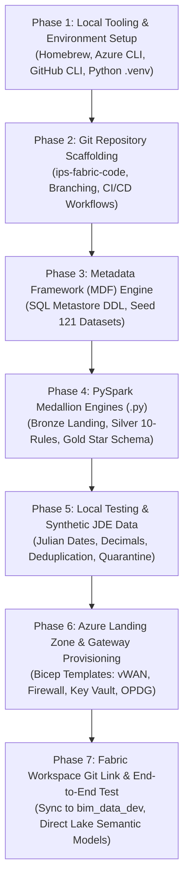

# Implementation Plan: Executing IPS BI Modernization from this Local macOS Machine

This implementation plan details the step-by-step roadmap to build, test, scaffold, and deploy the **IPS BI Modernization Platform** onto **Microsoft Fabric** and **Microsoft Azure** directly from this macOS developer machine.

---

## 1. Local Machine Readiness & Tooling Matrix

The developer machine is a macOS system. While Microsoft Fabric runs as a managed SaaS cloud service and Azure provides the underlying landing zone infrastructure, all code, schemas, orchestration pipelines, data quality engines, infrastructure as code, and CI/CD pipelines can be authored, simulated, and deployed from this local machine.

### Local Tooling Status

| Tool / Runtime | Current Status | Required Action / Version | Purpose |
| :--- | :--- | :--- | :--- |
| **Git** | Installed (`/opt/homebrew/bin/git`) | Ready | Local version control & branch management. |
| **Homebrew** | Installed (`7.0.6`) | Ready | Package manager for Mac CLI utilities. |
| **Python** | Installed (`3.12.5` via pyenv) | Set up virtual environment (`.venv`) | PySpark code authoring, local unit tests, data generators. |
| **Node.js & npm** | Installed (`v24.11.1`) | Ready | Optional tooling / CLI integrations. |
| **Java** | Installed (`/usr/bin/java`) | Verify Java 11/17 for PySpark | Local Apache Spark engine execution for unit tests. |
| **Azure CLI (`az`)** | **Not Found** | `brew install azure-cli` | Azure Landing Zone deployment, Key Vault, RBAC management. |
| **GitHub CLI (`gh`)** | **Not Found** | `brew install gh` | Repo management, PR reviews, GitHub Actions automation. |
| **VS Code Extensions** | User IDE | Install Microsoft Fabric Extension, Python, TMDL, Bicep | Development and debugging environment. |

---

## 2. Implementation Workflow: 7-Phase Execution Plan



---

### Phase 1: Local Developer Environment Setup (macOS)

1. **Install CLI Utilities via Homebrew:**
   ```bash
   brew install azure-cli gh
   ```
2. **Configure Python Virtual Environment:**
   ```bash
   python3 -m venv .venv
   source .venv/bin/activate
   pip install --upgrade pip
   pip install pyspark==3.5.2 delta-spark==3.2.0 pytest flake8 black azure-identity azure-keyvault-secrets requests pandas
   ```
3. **Verify Azure & GitHub CLI Authentication:**
   ```bash
   az login
   gh auth login
   ```

---

### Phase 2: Git Repository Scaffolding (Fabric Serialization Standard)

Initialize the Git repository following **Repository Pattern A (Single Workspace per Branch)** matching the structure approved in `IPS_Fabric_DevOps_GitHub_Integration.md`:

```
ips-fabric-code/
├── .github/
│   └── workflows/
│       ├── ci-validate.yml        # PR validation: linting, pytest, TMDL check
│       └── deploy-to-prod.yml     # Auto-deployment to PROD workspace
├── .gitignore
├── 01.Orchestration/
│   └── pl_orchestrate.Pipeline/   # Fabric Data Factory orchestration JSON
├── 02.Ingestion_NRT/
│   └── nb_nrt_stream.Notebook/    # PySpark streaming from CDC shortcuts
├── 03.Data_Engineering/
│   ├── nb_bronze_landing.Notebook/
│   ├── nb_bronze_to_silver.Notebook/   # Generic 10-rule Silver engine
│   └── nb_silver_to_gold.Notebook/     # Kimball star schema serving engine
├── 04.Environments/
│   └── env-spark-config.Environment/   # Spark settings & requirements.txt
├── sqldb-meta-orch-dev.SqlDatabase/
│   ├── Tables/                         # MDF schema DDL scripts
│   └── Seeds/                          # Initial metadata for 121 JDE tables
├── infra/
│   ├── bicep/                          # Azure Landing Zone IaC (vWAN, FW, KV)
│   └── scripts/                        # Automation & setup scripts
└── tests/                              # PyTest test suite with synthetic data
```

---

### Phase 3: Metadata-Driven Ingestion Framework (MDF) Engine

Build declarative SQL definitions for the metadata orchestrator:

1. **`meta.dataset_brz_to_silver`**:
   - Stores mapping configuration for the 121 datasets (58 Batch, 63 NRT).
   - Dynamic parameters: source table, target Silver table, primary business keys, Julian date columns, currency decimal scale rules, watermark column, active flag.
2. **`meta.dataquality_rule`**:
   - Configures granular data quality rules per entity (column null checks, range checks, referential lookups).
   - Severity flags: `WARNING`, `QUARANTINE` (routes bad rows to `silver.{target}_quarantine`), `STOP` (halts pipeline).
3. **`log.pipeline_execution` & `log.dq_rule_run`**:
   - Audit trail capturing row counts evaluated, passed, failed, duration, and execution statuses.

---

### Phase 4: PySpark Medallion Transformation Engines

Author clean, reusable PySpark modules enforced in **`.py` format** (to avoid `.ipynb` Git merge conflicts):

1. **Bronze Ingestion Engine (`nb_bronze_landing`)**:
   - Ingests raw data from OPDG Copy Activity or Firsthire Shortcuts into OneLake `lh_bronze`.
   - Appends mandatory audit fields: `_ingested_at`, `_pipeline_name`, `_source_file`, `_freshwr_synced`.
2. **Silver Generic Transformation Engine (`nb_bronze_to_silver`)**:
   - Reads dynamically from `meta.dataset_brz_to_silver`.
   - Executes the 10 enterprise transformation rules:
     - Julian date conversion (`CYYDDD` $\rightarrow$ Gregorian `YYYY-MM-DD`).
     - Dynamic decimal scaling for currency fields.
     - User Defined Code (UDC `CRPCTL.F0005`) descriptions joining.
     - Whitespace trimming on fixed-width CHAR fields.
     - Deduplication & windowed ranking (`row_number()`).
     - Strict data type casting (`Decimal(19,4)`, `TimestampType`, etc.).
     - Quarantine table dynamic redirection for failed DQ records.
3. **Gold Serving Engine (`nb_silver_to_gold`)**:
   - Populates the 16 Conformed Dimensions and Fact tables.
   - Generates deterministic 64-bit surrogate keys (`SB_*`) using `xxhash64`.
   - Handles SCD Type 1 and SCD Type 2 (`effective_start_date`, `effective_end_date`, `is_current`).
   - Inserts default member `-1` ('Unknown / Not Applicable') for orphan avoidance.
   - Applies dual-currency conversion into reporting USD.
   - Writes Delta Parquet with **Microsoft Fabric V-Order** sorting and **Z-Ordering** for sub-second Direct Lake query performance.

---

### Phase 5: Local Unit Testing & Simulation with Synthetic Data

Before touching the cloud environment, test transformation logic locally:

1. **Synthetic JDE Data Generator**:
   - Script that creates sample rows for `F0911` (GL), `F0301` (Customer), `F0401` (Supplier), `F0005` (UDC), `F0010` (Company) with realistic AS400 formatting (Julian dates like `124045`, unscaled integers like `12500` for `$125.00`, cryptic column headers).
2. **PyTest Suite (`tests/`)**:
   - Test Julian date parsing across leap and century boundaries.
   - Test currency scaling for 2-decimal (USD) and 0-decimal (JPY) formats.
   - Test deduplication logic on composite keys.
   - Test DQ quarantine redirection: valid rows pass to Silver, invalid rows split to Quarantine without stopping pipeline.
   - Test deterministic hash surrogate key reproducibility.

---

### Phase 6: Azure Infrastructure & Hybrid Connectivity Provisioning

Coordinate with infrastructure teams and deploy Azure components:

1. **Bicep IaC Templates (`infra/bicep/`)**:
   - Deploy Virtual WAN Hub (`10.100.0.0/23`), Azure Firewall policies, DNS Resolver (`ipscorp.local`), and Bastion host.
   - Deploy Azure Key Vault for secrets management.
2. **On-Premises Data Gateway (OPDG) Configuration**:
   - Verify Windows Server 2022 gateway machine (`genie-fabric-prod-01`).
   - Validate IBM i Access Client Solutions 64-bit ODBC driver connection to `IPSRR00` (port 6017, 8471).
   - Test outbound TLS 443 connectivity to Azure Service Bus Relay.

---

### Phase 7: Fabric Workspace Git Integration & Semantic Models

1. **Link Git to Fabric Workspaces**:
   - In `app.fabric.microsoft.com`, link `dev` branch to `bim_data_dev` workspace.
   - Verify all Lakehouses, Notebooks, Pipelines, and SQL Databases appear and synchronize seamlessly.
2. **Direct Lake Semantic Model & Power BI Deployment**:
   - Create Direct Lake Semantic Model on `lh_gold` Delta tables using TMDL.
   - Verify VertiPaq direct memory loading ($<800\text{ms}$ query response).
   - Configure Entra ID Security Groups and DAX Row-Level Security (RLS).
3. **FinOps & Capacity Scheduler**:
   - Set up capacity scheduling (State 1: F128 Non-Prod + F64 Prod).
   - Deploy Fabric Capacity Metrics App to monitor CU burn rates.

---

## 3. Immediate Action Items to Begin

1. **Execute Step 1 (Environment setup script):** Run `setup_mac_dev.sh` to install `azure-cli`, `gh`, and create the Python virtual environment.
2. **Scaffold the repository:** Generate `.gitignore`, GitHub Actions workflows, and project folders.
3. **Create the MDF schema & PySpark transformation engine:** Commit the SQL DDL and PySpark `.py` scripts.
4. **Run the local PyTest suite:** Verify all 10 transformation rules on synthetic JDE data.
