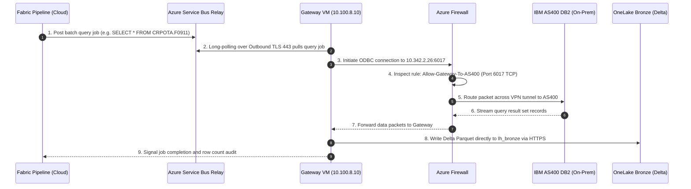
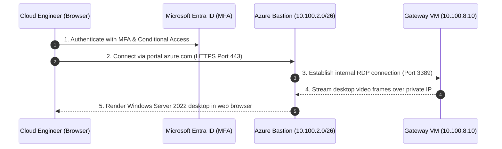

# Enterprise Cloud Networking Guide: Architecture, Connections & Alternatives

> **Project:** IPS BI Modernization to Microsoft Fabric  
> **Client:** IPS Corporation  
> **Topic:** Comprehensive Networking Architecture, Hybrid Connectivity, Component Justifications & Technology Alternatives  
> **Document Location:** `techstalk/networking_concepts.md`  

---

## 1. Executive Overview & The Core Networking Challenge

In this enterprise project, **Microsoft Fabric** is a multi-tenant **Software-as-a-Service (SaaS)** cloud platform, while the mission-critical transactional core—**JD Edwards EnterpriseOne on IBM AS400 DB2**—resides inside an **on-premises private enterprise datacenter**.

### The Core Problem:
How does a cloud data platform securely extract, transform, and serve gigabytes of sensitive operational data from a legacy on-premises mainframe **without opening inbound firewall ports**, while maintaining **strict network segmentation**, **centralized packet inspection**, and **sub-second query response times**?

### The Solution:
A **Hub-Spoke Network Architecture** built on **Azure Virtual WAN (vWAN)**, anchored by a centralized **Azure Firewall**, an **On-Premises Data Gateway (OPDG)** operating via outbound TLS 443 reverse-relay, **Azure Bastion** for zero-public-IP management, and an **Azure Private DNS Resolver** for seamless hybrid name resolution.

---

## 2. End-to-End Network Topology Diagram

```mermaid
graph TB
    subgraph "CLIENT ON-PREMISES DATACENTER"
        AS400["🖥️ IBM AS400 DB2 (IPSRR00)<br/>IP: 10.342.2.26<br/>Ports: 6017 (DB), 8471, 449, 1422"]
        DC["🌐 On-Prem Active Directory DCs<br/>IP: 10.3.3.4, 10.3.3.5<br/>Domain: ipscorp.local"]
        ONPREM_ROUTER["🔒 On-Prem Edge Router / VPN Device"]
        AS400 <--> DC
        AS400 <--> ONPREM_ROUTER
    end

    subgraph "HYBRID CONNECTIVITY (ENCRYPTED TUNNELS)"
        S2S_VPN["🔐 IPsec Site-to-Site VPN / ExpressRoute<br/>(Private Encrypted Transit)"]
        AZ_RELAY["⚡ Azure Service Bus Relay<br/>(Outbound HTTPS 443 - No Inbound Ports)"]
    end

    subgraph "AZURE CONNECTIVITY SUBSCRIPTION (HUB)"
        VWAN["🌐 Azure Virtual WAN (hub-centralindia-vwan)<br/>Transit Routing Engine"]
        VHUB["🏢 Virtual Hub (10.100.0.0/23)<br/>Central Route Table & VPN Gateway"]
        AFW["🔥 Azure Firewall (hub-southindia-afw)<br/>Centralized Stateful Inspection"]
        BASTION["🛡️ Azure Bastion (hub-southindia-bas)<br/>VNet: 10.100.2.0/26 (Zero Public IP)"]
        DNS_RES["📡 Private DNS Resolver (hub-southindia-dnspr)<br/>In: 10.100.2.64/28 · Out: 10.100.2.80/28<br/>Forwarder: ipscorp.local → 10.3.3.4/5"]
        
        VWAN <--> VHUB
        VHUB <--> AFW
        VHUB <--> BASTION
        VHUB <--> DNS_RES
    end

    subgraph "AZURE PRODUCTION SUBSCRIPTION (SPOKE WORKLOADS)"
        subgraph "Gateway VNet (10.100.8.0/24)"
            GW_NIC["Private IP: 10.100.8.10"]
            OPDG_VM["🖥️ Gateway VM (genie-fabric-prod-01)<br/>Windows Server 2022 · 64-bit IBM ACS ODBC"]
            NSG_GW["🔒 Gateway NSG<br/>Allow Bastion 3389 · Deny All Public Inbound"]
            GW_NIC --- OPDG_VM
            NSG_GW --- OPDG_VM
        end

        subgraph "Database & App VNets"
            DB_VNET["🗄️ Database VNet (10.100.7.0/24)"]
            APP_VNET["💻 Internal Workloads VNet (10.100.6.0/24)"]
        end

        KV["🔑 Azure Key Vault<br/>(ipskv-prod-chennai-01)"]
    end

    subgraph "MICROSOFT FABRIC SAAS TENANT"
        FDF["⚙️ Fabric Data Factory Pipelines<br/>(Copy Activity · Parameterized Batches)"]
        ONELAKE["💾 OneLake (Bronze → Silver → Gold)"]
        PBI["📊 Power BI Direct Lake Reports"]
        FDF --> ONELAKE --> PBI
    end

    ONPREM_ROUTER <==> S2S_VPN <==> VHUB
    OPDG_VM ==>"Outbound TLS 443"==> AZ_RELAY ==>"Control Channel"==> FDF
    OPDG_VM -->|"ODBC Port 6017 via Firewall"| AFW -->|"Route to On-Prem"| AS400
    OPDG_VM -->|"Resolve ipscorp.local"| DNS_RES -->|"Forward Port 53"| DC
    BASTION -->|"Private RDP (3389)"| OPDG_VM
    FDF -.->|"Fetch DB Secrets"| KV
```

---

## 3. Deep Dive: Network Components, Purpose & Alternatives

Every component in this network was deliberately chosen to satisfy enterprise compliance, high security, and high performance. Below is the detailed breakdown of each technology, why it is used, and what alternatives were evaluated.

---

### Component 1: Azure Virtual WAN (vWAN) vs. Traditional Hub-Spoke VNet Peering

#### What It Is
Azure Virtual WAN is an enterprise networking service that brings together networking, security, and routing functionalities into a single unified operational interface. It automatically creates a managed, software-defined hub mesh.

#### How It Works in This Project
- The Virtual Hub (`hub-southindia-vhub`, CIDR: `10.100.0.0/23`) acts as the central router.
- All spoke VNets (Data Gateway VNet, DB VNet, Internal VNet) connect to the vHUB via automated Hub Virtual Network Connections (`az network vhub connection create`).
- It manages routing tables dynamically without needing complex User Defined Routes (UDRs) on every single subnet.

#### Why We Use It
1. **Automated Any-to-Any Transitive Routing:** In traditional Azure networking, Spoke A cannot talk to Spoke B through a Hub without manual UDR route tables (`0.0.0.0/0` $\rightarrow$ NVA IP) and gateway transit flags. Virtual WAN handles this natively at scale.
2. **Built-in Scalability:** Easily integrates multiple branches, on-prem datacenters, and future multi-region cloud spokes across India (`southindia` and `centralindia`).
3. **Native Security Integration:** Azure Firewall integrates directly inside the Virtual Hub as a "Secured Virtual Hub" with one-click routing intent.

#### Alternatives Evaluated

| Feature | Azure Virtual WAN (Chosen) | Traditional Hub-Spoke VNet Peering | Custom Mesh Peering |
| :--- | :--- | :--- | :--- |
| **Routing Management** | **Automated** via Virtual Hub route tables | **Manual** (Requires UDRs on every subnet) | **Complex** ($N \times (N-1) / 2$ peering links) |
| **Transitive Routing** | **Built-in** across branches & spokes | Requires manual NVA forwarding configuration | None |
| **Operational Overhead** | **Low** (Single managed service) | **High** (Dozens of route tables to update) | **Extreme** (Unmanageable at scale) |
| **Cost** | Fixed hourly hub fee + scale units | Free peering fees (pay per GB transferred) | Free peering fees (pay per GB transferred) |
| **Enterprise Fit** | **Ideal for large enterprise landing zones** | Best for small architectures (< 5 VNets) | Anti-pattern for enterprise |

> **Architectural Decision:** We chose **Virtual WAN** because the enterprise plans future workload expansions, cross-region DR in Pune (`centralindia`), and multiple spoke VNets. Managing dozens of static UDR route tables manually would introduce critical operational and human-error risks.

---

### Component 2: Centralized Azure Firewall vs. Third-Party NVAs vs. NSGs Only

#### What It Is
Azure Firewall is a cloud-native, fully stateful firewall-as-a-service with built-in high availability, unrestricted cloud scalability, and threat intelligence filtering.

#### How It Works in This Project
- Deployed inside the Virtual Hub (`hub-southindia-afw`) with a dedicated public IP for egress inspection.
- Governed by **Azure Firewall Policy (`hub-southindia-afwp`)**:
  - **Network Rules:** Explicitly allows Gateway Subnet (`10.100.8.0/24`) to reach on-premises AS400 (`10.342.2.26`) strictly on required ports: `6017` (Database), `8471` (Signon), `449` (Server Map), `1422` (Central Server).
  - **Application Rules:** Restricts outbound HTTP/HTTPS to authorized Azure and Microsoft 365 FQDN tags.
  - **Zero Trust Default:** All traffic not explicitly allowed is dropped and logged.

#### Why We Use It
1. **Centralized Visibility:** A single inspection point for all cross-VNet, on-premise, and internet traffic.
2. **No Appliance Management:** Unlike virtual firewall VMs, Azure Firewall requires zero patching, zero OS maintenance, and automatically scales compute capacity as traffic increases.
3. **Detailed Diagnostic Logging:** Direct streaming of network and application logs to Azure Log Analytics (`ips-law-southindia-01`) for compliance audits.

#### Alternatives Evaluated

| Evaluation Metric | Azure Firewall (Chosen) | Third-Party NVA (Palo Alto / Fortinet) | NSGs Only (No Firewall) |
| :--- | :--- | :--- | :--- |
| **Inspection Capability** | Layer 3 to Layer 7 stateful inspection, FQDN tags | Deep Packet Inspection (DPI), Advanced Layer 7 IDS/IPS | Layer 3 / 4 basic 5-tuple filtering only |
| **High Availability** | **Native 99.99%** (No user configuration) | Requires complex active-passive load balancers | Native (Distributed fabric) |
| **Operational Overhead** | **Zero OS/VM patching** | Requires firmware upgrades, licensing, HA tuning | Zero (Built into NICs) |
| **Central Governance** | **Single policy** applies across all VNets | Managed via vendor console (Panorama / FortiManager) | Fragmented rules spread across dozens of subnets |
| **Cost** | ~$1.25/hr + data processing | High (Appliance VM costs + vendor license fees) | **Free** |

> **Architectural Decision:** While **NSGs** are still applied at the subnet level for micro-segmentation, NSGs cannot inspect Layer 7 traffic, cannot do FQDN filtering, and cannot log centralized routing flow. Third-party NVAs would add unnecessary licensing costs and VM maintenance overhead. **Azure Firewall** provides the optimal balance of cloud-native elasticity, compliance logging, and stateful inspection.

---

### Component 3: On-Premises Data Gateway (OPDG) & Azure Relay vs. Inbound Port Forwarding

#### What It Is
The On-Premises Data Gateway is software installed on a dedicated Windows Server VM that allows Microsoft cloud services (Fabric, Power BI, Azure Data Factory) to access on-premises data sources.

#### How It Works in This Project
- Deployed on VM `genie-fabric-prod-01` (`10.100.8.10`) running on Windows Server 2022.
- **The Reverse Connection Pattern:**
  1. The Gateway client initiates an **outbound** TLS connection over **port 443** to Azure Service Bus Relay (`*.servicebus.windows.net`).
  2. It keeps this outbound connection alive.
  3. When a Fabric pipeline wants to extract data, it drops a job request into the Azure Relay.
  4. The Gateway pulls the request down over its existing outbound channel, queries the local AS400 DB2 via local ODBC port 6017, and pushes results back up over TLS 443.
  5. **No inbound ports from the internet into the enterprise network are ever opened!**

#### Why We Use It
1. **Zero Inbound Attack Surface:** Enterprise InfoSec strictly forbids opening inbound firewall ports (like opening DB2 port 6017 to the public internet).
2. **Certified Driver Compatibility:** IBM AS400 DB2 requires proprietary 64-bit IBM i Access Client Solutions (ACS) ODBC drivers (`cwbdsede.dll`), which cannot run directly inside a managed serverless cloud environment. The Gateway host provides the Windows OS environment required to run this driver.
3. **Built-in Resilience:** Supports clustered active/passive or load-balanced gateway nodes.

#### Alternatives Evaluated

| Pattern | OPDG with Azure Relay (Chosen) | Inbound Port Forwarding / NAT | Azure Private Link to On-Prem |
| :--- | :--- | :--- | :--- |
| **Inbound Firewall Openings** | **ZERO (100% Outbound TLS 443 only)** | **Severe Risk** (Exposes port 6017/DB2 to public IP) | Zero |
| **IBM ACS Driver Support** | **Full Support** on Windows Server host | Requires cloud driver (often unsupported) | Requires self-hosted agent or VM |
| **Security Risk** | **Negligible** (Encrypted Azure Relay channel) | **Critical** (Vulnerable to brute-force & DDoS) | Low |
| **Implementation Complexity** | Simple standard client install | Requires public IP, NAT rules, DMZ proxy | High (Requires ExpressRoute & custom DNS) |

> **Architectural Decision:** **OPDG via Azure Relay** is the gold standard for hybrid analytics. It completely satisfies the customer's strict security mandate: *"No inbound internet traffic allowed into the on-premises environment."*

---

### Component 4: Hybrid Connectivity: Site-to-Site VPN vs. Azure ExpressRoute

#### What It Is
The physical and cryptographic network link connecting the enterprise datacenter edge router to the Azure cloud.

#### How It Works in This Project
- **Primary:** An IPsec Site-to-Site (S2S) VPN tunnel connects the on-premise firewall to the Azure Virtual Hub VPN Gateway.
- Uses IKEv2 protocol with AES-256 encryption.
- Directs traffic destined for Azure VNet IP range (`10.100.0.0/16`) across the tunnel, while traffic destined for on-prem DB2 (`10.342.2.26`) routes back across the tunnel.

#### Alternatives Evaluated

| Parameter | Site-to-Site VPN (Chosen for Phase 1) | Azure ExpressRoute | Public Internet (Direct) |
| :--- | :--- | :--- | :--- |
| **Connection Path** | Encrypted tunnel over public internet | **Dedicated private fiber** bypassing internet | Public internet |
| **Bandwidth / Throughput** | Up to 1.25 Gbps per tunnel | Up to 10 Gbps – 100 Gbps | Dependent on ISP |
| **Latency Predictability** | Variable (relies on public ISP hops) | **Deterministic & Ultra-low** | Highly variable |
| **Deployment Time** | **Hours / Days** (Configuration only) | Weeks / Months (Telco cross-connect provisioning) | Immediate |
| **Cost** | Low (Hourly VPN gateway charge only) | High (Port fees + Telco line circuits) | Free |

> **Architectural Recommendation:** Use **Site-to-Site VPN** for project implementation and initial historical load. If the enterprise later requires higher bandwidth (> 2 Gbps continuous throughput) or strict telco SLAs for real-time manufacturing telemetry, upgrade seamlessly to **Azure ExpressRoute**, which plugs directly into the same Azure Virtual WAN Hub.

---

### Component 5: Azure Bastion vs. Jumpbox VM with Public IP

#### What It Is
Azure Bastion is a fully managed Platform-as-a-Service (PaaS) that provides secure RDP and SSH connectivity directly within the Azure Portal over TLS.

#### How It Works in This Project
- Deployed inside a dedicated subnet `AzureBastionSubnet` (`10.100.2.0/26`).
- When a cloud engineer needs to configure the On-Premises Data Gateway VM or inspect ODBC DSN settings:
  1. The engineer logs into `portal.azure.com` with Entra ID MFA.
  2. Bastion renders an RDP session directly inside the browser using HTML5 / WebSockets over **port 443**.
  3. Bastion connects privately to the Gateway VM's private IP (`10.100.8.10`) over internal port 3389.
  4. **The Gateway VM has NO public IP address and port 3389 is never exposed to the internet.**

#### Alternatives Evaluated

| Security Aspect | Azure Bastion (Chosen) | Jumpbox VM with Public IP | Client-to-Site (P2S) VPN |
| :--- | :--- | :--- | :--- |
| **Public IP on Target VM** | **None** | Required on Jumpbox | None |
| **Port 3389 Exposed to Web** | **No (Browsed via HTTPS 443)** | **Yes (Constantly targeted by botnets)** | No |
| **Client Software Needed** | **None (Pure Web Browser HTML5)** | RDP Client software | VPN Client software (OpenVPN/Azure VPN) |
| **Vulnerability to Scanners** | **Immune** (PaaS protected by Microsoft) | High (Vulnerable to OS-level RDP exploits) | Low |

> **Architectural Decision:** Using a public-IP Jumpbox is a major security vulnerability and will fail enterprise security audits. **Azure Bastion** eliminates port scanning and credential brute-force attacks completely.

---

### Component 6: Azure Private DNS Resolver vs. Custom DNS VMs

#### What It Is
A cloud-native hybrid DNS service that lets you query Azure Private DNS Zones from on-premises and forward on-premises queries to enterprise domain controllers.

#### How It Works in This Project
- Deployed in `hub-dnsnetwork-southindia-rg` with two dedicated subnets:
  - **Inbound Subnet (`10.100.2.64/28`):** Listens for DNS lookups from Azure spokes.
  - **Outbound Subnet (`10.100.2.80/28`):** Evaluates conditional forwarding rules.
- **The Forwarding Rule:**
  When the Gateway VM queries `IPSRR00.ipscorp.local`, the DNS Resolver detects the domain `ipscorp.local` and automatically forwards the lookup to on-premises Domain Controllers (`10.3.3.4` and `10.3.3.5`) across port 53.

#### Alternatives Evaluated

| Criterion | Azure Private DNS Resolver (Chosen) | Custom DNS Virtual Machines (BIND / Windows DNS) | Azure Default DNS Only |
| :--- | :--- | :--- | :--- |
| **Server Maintenance** | **Zero (Serverless PaaS)** | High (Requires OS patching, VM scaling, HA clustering) | Zero |
| **Conditional Forwarding** | **Native ruleset engine** | Supported via DNS server forwarders | **Not Supported** |
| **High Availability** | **Built-in multi-zone redundancy** | Requires 2+ VMs behind an Internal Load Balancer | Native |
| **On-Premise Integration** | Seamless bi-directional forwarding | Manual configuration | Cannot resolve on-prem domains |

> **Architectural Decision:** Deploying custom Windows DNS VMs solely to forward DNS requests incurs unnecessary VM license costs, disk costs, and monthly patching overhead. **Azure Private DNS Resolver** provides an unmanaged, highly available serverless alternative.

---

## 4. IP Address Space Architecture & Subnet Allocations

The enterprise allocated a supernet of **`10.100.0.0/16`** (65,536 private IPs) in **South India (Chennai)**, carefully segmented to avoid overlapping with the on-premise network (`10.3.x.x` and `10.342.x.x`):

```
10.100.0.0/16 (Enterprise Supernet)
├── 10.100.0.0/23   (512 IPs)  → hub-southindia-vhub (Virtual WAN Hub & Azure Firewall)
├── 10.100.2.0/26   (64 IPs)   → AzureBastionSubnet (Azure Bastion Host)
├── 10.100.2.64/28  (16 IPs)   → hub-centralus-dnspr-in-snet (DNS Resolver Inbound)
├── 10.100.2.80/28  (16 IPs)   → hub-centralus-dnspr-out-snet (DNS Resolver Outbound)
├── 10.100.4.0/23   (512 IPs)  → prod-external-centralus-vnet (External Workloads)
├── 10.100.6.0/24   (256 IPs)  → prod-internal-centralus-vnet (Internal Applications)
├── 10.100.7.0/24   (256 IPs)  → prod-db-centralus-vnet (Database Tier Subnets)
└── 10.100.8.0/24   (256 IPs)  → prod-datagateway-centralus-vnet (Data Gateway & Integration)
```

---

## 5. End-to-End Traffic Walkthroughs

### Walkthrough 1: How a Data Pipeline Extracts Data from AS400 DB2



### Walkthrough 2: How an Engineer Administers the Gateway VM Safely



---

## 6. Summary Comparison Matrix: Chosen Stack vs. Common Alternatives

| Domain | Chosen Technology | Common Alternative | Why We Rejected The Alternative |
| :--- | :--- | :--- | :--- |
| **Network Core** | **Azure Virtual WAN** | Traditional VNet Peering | Traditional peering requires manual routing tables (UDRs) across every subnet, leading to routing loops and administrative errors. |
| **Firewall** | **Azure Firewall (Policy-driven)** | Third-Party NVA (Palo Alto VM) | NVAs require manual high-availability clustering, ongoing OS patching, and expensive third-party licensing. |
| **Gateway Channel** | **Outbound Reverse Relay (TLS 443)** | Inbound Firewall Port Forwarding | Inbound port forwarding exposes DB2 directly to internet port scans and brute-force attacks, violating enterprise security rules. |
| **Remote Access** | **Azure Bastion (PaaS)** | Jumpbox VM with Public IP | Public IP Jumpboxes are constant targets of automated brute-force attacks and require public IP fees. |
| **Hybrid DNS** | **Azure Private DNS Resolver** | Windows Server DNS VMs | DNS VMs require dedicated compute instances, disk storage, and monthly operating system maintenance. |
| **Micro-Segmentation**| **Subnet-level NSGs + IP Groups** | Wide open flat networks | Flat networks allow lateral movement of malware if any single server is compromised. |

---

## 7. Key Takeaways for Technical Leadership & Interviews

1. **Zero Inbound Connectivity:** The entire hybrid data integration pipeline operates strictly through **outbound connections**. No internet traffic is ever allowed inbound into the on-premises datacenter.
2. **Stateless Scalability:** By decoupling the Gateway VM (`genie-fabric-prod-01`) from storage, the VM can be resized, restarted, or clustered without losing any historical data stored in OneLake.
3. **Defense-in-Depth:** Security is implemented at three distinct layers:
   - **Layer 1 (Perimeter):** Azure Firewall packet and FQDN inspection.
   - **Layer 2 (Network):** Subnet Network Security Groups (NSGs) restricting ports to Bastion and DB2.
   - **Layer 3 (Identity):** Entra ID Role-Based Access Control and Azure Key Vault secret isolation.
