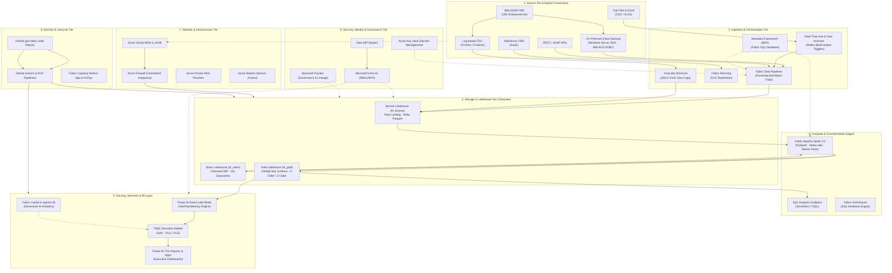

# IPS BI Modernization Platform — Comprehensive Technical Stack Specification

> **Project:** IPS BI Modernization to Microsoft Fabric  
> **Client:** IPS Corporation  
> **Architecture Pattern:** Hub-Spoke Enterprise Landing Zone & Medallion Architecture on OneLake  
> **Document Location:** `techstalk/technical_stack.md`  
> **Last Updated:** September 2026  

---

## Executive Summary

The **IPS BI Modernization Project** transitions legacy, on-premises business intelligence, batch ETL, and mainframe direct-query reporting into a next-generation **Software-as-a-Service (SaaS)** data and analytics platform powered by **Microsoft Fabric** and **Microsoft Azure**.

This document outlines the complete technology stack powering every tier of the platform: from hybrid connectivity and data ingestion, through distributed storage and lakehouse transformations, to dimensional serving, semantic modeling, DevOps CI/CD, identity governance, and enterprise networking.

---

## Architecture Topology & Tech Stack Map



---

## Detailed Technology Stack by Layer

### 1. Cloud Infrastructure, Networking & Core Platform

| Component | Technology / Service | Version / SKU / Spec | Purpose & Architectural Role |
| :--- | :--- | :--- | :--- |
| **SaaS Analytics Platform** | **Microsoft Fabric** | F32 / F64 / F128 Capacity Units (CUs) | Central unified analytics SaaS tenant hosting Lakehouses, Pipelines, Notebooks, and Power BI. |
| **Cloud Provider** | **Microsoft Azure** | Enterprise Subscription (CSP) | Foundational IaaS/PaaS landing zone infrastructure. |
| **Primary Azure Region** | **South India (`southindia`)** | Chennai Datacenter (Primary) | Sub-5ms ultra-low latency to local datacenter, On-Premises Data Gateway, and users near Chennai. |
| **Secondary Azure Region** | **Central India (`centralindia`)** | Pune Datacenter (Hub / DR) | Official paired disaster recovery region, Virtual WAN transit backbone, and data residency in India. |
| **Network Architecture** | **Azure Virtual WAN (vWAN) Hub-Spoke** | Standard vWAN Hub (`10.100.0.0/23`) | Central transit routing connecting on-premises data centers, connectivity VNets, and workload VNets. |
| **Network Firewall** | **Azure Firewall** | Standard / Premium (`hub-southindia-afw`) | Centralized stateful packet inspection, FQDN filtering, and network/application security rule governance. |
| **Hybrid Connectivity** | **Azure VPN Gateway / ExpressRoute** | Route-based IPsec / S2S VPN | Encrypted private tunnel between Azure Virtual Hub and on-premises routers. |
| **Secure Management** | **Azure Bastion** | Standard Bastion (`hub-southindia-bas`) | Browser-based RDP/SSH access to internal VMs and gateway hosts without public IPs. |
| **DNS Management** | **Azure Private DNS Resolver** | `hub-southindia-dnspr` | Private endpoints resolution and conditional DNS forwarding (`ipscorp.local` $\rightarrow$ `10.3.3.4`/`10.3.3.5`). |
| **Disaster Recovery** | **Azure Backup & Recovery Services** | `prod-backup-southindia-rsv` | Centralized backup vault with GRS replication to Central India (Pune). |
| **Cloud Posture & Guardrails** | **Microsoft Defender for Cloud & Azure Policy** | Enterprise Security Benchmark | Continuous security posture assessment, compliance monitoring, and automated policy enforcement. |

---

### 2. Upstream Systems & Hybrid Ingestion Tier

| Component | Technology / System | Specifications / Protocols | Details & Project Application |
| :--- | :--- | :--- | :--- |
| **Primary ERP Source** | **JD Edwards EnterpriseOne (JDE)** | Release 9.x / IBM i | Core transactional ERP spanning General Ledger, Accounts Receivable, Accounts Payable, Fixed Assets, Inventory, and Sales. |
| **Operational Database** | **IBM DB2 on IBM i (AS400)** | IBM POWER Hardware, OS v7.x4 | Operational relational DB hosting production schemas `CRPOTA` (transactional) and `CRPCTL` (control/UDC). Host: `IPSRR00`. |
| **On-Premises Data Gateway** | **Microsoft On-Premises Data Gateway (OPDG)** | Windows Server 2022 (16 vCPU, 64GB RAM, 350GB SSD) | Standard mode cluster connecting Fabric cloud pipelines to on-premises AS400 DB2 via outbound TLS 443 Azure Relay. |
| **Database Driver** | **IBM i Access Client Solutions (ACS) ODBC** | 64-bit (`cwbdsede.dll`), System DSN `DB2_AS400_PROD` | Certified ODBC driver handling AS400 communication across ports 6017, 8471, 449, and 1422. |
| **Change Data Capture (CDC)** | **Firsthire / Fivetran CDC** | Real-Time Log-Based CDC Replication | Captures low-latency change logs from 63 high-frequency tables directly into ADLS Gen2, eliminating AS400 CPU strain. |
| **CRM Source** | **Salesforce CRM** | REST / Bulk API / Fabric Mirroring | Customer Relationship Management data ingested via near-real-time CDC replication. |
| **Ad-Hoc Files & Manual Feeds** | **Excel (XLSX) & Flat Files (CSV)** | OneLake Data Access Scoped Path (`Files/FlatFile_Repo`) | Business spreadsheets and external partner feeds uploaded through Fabric Portal. |
| **Event-Driven File Ingestion** | **Fabric Real-Time Hub & Data Activator (Reflex)** | Event: `Microsoft.Storage.BlobCreated` | Automated ingestion trigger listening on OneLake folder events to execute pipelines instantaneously without scheduled delays. |

---

### 3. Ingestion & Orchestration Architecture

| Component | Technology | Role & Functionality |
| :--- | :--- | :--- |
| **Batch Orchestration** | **Microsoft Fabric Data Factory (FDF)** | Parameterized pipelines (`pl_orchestrate`, `pl_ingest_bronze_flat_files`) executing copy activities over OPDG. |
| **Metadata Framework Metastore** | **Fabric SQL Database (`sqldb-meta-orch-dev`)** | Central metadata-driven framework (MDF) repository storing dataset configurations, dynamic schemas, watermarks, and schedule rules. |
| **Dynamic Execution Engine** | **MDF Stored Procedures & Control Tables** | `meta.dataset_brz_to_silver`, `meta.dataquality_rule`, `log.pipeline_execution` determining ETL DAG execution at runtime. |
| **Zero-Copy Virtualization** | **Fabric OneLake Shortcuts** | Direct external links from Fabric Lakehouses to ADLS Gen2 folders populated by Firsthire CDC, bypassing data movement. |
| **SaaS Mirroring** | **Fabric Database Mirroring** | Near-real-time synchronization replicating cloud databases directly into Delta tables in OneLake. |

---

### 4. Storage & Distributed Medallion Lakehouse

| Layer | Container Name | Storage Format | Description & Optimization |
| :--- | :--- | :--- | :--- |
| **Storage Foundation** | **Microsoft Fabric OneLake** | ADLS Gen2 Hierarchical Namespace | Unified, tenant-wide virtualized data lake ("OneDrive for Data") serving as single source of truth. |
| **Table Storage Standard** | **Apache Delta Lake** | Delta Parquet (Version 2.4+) | ACID transactions, time travel, versioned history (`_delta_log`), and Change Data Feed (CDF). |
| **Bronze Layer (Raw)** | **`lh_bronze` / `th_bronze`** | Delta Parquet (Append-Only) | Raw, immutable landing zone preserving original AS400 field names, Julian dates, and 7 technical audit columns (`_ingested_at`, `_pipeline_name`, etc.). |
| **Silver Layer (Conformed)** | **`lh_silver` / `th_silver`** | Delta Parquet (3NF Conformed) | Standardized business nomenclature, Julian date expansion, decimal scaling, whitespace trimming, deduplication, and automated DQ Quarantine tables (`silver.{table}_quarantine`). |
| **Gold Layer (Curated)** | **`lh_gold` / `th_gold`** | Delta Parquet (Kimball Star Schema) | Dimensional serving layer housing 16 conformed dimensions and transactional/accumulating snapshot facts. |
| **Storage Optimization** | **Microsoft Fabric V-Order & Z-Order** | In-Memory Columnar Sorting | V-Order proprietary sorting applied during Spark writes to optimize row-group encoding for lightning-fast VertiPaq memory caching. Multi-column Z-Order applied to surrogate keys. |
| **File Lifecycle Governance** | **Delta VACUUM & OPTIMIZE** | 7-day retention / 128 MB target parquet | Maintenance runbooks compacting small files and purging historical tombstones to control storage growth and optimize read performance. |

---

### 5. Compute & Transformation Engines

| Component | Technology | Version / Configuration | Application |
| :--- | :--- | :--- | :--- |
| **Distributed Transformation** | **Fabric Apache Spark** | Spark 3.5 Runtime | Core distributed computing engine for Silver cleansers, data quality rules, and Gold star-schema merges. |
| **Transformation Language** | **PySpark & Spark SQL** | Python 3.10+ | Clean code serialized in `.Notebook/notebook-content.py` format. |
| **Spark Compute Pools** | **Fabric Starter Pools & Custom Environments** | Dynamic node scaling | Fast sub-10 second cold start nodes configured with project dependencies via `requirements.txt`. |
| **Relational Query Endpoint** | **Fabric SQL Analytics Endpoint** | Serverless T-SQL Engine | Automatic, read-only SQL endpoint generated for every Lakehouse allowing ad-hoc T-SQL queries and reporting views. |
| **Streaming Query Engine** | **Fabric Eventhouse / KQL Database** | Kusto Engine (KQL) | High-throughput time-series analytics and real-time streaming ingestion. |

---

### 6. Serving Layer, Semantic Modeling & Business Intelligence

| Component | Technology | Implementation Details |
| :--- | :--- | :--- |
| **BI Presentation Platform** | **Microsoft Power BI Service** | Premium/Fabric Capacity-backed reporting environment. |
| **Dataset Connectivity Mode** | **Power BI Direct Lake Mode** | Groundbreaking query mode reading Delta Parquet files directly from OneLake into the VertiPaq engine without data refresh or DirectQuery latency ($<800\text{ms}$ query response SLA). |
| **Semantic Data Modeling** | **Custom Star Schema Semantic Models** | Single-table dimensions and centralized facts adhering strictly to Ralph Kimball enterprise dimensional bus architecture. |
| **Modeling Language** | **DAX (Data Analysis Expressions)** | Time intelligence (YoY, YTD, MTD), dynamic dual-currency USD conversion, and gross margin measures. |
| **Model Serialization Format** | **TMDL (Tabular Model Definition Language)** | Git-friendly, multi-file human-readable tabular model definitions (`database.tmdl`, `tables.tmdl`) preventing PR merge conflicts. |
| **Desktop & Modeling Tools** | **Power BI Desktop, Tabular Editor, DAX Studio** | Advanced measure authoring, model metadata optimization, VertiPaq analyzer performance tuning. |
| **Report Distribution** | **Power BI Thin Reports (`.pbix`) & Power BI Apps** | Thin client reporting decoupled from datasets; packaged into departmental Power BI Apps with audience segregation. |
| **AI & Natural Language BI** | **Fabric Copilot & Agentic BI** | Integrated Azure OpenAI models for conversational natural language insights and exploratory dashboard synthesis. |

---

### 7. Security, Identity & Governance

| Domain | Technology / Standard | Implementation Pattern |
| :--- | :--- | :--- |
| **Identity Provider (Master)** | **Okta Identity Cloud** | Enterprise authoritative source of truth managing user lifecycles and role-based group assignments. |
| **Directory Federation & Sync** | **Okta SCIM & Push Groups** | Automated bi-directional synchronization pushing Okta groups to Microsoft Entra ID. |
| **Cloud IAM & Directory** | **Microsoft Entra ID (Azure AD)** | 5 standardized security groups: `SG-PBI-FabricAdmins`, `SG-PBI-WorkspaceAdmins`, `SG-PBI-Developers`, `SG-PBI-ReportConsumers`, `SG-PBI-GatewayAdmins`. |
| **Authentication & Access** | **MFA & Entra Conditional Access** | Phishing-resistant Multi-Factor Authentication, trusted location fencing, and session risk evaluation. |
| **Workspace Segmentation** | **2-Tier Workspace Isolation** | **Tier 1 (`bim_data_dev`):** Data engineering Lakehouses & pipelines. Contributor access restricted to Data Engineers.<br/>**Tier 2 (`bim_report_dev`):** Semantic models & thin reports. Analysts granted build/read on Gold only via OneLake sharing. |
| **Granular Storage Access** | **OneLake Data Access Roles** | Folder-level RBAC restricting file-uploaders exclusively to `Files/FlatFile_Repo/` with zero visibility into raw or delta tables. |
| **Data Row/Object Security** | **DAX RLS & OLS** | Semantic Model Row-Level Security (`USERPRINCIPALNAME()`) filtering data by Operating Company, Division, and Cost Center. |
| **Secrets & Credential Management** | **Azure Key Vault** | Dynamic retrieval of DB2 passwords, service bus tokens, and service principal secrets at runtime. |
| **Enterprise Data Governance** | **Microsoft Purview** | Automated data scanning, end-to-end lineage visualization (AS400 $\rightarrow$ Bronze $\rightarrow$ Silver $\rightarrow$ Gold $\rightarrow$ Power BI), technical/business data quality metrics, and centralized Business Glossary. |

---

### 8. DevOps, CI/CD & Development Tooling

| Capability | Tool / Technology | Configuration & Standard |
| :--- | :--- | :--- |
| **Source Control Repository** | **GitHub Enterprise (`ips-fabric-code`)** | Centralized Git repository utilizing **Repository Pattern A** (Single Workspace per Branch). |
| **Branching Strategy** | **GitFlow-inspired Workspace Mapping** | `dev` branch maps to DEV Fabric Workspace; `main` branch maps to PROD Fabric Workspace. Developers use isolated feature branches (`feature/*`) linked to personal sandbox workspaces. |
| **Item Serialization** | **Fabric Native Git Serialization** | - Lakehouses: `.Lakehouse` (`item.metadata.json`)<br/>- Notebooks: `.Notebook` (**Enforced `.py` format** to prevent JSON merge conflicts)<br/>- Pipelines: `.Pipeline` (`pipeline-content.json`)<br/>- Semantic Models: `.SemanticModel` (TMDL)<br/>- Environments: `.Environment` (`requirements.txt`) |
| **Continuous Integration (CI)** | **GitHub Actions (`ci-validate.yml`)** | Automated linter triggers on Pull Requests to `dev`: validates PySpark syntax (flake8/black), verifies TMDL formatting, and ensures naming conventions. |
| **Continuous Deployment (CD)** | **GitHub Actions (`deploy-to-prod.yml`)** | Automated deployment pipelines orchestrating promotion from DEV to PROD using Fabric REST APIs and deployment pipelines. |
| **Local IDE & Tooling** | **Visual Studio Code (VS Code)** | Local development environment equipped with Microsoft Fabric extension, PySpark kernel, Python extensions, and Git integration. |
| **Work Management** | **Azure DevOps / GitHub Issues** | User story tracking, sprint backlogs, and pull request review policies requiring minimum 2 peer approvals. |

---

### 9. FinOps, Capacity Management & Operations

| Component | Technology | Architectural Function |
| :--- | :--- | :--- |
| **Capacity Architecture** | **Two-State Compute Topology** | - **Implementation State:** F128 (Non-Prod) + F64 (Prod) = 192 CUs for high-volume historical loads.<br/>- **Steady-State:** F32 (Non-Prod) + F64 (Prod) = 96 CUs committed via 1-year capacity reservation (~40.5% savings). |
| **Operational Billing Model** | **Azure Capacity Reservation & PAYG** | Storage billed separately at standard ADLS Gen2 rates ($0.023/GB/mo); compute reserved to eliminate throttling. |
| **FinOps Observability** | **Microsoft Fabric Capacity Metrics App** | Real-time tracking of Capacity Unit burn rates, interactive vs. background smoothing evaluation, and proactive throttling prevention. |
| **Automated Scheduler** | **Azure Automation / Logic Apps** | Automated pause, resume, and capacity scaling schedules during non-business hours for non-production environments. |
| **Pipeline Auditing** | **Custom MDF Audit Tables** | Centralized logging into `log.dq_rule_run` and `log.pipeline_execution` recording evaluated, passed, and quarantined row counts per batch. |

---

## Technical Stack Summary Matrix

```
┌────────────────────────────────────────────────────────────────────────────────────────┐
│                        IPS BI MODERNIZATION TECHNICAL STACK                           │
├──────────────────────────┬─────────────────────────────────────────────────────────────┤
│ Domain                   │ Primary Technologies                                        │
├──────────────────────────┼─────────────────────────────────────────────────────────────┤
│ Cloud & Network          │ Microsoft Azure, Virtual WAN, Azure Firewall, DNS Resolver  │
│ Core SaaS Platform       │ Microsoft Fabric (F32/F64/F128 Capacity Units)             │
│ Source ERP & Database    │ JD Edwards EnterpriseOne, IBM DB2 on AS400, Salesforce      │
│ Ingestion & Gateway      │ Fabric Data Factory, On-Premises Data Gateway (ODBC ACS),   │
│                          │ Firsthire CDC, Real-Time Hub, Data Activator (Reflex)       │
│ Lakehouse & Storage      │ Microsoft OneLake, Apache Delta Lake 2.4+, V-Order Parquet │
│ Compute & Processing     │ Apache Spark 3.5 (PySpark), Serverless SQL Analytics, KQL   │
│ Serving & Semantic       │ Ralph Kimball Star Schema, Power BI Direct Lake Mode, DAX   │
│ BI & Presentation        │ Power BI Thin Reports, Power BI Apps, TMDL, Copilot         │
│ Identity & Security      │ Okta (IdP Master), Microsoft Entra ID, Azure Key Vault, RLS │
│ Governance & Lineage     │ Microsoft Purview, Enterprise Data Catalog, Business DQ    │
│ CI/CD & DevOps           │ GitHub, GitHub Actions, VS Code, Fabric Git Integration    │
│ FinOps & Monitoring      │ Fabric Capacity Metrics App, Azure Monitor, Log Analytics   │
└──────────────────────────┴─────────────────────────────────────────────────────────────┘
```

---

## Related Project Artifacts

- [Architecture Overview](file:///Users/chandu/Documents/Python_practice/Fabric/architecture_overview.md)
- [IPS BI Modernization Design Document](file:///Users/chandu/Documents/Python_practice/Fabric/IPS_BI_Modernization_Project_Design_Document.md)
- [Fabric DevOps & GitHub Integration](file:///Users/chandu/Documents/Python_practice/Fabric/IPS_Fabric_DevOps_GitHub_Integration.md)
- [Gold Layer & Semantic Model Design](file:///Users/chandu/Documents/Python_practice/Fabric/IPS_Fabric_Gold_Layer_Semantic_Model_Design.md)
- [Power BI & Fabric Security Design](file:///Users/chandu/Documents/Python_practice/Fabric/IPS_PowerBI_Fabric_Security_Design.md)
- [Secure File Upload & Automated Ingestion](file:///Users/chandu/Documents/Python_practice/Fabric/IPS_Secure_File_Upload_Automated_Ingestion.md)
- [Fabric Capacity Cost & FinOps Analysis](file:///Users/chandu/Documents/Python_practice/Fabric/IPS_Fabric_Capacity_Cost_Analysis.md)
